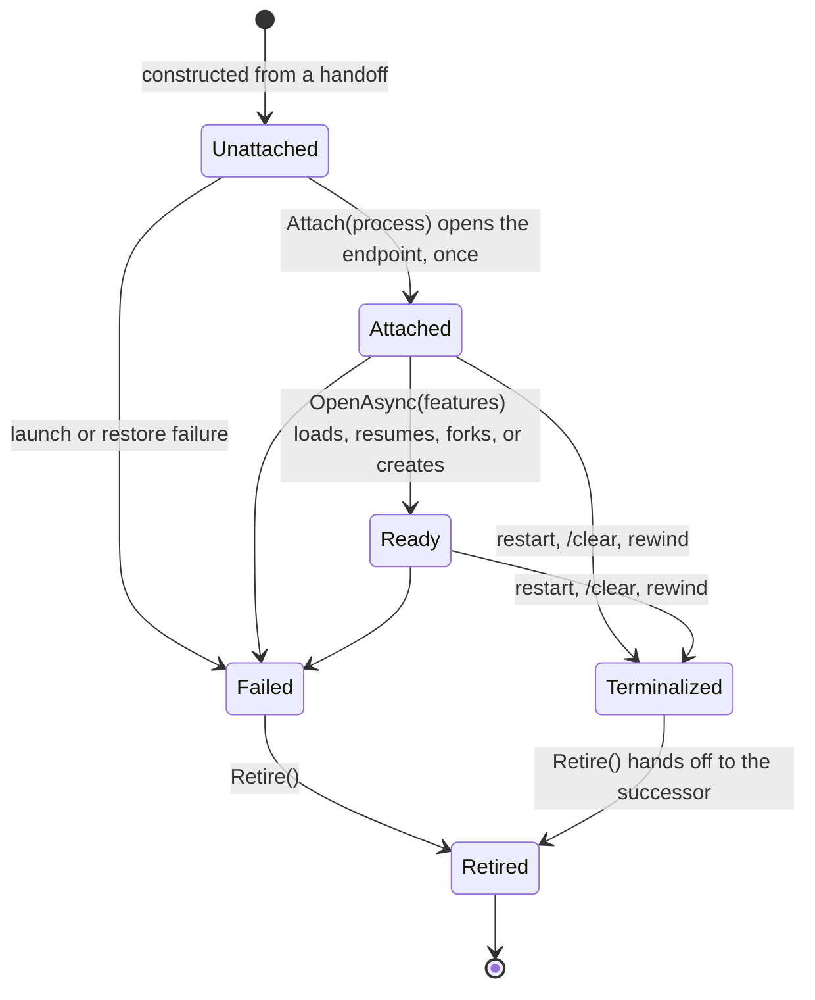

# ACP conversations

`AcpAgentSession` supplies main input and presentation for a loaded native session. `AcpRuntime` owns one
supervised provider process, initialization, and its hosted controllers. Main, BTW, independently owned workflow
threads, and adopted subagents use the same `AcpConversation` controller, with an endpoint and output port.

`ConversationOutput` owns the Core ledger. `ConversationView` reads one indexed conversation scope; the web
accumulator mirrors that membership and updates only affected projections. A consumer that controls a thread
holds `IAgentConversation`; a background transcript only needs the view. See
[conversation model and execution](../specs/conversation-layer.md) for the ownership and projection contract.

## Slot and incarnation

The model mirrors the [session message bus](session-message-bus.md). The persisted continuation
(`AcpConversationState`: provider session, turn number, guidance, plan turns) is the slot. An
`AcpConversation` is one incarnation of that slot. Restart, `/clear`, Rewind and reconnecting after a
failure retire the incarnation and hand its successor the same, an empty, or a rewound continuation, plus the
submissions still queued and the interaction identities already shown in the pane.
Ownership is the object itself: a conversation's `Live` is a check on its own lifetime, never a comparison
with a shared "current" generation, epoch, or session id.

The primary, sides, and subagents are one type. `AcpConversationSpec` gives the seed, the opening (`Continue`: load
or resume the seed's session, or create one; `ForkFromOpening`: fork a live parent, at a message for a rewind;
`AdoptedOpening`: take over a subagent session its parent announced), and the role (`Primary`, `Side`,
`Independent`, `Subagent`). The side-only behaviour left inside the conversation is the scope instruction in its prompts,
settling an interrupted opening, and its opening strategy; a subagent never opens, prompts, or closes, and shares
its root's background work. Everything else that differs lives in its port. See
[background work](../specs/background-work.md).

## Four owned channels

1. **Endpoint** — opened by `Attach` and held in a write-once cell. It addresses outgoing operations,
   receives the conversation's notifications and requests, answers requests, reports health, terminates its
   process, and receives that process's protocol faults. A retired endpoint refuses sends and drops late
   traffic; responses to the agent's own requests still go out. Closing an endpoint retires it and sends
   `session/close` once any opening request (new, fork, load, resume) settles, so a session that opens after
   its conversation was replaced is still closed.
2. **Port** — `AcpConversationPort`, handed in at construction, is the conversation's only event sink and its
   only way to persist, publish, report controls, usage and queue changes, fail the process, or restart it.
   `PrimaryPort` raises the facade events; `SidePort`, `IndependentPort`, and `SubagentPort` share `NestedPort`, which namespaces
   nested messages, request ids, and events; `SidePort` completes the side, `IndependentPort` saves a continuation
   only its owner restores and forgets it when the owner closes it, `SubagentPort` journals display
   events without a continuation; `RewindPort` stages a rewind's fork (below). Every port call takes the transition gate and is inert
   once the port is detached.
3. **Lifetime** — a cancellation source cancelled when the incarnation fails, is terminalized, retires, or is
   disposed. Agent-request tokens are linked to it, so a dead conversation's in-flight requests cancel. A
   login is cancelled only when the conversation is replaced or closed: one that outlives a runtime failure
   still completes, and a terminal login then restarts the agent.
4. **Terminals** — one `AcpTerminalManager` per conversation, closed when the incarnation ends; a terminal
   create racing the close fails.

A conversation's root background work ends with it: failure ends subagents and tasks as failed, terminalizing
for a restart ends them as stopped, and retiring or disposing retires them.

The runtime keeps process-level state: the connection, `initialize`, advertised `AcpAgentFeatures`, the
attached process generation, and conversation membership. The loaded session owns the journal and shared
output. Runtime failures end their hosted controllers; a journal failure ends writers across the session. Launch failures belong to the runtime because an unattached controller
has no endpoint to receive them.

Each Weavie-created controller receives an `AgentConversationBinding`: turn context, required controls, and
its own revocable grant on the session's MCP registry. Workflow grants capture one stage execution and completion
round. Ordinary BTW has no workflow completion authority. Adopted subagents borrow their parent's binding;
the protocol does not provide an independent credential for them.

The grant also carries the conversation's block claims. A `showBlock` or `updateBlock` call stages its operation
on the grant and returns a random token; the conversation that finds the token on its own tool row commits the
operation through its port, which saves the block and replaces or retracts the row. A subagent's claim is refused
because the grant is its parent's. See [rich content](../specs/acp-rich-content/design.md).

## Controls

A conversation's control changes reach the agent one request at a time, in the order they were asked for. A pick
from the pane is remembered as the user's default for the provider. An awaited batch (`ApplyControlsAsync`) is not:
it completes once the agent confirms each change, checks each against what the agent advertises when it is reached
(the options depend on the model), skips a value already in effect, and faults without failing the runtime when a
value isn't offered or the agent refuses it. The batch is bound to the conversation's lifetime, so replacing the
conversation faults it. A conversation opens on the user's defaults overlaid with the values the host holds
(`IAgentControlHold`), model first, before it turns ready; a held value the agent no longer offers is reported, and
never forgets the user's default. Independently owned opening requires every supplied control to succeed before
returning a handle.

## Locking

The order is transition gate → owner gate → conversation gate, and the transition gate comes before a workflow
runner's lock, which the held control values and the stage block read; the host never calls into a session while
holding the runner's lock. Never take an outer lock while holding an
inner one, and never hold any of them across an await. The transition gate is one reentrant lock per
process owner, shared into every conversation; it serialises transitions, port detachment, and every port
call, so port calls happen with no inner lock held. A request's own state lock is a leaf: a request card
publishes under the transition gate after checking the request is still open, and any completion's
resolution, also emitted under that gate, follows it. The owner captures the conversation it acts on at the
synchronous entry point and never re-reads `_primary` after an await.

## Replacing a conversation

The predecessor is dead before its successor runs, so nothing the old incarnation still has in flight — a
prompt, an approval, an input request, a login, a control change, a terminal request, steering, a late
`session/update` — can reach the successor:

1. terminalize the primary and suspend the sides; a running prompt gets `session/cancel`;
2. settle the primary's pending approvals, inputs and authentication, answering each request as cancelled;
3. retire the primary and install the successor from its handoff;
4. start the successor.

When the agent advertises `sessionCapabilities.close`, the predecessor's session has opened, and no background
work runs, `/clear` and Rewind keep the running process: the predecessor retires *closing* its provider session, and the successor attaches a new
endpoint to the same initialized process and opens there. An agent that refuses the close has the process stopped,
since nothing else would stop that session. Without close, or while the predecessor is still opening (a request
that may never return), only stopping the process stops the predecessor's work, so
the successor waits for a restart, which attaches it; the restart failing the old process's pending requests can
no longer reach the retired incarnation. Restart ends all work on the shared process. Clear ends independent work before replacing the archive.
Rewind refuses active independent work and closes idle workflow children, pausing their stages.

A primary's pane request ids stay unprefixed: every successor on a live process opens a new provider session, so
its cards carry a different thread identity, and the predecessor's cards are all resolved before it retires.

## Rewinding onto a verified fork

ACP advertises no capability for the AIR fork point, so a rewind proves it. The fork is a full primary
`AcpConversation` (`ForkFromOpening` with the rewind message) behind a staged `RewindPort`, attached to the
running process beside the untouched original. Its own opening forks, loads, and checks that the replay ends at
the fork-point message; until then the staged port publishes and persists nothing. Once verified, the port asks
the owner to commit: the journal and continuation are replaced together, the original retires, and the fork is
adopted as the primary with the predecessor's queue — loaded once. If the fork fails, or the original was replaced
meanwhile, the fork retires closing its session and the original is unchanged. An agent without close restarts
onto the verified fork instead.
