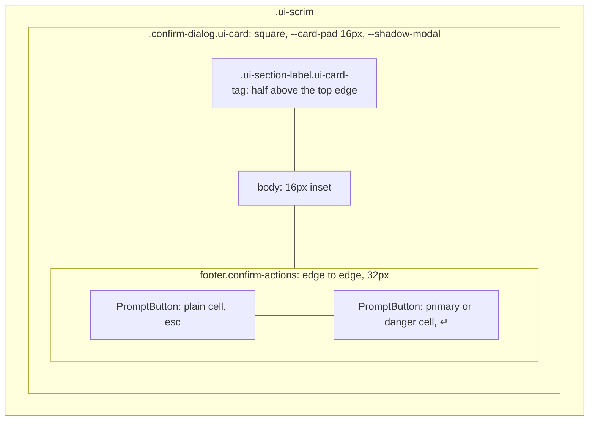
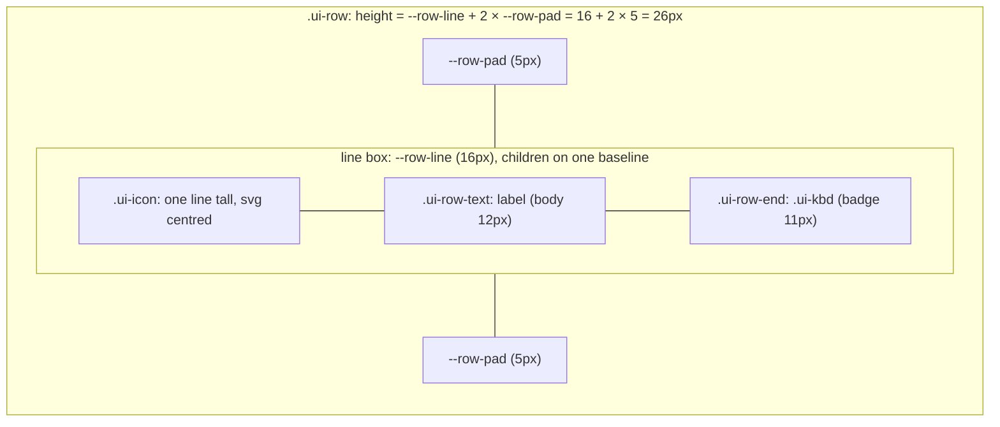

# Design system

Weavie's chrome (menus, dialogs, panels, tabs, cards) gets its type, alignment and heights from a small set
of **role tokens** in `src/web/src/styles.css` and **primitive classes** in `src/web/src/primitives.css`,
so a new surface looks like the rest of the product by construction rather than by per-file discipline.
A Biome plugin rejects raw typography; the `weavie-reviewer` agent covers what a source lint cannot see.

## Why

A census of 40 rendered surfaces found 32 font sizes, 5 dialog-title styles, 9 uppercase label styles,
6 shortcut-hint sizes, 3 bold weights, 15 line-height ratios, 10 single-line row heights and 14 text-button
heights, plus 20 rows whose centred mixed-size text sat 1–1.5px off the baseline. The causes were few: one
metadata token shared by chrome and content, controls and dialog titles inheriting whatever surrounded
them, and per-file `em` multipliers. The roles and primitives remove those sources.

## Chrome roles

Chrome is fixed px and does not follow the editor font. Each role is one `font` shorthand built from atomic
size, line and weight tokens; consumers write the shorthand.

Interface text has two sizes: 12px for everything, and 11px for the short list the badge role names.
Hierarchy comes from weight, dimness and the uppercase label, never from another pixel of size; the display
role is the one heading size, for a surface's own title.

| Role | Size / line / weight | Token | Use |
|---|---|---|---|
| hero | 36 / 40 / 600 | `--font-chrome-hero` | welcome window wordmark |
| display | 20 / 24 / 600 | `--font-chrome-display` | page headings: Getting Started, editor empty state, session inbox |
| lead | 16 / 24 / 400 | `--font-chrome-lead` | welcome tagline, recent rows, `.ui-button-xl` |
| body | 12 / 16 / 400 | `--font-chrome-body` | single-line chrome: rows, buttons, fields, pane headers, descriptions; titles at 600 |
| body-wrap | 12 / 18 / 400 | `--font-chrome-body-wrap` | wrapping text; `body`'s inherited default |
| badge | 11 / 16 / 600 | `--font-chrome-badge` | key hints and badges; counts and session names at 400. A count centred beside 12px text takes body, since centring two sizes splits their baselines |
| mono | 12 / 16 / editor weight | `--font-chrome-mono` | branch names, paths and other mono text in chrome |

Hero and lead exist only for landing surfaces. The family is `--font-chrome-family` (the
`interface.font.family` setting); mono uses `--font-content-family`.

- **Line heights.** Every single-line role uses 16px, so both sizes share one line box. Wrapping body
  text uses 18px, which is also what everything inherits.
- **Emphasis** is the same role followed by `font-weight: var(--font-weight-emphasis)` (600), or
  `--font-weight-mono-bold` (700) in the mono face, which ships only 400/700. There is no other bold.
- **`font:` goes first in a rule.** The shorthand resets `font-style` and `font-variant-numeric`; restate
  them after it.
- **Section labels** (the only uppercase style) are `.ui-section-label`: body at 600 with
  `--font-label-tracking`.

## Content and prose roles

Content roles follow the editor font — `font.size` and `editor.font.size`, including the font-zoom commands
— through the `--editor-font-*` variables `fonts.ts` publishes. They are for content only: the editor, the
terminal, the transcript, search results and the text typed into the composer. Buttons, dialog inputs, and
the labels and status lines around content are chrome and stay at the interface size.

| Token | Value | Use |
|---|---|---|
| `--font-content` | editor family, size and weight; line 1.24 | code-adjacent text: agent transcript and composer, search results, slash menu |
| `--font-content-secondary-size` | editor size × 0.8125 | small text that is itself content: blame annotations, quoted and inline code, thought text, search line numbers |
| `--font-content-title-size` | editor size × 1.3 | headings inside a content scope |
| `--font-content-row-line` | editor size × 1.5 | line box of content rows |
| `--font-prose` | prose family, editor size; line 1.5 | rendered documents: agent markdown, preview, plans, PR comments |

`em` font sizes are allowed only in prose: the four `*.prose.css` files (`agent/agent-markdown.prose.css`,
`editor/preview/preview.prose.css`, `editor/plan.prose.css`, `editor/comment.prose.css`) and `SOURCE_STYLES`
(`editor/source/source-styles.ts`), prose CSS held in TypeScript. New chrome geometry is px; `em` geometry belongs
where it should scale with the content font, as in the agent transcript and the preview, though some older chrome
rules still use it (connection banner, update card, shell tabs, parts of the review view).

## Primitives

All live in `primitives.css` inside `@layer ui` and own geometry and type plus button and field states;
row hover and selection colours stay in feature CSS. Add the primitive class beside the feature class.

- **`.ui-row`** — 26px list/menu row, baseline-aligned, body role. Variants: `-compact` (24px), `-content`
  (editor-font line box), `-stack` (multi-line; `min-height` instead of a fixed height). Slots:
  `.ui-row-text` (label column), `.ui-row-desc` (secondary, dim), `.ui-row-end` (trailing shortcut or meta).
- **`.ui-icon`** — inline box one line tall (`--row-line`, which a `.ui-button` sets to its own line),
  top-aligned, its `svg` at `--icon-size`.
- **`.ui-button`** — 24px text button. Variants: `-lg` (28px), `-xl` (40px, lead role; landing surfaces),
  `-primary`, `-danger`. **`.ui-button-group`** joins related buttons into
  one frame. **`.ui-icon-button`** — 20px square, no border. See [Buttons](#buttons).
- **`.ui-field`** — 28px text input. Variant: `-mono`.
- **`.ui-section-label`** — the section heading style.
- **`.ui-kbd`** — key hint chip, badge role, on whatever element holds the hint (``, `<kbd>`,
  `<small>`); `-plain` drops the chip border, `-cap` is a filled keycap tinted from the text colour of the
  button it sits in. Inside a button it is `aria-hidden` so the accessible name stays the label.
- **`.ui-card`**, **`.ui-card-tag`**, **`.ui-scrim`** — the square panel, its title tag and the layer behind
  a modal one. See [Cards and dialogs](#cards-and-dialogs).
- **`ModalShell`** (`chrome/ModalShell.tsx`, styled by `editor/confirm-dialog.css`) — every dialog: a
  `.ui-card` over a `.ui-scrim`, with **`PromptButton`** as its action.

## Buttons

One formula everywhere, so a toolbar, a card and a dialog read alike.

- **Plain** is a `--hairline` outline with no fill. The hairline is drawn from the text colour, so it shows
  on every theme; `--border` sits too close to the panel tone to outline a control.
- **Solid** is `-primary` (`--button-bg` with `--button-fg`) or `-danger` (`--danger`, white text): the
  action a group exists for, at most one of each per group. `--danger` is a fill; error text is `--bad`.
- **Joined.** Buttons that act on the same thing sit in a `.ui-button-group`, sharing edges: previous and
  next, Keep and Revert, Decline and Cancel, Interrupt and Steer. A lone button stays on its own.
- **Square.** Buttons, fields and key hints take their corner from `--control-radius`, which is 0.

## Cards and dialogs

A card is a square panel on the panel tone.

- **Title.** `.ui-section-label.ui-card-tag` as the card's first child: a tag half above the top edge, in the
  well colour of the fields below it. It is in flow, so a long title wraps and the content starts under it.
  A card sets its padding through `--card-pad`, which the tag reads to stay 16px in from the side.
- **Exception.** Getting Started is a landing surface with its own rounded look, shown inline or in a
  dialog, so it sets `--control-radius` to 4px.
- **Dialog.** `ModalShell` renders the tag from `title`, the body at a 16px inset, and
  `footer.confirm-actions`, which bleeds through `--card-pad`. A surface that draws its own display heading
  passes `labelledBy` instead of `title`. Controls that belong beside the title (a host picker, a close
  button) are the body's first row.
- **Actions.** Each `PromptButton` is a 32px cell (`--control-height-cell`) along the card's bottom edge,
  sharing the row equally: the default action is `primary` or `danger` and solid, the rest are plain with
  no outline, since the card frames them. A
  shortcut shows as a `.ui-kbd-cap` (`↵` for Enter, `esc` for Esc).
- **Containers.** A surface that holds a thread or other cards (a `/btw` side conversation, a subagent) is
  square and tinted, with a header row for its controls: collapse, status, Open. The tag is for a surface
  that asks one thing; a container's header is a control strip, and a tag on it competes with the tags of the
  cards inside.
- **Pending requests.** A request waiting on the user in the agent transcript (permission, question, sign-in,
  link) is a card whose tag carries an amber dot, with its decisions as joined 32px cells.
- **Backdrop and lift.** `.ui-scrim` dims and blurs what is behind a modal surface; `--shadow-modal` lifts
  it. A modal that cannot be a `ModalShell` uses both, never its own copy.

## Alignment and height

- **Text beside text aligns on the baseline**, never `align-items: center`: centring mixed sizes leaves the
  smaller text off-baseline.
- **Rows and controls are fixed-height.** Baseline alignment of mixed sizes makes an auto-height row grow by
  a sub-pixel (26 vs 26.5px), so `.ui-row` sets `height: --row-line + 2 × --row-pad` and absorbs it. The
  same construction gives `-content` rows a height that grows with the editor font instead of clipping.
- **Icons and controls beside text** sit in `.ui-icon`, a box one line tall, top-aligned so they stay on the
  first line of a wrapping row.
- **Touch sizes** set the primitives' variables (`--row-pad`, `--control-h`, `--icon-button-size`,
  `--pane-head-h`) on the compact-mode selectors; a `min-height` on a fixed-height row would leave the text
  top-aligned.

| Element | Heights |
|---|---|
| Rows | 26, compact 24, two-line stack 42, touch 44 |
| Text buttons | 24, `-lg` 28, `-xl` 40, touch 44 |
| Dialog and card action cells | 32, touch 44 |
| Icon buttons / fields | 20 / 28 |

## Cascade layers

`styles.css` opens with `@layer base, ui;`.

- **`base`** — `body { font: var(--font-chrome-body-wrap) }`, `button, input, select, textarea { font:
  inherit }` (controls take the full font, not the browser's 13.33px) and `strong, b` at emphasis weight.
- **`ui`** — the primitives.
- **Unlayered** — feature CSS and the prose files, which beat both layers regardless of specificity.

Layers are required because the build emits component-imported CSS before `styles.css`, so source order
cannot decide whether a feature rule overrides a primitive. The control rule sits in `base` because an
unlayered `button { font: inherit }` would beat every `.ui-button`.

## Enforcement

- **Lint.** Two GritQL plugins, registered under `plugins` in `src/web/biome.json`, run in `biome check` over
  `src/**/*.css`. Property names match in any case.
  - `lint/typography.grit`: a `font`, `font-size`, `font-weight` or `line-height` must be `inherit` or
    exactly `var(--font-…)` of a listed token. The list is closed, so the plugin is the token registry: an
    invented `--font-my-thing` fails.
  - `lint/font-tokens.grit`: a `--font-*` custom property may be declared only in `src/styles.css`, so no
    feature rule can redefine a role token.
- **Exemptions.** `typography.grit` skips `fonts.css` (`@font-face` descriptors) and `*.prose.css`;
  `font-tokens.grit` skips only `styles.css`.
- **Reviewer.** The lint does not see `font-family`, CSS held in TypeScript (`SOURCE_STYLES`), inline
  `style`, alignment, heights or UI text. `AGENTS.md` states those rules and `weavie-reviewer` checks them:
  hand-styled controls, dialog titles outside `ModalShell`, a `border-radius` on a card or its controls, a
  hand-rolled modal backdrop or shadow, centred mixed-size rows, `em` or literal
  heights, icons sized with `font-size`, non-prose rules in a prose file, and unexplained UI text.

## Adding a role or primitive

Prefer an existing role; add one only for a surface none of them serves.

- **Role** — define its atoms and shorthand in `styles.css` `:root` and add the name to the matching
  alternative in `typography.grit` in the same change, then add its row to the table above.
- **Primitive** — add it to `primitives.css` inside `@layer ui`, built only from tokens, and list it under
  [Primitives](#primitives) (and in `AGENTS.md` if it is a new kind of element).
