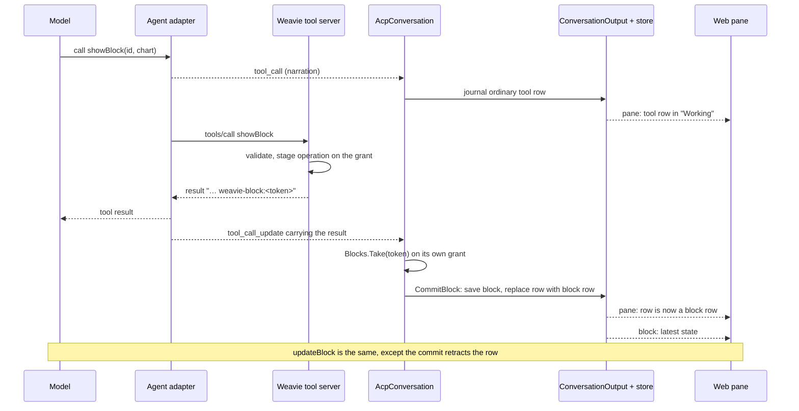

# Rich content in the agent pane — design

**Status:** design for [brief.md](brief.md). Names and signatures are from this worktree. The tool-result
relay was confirmed on raw frames from claude-agent-acp 0.102.0 and codex-acp 2.6.0, single and parallel.

## Summary

**What changes for the user.** An agent's reply can contain a chart or a table that Weavie draws in the
pane's own colours and fonts, and that the agent can change in place later. Images the agent references
appear inline. Dragging across a chart, clicking table cells, boxing part of an image, or highlighting
reply text puts that selection in the composer as an attachment, next to pasted images; the agent receives
exactly what was selected.

**The main pieces.**

| Piece | What it does |
| --- | --- |
| Two Weavie tools, `showBlock` and `updateBlock` | Validate the agent's chart or table and refuse a bad or oversized one with the reason |
| Claim token | A random value the tool returns; when it comes back on the call's row in the agent's stream, that row becomes the block |
| Block store | One saved record per block holding its latest state, beside the conversation it belongs to |
| Block row | A fixed-height transcript row that points at a block |
| Chart and table views | ECharts and a virtualized table, themed from Weavie's variables |
| Selection attachments | A second kind of composer attachment that carries text |
| Agent images | Markdown images, loaded through the host |

**Decided with the user.**

1. **Size limits:** 1 MiB of tool arguments, 12 series, 5,000 points per series, 2,000 rows, 24 columns,
   2,000 characters per cell, 20 MiB per remote image. A request over a limit is refused to the agent with
   the number.
2. **Approval cards are unchanged.** When the agent's permission mode asks before a Weavie tool runs, the
   existing approval card shows the tool's raw input, which here is the dataset, and saves it in the
   journal. Weavie cannot tell at that moment that the call is a block tool. Choosing the agent's "always
   allow" once ends the cards.
3. **An update costs a little saved history:** two or three small journal events with no data in them and
   one invisible retracted row, about 1 MB a day at one update a minute. Compaction is later work.
4. **Highlight attaches immediately**, with the setting `agent.attachOnSelect` (default on) because
   highlighting text is also how it is copied; when off, the command *Attach Selection to Prompt* does it.

## Where the brief meets the code awkwardly

| Brief says | Code reality | Design |
| --- | --- | --- |
| The tool server "stores the block" | A subagent calls with its parent's grant (`AcpConversation.cs:78`, `AcpConversation.Background.cs:20`), so the handler cannot refuse it | The handler *stages* the operation; the conversation that sees the token *commits* it. A subagent's claim is discarded |
| Updates leave the journal untouched (first draft of the brief) | The update's row is journalled at `tool_call`, before any token exists (`AcpConversation.ToolContent.cs:10-39`) | The row is retracted at claim. Cost in decision 3 |
| The update call shows no row at all | Same | It shows inside the "Working" group while the call runs, then goes |
| The dataset is never in the journal | The approval card journals `tool.Input` (`AcpConversation.Permissions.cs:71`) | True when no approval is asked. Decision 2 |
| "Block data loads in one batch after history" | History already streams over `/weavie-agent-history` | Blocks ride the final batch of that stream, in the same snapshot as the rows |
| "A boxed region of an image or diagram" | A Mermaid diagram is SVG; cropping it means rasterizing it first, and page fonts do not load inside an SVG image | Styles and fonts are inlined before rasterizing; see risks |

## Flow



## Evidence from the real wire

Read from `~/.weavie/acp-conversations.db`, the journal of real sessions on this host.

| | Claude (`claude-acp`) | Codex (`codex-acp`) |
| --- | --- | --- |
| Row title | `mcp__weavie__openFile` | `mcp.weavie.currentSession` |
| Kind | `other` | `execute` |
| Result arrives as | `content` text block: `FILE_OPENED` | `rawOutput`: `{"result":{"content":[{"type":"text","text":"…"}],"structuredContent":null,"_meta":null},"error":null}` |
| Row id | `tool:toolu_…` | `tool:<call id>` |

On the raw wire, Claude sends the result in both `rawOutput` and `content`; Codex sends `rawOutput` only,
and its first `tool_call` carries the arguments in `rawInput`. Both relay the result on the call's own row. They name the tool differently and put the result in
different fields, so the claim reads both fields and matches nothing but the token.

## What the link depends on

ACP does not oblige an agent to report an MCP tool's result, and gives no id that ties an MCP call to a
tool row. The design therefore rests on one stated dependency and nothing provider-specific:

> The agent reports a tool call's result on that call's own row, in `content` or `rawOutput`, the two
> fields ACP defines for a tool's output.

Anything else an adapter does differently is tolerated, because the claim only looks for Weavie's own
token in those two fields on any tool update:

| Variation | Why it still works |
| --- | --- |
| Result in `content`, in `rawOutput`, or in both | Both are read |
| Any `rawOutput` shape (string, array, object, nested, JSON-escaped) | Its raw text is searched; the token has no character that escaping changes |
| Result wrapped in a code fence or prefixed with other text | The token is matched anywhere in the text |
| Long output truncated by the adapter | The token is the first thing in the result |
| Result on the first `tool_call`, on a later update, or after the row already completed | The claim runs on every tool update and replaces the row in place |
| One update or many | Single use: the first sighting claims, later ones find nothing |
| Any tool kind or call id | None is read |
| Tool title | Read only to leave an in-flight `updateBlock` row undrawn: `AgentBlockRules.NamesUpdate` matches a one-word title ending in the tool's name, as `mcp__weavie__updateBlock` and `mcp.weavie.updateBlock` do. A title that doesn't draws the row until its result is claimed, and the block updates either way |
| Parallel calls, results in any order | Each result carries its own token |

What breaks it, and what the user and the agent then see:

| Agent behaviour | Outcome |
| --- | --- |
| Does not narrate MCP tool calls, or narrates them without results | When the turn ends, every operation still staged on that conversation is dropped with a notice in the pane: "*Agent* did not report the result of showBlock, so 'p95' was not shown." |
| Rewrites or redacts the token | The same notice |
| Reports the result on another session's row (a subagent) | The subagent notice; nothing is stored |
| Any of the above, then `updateBlock` | Refused: "Block 'p95' does not exist. If you showed it earlier, this agent did not report the tool result to Weavie; present the data as text." |

So an agent that cannot carry the link fails visibly at the first block, the model is told on its next
call, and nothing is silently half-shown. The fake agent reproduces every row of both tables, and each
provider Weavie ships a recipe for gets the real-agent run before blocks are relied on with it;
`docs/concepts/native-acp-agents.md` lists the dependency in its ACP contract.

## Formats by example

`showBlock` also takes an optional `dashboard` (`{ id, title }`) that gathers blocks into one card; see
[card tabs](../card-tabs/design.md).

**`showBlock`** — exactly one of `chart` or `table`.

```json
{
  "id": "p95",
  "title": "p95 latency · checkout-api",
  "chart": {
    "kind": "line",
    "x": { "type": "time" },
    "y": { "unit": "ms" },
    "y2": { "label": "errors", "unit": "%" },
    "series": [
      { "name": "now", "points": [[1794490680000, 318], [1794490740000, 344]] },
      { "name": "24h ago", "style": "comparison", "points": [[1794490680000, 297], [1794490740000, 262]] },
      { "name": "error rate", "axis": "y2", "points": [[1794490680000, 0.4], [1794490740000, 1.9]] }
    ],
    "thresholds": [{ "label": "threshold", "value": 400 }],
    "bands": [{ "label": "deploy", "axis": "x", "from": 1794490200000, "to": 1794490500000 }]
  }
}
```

```json
{
  "id": "errors",
  "title": "Recent errors",
  "table": {
    "columns": [{ "name": "time", "type": "time" }, { "name": "level", "type": "level" }, { "name": "message", "type": "text" }],
    "rows": [["2026-11-12T14:31:02Z", "error", "upstream timed out"]]
  }
}
```

`kind` is `line | area | bar | scatter`. `x.type` is `time | category | number`. A time is epoch
milliseconds or ISO 8601 and is stored as milliseconds. A comparison series is sent already shifted onto
the same x values. Column `type` is `time | number | text | level`.

**`updateBlock`** — a whole new `chart` or `table` replaces the block's data; `append` adds points to existing
series, or rows, and keeps the newest `append.keep`, which the schema requires inside `append`.

**A turn with nothing to say.** A refresh is a turn of its own, and an agent ends every turn with some text. The
`updateBlock` result tells it to reply with exactly `[[weavie:no-reply]]` (`AgentNoReply`) when updating is all
the turn did. The conversation holds a reply back while its text can still become that message, and a reply that
is exactly it is never shown: its text is dropped and only a retraction row naming the agent's message id is
journaled, because Rewind forks at the last reply of the previous turn. A reply that diverges is released whole, so nothing but that one string is
ever dropped, and an agent that ignores the instruction shows its text as before.

```json
{ "id": "p95",
  "append": { "keep": 60,
              "series": [{ "name": "now", "points": [[1794490800000, 371]] },
                         { "name": "24h ago", "points": [[1794490800000, 259]] }] } }
```

**Tool result** (the model reads the sentence; Weavie reads the token):

```text
weavie-block:4be1c07a9d2f4e6b8a35c1d0e97f2a64 Chart 'p95' is shown to the user. Do not repeat its data.
```

**Refusal** (`isError`):

```text
series[0].points has 12,400 points; the limit is 5,000 per series. Aggregate and resend.
```

**Block row** in the journal and on the wire (`AgentPaneMessage`):

```json
{ "Type": "item-completed", "ProviderId": "claude-acp", "ThreadId": "…", "TurnId": "7",
  "ItemId": "tool:toolu_01…", "ItemType": "block", "Category": "chart",
  "Summary": "p95 latency · checkout-api", "BlockId": "p95", "Status": "completed" }
```

**Block record** (`blocks.state`, and the body of the live `block` push and of history's `blocks`):

```json
{ "conversationId": null, "revision": 4812,
  "block": { "id": "p95", "title": "p95 latency · checkout-api", "updatedAtMs": 1794490803112,
             "chart": { "kind": "line", "…": "…" } } }
```

**Store table**

```sql
CREATE TABLE IF NOT EXISTS blocks (
  owner TEXT NOT NULL, conversation TEXT NOT NULL, id TEXT NOT NULL, state TEXT NOT NULL,
  PRIMARY KEY(owner, conversation, id));
```

**Submit with a selection** (`agent` feature, `submit`):

```json
{ "id": "…", "prompt": "why does this start before the deploy?", "attachmentIds": [],
  "selections": [{ "id": "sel-1", "label": "p95 latency · 14:18–14:30",
                   "text": "Chart \"p95 latency · checkout-api\" (p95), 14:18–14:30\ntime,now,24h ago\n14:18,318,297\n…" }] }
```

**Remote image**: `GET /weavie-agent-image?slot=…&incarnation=…&url=https%3A%2F%2F…`, answering the image
bytes or a 4xx whose plain-text body is the reason shown in the pane.

## Types

### Core (`src/Weavie.Core/Agents`)

```csharp
public sealed record AgentBlock {
    public required string Id { get; init; }
    public required string Title { get; init; }
    public required long UpdatedAtMs { get; init; }
    public AgentChart? Chart { get; init; }      // exactly one of Chart, Table
    public AgentTable? Table { get; init; }
}
public sealed record AgentChart { Kind, X, Y, Y2, Series, Thresholds, Bands }
public sealed record AgentTable { Columns, Rows }

/// What a block tool asked for; applied when its row is claimed.
public abstract record AgentBlockOperation {
    public sealed record Show(AgentBlock Block) : AgentBlockOperation;
    public sealed record Update(AgentBlockUpdate Change) : AgentBlockOperation;
}

public sealed class AgentBlockClaims {
    public bool Bound { get; }
    public void Bind(Func<string, AgentBlock?> find);                 // once, by the owning conversation
    internal AgentBlock? Find(string id);                             // ToolUnavailableException when unbound
    internal string Stage(AgentBlockOperation operation);            // returns the token
    public AgentBlockOperation? Take(string? text, IReadOnlyList<AgentPaneContent>? content);
    public IReadOnlyList<AgentBlockOperation> Drain();               // what a finished turn never claimed
    internal void Clear();
}

public static class AgentBlockValidator {
    public static AgentBlockOperation Validate(AgentBlockRequest request, AgentBlock? current);  // throws AgentBlockException
}
public static class AgentBlockOps {
    public static AgentBlock Apply(AgentBlock? current, AgentBlockOperation operation, long nowMs);
}
public sealed record AgentBlockState(string? ConversationId, AgentBlock Block);
public sealed record AgentBlockRecord(string? ConversationId, long Revision, AgentBlock Block);
```

Changed:

| Type | Change |
| --- | --- |
| `AgentPaneMessage` | `string? BlockId` |
| `CapabilityRegistryGrant` | `public AgentBlockClaims Blocks { get; } = new();` cleared in `DisposeAsync` |
| `McpServer.InflightCall` | `Blocks => key.Item1.Blocks`, beside `Sessions` |
| `ConversationOutput` | `Restore`/`Replace` take blocks too; `WriteBlock(AgentBlockState, AgentPaneMessage row, Action persist)`; drops a block when its row is retracted |
| `ConversationView` | `AgentBlock? Block(string id)` |
| `IConversationOutputSink` | `void Block(AgentBlockRecord record)` |
| `AgentPaneHistory` | `IReadOnlyList<AgentBlockRecord> Blocks` |
| `AcpSessionStore` | `SaveBlock`, `DeleteBlock`, `ReadBlocks`; `Replace` and `ClearWorkspace` prune |
| `AgentInputAttachment` | Becomes `abstract` with `Image(Path, Mime)` and `Selection(Label, Text)` cases, as `AgentMutation` is shaped |
| `AgentSettings` / `CoreSettings` | `agent.remoteImages`, `agent.attachOnSelect`, both `SettingKind.Bool`, `ApplyMode.Live`, default true |

### ACP (`src/Weavie.AgentClientProtocol`)

| Type | Change |
| --- | --- |
| `AcpConversationPort` | `AgentBlock? Block(string id)`, `void CommitBlock(AcpConversationState, AgentBlockOperation, AgentPaneMessage row)`, gated like `Emit` |
| `AcpToolState` | `bool Claimed` |
| `AcpConversation` | new partial `AcpConversation.Blocks.cs`; constructor binds `binding.Tools.Blocks` when `_ownsBinding` |

### Hosting and wire

| Type | Change |
| --- | --- |
| `AgentPaneWire` | `blockId` |
| `AgentPaneHistoryBatch` | `Blocks`, filled on the `Complete` batch only |
| `AgentBlockWire` (new, in `WireJson`) | The block record |
| `AgentPaneOutput` | `BlockCommand`; latest record per block, published as `block` after the pane buffer in `Flush()` |
| `AgentSubmitMessage` | `AgentSelectionWire[]? Selections` |

### Web (`src/web/src/agent`)

```ts
// AgentPaneTranscriptTypes.ts
kind: … | "block";  block?: { key: string; kind: "chart" | "table" };

// block-store.ts (session-owned)
interface AgentBlockRecord { conversationId: string | null; revision: number; block: AgentBlock }
function blockFor(session: ClientSession, key: string): Accessor<AgentBlock | undefined>;

// composer-state.ts
type AgentComposerAttachment =
  | { kind: "image"; id: string; mime: string; previewUrl: string; status: AgentAttachmentStatus; error: string | null }
  | { kind: "selection"; id: string; label: string; text: string };
```

## Components

### Block tools — `McpServer.BlockTools.cs` (new)

`McpServer.cs` gets two `case` lines and one schema entry; the handlers live in the new partial, as
`McpServer.ReviewHintTools.cs` does.

```csharp
async Task HandleBlockToolAsync(InflightCall call, string name, JsonElement arguments, …) {
    if (arguments.GetRawText().Length > AgentBlockLimits.ArgumentBytes) → tool error with the limit
    var request = JsonSerializer.Deserialize(arguments, AgentBlockJson.Default.AgentBlockRequest);   // JsonException → tool error with its path
    var current = call.Blocks.Find(request.Id);                // unbound grant → ToolUnavailableException
    var operation = AgentBlockValidator.Validate(request, current);   // AgentBlockException → tool error
    string token = call.Blocks.Stage(operation);
    → result text: token + " <Chart|Table> '<id>' is shown to the user. Do not repeat its data."
}
```

Rules:

- `showBlock` on an id that exists is refused: "already shown; use updateBlock". `updateBlock` on an id
  that does not exist is refused.
- `append.keep` is required by the schema and the JSON contract; series are matched by name, and a new name
  adds a series within the limit.
- `tools/list` omits both tools for a grant whose `Blocks` is not bound, which is terminal Claude's.
- `AgentBlockJson` is a source-generated context with `UnmappedMemberHandling.Disallow` and
  `NumberHandling.AllowReadingFromString`, plus a converter for `[x, y]` points.

### Claims — `AgentBlockClaims`

A grant belongs to one conversation incarnation, so its claims are that conversation's.

```csharp
string Stage(AgentBlockOperation operation) {
    string token = "weavie-block:" + Convert.ToHexStringLower(RandomNumberGenerator.GetBytes(16));
    lock (_gate) _staged[token] = operation;
    return token;
}
AgentBlockOperation? Take(string? text, IReadOnlyList<AgentPaneContent>? content) {
    lock (_gate) {
        if (_staged.Count == 0) return null;                       // ordinary tool output is never scanned
        foreach (Match match in Token().EnumerateMatches over text and each content[].Text)
            if (_staged.Remove(match.Value, out var operation)) return operation;   // single use
        return null;
    }
}
```

The token's alphabet `[a-z0-9:-]` survives JSON string escaping, so it is found in Codex's raw JSON and in
Claude's text block with one regular expression.

### Claiming the row — `AcpConversation.Blocks.cs` (new)

Called from `UpdateToolSerialized` (`AcpConversation.Tools.cs:22`) after `MergeTool` and before
`PublishTool`.

```csharp
bool ClaimBlock(AcpToolState tool) {
    if (tool.Claimed || _binding.Tools.Blocks.Take(tool.Text, tool.Content) is not { } operation) return false;
    if (!_ownsBinding) { Notice("Blocks from subagents are not shown."); return false; }   // plain row stays
    tool.Claimed = true; tool.Status = "completed";
    tool.Input = null; tool.Text = null; tool.Content = null;      // _tools is never pruned
    lock (_gate) _activeTools.Remove(tool.Id);
    _port.CommitBlock(State(), operation, operation is AgentBlockOperation.Show show
        ? ToolMessage(tool) with { Type = "item-completed", ItemType = "block", Category = Kind(show.Block),
                                   Summary = show.Block.Title, BlockId = show.Block.Id, Text = null, Content = null }
        : RetractedRow(tool));                                     // the RetractTurn shape, Turns.cs:207
    return true;
}
```

When a prompt turn ends (`DeliverPromptAsync`, `AcpConversation.PromptDelivery.cs:56`), the owning
conversation drains what is still staged on its grant and emits one `Notice` per operation.

`PublishTool` returns early for a claimed tool, beside `PlanReleased`. Forcing `completed` at claim keeps
the tool out of `TerminalizeToolsLocked`, which emits `ToolMessage` directly on restart.

| Moment | Row | Journal events |
| --- | --- | --- |
| `tool_call` | Ordinary tool row | 1 |
| Result with a token, show | Same `ItemId`, replaced in place by the block row (`AgentPaneLedger.cs:111-114`) | 1, the completion it would have written anyway |
| Result with a token, update | Retracted | 1 |
| Result with a token, on a subagent | Plain completed row and a notice | as today |
| No token, or refusal | Plain completed or failed row | as today |

### Commit — `AcpConversationPort.CommitBlock` → `ConversationOutput.WriteBlock`

```csharp
// OwnedPort
protected override void OnCommitBlock(AcpConversationState state, AgentBlockOperation operation, AgentPaneMessage row) {
    if (Prepare(row) is not { } prepared) return;                  // nested ports stamp ConversationId
    var block = AgentBlockOps.Apply(View.Block(Id(operation)), operation, nowMs);
    owner.Output.WriteBlock(new(conversationId, block), prepared, () => {
        store.SaveBlock(providerId, workspace, conversationId, block);    // upsert
        OnSave(state, [prepared]);
    });
}
```

- The operation is applied here, under the transition gate, so two appends land in row order whatever
  order their handlers ran in.
- `WriteBlock` persists, folds the row, sets the block, then calls `sink.Live` and `sink.Block` under the
  output gate, as `Write` does.
- **Survival rule: a block lives while its reference row does.** `ConversationOutput` drops a block when a
  retraction folds over its row (a refused turn, `RetractTurn`), and `AcpSessionStore.Replace` prunes every
  block no `ItemType == "block"` row in its `messages` refers to.

| Event | Existing call | Blocks |
| --- | --- | --- |
| `/clear` | `Replace(…, [], [])` | All deleted |
| Rewind | `Replace(…, kept)` | Deleted after the cut; earlier ones keep their latest data |
| Refused turn | `RetractTurn` | That turn's blocks deleted |
| Session or workspace delete | `ClearWorkspace` | Deleted |
| Restart, reconnect, cold load | `RestoreDisplay` | Read back with the rows |

### Delivery to the web

- **History.** `ReadHistory` snapshots rows and blocks under one lock; the final batch of
  `/weavie-agent-history` carries `blocks`. `pane-store.ts` puts them in `block-store.ts` when the batch
  is `complete`.
- **Live.** `AgentPaneOutput` keeps the newest record per block and publishes one `block` message per
  flush, after the pane rows. A block is latest state, so dropping an older record is correct.
- **Revision.** A block record takes the ledger's revision counter, so the existing `knownRevision`
  resync covers blocks. The web keeps the higher revision per key and clears the store on a generation
  change.

### Block row — `AgentBlockEntry.tsx` (new)

```tsx
<section class="agent-block" style={{ height: chart ? `${chartHeight}px` : undefined }}>
  <header class="agent-block-head">{title}<span class="agent-block-updated">{updated}</span></header>
  <Switch>
    <Match when={block()?.chart}>{(chart) => <AgentChart chart={chart()} … />}</Match>
    <Match when={block()?.table}>{(table) => <AgentTable table={table()} … />}</Match>
  </Switch>
</section>
```

- A chart's height is fixed (`agent-block-layout.ts`), and `estimateEntrySize` returns the same number, so a
  chart arriving or updating never moves the transcript. A table is as tall as its rows up to a cap, where it
  scrolls inside its frame; the rows are counted before filtering, so a filter never changes its height.
- The header is the title alone; the block shows what kind it is.
- A row whose block has not arrived renders its title from the row's `Summary` over an empty frame: a chart's
  full height, a table's title alone.
- "updated 14:32" appears once a block has been updated, from `updatedAtMs`.
- `AgentPaneLayout.ts`'s `rangeExtractor` also keeps the row that owns the in-progress selection mounted,
  as it does for pending forms.

### Chart — `charts.ts`, `AgentChart.tsx` (new)

- `echarts/core` with line, bar and scatter charts and the grid, tooltip, legend, mark-line, mark-area
  and brush components, loaded by a memoized dynamic import as Mermaid is in `editor/preview/diagrams.ts`.
- The renderer is canvas. An SVG renderer was tried for its text: in the app's WebKit webview a live line chart
  once lost its series lines under the pointer, which was never reproduced, and a bar or scatter chart at the
  limits is too many DOM nodes.
- Every series carries a stable `id`, so an update under `replaceMerge` keeps its view and animates the line to
  the new data; without one ECharts rebuilds every series on every update.
- Chart text is the chrome secondary role. Axis names sit along their axes and the grid lays itself out
  inside its bounds (`outerBoundsContain: "all"`), so no name or label can meet the legend above it.
- `chartOption(chart, palette)` is a pure function: `animationDuration: 0`, `animationDurationUpdate: 300`,
  comparison series dashed and dim, `thresholds` as `markLine`, `bands` as `markArea`, `y2` as a second
  `yAxis`.
- The palette is read from CSS variables and re-applied through `onPreviewThemeChanged`. `styles.css`
  gains `--chart-1` … `--chart-6`, derived from the theme's ANSI colours in `chrome-vars.ts`.
- A drag is the brush (`brushType: "lineX"`), a click is the series point; both call the selection store.

### Table — `AgentTable.tsx` (new)

- Rows are `.ui-row-content`, virtualized with `@tanstack/solid-virtual`; header and rows share explicit column
  widths sized from the data, because virtualized rows can't join one grid; sortable headers are `.ui-button`.
- A table's sort and filters live in `block-store.ts`, keyed by its transcript row, so a row the transcript
  unmounts when it scrolls away comes back as the user left it, and a block shown again starts fresh.
- Each column filters from the button beside its name (`AgentTableFilter.tsx`): a phrase the cell must
  contain, and the column's eight most common values to pick from. A selection's text names the filters.
- `level` cells take `--warn`, `--bad`, `--dim`. `time` cells render in local time.
- Dragging across cells attaches that rectangle; the row number attaches its row. The gesture attaches when it
  ends, like a chart brush.

### Selection attachments

```ts
// agent-selection.ts
function attachSelection(session: ClientSession, selection: { label: string; text: string }): void;
function attachRegion(session: ClientSession, source: CanvasImageSource, box: DOMRect): void;   // crop → uploadAgentImage
```

| Source | Gesture | Attachment |
| --- | --- | --- |
| Chart | Drag a range, or click a point | Text: title, id, range, a CSV of the selected points |
| Table | Click or shift-click cells, rows, columns | Text: title, id, a CSV of the selection with its header |
| Image, diagram | Drag a box | Image: the cropped region |
| Reply text or code | Highlight | Text: the highlighted text |

- The text is composed on the web at selection time, so it holds the values as they were.
- Host: `AcceptAgentSubmission` appends `Selection` attachments and rejects an oversized one through
  `PublishSubmissionState("rejected", …)`. `BuildPrompt` adds one `AcpContent.Text` block per selection.
  `EmitSubmitted` journals a `user-selection` row (`Summary` = label, `Text`), shown as a one-line chip.
- `RequireImageSupport` and terminal delivery consider only `Image` attachments.
- Command `weavie.agent.attachSelection` (*Attach Selection to Prompt*, web, unbound), registered by the
  reply that holds the text selection, with `When = "agentSelectionAttachable"`. With
  `agent.attachOnSelect` on, the same handler runs when the highlight gesture ends.
- Command `weavie.agent.attachBlock` (*Attach Block to Prompt*, web, unbound) attaches a whole chart or table. The
  block owns it while focus is inside it, and its header button shows the shortcut.

### Images

- `MarkdownProfile.allowImages` becomes `images: "none" | "direct" | "hosted"`. The agent flavor uses
  `hosted`, which renders an inert placeholder; `agent-images.ts` hydrates it once the reply has finished
  streaming, as `hydrateGithubMedia` does for attachments.
- A workspace path loads from `/weavie-media`; an `https` address loads from `/weavie-agent-image`. Both
  are fetched to a blob and shown from an object URL, cached per session, so a crop never taints its
  canvas and a remounted row does not refetch.
- An image sits in a fixed-height frame with `object-fit: contain`, which `markdownHeight` counts.
- `AgentImageFetcher` (Core, taking an `HttpMessageHandler`): https only, default port, no user info;
  `image/*` except `image/svg+xml`; buffered to the size limit; refused when `agent.remoteImages` is off.
- `/weavie-media` gains the token and `Access-Control-Allow-Origin` preamble `/weavie-agent-history` has,
  through one shared helper, so a remote connection can fetch it for cropping.

### Agent guidance

The guidance lives in the two tools' descriptions: use `showBlock` for data worth seeing as a chart or a large
or live table; use a markdown table for a small static one; update in place instead of resending or reprinting;
one update per block at a time. Every agent that lists the tools reads it, whereas the embedded instructions
reach only agents with embedded context; terminal Claude never lists the tools.

## Error handling

| Failure | Where the user or agent sees it |
| --- | --- |
| Malformed request, unknown field, wrong type | Tool error with the JSON path; failed tool row |
| Over a limit | Tool error naming the field, the value and the limit; failed tool row |
| `showBlock` on an existing id, `updateBlock` on a missing one | Tool error; failed tool row |
| Block tool from terminal Claude | Not listed; a direct call gets "tool unavailable" |
| Block tool from a subagent | Plain tool row and the notice "Blocks from subagents are not shown." |
| Agent does not report the result on the call's row | Plain tool row, and at turn end a notice naming the block that was not shown; a later `updateBlock` is refused with the reason |
| Store write fails | The existing `AcpSessionStoreException` path: the agent stops and the pane shows the error |
| Chart library fails to load or render | The block frame shows the error text; the title stays |
| Selection text too large | The submission is rejected in the composer with the limit |
| Image not found, wrong type, too large, or remote images off | The reason, in the image's frame |
| Agent without image support, image-region attachment | "does not accept image prompts", as for a pasted image |

No timeouts are added. A remote image fetch ends with its request or its session.

## Testing

| Layer | Covers |
| --- | --- |
| `tests/Weavie.Core.Tests` | `AgentBlockValidator` (each limit names itself), `AgentBlockOps` (replace, append, trim), `AgentBlockClaims` (single use, unbound, cleared), `AcpSessionStore` (upsert, prune in `Replace`, `ClearWorkspace`), `McpServer` (errors, per-grant `tools/list`), `AgentPaneLedger` (tool row to block row in place), `ConversationOutput` (history with blocks, block dropped on retraction), `AgentImageFetcher` with a stub handler |
| `tests/Weavie.Hosting.Tests`, new `AcpBlockTests` | Show claims its own row with no extra journal event; update retracts and leaves no dataset in `pane_events`; Claude-shaped and Codex-shaped results; two parallel calls whose results arrive swapped; two appends applied in row order; subagent refused; no relay; restart; `/clear`; Rewind; `/btw` and workflow-thread isolation; refused turn deletes its block. Selection attachments beside `AcpSideAttachmentTests` |
| Fake agent | `block:<relay>:<tool>:<json>`, `block-parallel:…` and `block-subagent:…` (`tools/Weavie.FakeAcp/FakeAcpAgent.Blocks.cs`) narrate the call with one relay per row of both tables in "What the link depends on": Claude and Codex shapes, JSON-escaped, content-only, fenced, truncated, result on the first `tool_call`, result after completion, repeated, swapped parallel results, no narration, no result, altered token, a row title that doesn't name the tool, and a call narrated on a subagent session. Plain `mcp:` calls stay un-narrated |
| Vitest | `AgentPaneMessages`, `AgentPaneEstimate`, `AgentPaneAccumulator`, `block-store`, `chartOption`, table sort, filter and selection, selection text composition, `composer-state` |
| e2e headless (`src/web/e2e/functional`) | `agent-blocks.spec.ts`: a block between two pieces of reply text; in-place update with many small appends; reload with the history response held, row offsets unchanged when blocks land; Rewind; `/clear`. `agent-attachments.spec.ts`: each gesture, stacked chips, the prompt the fake receives. `agent-images.spec.ts`: workspace image, region crop, the setting-off message |
| e2e remote | One test: cropping an image across origins |
| `pnpm e2e:perf` | Required: `markdown-renderer.ts` is under `src/web/src/editor`, and `estimateEntrySize` and `rangeExtractor` run per scroll frame |
| Real agents | Before the Phase 1 PR merges and again after Phase 2: Claude and Codex each show a chart, append to it five times, and call two block tools in parallel; raw frames kept under `temp/` |

## Files

### Phase 1 — own PR

The handlers are callable but not listed in `tools/list`, so nothing is user-visible; tests and the fake
agent exercise the whole path.

| File | Change |
| --- | --- |
| `src/Weavie.Core/Agents/AgentBlock.cs` (new) | Block, chart, table, operation, state and record types; `AgentBlockJson` |
| `src/Weavie.Core/Agents/AgentBlockClaims.cs` (new) | Stage, take, bind |
| `src/Weavie.Core/Agents/AgentBlockRules.cs`, `AgentBlockReferences.cs` (new) | Validation, apply, limits; which rows keep which blocks |
| `src/Weavie.Core/Mcp/McpServer.BlockTools.cs` (new) | Handlers and schemas |
| `src/Weavie.Core/Mcp/McpServer.cs`, `McpServer.Cancellation.cs`, `CapabilityRegistryGrant.cs` | Dispatch, `Blocks` |
| `src/Weavie.Core/Sessions/AcpSessionStore.Blocks.cs` (new), `AcpSessionStore.cs` | Table, upsert, prune, delete |
| `src/Weavie.Core/Agents/ConversationOutput.cs`, `AgentPaneLedger.cs`, `AgentPaneMessage.cs` | Blocks, revision, `BlockId` |
| `src/Weavie.AgentClientProtocol/AcpConversation.Blocks.cs` (new) | Claim |
| `src/Weavie.AgentClientProtocol/AcpConversation.cs`, `.Tools.cs`, `.ToolContent.cs`, `AcpConversationPort.cs`, `AcpNestedPorts.cs` | Bind, hook, `Claimed`, port commit |
| `src/Weavie.AgentClientProtocol/AcpAgentSession.Journal.cs`, `.Process.cs`, `.Rewind.cs` | Restore and replace with blocks |
| `src/Weavie.Hosting/Agents/AgentPaneOutput.cs`, `AgentPaneProtocol.cs`, `Messaging/WireJson.cs` | Live `block`, history `blocks`, contracts |
| `src/web/src/agent/block-store.ts` (new), `pane-store.ts`, `messaging/protocol-types.ts` | Web store and wire types |
| `tools/Weavie.FakeAcp/FakeAcpAgent.WeavieTools.cs` | Narration |
| `docs/concepts/acp-conversations.md`, `docs/specs/agent-pane-persistence.md` | Claims and the block store |

### Phase 2

| File | Change |
| --- | --- |
| `McpServer.BlockTools.cs`, `McpServer.cs`, `EmbeddedAgentGuidance.cs`, `AcpConversation.PromptBuilder.cs` | List the tools per grant; guidance |
| `src/web/src/agent/AgentBlockEntry.tsx`, `AgentBlockLayout.ts`, `charts.ts`, `AgentChart.tsx`, `AgentTable.tsx`, `agent-blocks.css`, `agent-selection.ts`, `agent-images.ts` (new) | Rendering, selection, images |
| `AgentPaneTranscriptTypes.ts`, `AgentPaneMessages.ts`, `AgentPaneActivitySummary.ts`, `AgentTranscriptEntry.tsx`, `AgentPaneEstimate.ts`, `AgentPaneLayout.ts`, `AgentMarkdown.tsx`, `editor/preview/markdown-renderer.ts`, `styles.css`, `theme/chrome-vars.ts`, `package.json` | Entry kind, estimate, mount retention, image mode, palette, `echarts` |
| `AgentTurnSubmission.cs`, `AcpConversation.PromptBuilder.cs`, `HostSession.Messages.cs`, `composer-state.ts`, `AgentAttachmentStrip.tsx` | Selection attachments |
| `src/Weavie.Core/Agents/AgentImageFetcher.cs`, `src/Weavie.Hosting/HostCore.AgentImages.cs`, `Web/WorkspaceHttpServer.AgentImages.cs` (new) | Remote image route |
| `Web/WorkspaceHttpServer.cs`, `.Files.cs`, `.AgentHistory.cs` | Shared token and CORS preamble |
| `AgentSettings.cs`, `CoreSettings.cs`, `CoreCommands.cs`, `commands/types.ts` | Two settings, one command |
| `docs/concepts/mcp-registry.md`, `docs/specs/workspace-http-media.md`, `AGENTS.md` | Tools, image route, a Concepts line |

## Risks

| Risk | Consequence | Handling |
| --- | --- | --- |
| The relay differs on the raw wire from what the journal shows (order, parallel calls, a result split across updates) | A block that never appears | Build step 1 captures frames before any other code; the claim runs on every update that carries output |
| An agent, or a later adapter version, that does not report results on the row | The agent is told the block is shown and it is not | One stated dependency on ACP's own fields; a notice at turn end; the model told on its next call; fake-agent matrix; real-agent run per provider |
| Staged operations never claimed | Memory held | Drained at turn end; cleared with the grant |
| A handler validates an update against a block another update is about to change | A stale check, for example a series limit | Apply happens at commit in row order; guidance asks for one update per id at a time |
| Retracted update rows accumulate | History grows by small rows | Accepted (decision 3); compaction in `Replace` later |
| Rewind keeps an earlier block with data from the discarded future | The forked agent does not remember sending it | The brief's decision; stated in the spec |
| Rasterizing a Mermaid diagram for a region crop | Fonts fall back inside an SVG image | Inline computed styles and the font before drawing; if WebKit still differs, diagram regions are cut and reported |
| Kind-only table height | A short table leaves empty space | Small static tables are markdown tables by guidance |
| Chart row above the viewport updating | Reader position | Height never changes; the chart redraws inside its frame |
| Auto-attach on highlight | Chips from copying text | `agent.attachOnSelect` |
| Files already past 300 lines (`McpServer.cs` 938, `AgentTranscriptEntry.tsx` 335, `composer-state.ts` 357, `AgentPaneMessages.ts` 350) | Size rule | New code in new files; these take hook lines only |

## Build checklist

**Phase 1**

- [x] 1. Capture raw ACP frames from real Claude and Codex calling a Weavie tool, singly and in parallel; record
   them under `temp/` and correct this design if they differ from the journal evidence.
- [x] 2. `AgentBlock` types, `AgentBlockJson`, validator, ops, limits, with Core tests.
- [x] 3. `AcpSessionStore.Blocks`: table, upsert, delete, prune in `Replace`, `ClearWorkspace`.
- [x] 4. `ConversationOutput`, `ConversationView`, ledger revision, `AgentPaneMessage.BlockId`.
- [x] 5. `AgentBlockClaims`, grant and `InflightCall` wiring, the two handlers (unlisted).
- [x] 6. `AcpConversation.Blocks`, the `Claimed` guards, port `CommitBlock`, restore and rewind with blocks.
- [x] 7. Fake agent narration matrix, turn-end drain and notice, `AcpBlockTests`.
- [x] 8. Wire contracts, history `blocks`, live `block`, `block-store.ts`.
- [x] 9. Real Claude and Codex run through `AcpAgentSession` (both show and update in place); `dotnet format`, `biome check --write`. Phase 1 ships in the same PR as Phase 2, as separate commits.

**Phase 2**

- [x] 10. List the tools per grant; guidance.
- [x] 11. Block entry kind, fixed frame, estimate, mount retention.
- [x] 12. ECharts chart view, palette tokens, theme re-apply.
- [x] 13. Table view.
- [x] 14. Attachment union end to end; selection gestures; command and setting.
- [x] 15. Image mode, hydration, remote route, CORS helper, setting.
- [x] 16. e2e specs, `pnpm e2e:perf`, the remote crop test, real-agent run, docs, PR. Review and the tester video are the next stages.
