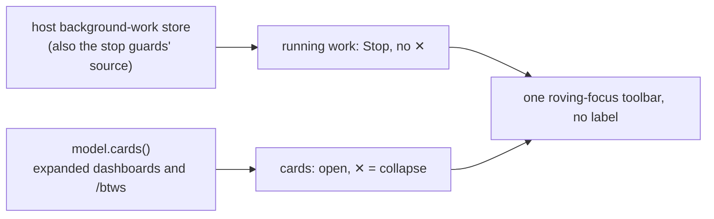

# Card tabs — design

**Status:** design for [brief.md](brief.md), after [challenge.md](challenge.md). Names and signatures are from
this worktree, read by the `weavie-architect` agent and checked against the code. Built in
[PR #1219](https://github.com/Kapps/weavie/pull/1219); [review.md](review.md) lists what review changed.

## Summary

Approving needs only this section. **Reference for the build**, below it, is for whoever builds this.

**What you get**

- Ask for a dashboard and the charts arrive in one card in the chat, full size, collapsible.
- Open on that card, on a `/btw`, or on a single chart shows the same content in an editor tab at full width,
  live in both places. In the tab, each chart or table can be dragged taller.
- The strip above the composer lists running work, then every expanded dashboard and `/btw`. ✕ collapses the
  card, which takes it off the strip.
- The agent can open a dashboard's tab when asked, without taking focus.

**How it is built**

A dashboard is one saved row in the conversation's history, and each of its charts' existing rows points at
it, so reload, `/clear` and Rewind treat it like any other history. Collapse is saved the way a `/btw`'s is
today. The tab and the card draw the same objects, so nothing is copied.

**Decided with you**

1. **A `/btw` is named "BTW · " and its first question, shortened,** in the strip and on its tab.
2. **Only a chart added in a later turn leaves a one-line row.** Charts added in the turn that creates the
   dashboard appear in the card with no line each.
3. **`Alt+B` collapses the card you last clicked or focused.** It no longer falls back to the newest visible
   one.
4. **The agent opens a dashboard with a tool, not a command.** Only a tool call knows which conversation is
   asking, and a `/btw` and the main chat can each have a "rollout". Open for the user is a command.

**Where the code pushed back**

- The card sits where the dashboard's saved row lands, which is just after its first chart and not exactly on
  it.
- After a Rewind, a main-chat dashboard's collapsed state returns to what it was at the cut, while a `/btw`'s
  survives. That is how Rewind treats the two kinds of history today, and it is left alone.
- Tabs other than files save no view state today, so remembering dragged heights adds that for these tabs.
- Selecting inside a `/btw` tab still attaches to the main composer, with the tab's own reply box beside it.

**Main risks**

- A card that grows while you read above it or inside it could shift the chat on an iPhone. It uses the same
  mechanism as any row that grows, and it is checked on a real phone before merge.
- An agent may send the new dashboard argument in the wrong shape. It gets a clear error and can retry; real
  Claude and Codex are run before any of the web work.
- A long-running session lists every expanded `/btw` in the strip the first time. ✕ collapses each.

**Plan.** One PR in eleven steps; real Claude and Codex runs at steps 3 and 10; an iPhone check before merge.

# Reference for the build

## Where the brief meets the code awkwardly

| Brief says | Code reality | Design |
| --- | --- | --- |
| The card sits "at the place its first block was shown" | A block row replaces its tool row in place, and a new row is appended when the result is claimed (`AgentPaneLedger.cs:113-122`), so the dashboard row lands just after its first member | The card's place is the dashboard row |
| A block added "later" leaves one line | History arrives newest first and the first batch is painted alone (`AgentPaneProtocol.cs:20-25`), so a member can be on screen before its dashboard row | The host writes the line's text on the member row. "Later" means another turn than the dashboard row's (decision 2) |
| Collapse is saved "as a `/btw`'s is today" | Rewind keeps rows after the cut only for nested conversations (`AcpRewindPlan.cs:28-31`) | A main-chat dashboard's collapse returns to its state at the cut; a `/btw`'s survives. Accepted |
| Open and collapse act on a named card, from the palette too | The web registry holds one handler per command id (`commands/registry.ts:196-200`), and `ownCommand` swaps the handler (`agent-command-owner.ts`) | A focused card registers a *target*; one handler reads it |
| The agent opens "its own conversation's" dashboard | `runCommand` has no caller; block tools do (`McpServer.Cancellation.cs:50`) | A block tool (decision 4) |
| The tab remembers dragged heights | A non-file tab captures `state: null` (`TabContent.tsx:77-85`) | The tab's view state is a signal the blocks tab writes |
| Each block's height can be dragged | A table's height is CSS capped at 270px (`agent-blocks.css:124-127`) | The cap becomes a CSS variable the tab sets |
| The strip shows cards with no work running | The tray hides when the host list is empty, and its command is gated on running work (`AgentBackgroundTray.tsx:48`, `AgentPaneBody.tsx:22-27`) | A second context key, `agentStripActive` |
| Selecting in a `/btw` tab attaches to the main composer | It does today (`composer-store.ts:30-31`), with the tab's own reply box beside it | Unchanged, as the brief says |

## Flow

```mermaid
sequenceDiagram
    participant M as Model
    participant T as Weavie tool server
    participant C as AcpConversation
    participant O as ConversationOutput + store
    participant W as Web pane
    participant E as Editor tab

    M->>T: showBlock(id, dashboard {id, title}, chart)
    T->>T: validate, read standing dashboard, stage
    T-->>M: "weavie-block:<token> … Created dashboard 'rollout' …"
    Note over C: the result arrives on the call's own tool row
    C->>C: Take(token); AgentDashboards.Rows(marker?, dashboard, row)
    C->>O: CommitBlock: save block, dashboard row, member row (one transaction)
    O-->>W: rows, then block state
    W->>W: project: member rows gather under the dashboard row
    Note over W: card at the dashboard row; a later-turn member also shows one line
    W->>E: Open (weavie.agent.openCard) → tab "dashboard:rollout@"
    Note over W,E: both read the same entry and the same block signal
    W->>O: setCardCollapsed → "dashboard-collapsed" row
    O-->>W: row; the card collapses and leaves the strip
```

## Formats by example

**`showBlock` with a dashboard** — `dashboard` is optional; inside it `id` and `title` are both required.

```json
{ "id": "p95", "title": "p95 latency",
  "dashboard": { "id": "rollout", "title": "Checkout rollout" },
  "chart": { "kind": "line", "x": { "type": "time" }, "series": [] } }
```

**Tool results** — the token stays first; the quoted title is the standing one, so a title the agent changed
is visible to it.

```text
weavie-block:<token> The chart 'p95' is shown to the user. Created dashboard 'rollout' ("Checkout rollout") with it. Don't repeat its data; change it with updateBlock.
weavie-block:<token> The chart 'errors' is shown to the user. Added to dashboard 'rollout' ("Checkout rollout"). Don't repeat its data; change it with updateBlock.
```

**Refusals**

```text
dashboard.id must be 1-64 letters, digits, '.', '_' or '-'.
updateBlock cannot move a block into a dashboard; show it again with showBlock under a new id.
```

**Dashboard row** (journal and wire; no new `AgentPaneMessage` field)

```json
{ "Type": "item-completed", "ProviderId": "claude-acp", "ThreadId": "…", "TurnId": "7",
  "ItemId": "dashboard:rollout", "ItemType": "dashboard", "Summary": "Checkout rollout", "Status": "completed" }
```

**Member row** — today's block row plus `ParentItemId`; a later turn's also carries the line.

```json
{ "Type": "item-completed", "TurnId": "12", "ItemId": "tool:toolu_01…", "ItemType": "block", "Category": "chart",
  "Summary": "Error rate", "BlockId": "errors", "ParentItemId": "dashboard:rollout",
  "Text": "added to Checkout rollout", "Status": "completed" }
```

**Collapse row** — the dashboard row with `"Type": "dashboard-collapsed"`, `Summary` and `Text` null, and
`"Status": "collapsed"` or `"expanded"`.

**Page to host** — `agent` / `setCardCollapsed`, replacing `setAsideCollapsed`:

```json
{ "conversationId": null, "dashboardId": "rollout", "collapsed": true }
```

**Host to page** — `editor` / `openOverlay` gains the intent `openFile` already carries:

```json
{ "path": "dashboard:rollout@", "kind": "dashboard", "intent": "background", "revision": 12 }
```

**`openDashboard`** — `{ "id": "rollout", "focus": false }`

```text
Dashboard 'rollout' ("Checkout rollout") is open in an editor tab.
Dashboard 'rollout' does not exist in this conversation. Create it by passing 'dashboard' to showBlock.
```

**Tab paths and saved tab**

| Kind | Path |
| --- | --- |
| `subagent` | `subagent:<conversationId>` (unchanged) |
| `aside` | `aside:<conversationId>` |
| `dashboard` | `dashboard:<dashboardId>@<conversationId or empty>` |
| `block` | `block:<blockId>@<conversationId or empty>` |

```json
{ "path": "dashboard:rollout@", "kind": "dashboard", "viewState": { "heights": { "p95": 420 } } }
```

An id cannot contain `@`, so the first `@` splits the path. `EditorSessionEntry.Kind` is an unvalidated
string saved as given (`EditorSessionModel.cs:19`), so Core's editor model needs no change.

## Types

### Core (`src/Weavie.Core`)

```csharp
// Agents/AgentBlock.cs
public sealed record AgentDashboardRequest { public required string Id { get; init; } public required string Title { get; init; } }
// AgentBlockRequest gains:  public AgentDashboardRequest? Dashboard { get; init; }
public sealed record Show(AgentBlock Block, AgentDashboardRequest? Dashboard) : AgentBlockOperation(Block.Id);

// Agents/AgentDashboards.cs (new)
public static class AgentDashboards {
    public const string ItemType = "dashboard";
    public static string ItemId(string dashboardId);                                  // "dashboard:" + id
    public static bool IsMarker(AgentPaneMessage row, string dashboardId);            // item-completed, ItemType, ItemId
    public static IReadOnlyList<AgentPaneMessage> Rows(AgentPaneMessage? marker, AgentDashboardRequest dashboard, AgentPaneMessage row);
    public static string TabPath(string? conversationId, string dashboardId);
}
public sealed record AgentCardRef(string? ConversationId, string? DashboardId);       // a /btw is (id, null)

// Agents/AgentBlockClaims.cs
public void Bind(Func<string, AgentBlock?> find, Func<string, AgentPaneMessage?> findDashboard);
public AgentPaneMessage? Dashboard(string id);    // ToolUnavailableException when unbound, like Find
public string? StagedTitle(string dashboardId);   // a staged Show that will create it

// Agents/ConversationOutput.cs
public void WriteBlock(AgentBlockState state, IReadOnlyList<AgentPaneMessage> rows, Action persist);
// ConversationView:
public AgentPaneMessage? Dashboard(string id);

// Agents/IAgentSession.cs — SetAsideCollapsed (:93) is deleted
public interface IStructuredAgentCards { void SetCardCollapsed(AgentCardRef card, bool collapsed); }

// Mcp/IDiffPresenter.cs
Task OpenTabAsync(string path, string kind, bool focus, CancellationToken cancellationToken);
```

Unchanged: `AgentPaneMessage` (only the `ParentItemId` comment at `:77` gains "or the dashboard of a block
row"), `AgentBlockRules.Validate`'s signature, `AgentPaneLedger`, and `AgentBlockReferences` — a member row is
still an `item-completed` `block` row with a `BlockId`, so it still keeps its block alive.

### ACP (`src/Weavie.AgentClientProtocol`)

```csharp
// AcpConversationPort.cs
public AgentPaneMessage? Dashboard(string id);    // gated like Block (:17-19)
public bool CommitBlock(AcpConversationState state, AgentBlockOperation operation, IReadOnlyList<AgentPaneMessage> rows);
protected abstract void OnCommitBlock(AcpConversationState state, AgentBlock block, IReadOnlyList<AgentPaneMessage> rows);
// AcpAgentSession : IStructuredAgentCards
public void SetCardCollapsed(AgentCardRef card, bool collapsed);
```

### Hosting and wire

| Type | Change |
| --- | --- |
| `HostSession.AgentAsideCollapsedMessage` (`HostSession.Messages.cs:382`) | Becomes `AgentCardCollapsedMessage(string? ConversationId, string? DashboardId, bool Collapsed)`; the `setCardCollapsed` handler replaces `setAsideCollapsed` (`:207-212`) |
| `EditorOverlayOpened` (`HostSession.EditorState.cs:142`) | `(string Path, string Kind, string Intent, long Revision)` |
| `HostSession.OpenEditorOverlay` (`:49`) | `(string path, string kind, EditorOpenIntent intent)`; the intent-to-text switch at `:60-64` becomes one helper both opens use |
| `McpDiffPresenter` | `OpenTabAsync`, through a new `Action<string, string, EditorOpenIntent> openOverlay` |
| `AgentSessionHost` | `Cards = Session as IStructuredAgentCards` |

### Web (`src/web/src`)

```ts
// agent/AgentPaneTranscriptTypes.ts
kind: … | "dashboard" | "block-added";
dashboardId?: string;                       // on a dashboard card and on a block-added line
// AgentTranscriptSnapshot gains:
readonly cardIndexes: readonly number[];    // entries of kind aside or dashboard

// agent/AgentPaneModel.ts
dashboard(conversationId: string | null, dashboardId: string): AgentTranscriptEntry | undefined;
block(conversationId: string | null, blockId: string): AgentTranscriptEntry | undefined;
readonly cards: Accessor<readonly AgentTranscriptEntry[]>;   // expanded only

// editor/session-types.ts
kind?: … | "subagent" | "task" | "aside" | "dashboard" | "block";

// editor/tab-entry.ts
type AgentCardRef =
  | { kind: "subagent" | "aside"; conversationId: string }
  | { kind: "dashboard"; conversationId: string | null; dashboardId: string }
  | { kind: "block"; conversationId: string | null; blockId: string };
cardTabPath(card: AgentCardRef): string;
cardForTab(kind: TabKind, path: string): AgentCardRef | null;

// editor/editor-controller.ts
openAgentTab(session, kind: "subagent" | "task" | "aside" | "dashboard" | "block", path: string, intent: "navigation" | "background"): void;

// agent/agent-command-owner.ts
ownTarget<T>(context: string, element: Element, target: T): () => void;   // ownCommand's release rules
ownedTarget<T>(context: string): T | undefined;
```

## Components

### Tool surface — `McpServer.BlockTools.cs`, `AgentBlockRules.cs`

- `dashboard` is added to `showBlock`'s schema only, with one sentence in the tool's description.
- **An id and a title, both required.** An id under the block id rule makes "Rollout" and "rollout" two
  visibly different things in the result text; a title-derived id would make them two dashboards silently.
- The first block sets the title; a later differing title is ignored and the result quotes the standing one.
- `Validate`, show branch: check `Dashboard.Id` against the block id pattern, require a non-empty title,
  return `new Show(block, dashboard)`. Update branch: `if (request.Dashboard is not null) Refuse(…)`. The
  request type is shared by both tools, so the rule is the guard.
- The handler picks its text before staging:

```csharp
string? standing = call.Blocks.Dashboard(id)?.Summary ?? call.Blocks.StagedTitle(id);   // null → "Created…", else "Added…"
```

  `StagedTitle` only keeps the text right for parallel calls; which call creates the row is decided at commit.

### Rows — `AcpConversation.Blocks.cs`, `AgentDashboards.cs`, `AcpConversationPort.cs`

```csharp
// ClaimBlock, replacing the single-row commit (AcpConversation.Blocks.cs:35-36)
var rows = operation is AgentBlockOperation.Show { Dashboard: { } dashboard }
    ? AgentDashboards.Rows(_port.Dashboard(dashboard.Id), dashboard, row) : [row];
if (_port.CommitBlock(Continuation, operation, rows)) { foreach (var written in rows) TrackTurnItem(written); return; }

// AgentDashboards.Rows
marker is null
    ? [new() { /* provider, thread, turn from row */ Type = "item-completed", ItemType = ItemType, ItemId = ItemId(dashboard.Id), Summary = dashboard.Title, Status = "completed" },
       row with { ParentItemId = ItemId(dashboard.Id) }]
    : [row with { ParentItemId = marker.ItemId, Text = marker.TurnId == row.TurnId ? null : $"added to {marker.Summary}" }];
```

- `ClaimBlock` runs under the transition gate the port locks, so the lookup and the commit are one critical
  section: two parallel calls cannot both create the row.
- Tracking moves after a successful commit, so a failed commit leaves no row id for `RetractTurn`.
- `OwnedPort.OnCommitBlock` prepares every row (a nested port stamps `ConversationId`, which is what makes a
  `/btw`'s dashboard its own), then `WriteBlock(state, rows, …)` saves the block and calls `OnSave(state, rows)`
  once, so the rows share one store transaction.
- The dashboard row is an `item-completed` row with an item id, so `TrackTurnItem` records it
  (`AcpConversation.cs:194-208`) and a refused creating turn retracts it with its members.

**What existing code does with the new rows**

| Code | Behaviour |
| --- | --- |
| `AgentPaneLedger` | The dashboard row is appended and indexed by its item key; a retraction replaces it in place; `dashboard-collapsed` is appended (`:113-122`). No change |
| `/clear` | `Replace(…, [], [])` removes everything |
| Rewind past the content | The kept prefix has no dashboard row, members or collapse rows; `PruneBlocks` deletes the blocks |
| Partial Rewind | The dashboard row and earlier members stay; a later member's row goes, and its block with it |
| A `/btw`'s dashboard under Rewind | Kept whole when the `/btw` is anchored before the cut (`AcpRewindPlan.cs:31`) |
| Refused turn | Its dashboard row and member rows are retracted; the blocks are deleted |
| History (`HistoryBody`) | `Text` is stripped only from `tool` rows, so the member's line text survives |

### Collapse — `AcpAgentSession.SideConversations.cs`

One path for both cards, replacing `SetAsideCollapsed` (`:57-65`):

```csharp
public void SetCardCollapsed(AgentCardRef card, bool collapsed) {
    lock (_turnTransitionGate) {
        ObjectDisposedException.ThrowIf(_disposed, this);
        var view = Output.View(_definition.Id, card.ConversationId);
        var marker = (card.DashboardId is { } id ? view.Dashboard(id) : view.Rows.FirstOrDefault(row => row.Type == "side-conversation-started"))
            ?? throw new InvalidOperationException("That card is no longer in this conversation.");
        _primary.Publish(marker with { Type = card.DashboardId is null ? "side-conversation-collapsed" : "dashboard-collapsed",
            Text = null, Summary = null, Status = collapsed ? "collapsed" : "expanded" });
    }
}
```

Collapse is its own row type and not a re-emitted dashboard row, because every `item-completed` is tracked
against the publishing conversation's turn.

### Projection — `AgentPaneBlocks.ts`

`AgentPaneBlocks.take` runs in `projectAgentTranscript`'s loop, ahead of `durableEntry`, and returns the entries a
block or dashboard row adds at its place:

```ts
if (message.itemType === "dashboard") {
  if (message.type === "item-completed") push((card = dashboardEntry(message, orphans.take(itemId))));
  else if (message.type === "dashboard-collapsed") cards.get(itemId)!.asideCollapsed = message.status === "collapsed";
  continue;
}
if (message.type === "item-completed" && message.itemType === "block" && message.parentItemId) {
  const block = blockEntry(message);                        // today's branch (:175-190), extracted
  (cards.get(message.parentItemId)?.asideEntries ?? orphans.list(message.parentItemId)).push(block);
  if (message.text) push(addedEntry(message));               // kind "block-added": `${summary} · ${text}`
  continue;
}
```

- The first member, and parallel siblings, come before the dashboard row; they wait in `orphans` until it is
  met.
- The card reuses the nested-card fields subagent cards already reuse: `asideEntries` for its blocks,
  `asideCollapsed` for its state. Its id is `dashboard-<dashboardId>@<conversationId or empty>`.
- The projection runs per conversation, so a `/btw`'s dashboard is projected inside that `/btw`.
- Dashboards do not use `AgentPaneConversationRows`: that groups by `conversationId`, and a dashboard's
  members share a conversation with ordinary rows.
- `dashboard` joins `block` as never-activity in `AgentPaneActivitySummary.ts`, so these rows always take the
  full projection, never the incremental upsert (`AgentConversationProjection.ts:244-260`).

**Partial history** (the first batch painted alone)

| First batch holds | Shown | When history completes |
| --- | --- | --- |
| A later-turn member, no dashboard row | Its line | The card appears above; the pane is bottom-origin, so nothing below moves |
| A creating-turn member, no dashboard row | Nothing | The card appears above |
| The dashboard row without its first member | The card with the members loaded so far | The card gains its earlier members |

### Card — `AgentCardShell.tsx`, `AgentDashboardEntry.tsx` (new)

- `AgentCardShell` is the box and head taken out of `AsideEntry` (`AgentAsideEntry.tsx:37-53`): label, status,
  collapsed, `onToggle`, an actions slot, a meta slot. The head becomes a row holding the toggle button and
  Open as siblings, since a button cannot hold a button. A `/btw` keeps its look and gains Open.
- `AgentDashboardEntry` is the shell plus one `AgentBlockEntry` per member.
  - Expanded header: title and Open.
  - Collapsed header: adds counts by block kind and the newest `updatedAtMs` from the block store.
- `.agent-dashboard .agent-entry-block { border-left: 0 }` removes the member accent.
- `AgentBlockEntry` gains `onOpen` (the lone block's Open, beside Attach) and `height`.
- **The added line** is a `.ui-row-content` button; pressing it scrolls to the card and changes nothing else.
  `AgentPaneScroll` exposes `revealEntry(id)` over its private `reveal(index)` (`:224-233`).
- **Estimate** (`AgentPaneEstimate.ts`, after the block check at `:21-22`): a dashboard is its chrome plus, when
  expanded, the sum of its members' estimates; a `block-added` line is one line.
- **Growth.** A new member changes the entry object: an unmounted row is re-estimated, a mounted one is
  measured, and the reading anchor holds the reader's row. No new mechanism.
- **Selection drag.** A Solid context `AgentRowContext { rowId, reveal }` is provided per virtual row in
  `AgentTranscript.tsx`. `AgentBlockEntry` calls `noteBlockSelecting(row.rowId, …)` in place of its own entry
  id, so `rangeExtractor` (`AgentPaneLayout.ts:83-94`) keeps the top-level row mounted at any nesting depth. In
  a tab there is no provider and nothing to retain.

### Tabs — `AgentConversationTab.tsx`, `AgentBlocksTab.tsx`

| Kind | Component | Title | When the content is gone |
| --- | --- | --- | --- |
| `subagent` | `AgentConversationTab` | as today | as today |
| `aside` | `AgentConversationTab` | "BTW · " + its question (decision 1) | "This conversation is no longer in the transcript." |
| `dashboard` | `AgentBlocksTab` | the dashboard's title | "This dashboard is no longer in the transcript." |
| `block` | `AgentBlocksTab` | the block's title | "This block is no longer in the transcript." |
| `task` | `AgentTaskTab` | unchanged | unchanged |

- `AgentConversationTab` is `AgentSubagentTab.tsx` renamed. Its lookup, `model.conversation(id)`, already
  resolves a `/btw`. The subagent header shows only for `subagent`; an `aside` renders its transcript expanded
  and then `AgentAsideReplyBox`.
- `AgentBlocksTab` takes its entries from `model.dashboard(…)?.asideEntries` or `[model.block(…)]`. These are
  the same entry objects the chat card renders, so `tableView(session, entry.id)` gives both the same sort and
  filters with no change.
- **Height handle.** Each block is followed by a `role="separator"` handle: pointer drag, and ArrowUp and
  ArrowDown from the keyboard, with a 160px minimum. A chart follows its frame through its own
  `ResizeObserver` (`AgentChart.tsx:31,43`); a table reads `max-height: var(--agent-table-max-h, 270px)`. The
  drag reuses `chrome/width-drag.ts`, renamed for either axis.
- **View state.** `ActiveTabContent` holds `createSignal(tab.entry.viewState)`; the generic presenter's
  `capture` returns it, `restore` applies a saved one, and the blocks tab calls `controller.captureTab(tab)`
  when a drag ends, as `ReviewTab.tsx:42` does. Other overlay kinds keep capturing null.
- The gone notice shows once history is complete, as the subagent tab's does (`AgentSubagentTab.tsx:23-29`).
  The tab stays open.
- `TabStrip.tsx` gains the three labels (`:45-69`) and icons.

### Commands — `CoreCommands.cs`, `commands/types.ts`, `App.tsx`

| Command | Change |
| --- | --- |
| `weavie.agent.openCard` (new, web, unbound) | *Open Card in Tab*. Args `{ kind, conversationId?, dashboardId?, blockId?, background? }`; with no args it opens the focused card. `When = "agentCardFocused"`. Replaces `weavie.agent.openSubagent`, which is deleted |
| `weavie.agent.toggleAside` | Id and `Alt+B` kept. Title *Collapse or Expand Card*, `When = "agentFocused && agentCardFocused"` so `Alt+B` reaches a shell or the editor once the keyboard is there, args `{ kind, conversationId, dashboardId?, collapsed }` (a card named without `collapsed` is refused). Over a lone block it acts on the card around it. The "newest visible" fallback goes, and with it `toggleAgentAside`, `registerNestedToggle` and the DOM query (`AgentNestedCard.tsx:10-28`) |
| `weavie.agent.openBackgroundItem` | `id` required and hidden from the palette; the "most recent" branch goes (`background-tab.ts:15-20`). The strip is its keyboard path |
| `weavie.agent.showBackgroundWork` | `When = "agentStripActive"`; title *Focus Agent Strip* |

- **Owner.** Each card (dashboard, `/btw`, subagent, lone block) calls
  `ownTarget("agentCardFocused", element, { session, card, toggle })` on `focusin` and `pointerdown`, as
  `AgentBlockEntry.tsx:37-54` does for Attach. The two handlers use explicit args first, else
  `ownedTarget(…)`, and act on the owned target's own session.
- `ownCommand` and `ownTarget` share one private core.
- Every button's tooltip is its command's title and live shortcut.
- **Without focus.** `openAgentTab` takes the intent `openFileFor` takes (`editor-controller.ts:511-538`): a
  `background` open adds the tab and presents it only when the editor does not hold keyboard focus.
  `openWebTab`, `openSourceTab` and the `openOverlay` handler fold into the same function.

### The agent's open — `openDashboard`

Listed with the block tools, so only a pane conversation's grant sees it.

```csharp
if (call.Blocks.Dashboard(id) is not { } marker) → tool error
await _presenter.OpenTabAsync(AgentDashboards.TabPath(marker.ConversationId, id), AgentDashboards.ItemType, ReadLenientBool(args, "focus"), ct);
```

The row read through the caller's own grant carries its conversation id, so a `/btw` opens its own dashboard.
The path mirrors `openFile`: presenter → `HostSession.OpenEditorOverlay(path, kind, intent)` → `editor` /
`openOverlay`. It is a saved host edit, so the tab exists even with no page attached.

### Strip — `AgentStrip.tsx` (renamed from `AgentBackgroundTray.tsx`)



- Group 1 is `agentBackground(session)`, unchanged.
- Group 2 is `model.cards()`: a memo over `transcript().cardIndexes` filtered by `asideCollapsed !== true`. An
  expanded `/btw` is followed by the expanded dashboards inside it. `cardIndexes` is computed in the projection
  pass and joins `shareTranscript`'s unchanged check, so the memo costs O(cards) per flush.
- A card entry is a pill that runs `openCard` with the explicit ref, and a ✕ that runs `toggleAside` with
  `{ …ref, collapsed: true }`.
- The strip shows when either group is non-empty. The label span and its CSS are deleted.
- `AgentPaneBody` sets `agentStripActive` beside `agentBackgroundActive`, which still gates Stop.

### Card and tab showing at once

| Concern | Rule |
| --- | --- |
| Reply box focus | The Reply button and `AgentAsideReply` move into `AgentAsideReplyBox`, used by card and tab. The click sets a local `openedHere`; the box focuses on mount only then (replacing `AgentAsideReply.tsx:34-36`). Draft and open state stay shared |
| Collapse target | No DOM query remains; the tab shows its content expanded |
| Table sort and filters | Shared, by the shared entry |
| Selection target | The main composer, as today |

## Error handling

| Failure | Where the user or agent sees it |
| --- | --- |
| Malformed `dashboard`, bad id, empty title | Tool error naming the path; failed tool row |
| `dashboard` on `updateBlock` | Tool error telling the agent to show the block again under a new id |
| `openDashboard` with an unknown id | Tool error naming the id and how to create it |
| `openDashboard` or `dashboard` from terminal Claude or a subagent | Not listed, or the existing "blocks from subagents are not shown" notice |
| The agent stringifies the nested object | Tool error naming the path |
| Collapse or open for a card that is gone | The command fails with "That card is no longer in this conversation." |
| A tab whose content is gone | The notice in the tab |
| Store write fails | The existing `AcpSessionStoreException` path |
| Commit fails after a parallel create | The rows are right; only the earlier result text said "Added" |

No timeouts, caps, or defaults are added.

## Testing

| Layer | Covers |
| --- | --- |
| `tests/Weavie.Core.Tests` | `AgentBlockTests` (dashboard validation, update refuses it, `AgentDashboards.Rows` for create, same-turn add, later-turn add); `AgentPaneLedgerTests` (dashboard row retracted in place, collapse rows append); `RegistryMcpTests.Blocks` (both result texts, the staged-aware parallel text, `openDashboard` success, unknown id, unbound grant); `AcpSessionStoreTests` (rows saved together, `Replace` prunes a removed member's block) |
| `tests/Weavie.Hosting.Tests` | `AcpBlockTests` (create; add in a later turn; parallel calls into one dashboard with swapped results; a refused creating turn; restart; `/clear`; `/btw` isolation; one transaction); `AcpRewindTests` (partial, past the content, collapse after the cut); `AcpSideCollapseTests` (`SetCardCollapsed` for a `/btw`, a main dashboard, a `/btw`'s dashboard, a missing card) |
| Fake agent | No change: `block:<relay>:<tool>:<json>` already posts any Weavie tool |
| Vitest | `AgentPaneMessages` (orphans adopted, later line, collapse, retracted dashboard row, dashboard row absent), `AgentPaneEstimate`, `AgentTranscriptSnapshot`, `AgentConversationProjection` (nested), `AgentPaneLayout`; new tests for `tab-entry` paths and `ownTarget` |
| e2e headless | `agent-blocks.spec.ts`: the card forms, the later line scrolls to it, collapse survives reload, a held history response shows no loose rows, `/clear`. New `card-tabs.spec.ts`: open each kind; live in both; a dragged height survives reload; the gone notice after Rewind; reply focus stays where it was opened; shared sort; strip entries and ✕. Updates to the background, side-conversation, background-open and mobile specs |
| `pnpm e2e:perf` | Required: `estimateEntrySize` and `rangeExtractor` run per scroll frame |
| Real Claude and Codex | Both pass the nested `dashboard` object; parallel shows into one dashboard; a later-turn add; `updateBlock` with a dashboard is refused; `openDashboard` with and without focus; a `/btw` reusing the main chat's id gets its own dashboard. Raw frames kept under `temp/` |
| Real iPhone | A card growing while the reader is above it, and inside it |

## Files

| File | Change |
| --- | --- |
| `src/Weavie.Core/Agents/AgentBlock.cs`, `AgentBlockRules.cs` | The dashboard request, on `Show`; validate it, refuse it on update |
| `src/Weavie.Core/Agents/AgentDashboards.cs` (new) | Row identity, `Rows`, `TabPath`, `AgentCardRef` |
| `src/Weavie.Core/Agents/AgentBlockClaims.cs`, `ConversationOutput.cs`, `AgentPaneMessage.cs` | Second lookup and `StagedTitle`; `WriteBlock(rows)` and `ConversationView.Dashboard`; a comment |
| `src/Weavie.Core/Agents/IAgentSession.cs` | `IStructuredAgentCards`; `SetAsideCollapsed` removed |
| `src/Weavie.Core/Mcp/McpServer.BlockTools.cs`, `McpServer.cs`, `IDiffPresenter.cs`, `PermissionModeDiffPresenter.cs` | Schema, result text, `openDashboard`, `OpenTabAsync` |
| `src/Weavie.Core/Commands/CoreCommands.cs` | The four command changes |
| `src/Weavie.AgentClientProtocol/AcpConversation.Blocks.cs`, `AcpConversationPort.cs`, `AcpAgentSession.SideConversations.cs` | Build and track rows; commit rows; `SetCardCollapsed` |
| `src/Weavie.Hosting/HostSession.Messages.cs`, `HostSession.EditorState.cs`, `Messaging/WireJson.cs`, `McpDiffPresenter.cs`, `Agents/AgentSessionHost.cs`, and the three `OpenEditorOverlay` callers | `setCardCollapsed`, overlay intent, `OpenTabAsync`, `Cards` |
| `src/web/src/agent/AgentPaneBlocks.ts` (new), `AgentPaneMessages.ts`, `AgentPaneTranscriptTypes.ts`, `AgentTranscriptSnapshot.ts`, `AgentPaneActivitySummary.ts`, `AgentPaneModel.ts`, `AgentPaneEstimate.ts` | Block and dashboard projection, two entry kinds, `cardIndexes`, lookups, estimates |
| `src/web/src/agent/AgentCardShell.tsx`, `AgentDashboardEntry.tsx`, `AgentAsideReplyBox.tsx` (new), `AgentAsideEntry.tsx`, `AgentAsideReply.tsx` | The shared box, the dashboard card, focus only where opened |
| `src/web/src/agent/AgentBlockEntry.tsx`, `agent-blocks.css`, `agent.css` | `onOpen`, `height`, row context, no member accent, the table cap variable, strip label CSS removed |
| `src/web/src/agent/AgentTranscriptEntry.tsx`, `AgentTranscript.tsx`, `AgentPaneScroll.ts` | Two entry kinds, `AgentRowContext`, `revealEntry` |
| `src/web/src/agent/AgentNestedCard.tsx`, `AgentSubagentEntry.tsx`, `agent-command-owner.ts` | The DOM toggle removed; `ownTarget` |
| `src/web/src/agent/AgentSubagentTab.tsx` → `AgentConversationTab.tsx`, `AgentBlocksTab.tsx` (new), `subagent-tab.ts` | The two tab components and their lookups |
| `src/web/src/agent/AgentBackgroundTray.tsx` → `AgentStrip.tsx`, `AgentPaneBody.tsx`, `background-tab.ts` | Two groups, `agentStripActive`, a required id |
| `src/web/src/editor/session-types.ts`, `tab-entry.ts`, `TabContent.tsx`, `TabStrip.tsx`, `editor-controller.ts` | Kinds, paths, the view-state signal, labels, intent |
| `src/web/src/chrome/width-drag.ts` → `resize-drag.ts`, `agent/agent-cards.ts`, `agent/agent-row-context.ts` (new), `commands/types.ts`, `App.tsx` | Either-axis drag; card helpers and the row context; command ids and the two handlers |
| `src/web/e2e/mock-host.ts` | The `openOverlay` intent |
| `docs/specs/background-work.md`, `docs/concepts/mcp-registry.md`, `docs/specs/acp-rich-content/design.md`, `AGENTS.md` | The strip, the tool, the `dashboard` argument, a Concepts line |

`AgentTranscriptEntry.tsx`, `AgentPaneMessages.ts` and `AgentPaneAccumulator.ts` are already past 300 lines and
take hook lines only; new code goes in new files.

## Risks

| Risk | Consequence | Handling |
| --- | --- | --- |
| A card growing above or under a reader on iOS | The transcript moves mid-gesture | The same anchor path as any row growth; the iPhone check gates the merge |
| An agent stringifies or drops the nested `dashboard` object | Tool error, or a loose block | Visible to the model; the real-agent run is step 3, before any web work |
| Collapse of a main-chat dashboard reverts on Rewind while a `/btw`'s does not | Two cards behave differently | Stated here; no special case in `AcpRewindPlan` |
| Several blocks added one after another in the creating turn draw no line | The new-output mark fires only if the card is the last entry | Decision 2 |
| Old sessions list every expanded `/btw` in the strip | A long strip the first time | The brief's decision; ✕ collapses each |
| The dashboard lookup scans the conversation's rows | O(rows) per dashboard show, collapse, and open | Never on `updateBlock`; index it in `ConversationOutput` if it measures |
| Two mounts of one reply box | Focus jumps between pane and tab | `openedHere`; an e2e check |
| Renaming the tray and the subagent tab | Import and selector churn | `git mv`; `data-` attributes kept |
| `Stop Background Task` still defaults to the most recent task | Outside the brief's rule, which names open and collapse | Left as it is |

## Build checklist

One PR, one commit per step; each step is testable alone.

- [x] 1. Core: the dashboard request, the rule, `AgentDashboards.Rows`; `AgentBlockTests`.
- [x] 2. `ConversationView.Dashboard`, `WriteBlock(rows)`, the claims lookups; ledger tests.
- [x] 3. The port and `ClaimBlock`; schema and result text; `AcpBlockTests` and the rewind tests. Then real
      Claude and Codex: show, parallel, later add, update refusal.
- [x] 4. `SetCardCollapsed`, `setCardCollapsed`, the web publish rename; `AcpSideCollapseTests`.
- [x] 5. Web projection, types, estimates, model lookups, `cardIndexes`; vitest.
- [x] 6. `AgentCardShell`, `AgentDashboardEntry`, the added line, `AgentRowContext`, CSS;
      `agent-blocks.spec.ts`; `pnpm e2e:perf`.
- [x] 7. `ownTarget`, `openCard`, the generalized toggle, the deletions.
- [x] 8. Tab kinds and paths, `openAgentTab` with an intent, `AgentConversationTab` with `AgentAsideReplyBox`,
      `AgentBlocksTab` with heights and view state, `TabStrip`; `card-tabs.spec.ts`.
- [x] 9. `AgentStrip` with two groups and `agentStripActive`; the background specs.
- [x] 10. `OpenTabAsync`, the overlay intent, `openDashboard`; MCP tests. Then real Claude and Codex: open
      with and without focus.
- [ ] 11. The iPhone check (open: needs the user), docs, `dotnet format`, `biome check --write`, the PR.
