# CI duration: measurements and proposals

Status: #1, #3, #4, #5 and #6 implemented; #2 deferred (see its section); the rest are proposals.

## Summary

The median green `ci` run takes **15.3 min** from trigger to the `ci` check (p90 19.3 min). The Linux e2e
leg is the critical path in **42 of 42** green runs: bundle (4.2 min) → slowest shard (9.8 min) → report
and `ci` gate (0.6 min). Everything else finishes earlier: `.NET tests` by 7 min, the macOS native build
by 9 min (p90 11 min).

The e2e shards are badly unbalanced. Playwright splits tests by **count**, not duration, so shard 1 runs
3.7 min of tests and shard 6 runs 9.1 min. A duration-balanced split of the same six shards finishes in
7.1 min. More than half of all e2e time (56%) goes to the per-test `weavie` fixture, not to test bodies,
though #4 shows little of that is the host itself.

Dependency caches already hit, so caching is not a lever. The ranked proposals below would take the
median from ~15.3 to ~11.5 min without dropping any coverage.

## Method

- **Sample**: the last 60 `ci.yml` runs (2026-10-19 → 2026-11-03): 47 completed (37 PR, 10 pushes to
  `main`; 43 green, 4 failed), 12 cancelled (superseded pushes, which `cancel-in-progress` cancels by
  design), and 1 still running. Timing tables use the **42 green, completed runs**. One more green run (41286591728)
  is excluded: every job that ended after 2026-11-01 08:00 UTC reports its end time exactly **+60 min**
  after its last step ended. That is a GitHub timestamp artifact at the US DST change, not a real stall.
- **Sources**: `gh run view --json jobs` for steps; the REST `actions/runs/{id}/jobs` endpoint for
  `created_at` (queue time = `started_at − created_at`); the Playwright blob reports from run 41571164267
  for per-test durations; the job logs of the same run for cache hits and build phases; the last 30
  CodeQL (default setup) runs.
- **Scope**: PR and `main` runs only exercise the `linux` e2e platform. macOS and Windows e2e run only
  when `release.yml` calls `ci` with `full: true`, which isn't measured here.

## Measurements

### Per job (42 green runs)

| Job | Queue p50 | Queue p90 | Run p50 | Run p90 | Max |
|---|---|---|---|---|---|
| e2e (linux) / shard ×6 | 2s | 100s | 7.8m | 9.8m | 19.6m |
| native build (macos) | 3s | 22s | 8.6m | 10.9m | 11.8m |
| .NET tests | 2s | 8s | 6.9m | 7.9m | 8.7m |
| native build (windows) | 2s | 20s | 5.6m | 6.3m | 7.2m |
| native build (linux) | 2s | 38s | 4.5m | 5.2m | 6.5m |
| e2e (linux) / bundle | 2s | 37s | 4.2m | 4.9m | 5.6m |
| web checks | 2s | 10s | 1.0m | 1.1m | 1.2m |
| e2e (linux) / report | 2s | 10s | 0.4m | 0.6m | 0.6m |
| platforms, ci | 2s | 5s | 0.1m | 0.1m | 0.3m |

Whole run, trigger to `ci` check: **p50 15.3 min, p90 19.3 min, max 23.9 min**.

### Critical path (p50 seconds)

| Segment | p50 | p90 |
|---|---|---|
| Trigger → bundle starts (`platforms` + queue) | 11 | 45 |
| Bundle | 255 | 293 |
| Bundle done → slowest shard starts (queue) | 3 | 161 |
| Slowest shard | 590 | 607 |
| Slowest shard done → `ci` done (report + gate) | 35 | 46 |
| **Total** | **918** | **1156** |

```mermaid
gantt
    title Median green ci run (seconds from trigger)
    dateFormat X
    axisFormat %M:%S
    section Critical path
    platforms + queue          :crit, p, 0, 11
    e2e bundle (AOT publish)   :crit, b, 11, 266
    slowest shard (6/6)        :crit, s6, 269, 859
    report + ci gate           :crit, r, 859, 918
    section Other e2e shards
    shard 1/6                  :s1, 269, 538
    shard 3/6                  :s3, 269, 701
    shard 4 and 2/6            :s4, 269, 821
    section Off the critical path
    web checks                 :w, 0, 60
    .NET tests                 :d, 0, 420
    native build (linux)       :nl, 10, 280
    native build (windows)     :nw, 10, 345
    native build (macos)       :nm, 10, 537
```

### Shard imbalance

Playwright with `fullyParallel` shards by contiguous test **count** (`filterForShard` in
playwright 1.61.1), so every shard gets 94–95 tests whatever they cost.

| Shard | Job p50 | Job p90 | Playwright step p50 | Sum of test durations (run 41571164267) |
|---|---|---|---|---|
| 1/6 | 4.5m | 4.9m | 225s | 211s |
| 2/6 | 8.3m | 8.8m | 458s | 473s |
| 3/6 | 7.2m | 7.5m | 390s | 356s |
| 4/6 | 9.2m | 9.4m | 501s | 493s |
| 5/6 | 8.1m | 8.5m | 443s | 482s |
| 6/6 | 9.8m | 10.1m | 546s | 535s |

The gap between the slowest and fastest shard is 5.4 min at p50. Each shard also spends a fixed
**~43s** outside Playwright on checkout, toolchain, pnpm install, bundle download, and browser install.

Simulated makespan (the slowest shard's test time) over the measured per-test durations, 2550s in total:

| Shards | Count split (today's algorithm) | Duration-balanced (LPT, by test) | Duration-balanced (LPT, by file) |
|---|---|---|---|
| 6 | 535s | 425s | 425s |
| 8 | 436s | 319s | 320s |
| 10 | 410s | 255s | 256s |
| 12 | — | 213s | 213s |

Adding shards under the count split barely helps: the expensive review and render-budget specs sort
last and stay together. Balancing **by file** is as good as balancing by test (no file is near the
makespan; the largest is 103s), so it keeps `beforeAll` and file-level `serial` semantics intact.

### Where e2e test time goes (run 41571164267, 565 tests)

| Bucket | Seconds | Share |
|---|---|---|
| `Before Hooks` (mostly the `weavie` fixture; see #4 for what's inside it) | 1129 | 44% |
| `After Hooks` (host teardown) | 301 | 12% |
| Test bodies | ~1120 | 44% |

The median test takes 3.9s. Only 4 tests run longer than 20s; the slowest is
`unified-review-wheel.spec.ts` › "wheel scrolling preserves file order…" at 48s. Per project:
headless 2032s, chromium 312s, remote 137s, mobile 70s. Each test owns a fresh host by design, and host
reuse was rejected earlier (see the e2e teardown work), so the lever is a cheaper fixture, not sharing hosts.

### Inside the bundle job (run 41571164267, `Publish self-contained test bundle` = 230s)

| Phase | Seconds |
|---|---|
| Restore + managed compile (Core, Hosting, Runner) | 56 |
| Runner Native AOT (`Generating native code`) | 32 |
| Worker: managed build + Vite build (13.5s) + hook relay | 45 |
| Headless Native AOT | 85 |
| FakeClaude + FakeAcp | 6 |

These phases run strictly in sequence: `StageHeadlessWorker` is an `Exec` after the Runner's publish,
so the worker's Vite build and AOT compile can't start until the Runner's AOT compile finishes.

### Other heavy steps (p50, off the critical path today)

| Job | Step | p50 | Note |
|---|---|---|---|
| .NET tests | Test Hosting | 138s | |
| .NET tests | Verify .NET formatting | 113s | non-mac projects + whitespace on mac sources |
| .NET tests | Test Core | 52s | each `dotnet test` builds its own graph again |
| native build (macos) | Build (AOT publish) | 219s | p90 315s, a high-variance runner |
| native build (macos) | Verify .NET formatting | 94s | the **whole** solution again, including what Linux already verified |
| native build (windows) | setup-dotnet (NuGet cache extract) | 69s | |
| native build (linux) | Build (AOT publish) | 193s | |

### Caches

Every cache hit on its primary key in the sampled run: pnpm store (`node-cache-*-pnpm-<lock>`) on all
jobs, NuGet (`nuget-<os>-<hash>`) on all .NET jobs, and Playwright browsers (`playwright-Linux-<lock>`)
on all six shards. Step timings agree across all 42 runs: `setup-web` p50 7s, Linux `setup-dotnet` 7s,
shard `pnpm install` 4s, browser install 12s (the remaining cost is `--with-deps` apt work). Better
dependency caching has nothing left to win. What isn't cached is **build output** (managed compile,
ILC, Vite), and that's where the time goes.

### Queueing

Queue time is near zero until about 12 Ubuntu jobs from `ci` are running at once (median 12, max 16,
when a job waited >30s). That pattern matches the account's hosted-runner concurrency cap: one PR run
peaks at ~10 Ubuntu jobs plus macOS, Windows, and 5 CodeQL jobs, so two overlapping pushes contend.
It's why the shard queue p90 is 100s. **Adding shards adds pressure on this cap.**

### Variance and flakes

- **Tail latency is apt.** 11 of 588 apt-touching steps took >60s. The worst, in run 40014261583, was
  `Install Playwright Chromium (Linux)` at 687s on one shard (the run took 24 min). This is the
  mirror stall already described in `e2e-platform.yml`.
- **Failures:** 4 of 46 completed runs failed, each in exactly one e2e test:
  - `acp-background.spec.ts` › "running work survives a page reload…" failed twice, once on a PR and
    once on a `main` push (41370842492). Root-caused and fixed in be104961 (#1126, Restart Agent
    replied before the restart finished). No later occurrences.
  - `web-tab.spec.ts` › "same URL keeps isolated live state in two exact sessions"
    (feature/session-finished-state) and `diff-review.spec.ts` › "a file opened while the review
    computes keeps the editor" (bug/review-branch-stacked-parent) each failed once on a PR branch. This
    data can't tell whether the branch caused them. If either recurs on `main`, it's a flake to
    root-cause under [e2e-flake-policy](e2e-flake-policy.md).
- **CodeQL** (default setup, 5 languages in parallel) takes p50 3.4 min, max 4.5 min for `csharp`.
  It's never on the critical path, but it holds 5 concurrent runners at the start of every PR run.

## Proposals, ranked

Estimated savings are against the p50 total of 15.3 min, cumulative in rank order. None of them
removes or loosens a test, a platform, or the AOT build that ships.

### 1. Balance shards by measured duration: −2.0 min, no extra runners

Plan the shards once per run from the previous green `main` run's per-file durations, using a longest
processing time (LPT) bin-packing, and give each shard an explicit file list instead of `--shard=i/6`.

- **Timing source** (no hand-maintained copy): after a green Linux run, the `report` job merges the
  shard blobs to JSON, reduces them to `[project] › file → seconds`, and saves that to `actions/cache`
  as `e2e-timings-<run_id>-<attempt>`. A run restores its own branch's newest timings, otherwise
  `main`'s. macOS and Windows (release runs) plan from the same Linux timings, since relative cost is
  what matters.
- **Plan once, in one place** (`.github/scripts/plan_e2e_shards.py`). The bundle job runs
  `playwright test --list --reporter=json` for the authoritative test set, LPT-packs the
  `[project] › file` units, and ships one `--test-list` file per shard inside the bundle artifact.
  Every shard runs from that one plan, and the packing assigns each listed unit to exactly one shard,
  so coverage is complete by construction. The shard count lives only in the planner's step
  (`SHARDS`); the shard matrix comes from its output.
- **New or unknown files** weigh their test count times the median per-test time. With no timings cache at all (evicted after 7
  idle days), every file gets equal weight: the result is still a correct, complete plan, just less
  balanced. Surface it as a `::warning` in the job summary rather than failing the run.
- **Result:** the slowest shard goes from 590s to ~470s (425s tests + 43s fixed).
- **Tradeoffs:** ~60 lines of script plus a small change to `report`. Test order across shards changes,
  so an order-dependent leak can surface; fix it, never hide it. Splitting by file keeps `beforeAll`
  semantics.

### 2. Overlap the bundle's two AOT compiles and Vite: ~−0.5 min (deferred)

On a closer look, the 56s managed compile is shared by both apps and can't overlap. Only the Runner's
32s AOT and part of the worker's Vite build can, so the realistic saving is 30–45s, not 1–1.5 min. It
also means restructuring `StageHeadlessWorker`, the staging path releases use. Deferred until the cheaper
items are measured. The approach, if picked up: have `StageHeadlessWorker` publish the worker
alongside the Runner's own native compile rather than after `Publish`, keeping "publish the runner, get
a complete worker" as the one staging path, and prove it with a release dry run.

### 3. Move to 8 duration-balanced shards: −1.75 min, +2 Ubuntu runners per run

After #1, eight shards finish in ~365s (320s + 43s) instead of ~470s. Ten would reach ~300s, but the
returns shrink while queue risk grows.

- **Tradeoffs:** peak Ubuntu jobs per run go from ~10 to ~12, past the measured point where queueing
  starts (~12), so two overlapping PR runs will queue more. Adopt it only after #1 and #2. Then measure
  the shard queue p90; if it rises above the ~100s this saves, go back to 6. On a public repo, standard
  runner minutes cost nothing; the cap is concurrency, not money.

### 4. Cut the per-test fixture cost: implemented

Profiling one test's lifecycle, pinned to 4 cores, showed that host boot is not the cost: the AOT host
listens in ~75ms and the splash clears ~470ms later. The fixture time went to two other things.

| Cost | Per test | After | Cause |
|---|---|---|---|
| Trace DOM snapshots | ~0.5s of setup, and more in every test step | ~0 | `trace: "retain-on-failure"` records a DOM snapshot around every action, passing or not |
| Host shutdown | 603ms | 107ms | Interactive shells ignore SIGTERM, so each shell pane sat out the PTY's 500ms grace period before SIGKILL |

- **Traces** keep per-action screenshots and sources but drop DOM snapshots (`snapshots: false`). A failure's
  DOM now needs a local rerun with `--trace on`; see [e2e-flake-policy](e2e-flake-policy.md).
- **Shutdown:** a launch that sets `HangUpOnStop` (only the shell pane) also gets SIGHUP, as a closing
  terminal would send. Agents keep SIGTERM alone so they can finish their own shutdown. Closing a shell pane
  gets 500ms faster for users too. Background jobs now end with the pane, as in any terminal that closes:
  bash forwards the hangup to them, so `npm run dev &` no longer outlives its pane unless it uses `nohup`
  or `disown`. The close confirmation and update drain hold still only look at foreground jobs.

Dropping the snapshots also removed the delay that hid a real race: a palette opened while a review undo
was in flight closed when the undo's reveal took focus. Opens now leave the keyboard with an open palette,
and `review-history-delivery.spec.ts` pins it by holding the undo's reply.

Together these took an 18-test sample (`session.spec.ts`, `close-review.spec.ts`) from 73–84s to 42–45s.

### 5. Stop the macOS job re-verifying what Linux already verified: −1.3 min on macOS

`native build (macos)` runs `dotnet format weavie.slnx --verify-no-changes` over the whole solution
(94s), while `.NET tests` already verifies every non-mac project, plus whitespace on the mac sources,
via `format-dotnet.py`. Have macOS verify only the projects Linux can't evaluate (the `-macos` target
frameworks, with full analyzers), and drop the whitespace-only mac pass from Linux. Coverage is the
same, each project gets checked once, and the duplication goes away.

- **Why it matters:** after #1–#3 the e2e path is ~11.5 min, and macOS's p90 (10.9 min) is within a minute of
  it. This keeps it clear. A faster macOS image could also help, but `xcode-27` is pinned
  by the workload's Xcode requirement (see `.github/actions/setup-macos-workload`), so that isn't a free
  choice.

### 6. Take apt off the shard path: −10s typical, removes the 3–11 min tail

Every shard runs `playwright install --with-deps chromium`, which is an apt transaction against a mirror
that has stalled for 3–11 min (run 40014261583), wrapped in a 3× retry loop. Run the shards in the
official `mcr.microsoft.com/playwright:v<version>-noble` image instead: the browsers and OS deps are
baked in, so the apt step, the browser cache, and the retry loop all go away.

- **Single source:** the planning step reads the installed `@playwright/test` version and passes it to
  the shard job as an output, so the image tag is never a literal in the workflow. Shards run as
  `--user 1001`, per Playwright's CI guidance.
- **Tradeoffs:** the image pull (~20–30s, cached per runner) replaces ~12s of p50 install, so the typical
  run is about even. The win is the tail (p90 and max). The bundle comes from a different image
  (`ubuntu-latest`), so ldd-check the self-contained AOT binaries in the container once first.

### 7. Build the .NET test graph once: −2 to −3 min of `.NET tests`, off the critical path

Seven sequential `dotnet test <csproj>` calls each re-evaluate and re-build overlapping graphs. A single
`dotnet build` of a test solution filter followed by `dotnet test --no-build` (assemblies in parallel)
would cut runner minutes and get `.NET` results back sooner.

- **Tradeoffs:** not on the critical path, so it saves no wall-clock today. It matters if #1–#3 ever
  bring e2e under ~7 min. Watch the Hosting suite's inotify use if test assemblies run in parallel.

### 8. Don't gate `ci` on the merged HTML report: −0.5 min

`ci` needs the whole `e2e` reusable workflow, including `report`, which only merges blobs into HTML
(about 25s plus scheduling). Having `ci` depend on the shards' outcome and leaving `report` to run
alongside would save ~30s.

- **Tradeoffs:** a reusable workflow exposes a single `result`, so this needs either the merge folded
  into the gate job or the shard results exported as outputs. It's small, so do it only if the
  restructure for #1 makes it cheap.

### Considered, not recommended

- **More caching (bundle by content hash, `obj/` caches).** Branch-scoped cache isolation means a PR's
  bundle cache only helps re-runs of that PR, and caching incremental `obj/` state risks stale-build
  results. Dependency caches already hit.
- **Skipping jobs by changed paths.** In the last 40 merged PRs: 17 web-only, 8 .NET-only, 14 both,
  1 docs-only. Web-only PRs still need e2e and native builds (they embed `wwwroot`). .NET-only PRs still
  need the full stack. Only `.NET tests` (web-only) and `web checks` (.NET-only) could be skipped,
  neither on the critical path, so there's no wall-clock win in exchange for the risk of skipping a
  real dependency.
- **Larger (8/16-core) runners for the bundle.** These are billed even on a public repo. The AOT compiles
  are sequential (see #2), so fix that first; reconsider only if a parallel bundle is still >3 min.
- **Retries, quarantines, or dropping slow tests.** Excluded by policy, and the slow tests here (render
  budgets, 300k-line review) guard real regressions.

## Projected critical path

| After | Bundle | Slowest shard | Report + gate | Total p50 |
|---|---|---|---|---|
| Today | 255s | 590s | 35s | ~15.3 min |
| #1 balanced, 6 shards | 255s | ~470s | 35s | ~13.3 min |
| + #3 8 shards | 255s | ~365s | 35s | ~11.6 min |
| + #5 macOS format split | — | — | — | p90 stays e2e-bound |

## Measured results (#1, #3, #5, #6)

Four consecutive runs of this branch, on 2026-11-03. The first is the old layout, so it's the closest
like-for-like baseline. It ran well under the 15.3 min median.

| Run | Layout | Trigger → last job | Bundle | Shard jobs (fastest–slowest) | Sum of Playwright steps | macOS build |
|---|---|---|---|---|---|---|
| 41579242583 | 6 shards by count | 13.1 min | 188s | 287–552s | 2393s | 428s |
| 41582936245 | 8 shards, no timings yet | 12.1 min | 275s | 211–405s | 2040s | 622s |
| 41584165279 | 8 shards, timed | 12.7 min | 292s | 302–405s | 2470s | 380s |
| 41585443256 | 8 shards, timed | 10.5 min | 201s | 281–385s | 2235s | 484s |

- **What the change caused:** the slowest shard fell from ~9.2–9.8 min to ~6.4–6.75 min, about 2.5–3 min.
- **What it didn't:** the bundle swung between 188s and 292s across these runs, unrelated to this change,
  and that swing moves the total by up to 1.7 min. Two timed runs can't give a new median; re-measure
  over ~30 runs.
- **macOS format check:** 26s in the one run checked, against a 94s p50.
- **Test count:** 548 in all three new runs (547 passed, 1 skipped). The baseline's 547 is from an older `main`.

Shards were planned at ~250s each in run 41584165279 and their Playwright steps took 250–356s. Total
Playwright time varies by ±10% between runs of the same suite (2040–2470s), and single-run timings
carry that noise per file. Averaging each file's time over several runs when recording is the next
step if the spread stays wide.
