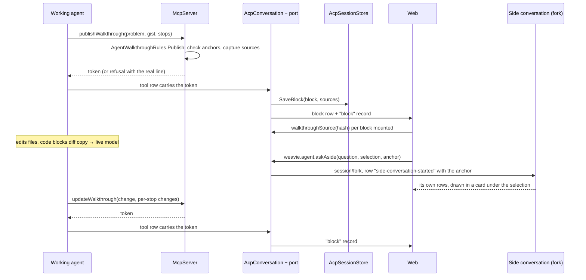

# Code walkthroughs: design

Implements [brief.md](brief.md). The challenge it answers is [challenge.md](challenge.md).

## What changes for the user

An agent can publish a **walkthrough**: a guided read of how some code works. It appears as a card in the agent
pane and opens in an editor tab as one centred column. It starts from the problem and a one-paragraph answer, then
goes through **stops** in the order the code runs. Each stop shows whole functions from the real files, with the
dull parts folded, notes under the lines they describe, and a box saying what a followed example looks like after
that stop. A strip along the bottom lists the stops by name and marks where you are.

With a new setting on (off by default), the agent publishes a walkthrough of the code it is about to change, before
editing it, and updates the same walkthrough afterwards. While it edits, the code blocks show its changes as red and
green lines. After the update, a box at the top says what changed, and each touched stop is tagged *changed*,
*plays out differently* or *new*.

The reader can select any text, prose or code, and ask about it. The answer arrives in a card under the selection,
with Reply and Stop. The working agent is not interrupted.

## How it is built

- **Two new agent tools**, publish and update. The agent sends prose and anchors (file, line range, folds, notes),
  never code. Weavie reads the lines itself.
- **Weavie checks every anchor** against the saved file and refuses a wrong one with the real text of the line, so
  the agent corrects itself. Nothing unchecked is drawn as code.
- **Weavie keeps its own copies** of each cited file, stored beside the walkthrough and deleted with it. Diffs and
  note positions come from these copies, never from the review.
- **A walkthrough is saved the way charts and tables are.** That gives it saving with the conversation, restoring
  after a restart, and removal on `/clear` and Rewind without new machinery.
- **The card and the tab** extend the existing card system with a third kind of card.
- **Code blocks** are small read-only editors on the real file, built from the parts the review uses.
- **Prose is markdown**, drawn by the component that draws agent replies, so a diagram is a Mermaid block and
  needs nothing new.
- **A question is a `/btw` with an anchor.** The selection toolbar and the `/btw` machinery already exist. The new
  part is small: a `/btw` can carry where it was asked, and one asked from a walkthrough is drawn there and not in
  the pane.

## Where the code made the brief awkward

- **There is no read-only review editor to reuse.** The review's diff editor needs a review around it, and its
  read-only mode has never been used. The code block is built from the same lower-level parts the review uses (the
  editor, the red and green painting, line hiding, the fold rows), shared with the review, not copied.
- **A page of whole functions means many editors on one page**, where the first design had one or two. A block
  becomes an editor only as it nears the screen, and holds its place with a measured height before that.
- **The selection toolbar always sends to the main conversation.** It gains one parameter: where Send goes. Replies
  and editors keep today's behaviour; a walkthrough passes "ask a `/btw` about this".
- **A `/btw` cannot be stopped today.** Stop is added for side conversations in general, so `/btw` cards get it too.
- **"The agent already edited this file" has no clean source.** What Weavie reliably knows is whether a file holds
  agent edits you have not kept. The label appears when the walkthrough's first copy of a file was taken in that
  state.
- **The review bar can float over any tab that covers the editor.** It belongs to the editor underneath and sits
  above whatever is drawn over it, which is how it hid the strip in the mockup. The build makes it show only while
  its editor, or a preview of its file, is what the tab displays. That fixes it for every such tab, and a test holds
  a walkthrough tab open over a file under review.
- **A fork taken mid-edit believes its parent was interrupted.** I tested this on real Claude and Codex: the fork
  opens at once while the parent's command is still running, knows everything the parent knew up to that moment,
  and leaves the parent's turn untouched. Both agents tell the fork that the unfinished step was "interrupted",
  though. That is true of every `/btw`, so the side-conversation instructions gain a sentence: the work it came from
  is still running elsewhere and is not its to resume.

## Decisions

- **Questions are answered by a fork, not by the working agent.** Asking never interrupts the work. The cost is
  that the working agent does not see the questions.
- **Stop appears on `/btw` cards too**, since a walkthrough question is one. Steering a working `/btw` is not part
  of this design.
- **Publishing does not open a tab.** The card appears in the pane and is opened when wanted.
- **The setting** is `agent.walkthrough.beforeEditing`.

## Main risks

- **Quality of the read.** Weavie guarantees the code is real, not that the stops are well chosen or the prose is
  right. This form asks more of the agent than the first did: picking whole functions, folding the right parts, and
  following an example whose values Weavie cannot check. The mockup was hand-written on code I knew. The tool
  descriptions and the setting's guidance carry this, and they need tuning against real Claude and Codex.
- **Cost to the working agent.** Writing a walkthrough takes a long tool call before the first edit and another
  after. That is why the setting is off by default.
- **Agents misnumber lines.** Refusals name the exact line and text to keep a retry cheap.
- **Many editors on a page.** Mounted as they near the screen and measured by the editor's render-budget tests.
- **Questions can edit files**, as a `/btw` can. They are told not to.
- **The example's state is unchecked.** It is drawn as prose under a heading, never as code.

## Plan

1. Host: the walkthrough data, checking and copies, storage, publish and update tools.
2. Web: the card, the tab, the reading page and the bottom strip.
3. Web: code blocks with diff, folds and notes.
4. Questions: an anchor on `/btw`, Stop, the selection toolbar's target, and cards under the selection.
5. The setting and its guidance, then a run on real Claude and Codex to tune the wording.
6. End-to-end tests and a proof video.

# Reference for the build

## Flow



## Data formats

### `publishWalkthrough` arguments

```json
{
  "id": "chart-rows",
  "title": "How a chart the agent asks for lands on its own row",
  "problem": "The agent asks for a chart by calling `showBlock`. That call reaches Weavie on one connection…\n\nSo when a tool row arrives, how does Weavie know it is the chart's?",
  "gist": "`showBlock` never draws. It holds the chart under a random ticket and hands the ticket to the agent…",
  "example": "showBlock { id: \"p95\", title: \"p95 latency\", chart: … }",
  "stops": [
    {
      "id": "call-arrives",
      "name": "Call arrives",
      "title": "The call arrives: check it, hold it, answer with a ticket",
      "lead": "The agent calls `showBlock`. This is the whole handler. Read it for what it does not do.",
      "code": [
        {
          "path": "src/Weavie.Core/Mcp/McpServer.BlockTools.cs", "from": 129, "to": 152,
          "folds": [],
          "notes": [
            { "line": 139, "token": "AgentBlockRules.Validate(", "text": "A malformed chart is refused here" },
            { "line": 143, "token": "call.Blocks.Stage(operation) + text", "text": "Held, not drawn. The ticket goes first" }
          ]
        }
      ],
      "state": {
        "cells": [
          { "label": "Waiting for a row", "value": "weavie-block:3f9a… → Show chart \"p95\"" },
          { "label": "Saved", "value": "" },
          { "label": "On screen", "value": "showBlock, running" }
        ],
        "note": ""
      },
      "why": {
        "title": "Why not draw the chart here?",
        "text": "This handler cannot tell which conversation is calling…",
        "source": { "kind": "spec", "ref": "docs/specs/acp-rich-content/design.md" }
      },
      "predict": { "question": "Two charts are requested at once…", "answer": "No. Each result carries its own ticket…" }
    },
    {
      "id": "waiting-room", "name": "Waiting room", "title": "The waiting room", "lead": "…",
      "code": [
        {
          "path": "src/Weavie.Core/Agents/AgentBlockClaims.cs", "from": 11, "to": 90,
          "folds": [{ "from": 17, "to": 54, "label": "Bind, Find, Dashboard, StagedTitle: lookups the owning conversation supplies" }],
          "notes": [{ "line": 13, "token": "_staged = new", "text": "Everything waiting for a row, by ticket" }]
        }
      ]
    }
  ],
  "closing": "## The whole path\n\n```mermaid\nsequenceDiagram\n  …\n```"
}
```

- `problem`, `gist`, `lead`, `why.text` and `closing` are markdown. A diagram is a `mermaid` fence in any of them.
- Required: `id`, `title`, `problem`, `gist`, at least one stop; per stop `id`, `name`, `title`, `lead`, and at
  least one code block. `state`, `why`, `predict`, `example` and `closing` are optional. `example` is required when
  any stop has `state`.
- `name` is the stop's label in the bottom strip.
- `source.kind`: `spec`, `pr`, `commit`, `reading` (the agent's own reading; `ref` omitted).
- An empty `value` in a state cell draws as "nothing".

### `updateWalkthrough` arguments

```json
{
  "id": "chart-rows",
  "change": "showBlock with an id that is already on screen now replaces that chart.",
  "stops": [
    { "id": "committing", "effect": "changed",
      "note": "Was: showing an id that is already on screen changed nothing. Now it replaces that chart.",
      "code": ["… every block of the stop, recorded against the edited files …"],
      "predict": { "question": "…", "answer": "One chart, holding the second call's data." } },
    { "id": "row-becomes-chart", "effect": "affected",
      "note": "This code was not edited. A show is never refused at the end of it any more.",
      "code": ["… the same anchors, one note reworded …"] },
    { "id": "replace-row", "after": "committing", "name": "Old row goes", "title": "…", "lead": "…", "code": ["…"] }
  ]
}
```

Each entry of `stops` is one operation.

- A known `id` patches that stop. It needs `effect` (`changed`: its explanation changed; `affected`: its code is
  untouched but plays out differently) and `note`. Each other field given replaces the field; `code` replaces all
  of the stop's blocks.
- An unknown `id` adds a stop and needs every publish field. `after` names the stop it follows; without it the stop
  goes last. It is tagged *new*.
- `change` is required: one or two sentences on what the agent changed. `problem`, `gist`, `example` and `closing`
  replace their fields when given, and may not be empty. `title` is set when publishing and refused on update.

### Tool results

```text
weavie-block:3f… Walkthrough 'chart-rows' is shown to the user. After you change the code it explains, call
updateWalkthrough: patch every stop the change alters, including stops whose code you did not touch, and add
stops for what you found while editing.

weavie-block:9a… Walkthrough 'chart-rows' is updated; the user sees which stops changed.
```

Refusals (tool errors, nothing staged):

```text
stops[1].code[0].notes[0]: line 13 of 'src/Weavie.Core/Agents/AgentBlockClaims.cs' does not contain
'_staged = new'. Line 13 is "private readonly Lock _gate = new();". '_staged = new' is on line 14.

stops[0].code[0]: lines 129-152 are outside 'src/…/McpServer.BlockTools.cs', which has 120 line(s).
stops[1].code[0].folds[0]: lines 17-95 are outside the block's lines 11-90.
stops[1].code[0].notes[2]: line 40 is inside the fold at lines 17-54. A note sits on a line that is shown.
Walkthrough 'chart-rows' does not exist in this conversation. Publish it with publishWalkthrough.
stops[2]: stop 'gone' does not exist, so it needs 'name', 'title', 'lead' and 'code' to be added.
stops[0]: a stop that exists is changed with 'effect' ('changed' or 'affected') and a 'note'.
```

### Stored block (`blocks.state`, also the `block` wire record's `block`)

```json
{
  "id": "chart-rows",
  "title": "How a chart the agent asks for lands on its own row",
  "updatedAtMs": 1795600000000,
  "walkthrough": {
    "root": "/home/me/repo/worktree",
    "problem": "…", "gist": "…", "example": "…", "closing": "…",
    "change": "showBlock with an id that is already on screen now replaces that chart.",
    "files": [
      { "path": "src/Weavie.Core/Agents/AgentBlockRules.cs", "before": "<sha256>", "after": "<sha256>", "late": false }
    ],
    "stops": [
      { "id": "committing", "name": "Committing", "title": "…", "lead": "…",
        "effect": "changed", "note": "Was: …",
        "code": [{ "path": "…", "from": 82, "to": 106, "source": "<sha256>",
          "folds": [{ "from": 86, "to": 105, "label": "…" }],
          "notes": [{ "line": 85, "token": "return show.Block;", "text": "A show always applies now", "was": "Showing an id that is already on screen gives nothing back" }] }],
        "state": { "cells": ["…"], "note": "…" }, "why": { "…": "…" }, "predict": { "…": "…" } }
    ]
  }
}
```

- `root`: the worktree the paths are relative to, so the page can open the live file.
- `files[].before`: the first copy the walkthrough recorded of that path. `after`: the file as it stood at the last
  update; absent until the first update. `late`: the first copy was taken while the file held unkept agent edits.
- `code[].source`: the copy the block's lines, folds and notes were checked against.
- `effect`: `changed`, `affected` or `added`; absent on a stop no update touched. `change`: absent until the first
  update.
- `notes[].was`: the text of the note the stop held before the patch on the same `path` and `token`, when it
  differs. Weavie sets it; the agent does not send it.

### Pane rows

| Row | Fields |
| --- | --- |
| Walkthrough's reference row | `type: item-completed`, `itemType: block`, `category: walkthrough`, `summary: <title>`, `blockId` |
| Card collapsed or expanded | `type: block-collapsed`, `blockId`, `status: collapsed \| expanded` (the reference row's identity, no text) |
| Question asked | the existing `side-conversation-started` row, with `anchor: { conversationId, blockId, place, quote }` |

`anchor` is a new `AgentPaneMessage` field (`AgentAsideAnchor`), also on the pane wire row. `conversationId` is the
walkthrough's conversation, null for the primary. `place` is `problem`, `gist`, `closing`, `<stop>/lead`,
`<stop>/state`, `<stop>/why`, `<stop>/predict`, or `<stop>/code/<block index>/<line>@<copy>` with the line numbered
in the block's recorded copy, which `<copy>` names (the first 12 characters of its hash). `quote` is one line of up to
200 characters. The host checks the place's characters and length and the quote's length; the page reads them. Every
later row of the conversation (`side-conversation-closed`, `-failed`, `-collapsed`, its own transcript) is
unchanged.

### Commands and session messages

| Name | Kind | Payload | Reply |
| --- | --- | --- | --- |
| `weavie.agent.askAside` | existing command | `AgentAsideCommand` gains `Anchor: { blockId, place }` | none |
| `weavie.agent.stopAside` | web command, unbound; Stop on a BTW card runs it | `{ conversationId? }`, else the focused BTW card | none |
| `stopAside` (`agent` feature) | handle, action failed "Stopping the side conversation" | `{ conversationId }` | none |
| `walkthroughSource` (`agent` feature) | concurrent request, action failed "Loading walkthrough code" | `{ conversationId, blockId, hash }` | `{ text }` |
| `setCardCollapsed` (`agent` feature) | existing | gains `blockId` | none |

### Limits (`AgentWalkthroughLimits`)

Stops 24, code blocks per stop 6, lines per block 400, folds per block 12, notes per block 24, state cells 4,
`name` 24 characters, `title` and a note 200, a state value 300, other text 4,000, a cited file 2 MB. The tool
schema states them; a request over one is refused with the number, as blocks are.

## Types

### `Weavie.Core/Agents` (new `AgentWalkthrough.cs`, `AgentWalkthroughRules.cs`, `WalkthroughCapture.cs`)

```csharp
public sealed record AgentWalkthrough {
	public required string Problem { get; init; }
	public required string Gist { get; init; }
	public string? Example { get; init; }
	public string? Closing { get; init; }
	public string? Change { get; init; }
	public required IReadOnlyList<AgentWalkthroughStop> Stops { get; init; }
	public required IReadOnlyList<AgentWalkthroughFile> Files { get; init; }
}
public sealed record AgentWalkthroughFile { Path, Before, After?, Late }
public sealed record AgentWalkthroughStop { Id, Name, Title, Lead, Code, State?, Why?, Predict?, Effect?, Note? }
public sealed record AgentWalkthroughCode { Path, From, To, Source, Folds, Notes }
public sealed record AgentWalkthroughFold { From, To, Label }
public sealed record AgentWalkthroughNote { Line, Token, Text, Was? }
public sealed record AgentWalkthroughState { Cells, Note? }             // Cells: Label, Value
public sealed record AgentWalkthroughWhy { Title, Text, Source }        // Source: Kind, Ref?
public sealed record AgentWalkthroughPredict { Question, Answer }

// What the tools deserialize: the same shapes without Source/Before/After/Late/Was.
public sealed record AgentWalkthroughRequest { Id, Title?, Problem?, Gist?, Example?, Closing?, Change?, Stops }
public sealed record AgentWalkthroughStopRequest { Id, After?, Name?, Title?, Lead?, Code?, State?, Why?, Predict?, Effect?, Note? }
```

Changed:

- `AgentBlock` gains `AgentWalkthrough? Walkthrough`. `Kind` becomes
  `Chart is not null ? "chart" : Table is not null ? "table" : "walkthrough"`.
- `AgentBlockOperation.Show` gains `IReadOnlyDictionary<string, string> Sources` (hash → text; empty for charts and
  tables). New `AgentBlockOperation.Walkthrough(string Id, IReadOnlyList<AgentWalkthroughChange> Changes,
  IReadOnlyDictionary<string, string> Sources)`.
- `AgentWalkthroughChange`: `SetText(problem, gist, example, closing, change)`, `AddStop(stop, after)`,
  `PatchStop(id, request, code)`, `RecordFiles(files)`.
- `AgentBlockRules.Apply` routes a `Walkthrough` operation to `AgentWalkthroughRules.Apply`. `UpdateTitle()` also
  matches `updateWalkthrough`, so its in-flight row is hidden like `updateBlock`'s.
- `AgentBlockJson` adds `AgentWalkthroughRequest` and `AgentWalkthroughStopRequest`.
- `AgentCardRef(string? ConversationId, string? DashboardId, string? BlockId)`.
- `AgentPaneMessage` gains `string? Anchor`.
- `AgentTurnSubmission` gains `AgentAsideAnchor? Anchor`, with `public sealed record AgentAsideAnchor(string
  BlockId, string Place, string Quote)`. `AskAside` reads it; every other consumer ignores it.
- `IStructuredAgentSideConversations` gains `void StopAside(string conversationId);`.
- `IAgentSession.cs` adds:

```csharp
/// <summary>The code a structured agent session's walkthroughs recorded.</summary>
public interface IStructuredAgentWalkthroughs {
	/// <summary>The copy <paramref name="hash"/> names, as walkthrough <paramref name="blockId"/> recorded it.</summary>
	string Source(string? conversationId, string blockId, string hash);
}
```

### `Weavie.Core` elsewhere

- `Weavie.Core/FileSystem/WorktreeTextFile.cs` (new): the path checks `ReviewHintStore.Capture` makes today
  (`AgentPath.Resolve`, `PathBoundary.Contains`, exists, is text), returning the worktree-relative path and text or
  the refusal. `ReviewHintStore.Capture` and `WalkthroughCapture` both call it. `ReviewHintStore.Hash` moves there
  as `WorktreeTextFile.Hash`.
- `WalkthroughCapture(IFileSystem fileSystem, string worktreeRoot, Func<string, bool> hasUnkeptAgentEdits)`: reads a
  cited file once per tool call and answers `Read(path) → (relative, text, hash, late) | refusal`.
- `SessionChangeTracker.HasPendingAgentLines(string path)` (new, public): `_provenance[path].HasPending` under
  `_gate`.
- `McpCapabilities` gains `required WalkthroughCapture Walkthroughs`. `HostSession` builds it beside `ReviewHints`
  with `Changes.HasPendingAgentLines`.
- `AgentSettings.WalkthroughBeforeEditing = "agent.walkthrough.beforeEditing"`, registered in `CoreSettings` as
  `SettingKind.Bool`, `SettingOwner.Machine`, `ApplyMode.Live`, default `false`.
- `EmbeddedAgentGuidance.Compose(HostRuntimeInfo runtime, bool walkthroughBeforeEditing)`; `ClaudeIdeIntegration`
  passes `false`. `SideConversationInstructions` gains the sentence in "Questions" below.

### `Weavie.AgentClientProtocol`

- `AcpConversationPort.CommitBlock` passes the operation's sources to
  `OnCommitBlock(state, block, sources, rows)`.
- `AcpAgentSession.SideConversations.cs`: `AskAside` carries the submission's anchor onto the side conversation and
  its started row; `StopAside`; `SetCardCollapsed` accepts a `BlockId`.
- `AcpAgentSession.Walkthroughs.cs` (new partial): implements `IStructuredAgentWalkthroughs.Source`.
- `AcpSessionStore.Blocks.cs`: `SaveBlock(workspace, state, sources)`, `ReadBlockSource(providerId, workspace,
  conversationId, blockId, hash)`, source deletes in `DeleteBlock`, `PruneBlocks` and `ClearWorkspace`.

### Web (`src/web/src`)

```ts
// messaging/protocol-types.ts
export interface AgentBlock { id; title; updatedAtMs?; chart?; table?; walkthrough?: AgentWalkthrough | null }
export interface AgentWalkthrough { problem; gist; example?; closing?; change?; stops: WalkthroughStop[]; files: WalkthroughFile[] }
// … mirrors of the stored shapes above …
// AgentPaneUpdate gains anchor?: string | null

// editor/tab-entry.ts
export type AgentCardRef = … | { kind: "walkthrough"; conversationId: string | null; blockId: string };
// cardTabPath: "walkthrough:<id>@<conv>"

// agent/selection-actions.tsx
export interface SelectionTarget { send(selection: AgentSelection, comment: string): string }   // returns the submission id
export function createSelectionActions(host: HTMLElement, session: ClientSession, target: SelectionTarget)

// agent/walkthrough/walkthrough-questions.ts
export interface WalkthroughQuestion { conversationId: string; place: string; quote: string; entry: AgentTranscriptEntry }
export function walkthroughQuestions(session: ClientSession, card: AgentCardRef): WalkthroughQuestion[];

// agent/walkthrough/walkthrough-view.ts — per tab, round-tripped through the tab's view state
export interface WalkthroughViewState { stopId: string | null; read: string[]; openFolds: string[]; revealed: string[] }
```

`TabKind` (`editor/session-types.ts`) and its host mirror gain `"walkthrough"`.

## Components

### Checking and capture (`AgentWalkthroughRules`)

```text
Publish(request, current, capture) → Show(block, sources)
  refuse if current exists, id/title invalid, limits exceeded, stop ids repeat, a required field is missing,
            a stop has state but the walkthrough has no example
  for each stop: Stop(request, capture, files, sources)
  block.Walkthrough = { problem, gist, example, closing, stops, files }

Stop(request, capture, files, sources)
  for each code block:
    (relative, text, hash, late) = capture.Read(block.Path)       // WorktreeTextFile refusals pass through
    1 ≤ from ≤ to ≤ lines, to − from < Lines                      else refuse with the line count
    folds: inside from..to, after its first line, not touching   else refuse with the block's range
    for each note: from ≤ line ≤ to, outside every fold, and lines[line].Contains(token, Ordinal)
                                                                  else refuse with that line's text and the
                                                                  lines in the block that do contain the token
    sources[hash] = text
    files.TryAdd(relative, { before: hash, late })                // the first copy of a path wins
    block.Source = hash

Update(request, current, capture) → Walkthrough(id, changes, sources)
  refuse if current is null or not a walkthrough, or change is missing
  known id   → PatchStop: effect and note required; fields given replace; code checked as above
  unknown id → AddStop: all publish fields required; after must name a stop that exists or is added earlier
  RecordFiles: for every path in current.Files ∪ new files: capture.Read → After = hash, sources[hash] = text
               a file that no longer exists gets After = "" (the page shows "deleted since")

Apply(current, operation, nowMs) → block or null
  changes apply in order to the walkthrough as it stands now
  PatchStop on a stop that no longer exists → null (the whole operation is dropped, as block updates are)
  PatchStop with code: each new note takes Was from the old note on the same path and token whose text differs
  AddStop: placed after its `after` stop, else last; Effect = "added"; an id already present → null
  RecordFiles: Before and Late are kept for known paths; After replaced
  UpdatedAtMs = nowMs
```

Validation reads the block at the call and `Apply` runs at the commit, as for charts.

### Tools (`McpServer.WalkthroughTools.cs`, new)

- `publishWalkthrough` and `updateWalkthrough` join `BlockToolEntries`, so only a conversation that can show blocks
  sees them. Their schemas are built from `AgentWalkthroughLimits` and the rules' value sets, like
  `BlockSchemas()`.
- Both stage through `call.Blocks.Stage(operation)` and return the token, exactly as `showBlock` does. The
  conversation claims the row in `AcpConversation.ClaimBlock`, unchanged except that a claimed `Walkthrough`
  operation takes the update branch (the row is retracted).
- The tool description is where the form is taught. It says: a walkthrough is a guided read for someone who has not
  seen this code. Open with the problem the code solves and the question it raises, then answer it in one paragraph.
  Go through the code in the order it runs, a stop per step. Show whole functions or types, never excerpts; fold
  what is not the point and say in the fold's label what it holds. Put a note under each line that matters, in plain
  words, naming the token it is about. Follow one concrete example through every stop and state what it looks like
  after each. Say why the code is built this way where the code shows it, and cite where you learned that, or mark
  it as your own reading. Send anchors, never code.

### Storage (`AcpSessionStore`)

```sql
CREATE TABLE IF NOT EXISTS block_sources (
  owner TEXT NOT NULL, conversation TEXT NOT NULL, block TEXT NOT NULL, hash TEXT NOT NULL, text TEXT NOT NULL,
  PRIMARY KEY(owner, conversation, block, hash));
```

`SaveBlock` inserts the new sources (`INSERT OR IGNORE`), then deletes this block's sources whose hash the saved
block no longer names (`files[].before`, `files[].after`, `code[].source`), in the same `Execute`. `DeleteBlock`,
`PruneBlocks` and `ClearWorkspace` delete a block's sources with the block. Sources never enter
`ConversationOutput` or the wire record; the page asks for one by hash.

### Questions (a `/btw` with an anchor)

```text
AskAside(submission)                                   // AcpAgentSession.SideConversations.cs, as today, plus:
  anchor = submission.Anchor
  if anchor is set: _primary's view has block anchor.BlockId with a walkthrough     else refuse
                    "That walkthrough is no longer shown."
  the side conversation keeps the anchor; SideMarker sets BlockId, Anchor = Place, Summary = Quote
  the prompt sent to the fork is headed, by Weavie:
      The user is reading the walkthrough "<title>"<, at stop n, "<stop title>">, and selected:
      <quote>

StopAside(conversationId)                              // new, for every side conversation
  _sides[conversationId].Conversation.Interrupt()      // unknown id, or not working → nothing
```

- Everything else is a `/btw`: `SidePort`, the kept continuation, `ReplyAside`, `SuspendSides`, restore after a
  restart, the load-time cleanup of a started row with no kept continuation, Rewind refusing while one works, and
  the session it is to other agents.
- **Fork source**: the primary conversation, as for every `/btw`. A walkthrough is always the primary's: blocks
  from subagents are not shown.
- **Instructions**: `SideConversationInstructions` gains: "The conversation you were forked from is still running
  elsewhere. Ignore any note that a tool call or turn was interrupted, and never resume, re-run or check on that
  work. Do not edit, create or delete files unless the user asks you to in this conversation."
- **Collapse**: a question is drawn as a `/btw` card (`AsideEntry`); collapsing it leaves its head under the text,
  and a request waiting on the user still shows in it.
- **Collapse of the walkthrough's own card**: `SetCardCollapsed` with a `BlockId` finds the block's reference row
  and publishes it as `block-collapsed`, as dashboards do with `dashboard-collapsed`.

### Guidance

When `agent.walkthrough.beforeEditing` is on, `Compose` appends:

```text
Before you edit code for a task, once you understand the code you are about to change, publish a walkthrough of
how it works today with mcp__weavie__publishWalkthrough. Do this once per task, before your first edit to that
code. When your edits are done, call mcp__weavie__updateWalkthrough on the same walkthrough: say what you changed,
patch every stop the change alters, including stops whose code you did not touch, record their code again
against the edited files, and add stops for what you found while editing.
```

Guidance is sent once per conversation, so a change applies from the next conversation.

### Web: pane card (`src/web/src/agent/walkthrough/`)

- `AgentPaneBlocks.take`: a block row with `category === "walkthrough"` becomes an entry of kind `walkthrough`
  (a card; `isCard` and `cardIndexes` include it), and `block-collapsed` sets `asideCollapsed`.
  `AgentTranscriptEntry.block.kind` gains `"walkthrough"`.
- `AgentConversationProjection.publish`: a `side-conversation-started` row with `blockId` set registers its
  conversation and produces no transcript entry, so the question is not in the pane or its strip.
  `walkthroughQuestions` builds the same `sideConversationEntry(origin, messages, project)` for it.
- `WalkthroughCard.tsx`: `AgentCardShell` labelled `Walkthrough · <title>`, an Open action, the short version, and
  one `.ui-row` per stop (number, title, effect tag). A row opens the tab at that stop. When a question of this
  walkthrough waits on the user, one more row says so and opens the tab at its card.

### Web: the reading tab

`WalkthroughTab.tsx` (lazy, in `TabContent` for kind `walkthrough`, inside `AgentCardTabFrame`).

- **One column**, `max-width: 900px`, centred, scrolling with the tab.
- **Header**: title; `problem`; "The short version" with `gist`; `example` in the mono face when set. After an
  update, an "Updated after the change" box: `change`, then a `.ui-row` per stop with an `effect`, with its tag.
- **Each stop** (`WalkthroughStop.tsx`): "Stop n of N", title, the effect tag with `note`, `lead`, its code blocks,
  "After this stop" (the state cells in a row, then `state.note`), the why box (title, text, source), and "Before
  you read on" (the question and Show the answer).
- **`closing`** after the last stop.
- **Prose** is drawn by `AgentMarkdown` with `renderMermaid` on, so backticks, links and Mermaid fences behave as
  in a reply.
- **Bottom strip** (`WalkthroughStrip.tsx`): `position: sticky; bottom: 0` inside the tab, the column's width.
  Previous and next (`.ui-stepper`), then one button per stop: its number and `name`, the current one lit, read ones
  marked, an orange dot for `changed`, blue for `affected`, green for `added`. A button's tooltip is the stop's
  title. The current stop is the last whose heading has passed the top third of the tab, reported by an
  IntersectionObserver; `read` grows as stops become current. A stop or card scrolled to stays at the top while the
  blocks above it mount, until the reader scrolls.
- **Commands** (client, unbound, in the palette): `weavie.walkthrough.nextStop`, `weavie.walkthrough.previousStop`.
  They act on the focused walkthrough tab through `ownCommand`, as `weavie.agent.attachBlock` does, and the strip's
  buttons show their binding when one is set. `weavie.agent.openCard` and `weavie.agent.toggleAside` accept the new
  card kind. `TabStrip` names the tab by the walkthrough's title, with its own icon.

### Web: asking from a selection (`walkthrough-selection.ts`)

- `createSelectionActions` takes a `SelectionTarget`. `installReplySelection` and `connectSelectionActions` pass
  today's `sendAgentSelection`; nothing changes for them.
- The walkthrough's target runs `weavie.agent.askAside` with the comment as the question, the selection, and
  `Anchor: { blockId, place }`. Add to context still attaches the selection to the main composer.
- **Prose**: one `selectionchange` listener on the page, as `installReplySelection` has. The place is the nearest
  ancestor's `data-place` (`problem`, `gist`, `<stop>/lead`, …).
- **Code**: each block's editor reports its selection (`onDidChangeCursorSelection`) with
  `selectionExcerpt(model, selection)`. The place is `<stop>/code/<index>/<line>`, the selection's last line mapped
  back to the block's recorded copy.
- **Cards**: `walkthroughQuestions` groups the questions by place. Under prose a card is a DOM sibling of its
  paragraph. Under code it is a zone card (`createZoneCards`, as inline replies use) below its line. The card is
  `AsideEntry`'s body: `AgentCardShell` with the question as its head, the quote on one line, `NestedTranscript`,
  and `AgentCardReplyBox` over `replyComposer(session, conversationId)`. While `sideConversationState(…).active`,
  the head shows Working and a Stop icon (`stopAside`); the same Stop is added to `AsideEntry` for `/btw` cards.
- The quoted text stays lit while its card is drawn: a decoration in code, a `<mark>` in prose when the quote is
  still found there.
- A place that no longer resolves (the stop was patched, the line is gone) puts the card at the end of its stop,
  or of the walkthrough, with "Asked about text that has since changed".
- Selection actions are disabled with a tooltip when the agent has no `/btw` entry in its slash commands.

### Web: code block (`src/web/src/agent/walkthrough/walkthrough-code.ts`)

```text
createWalkthroughCode(session, mount, code, file, view) → { dispose }
  until mount is within one viewport of the screen: a placeholder as tall as its shown lines; then:
  model   = files.stat(root/path).exists ? scope.open(root/path) : the tab's one copy per path and recorded text,
            notice "Deleted since this walkthrough recorded it"
  editor  = createEmbeddedEditor(mount, model, …, { readOnly: true, minimap off, folding off, sticky scroll off,
            wordWrap: "on", wrappingIndent: "deepIndent", scrollBeyondLastLine: false,
            scrollbar: { handleMouseWheel: false, alwaysConsumeMouseWheel: false } })
  before  = source(file.before), copy = source(code.source), after = file.after && source(file.after)
  refresh (on the model's settled content, debounced like the inline diff):
    markers = computeDiffMarkers(DiffComputer.compute(uri, { original: before }, model))
    paint markers' decorations, addDiffZones(editor, accessor, markers)            // red ghosts, green lines
    map     = diffLines(copy, model text); line(n) = mapLine(map, n)
    shown   = line(from)..line(to), minus each fold the reader has not opened
    hiddenAreas(editor).setHiddenAreas(everything else, "weavie.walkthrough")
    cards   → one createZoneCards layer (as inline replies use) holds every row between lines; under a line whose
              next one is hidden, a card hangs after the line's last character (`afterColumn`), since Monaco
              draws a zone only when the position after it is visible:
              a closed fold's "<N> lines · <label>", an open fold's "Hide", each note (and "Was: …"), and each
              question asked about a line.
    notes   → for each note whose line maps exactly and still contains its token:
                inlineClassName "walkthrough-mark" on the token, and its card under the line
              any other note is not drawn and the block says "A noted line changed"
    notices: file.late → "Recorded after edits to this file began"
             after && model text !== after → "Changed since this walkthrough was updated"
             diffLines throws → no diff or notes; the copy's lines are shown with "Too large to compare"
  height = editor.getContentHeight() on onDidContentSizeChange
```

- Shared with the review: `EditorHost.createReviewCopyScope` is renamed `createFileModelScope`, and the diff paint
  is the review's own `computeDiffMarkers` and `addDiffZones`. Fold rows are zone cards, so the review's gap rows
  stay where they are.
- Sources are fetched once per hash through `walkthroughSource` and cached per session.
- Hover and go to definition come from the model's `weavie-file` scheme. The block does not call
  `connectTextEditor`, so it gets no blame, hints, spell check or review actions.
- A mounted block stays mounted until the tab closes.

### The review bar

`toolbarHost` in `editor-controller.ts` returns the editor's DOM node whenever the editor's connection is live, so
the bar can float over a tab that covers the editor. It returns the node only when `active()` holds (the editor is
displayed, or a preview is reviewing its model) and null otherwise; `refreshPresentation` already removes the bar
on null. This is for every overlay tab, not walkthroughs alone.

## Fork test

Run during design against `@agentclientprotocol/claude-agent-acp` 0.109.0 and `@agentclientprotocol/codex-acp`
2.8.0, with the `session/fork` then `session/load` sequence Weavie sends, five seconds into a 45-second shell
command and again with the parent idle.

| | Claude | Codex |
| --- | --- | --- |
| Fork mid-tool-call | Opened in 341 ms, not blocked | Opened in 33 ms, not blocked |
| What the fork knew | The task, the file read so far and its content | The same |
| Parent's turn | Command finished on time, `end_turn` | The same |
| Ran alongside the parent | Fork answered 33 s before the parent's command ended | 35 s before |
| The unfinished call in the fork | Closed with a synthetic "interrupted" result and a "No response requested." reply | A `turn_aborted` note; the call is absent from the replay |
| Model and effort | Adapter default, not the parent's | Adapter default, not the parent's |

Not tested: a fork while the model is streaming text, while a permission request is pending, or through Weavie's
own client (the probe sent no MCP server and did not re-apply controls).

## Error handling

| Situation | Handling |
| --- | --- |
| Bad anchor, fold or note, limit exceeded, malformed arguments | Tool error with the path into the arguments, the reason and the real text; nothing staged |
| Agent never reports the tool row | Existing notice: the block "was not shown" (`ClaimBlock`'s unclaimed path) |
| Update whose stop vanished before the commit | Existing notice: "changed or was removed before this update landed" |
| Storage failure | Existing `ArchiveFailed` path; the block is not committed |
| Question refused at start (no fork support, rewinding, clearing, walkthrough gone) | The `askAside` command fails with the reason as a toast; selection actions are disabled where the page can know first |
| Question fails or its agent restarts | The existing `side-conversation-failed` row; the card shows it, as a `/btw` card does |
| Question needs a permission | The request is drawn in the card's transcript and answered there; the pane card says a question is waiting |
| Source request for an unknown hash | The request throws; the block shows "This code is no longer stored" |
| A Mermaid block fails | `AgentMarkdown`'s existing error display |
| Cited file deleted, changed, or too large to diff | The block's notices above |
| A question's place no longer resolves | The card moves to the end of its stop or of the walkthrough and says so |

## Testing

- **Core unit** (`tests/Weavie.Core.Tests`): `AgentWalkthroughRulesTests` (every refusal's text, first copy wins,
  folds and notes checked, add versus patch, `Was` taken from the old note, `Apply` in order and on a vanished
  stop); `WalkthroughCaptureTests` (outside the worktree, binary, missing, late); `RegistryMcpTests.Walkthroughs`
  (tools listed only for a bound grant, schema limits); `AgentBlockTests` for `Kind`.
- **Hosting** (`tests/Weavie.Hosting.Tests`, `AcpAgentSessionFixture` and the fake agent's `block:<relay>:<tool>:`
  drafts): `AcpWalkthroughTests` (publish becomes a block row for the claude and codex relays; update retracts its
  row; sources saved, pruned on update, deleted on `/clear` and Rewind; restore after restart); side-conversation
  tests gain: an anchored ask sets `blockId`, `anchor` and `summary` on its started row; an anchor naming a block
  that is gone is refused; `StopAside` interrupts a working side conversation and leaves the primary's turn
  running; the anchor survives a restart.
- **Web unit**: `AgentPaneBlocks.test.ts` (walkthrough entry, collapse); `AgentConversationProjection` (an anchored
  aside is not in the pane); `walkthrough-questions.test.ts` (grouping by place, a place that no longer resolves);
  line mapping, shown-range and fold computation; selection actions with a target.
- **e2e functional** (`src/web/e2e/functional/walkthroughs.spec.ts`, fake agent): publish → card → tab; a fold
  opens; notes sit under their lines; the strip follows scrolling and jumps; the fake edits a file → red and green
  lines; update → the top box, tags and strip dots; select prose and select code → comment → card under the
  selection → reply; Stop; a walkthrough tab over a file under review shows no review bar. `pnpm e2e:perf` for the
  `src/web/src/editor` changes, plus a budget case that scrolls a walkthrough of twelve blocks.
- **Real agents**: with the setting on, one task each on Claude and Codex: publish before editing, edit, update, a
  question mid-edit. Tool descriptions and guidance are tuned from these runs.

## Files that change

| File | Change |
| --- | --- |
| `src/Weavie.Core/Agents/AgentWalkthrough.cs` (new) | Stored and request types, limits |
| `src/Weavie.Core/Agents/AgentWalkthroughRules.cs` (new) | Publish, Update, Apply |
| `src/Weavie.Core/Agents/WalkthroughCapture.cs` (new) | Reads and hashes cited files |
| `src/Weavie.Core/FileSystem/WorktreeTextFile.cs` (new) | Shared path and text checks, hash |
| `src/Weavie.Core/Review/Hints/ReviewHintStore.cs` | Uses `WorktreeTextFile` |
| `src/Weavie.Core/Agents/AgentBlock.cs`, `AgentBlockRules.cs` | `Walkthrough`, `Kind`, operation variants, `Apply` routing, update title |
| `src/Weavie.Core/Agents/AgentDashboards.cs`, `IAgentSession.cs`, `AgentPaneMessage.cs`, `AgentTurnSubmission.cs` | `AgentCardRef.BlockId`, `IStructuredAgentWalkthroughs`, `StopAside`, `Anchor` |
| `src/Weavie.Core/Changes/SessionChangeTracker.Corrections.cs` | `HasPendingAgentLines` |
| `src/Weavie.Core/Mcp/McpServer.WalkthroughTools.cs` (new) | Two tools and schemas |
| `src/Weavie.Core/Mcp/McpServer.cs`, `McpCapabilities.cs` | Dispatch, capture |
| `src/Weavie.Core/Mcp/EmbeddedAgentGuidance.cs`, `Agents/Claude/ClaudeIdeIntegration.cs` | Setting guidance, side-conversation sentence |
| `src/Weavie.Core/Configuration/AgentSettings.cs`, `CoreSettings.cs` | The setting |
| `src/Weavie.Core/Sessions/AcpSessionStore.cs`, `AcpSessionStore.Blocks.cs` | `block_sources` |
| `src/Weavie.AgentClientProtocol/AcpAgentSession.Walkthroughs.cs` (new) | `Source` |
| `src/Weavie.AgentClientProtocol/AcpAgentSession.SideConversations.cs`, `AcpAgentSession.Conversations.cs` | Anchor on ask and marker, `StopAside`, block collapse |
| `src/Weavie.AgentClientProtocol/AcpConversationPort.cs`, `AcpConversation.Blocks.cs`, `AcpConversation.PromptBuilder.cs` | Sources on commit, walkthrough claim branch, setting, ask heading |
| `src/Weavie.Hosting/HostSession.cs`, `HostSession.Messages.cs`, `HostCore.Sessions.cs`, `Agents/AgentSessionHost.cs`, `Messaging/WireJson.cs` | Capture wiring, `stopAside`, `walkthroughSource`, anchor on `AgentAsideCommand` |
| `src/web/src/messaging/protocol-types.ts`, `editor/session-types.ts`, `editor/tab-entry.ts` | Types, tab kind, card ref |
| `src/web/src/agent/AgentPaneBlocks.ts`, `AgentConversationProjection.ts`, `AgentTranscriptEntry.tsx`, `agent-cards.ts`, `card-tab.ts`, `AgentPaneEstimate.ts`, `AgentTranscriptSnapshot.ts` | Walkthrough entry, anchored aside kept out of the pane, card plumbing |
| `src/web/src/agent/selection-actions.tsx`, `agent-reply-selection.ts`, `editor/editor-selection-actions.ts`, `agent/composer-store.ts` | `SelectionTarget`, ask with an anchor |
| `src/web/src/agent/AgentAsideEntry.tsx` | Stop while working; body shared with the walkthrough's cards |
| `src/web/src/agent/walkthrough/*` (new) | Card, tab, stop, strip, code block, selection, questions, view state, CSS |
| `src/web/src/editor/TabContent.tsx`, `TabStrip.tsx`, `App.tsx`, `commands/types.ts` | Tab body, label, commands |
| `src/web/src/editor/editor-host.ts`, `review/*`, `editor-controller.ts` | Renamed model scope, review bar host |
| `docs/concepts/…`, `AGENTS.md` | One-line concept entry linking this spec |

## Risks

| Risk | Handling |
| --- | --- |
| Agents write a weak read: wrong stops, snippets in place of functions, prose that restates code | The tool description teaches the form; tuned on real agents; whole-function ranges are the default the schema describes |
| Agents misnumber lines | Refusals quote the line and list where the token is |
| The example's state is wrong | Drawn as prose under "After this stop"; out of scope to verify (brief) |
| A walkthrough costs the working agent time and tokens | Off by default; published once per task |
| Many editors in WebKit | Mounted as they near the screen; a render-budget case for a twelve-block walkthrough |
| A long function makes a long page | 400 lines per block, folds, and the strip to move between stops |
| Fork taken inside a tool call copies broken history | Observed fine on both agents (see Fork test); the side-conversation instructions cover the synthetic interruption |
| A fork opens on the adapter's default model and effort | `SidePort.OnControlDefaults` already returns the primary's live controls; confirmed in the real-agent run |
| A question edits files | Instructions forbid it; trust equals `/btw` (brief decision 10) |
| Many questions clutter the session list other agents see | Each is a `/btw`, as today; dismissing one collapses it |
| Zone cards and text zones inside read-only embedded editors behave differently from full editors | Inline replies already run zone cards with a reply box; covered by the e2e spec on both |
| Review regressions from the shared gap rows, model scope and bar host | Existing review specs plus `pnpm e2e:perf` |
| Source rows grow in long sessions | Pruned on every save to what the block names; deleted with the block |
| A walkthrough survives Rewind with its post-edit state | Stated in the brief; unchanged block behaviour |

## Build checklist

- [x] `WorktreeTextFile`; `ReviewHintStore` on it; hint tests still pass
- [x] Walkthrough types, limits, `AgentBlock.Walkthrough`, `Kind`
- [x] `WalkthroughCapture`, `SessionChangeTracker.HasPendingAgentLines`, `McpCapabilities` wiring
- [x] `AgentWalkthroughRules` Publish, Update, Apply with unit tests
- [x] Operation variants; sources through `CommitBlock` and `OnCommitBlock`
- [x] `block_sources` table, save, prune, delete, read
- [x] `publishWalkthrough` and `updateWalkthrough` tools, schemas, dispatch, hidden update row
- [x] `walkthroughSource` request; `AgentCardRef.BlockId` and `block-collapsed`
- [x] Hosting tests for publish, update, storage
- [x] Web types, walkthrough entry, pane card, tab kind, tab body, commands
- [x] Reading page: header, stops, state, why, predict, closing, the update box and tags
- [x] Bottom strip: current, read, effect dots, previous and next
- [x] `createFileModelScope`; review specs and `pnpm e2e:perf` pass
- [x] Code block: deferred mount, diff, folds, notes, notices
- [x] Review bar hosted only while its editor is displayed
- [x] `AgentAsideAnchor` on the command, the submission and the started row
- [x] `StopAside`, `stopAside`, Stop on walkthrough question cards
- [x] Selection Send target; walkthrough selection in prose and in code; cards under the selection
- [x] Hosting and web tests for anchored asks and Stop
- [x] The setting, guidance, `Compose` callers, the side-conversation sentence
- [x] `walkthroughs.spec.ts`
- [ ] Real Claude and Codex runs: tune the tool description and guidance; confirm a question mid-edit runs on the
      session's model and ignores the synthetic interruption
- [x] Concept entry in `AGENTS.md`
- [x] `dotnet format`, `biome check --write`; reviewer pass belongs to the review stage
