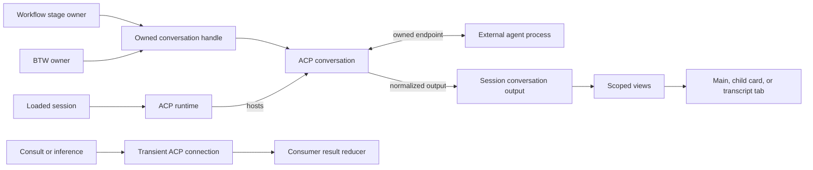
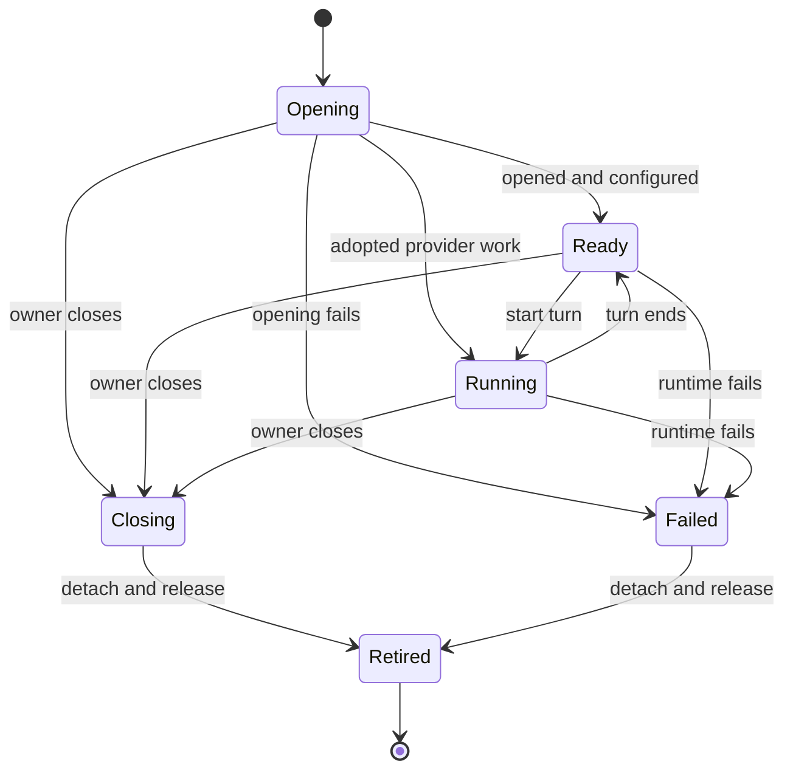

# Conversation model and execution

## Boundary

Main chat, BTW, provider subagents, and workflow threads share one conversation read model. A consumer
that controls a thread holds an owned handle. ACP owns protocol execution and the process that hosts it.
The external agent retains its actual model context; Weavie retains observable output and interaction state.

| Alternative | Trade-off | Decision |
| --- | --- | --- |
| Add handles only to BTW | Simplifies one feature but leaves background views and workflow execution separate | Too narrow |
| Shared read model, owned handles, ACP runtime | Reuses the existing ledger and controller without giving passive readers execution responsibilities | Selected |
| Universal conversation manager | Adds scheduling, storage, and lifecycle policy beside existing owners | Excluded |

| Type | Owner and responsibility |
| --- | --- |
| `ConversationOutput` | Loaded session owns one ledger, scoped row indexes, and revision/reset bookkeeping |
| `ConversationView` | Read-only access to one thread's rows; owns no execution |
| `AcpRuntime` | Session owns this process, initialization, controller membership, and process-failure boundary |
| `AcpConversation` | Runtime hosts one incarnation: endpoint, turn queue, controls, interactions, cancellation, and output port |
| `IAgentConversation` / `AcpConversationHandle` | Consumer holds this address for submission, controls, interrupt, output, terminal outcome, and disposal; it delegates to the controller |
| `AgentConversationBinding` | Construction-time instructions, control hold, and revocable registry grant |
| `WorkflowStageExecution` | Workflow runner owns one exact stage visit and its completion round |
| `WorkflowStageOwner` | Hosting owns the child handle and connects that visit's delivery and retirement to it |

A conversation view is data access; a controller is a stateful service. A turn ending, a conversation
ending, background work ending, and a stage completing are distinct events. There is no generic wrapper
state machine or feature-specific workflow/BTW execution engine.

## Shared output and incremental projection

`AgentPaneMessage` and `AgentPaneLedger` remain the common contract and fold. Starts, deltas, completions,
requests, media, and retractions retain their existing identities. `ConversationOutput` owns this ledger;
Hosting forwards its revisioned records instead of maintaining another fold. The controller's bound port
supplies conversation/provider identity and journals materialized completions before publication.

The ledger registers parent and conversation membership once and indexes existing rows by ordinal.
A scoped `ConversationView.Rows` enumerates that conversation's rows without materializing unrelated main
or sibling history. Reset and replay rebuild membership with the ledger. Runtime transition gates precede
the output gate; output does not call controllers while holding its gate.

The existing web accumulator mirrors that membership over its existing rows. Its conversation projections
reuse unchanged results; there is no separate frontend manager or copied conversation history. Initial
history reconstruction may scan everything. Live child updates project only the affected thread and
necessary ancestor summaries, including when collapsed. Main updates retain their incremental path when
child cards exist. A membership change invalidates the affected placement even when a tool delta arrives
in the same batch. Unrelated main and sibling histories are neither scanned nor reprojected.

Completion, retraction, reset, replay, and history/live reconciliation use this same path. Child completion
never ends the parent's turn. Subagents retain their actual parent links; BTW descendants stay in that BTW transcript.
Cards start collapsed across providers, explicit expansion survives completion, and pending approvals stay
visible. Navigation and transcript tabs address the same scoped model.

The ledger also assembles interactive text before journaling and publishing `item-completed`, preserving
first non-null media/URI metadata. This replaces ACP's separate text accumulator and recovery's duplicate
fold. ACP retains protocol correlation; recovery retains interruption policy. `AgentTranscript` is a lossy
session-read projection of a scoped view, not another common model.

## Runtime and handles

`AcpAgentSession` retains the main-input facade and presentation policy. `AcpRuntime` owns the existing
supervised ACP connection, with `RestartPolicy.Never`, and hosts all same-provider interactive controllers.
In-flight operations remain bound to their incarnation during restart, clear, and rewind. Queued
submissions transfer explicitly through the handoff policy.

BTW and workflow children share `StartOwned` for controller creation, registration, initial publication,
and opening. Both save a resumable continuation; a workflow child's is tagged with its owner, restored only through
that owner, and forgotten when the owner closes it. Their common nested port handles placement and request routing.
IDs remain at protocol, persistence, and UI boundaries; the workflow owner retains an object.

`OpenFreshAsync` and `OpenForkAsync` open against the session's runtime. Opening waits for the captured
main incarnation to be ready, snapshots its controls, verifies provider support, and returns only after
child setup succeeds. A fork requires a live parent on that runtime. Required control values fail explicitly
if unavailable. A workflow may override model/options on the child after the snapshot, before prompting.
The permission mode is copied from main; workflows cannot select a different permission mode.

Cancelling an open retires its endpoint immediately and closes a provider session that arrives later.
The wire open itself remains owned until it settles. Opens serialize per connection: a blocked provider
open can block later opens; Restart Agent ends that shared process. Unsupported fork or independent close
fails with a visible reason. Authentication uses the existing runtime's interaction path.

This is the controller lifecycle, not extra state in its handle or view. Settlement additionally accounts
for queued input, control changes, prompt delivery, steering, interactions, and background work. Terminal
outcome is observable even when retirement precedes subscription. A provider-owned subagent is adopted
for observation and supported responses; it has no unsupported prompt/close handle.

Closing a child leaves the process available when the provider enforces session close. A refused close
fails the shared process and its siblings. Runtime failure, restart, and session unload end hosted work.
Archive failure refuses further writes and schedules runtime shutdown outside the write stack, while its
visible error does not depend on a successful append. Clear ends owned children before replacing history.
Rewind refuses active/opening independent work; an idle workflow child retires before main history is replaced, and its terminal outcome pauses
the owning stage. A saved transcript remains readable after execution ends.

## Consumers

| Consumer | Ownership and delivery | Result and end |
| --- | --- | --- |
| Main | Session owns current controller; input uses main facade | Main view; incarnation replaced on restart/clear/rewind |
| BTW | Aside feature owns a fork through the shared opening path | Nested replies; saved continuation can reopen after a turn |
| Native subagent | Parent background owner adopts provider-announced endpoint | Same scoped model; provider reports its end |
| Consult | MCP call owns restricted transient process and fresh session | Text after last tool plus denied actions; dispose after result/cancel |
| Inference | Typed query owns restricted transient process in its worktree | Bounded text, typed validation, usage and errors remain query-owned |
| Workflow `continue` | Stage borrows main input; does not own main | Main transcript; stage tools drive progression |
| Workflow `fork` / `fresh` | The run owns one child per opening stage and lends it to one visit at a time | Replies/revisions in card; outputs and questions return to main; the run ending closes it |
| Session message / bundled prompt | Input producer addresses existing session | Uses ordinary submission and lifecycle |

Consult and inference share ACP open/configure/prompt mechanics and chunk decoding, not an interactive
ledger. Their different reducers remain small: consult discards earlier text at a tool boundary; inference
accumulates bounded text for typed validation. Process-wide capabilities keep restricted queries on their
own transient processes. Provider probes reuse open/configure without inventing a prompt or transcript.
Terminal Claude retains its PTY and `--print` adapters and refuses independent workflow contexts.

Another-provider workflow execution is deferred. Its extension point is a fresh owned conversation on a
separately supervised runtime, with the same binding and read model; it must not switch main's provider or
copy history across providers. That process acquisition and authentication policy is not implemented by
this change. All supported conversations share the worktree; forking context never forks files.

## Workflow and tool ownership

Every Weavie-created interactive conversation gets its own grant on the session's MCP registry. This
credential routes calls to its binding, and a BTW's makes it the caller of
[session messaging](session-messaging.md); it is not another registry or a sandbox. Ordinary services remain
session-wide. Main and BTW cannot complete a child-owned stage. For `continue`, main's grant captures its
current stage visit at tool admission. The default registry entry uses the same admission rule.

A stage visit spans work, decisions, failure/resume, and same-stage revisions. Completing work makes further
completion invalid while its decision is pending. Revising retains the handle and advances the completion
round. A tool call captures both visit and round; a delayed call cannot complete a revision or a later visit
to the same stage name. The runner validates these objects under its state lock.

The runner advances on accepted outputs and decisions, not on silence or conversation settlement. Normal
retirement revokes the grant, drains accepted completion replies, and closes the child. MCP owns those reply
receipts: registration precedes completion; revocation seals the set; send completion or disconnection
releases it. Other tools are cancelled and cannot delay closure. No transport bookkeeping lives in the
workflow engine, and no teardown awaits itself under the runner lock. Jump, cancel, and teardown interrupt
immediately. Invalid outputs and `failStage` retain the live visit and handle.

Main stays usable while a child runs. Outputs, summary, and user questions return through the runner's owed
kickoff mechanism. Revisions and later visits reuse the child; its grant captures only the visit it is lent to.
Losing its incarnation during a visit pauses the stage; Resume restores it from its owner's continuation, which
survives an agent restart and a reload but not a crash, `/clear`, or Rewind. The authoring prompt explains when to
use `continue`, `fork`, `fresh`, and `reuse`. See [workflow-context-reuse](workflow-context-reuse/design.md).

Main's prompt-image delivery is persisted with the run. Each child handle owns its own receipt: revisions
retain it, reopening resets it, and only an accepted submission consumes the images owed to that child.

Native subagents may inherit the parent's credential. ACP adoption does not let Weavie install an independent
one, so calls through it act within that parent's binding. The design claims no finer attribution without
provider support and no isolation from an agent's own process tools.

## Replacement and verification

| Shared code | Removed duplication |
| --- | --- |
| Ledger completion assembly and scoped views | ACP text accumulator, recovery text fold, Hosting's private ledger |
| Indexed web projections | Whole-history child regrouping and unrelated conversation projection |
| Transient runner and decoder | Repeated consult/inference session setup and chunk extraction |
| Runtime plus owned child opening | Process mechanics in the session facade, parallel BTW/workflow construction, `SideRuntime` wrapper |
| Registry-bound stage admission | Main-only admission rules duplicated at MCP and Hosting call sites |

The intended buildable boundaries are output folding, transient execution, runtime/child ownership,
indexed passive views, tool bindings, and same-provider workflow contexts. Each boundary replaces its
callers in lockstep; there are no compatibility adapters. Tests cover scoped identity, materialized
completions, media, retractions, reset/replay, nested approvals, late work, cancellation, close refusal,
stage reentry, revision, response delivery, restart, rewind, and teardown failures.

Deterministic operation counts verify locality as unrelated history and sibling count grow, including
collapsed children and main updates with cards. Layout budgets supplement those counts; they do not measure
JavaScript scanning/allocation. Headless journeys verify placement, navigation, reload, workflow reports,
revision, and read-only closure. Real-provider probes check fork credentials, model isolation, and close
semantics without replacing deterministic tests.

Line accounting separates production, tests, and documentation. This implementation adds capabilities and
coverage as well as removing duplicated paths; net deletion is not claimed. Removed coverage, compressed
formatting, and deferred behavior do not count as refactoring savings.

No global conversation directory, scheduler, pool, retry layer, cross-provider history conversion, new
transcript format, or general permissions framework is introduced.
