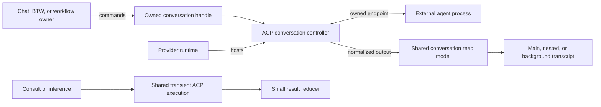
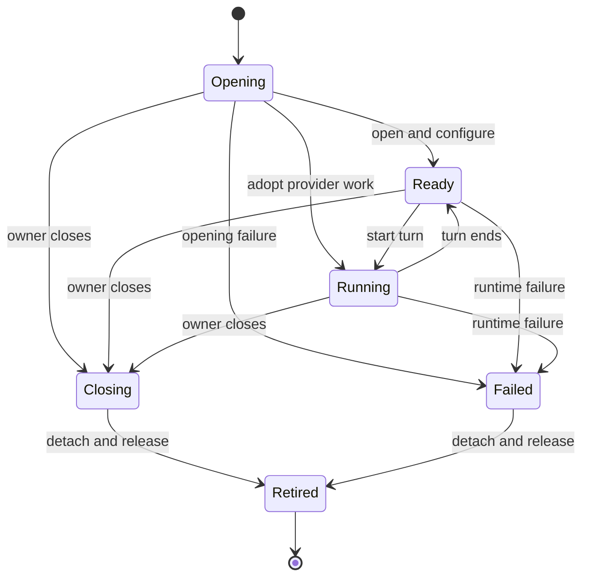

# Conversation model and execution

Status: design proposal; no implementation changes.

## Purpose

Main chat, BTW, background agents, and workflow threads share a conversation read model. Features that
control a thread hold an owned conversation handle. Provider runtimes own processes and protocol work.
Consultation and inference share their common ACP execution mechanics and chunk decoding, retaining small
result reducers without a transcript ledger. The objective is fewer execution paths and less code.

A conversation model is data about one thread. A conversation controller is the stateful service that
operates that thread. The external agent maintains the model's actual history and context; Weavie keeps
the observable output and the state needed to interact with it. A turn, a conversation, background work,
and a workflow stage have separate completion boundaries.

## Chosen boundary

| Alternative | Trade-off | Decision |
| --- | --- | --- |
| An owned handle added only to the BTW interface | Removes feature-side ID lookup, but leaves another-provider steps and background observation on separate paths | Too narrow |
| Shared read model, capability-specific control, provider runtime | Reuses the existing ledger and ACP ownership; supports independent threads without making every consumer interactive | Selected |
| Universal conversation manager with scheduling, persistence, and provider pooling | Adds lifecycle and policy ownership beside the existing owners | Excluded |

Names below describe responsibilities; there is no second generic conversation implementation wrapped
around an ACP lifecycle state machine.

| Concept | Owner and responsibility |
| --- | --- |
| `ConversationView` | Read-only view of one thread's normalized rows and terminal outcome; owns no execution lifecycle |
| `ConversationOutput` | Session-owned instance of the Core message/ledger implementation, with bound writers and scoped read views; one backing ledger per visible session |
| Conversation controller | One incarnation's endpoint, queue, controls, pending interactions, cancellation, and output writer; ACP implements these mechanics |
| Owned conversation handle | Held by the consumer responsible for closing the thread; delegates to its controller and runtime owner, with no independent lifecycle state |
| Provider runtime | Owned by a loaded session or a dedicated operation; owns the process, initialization, conversation membership, and process-failure fan-out |
| Conversation binding | Construction-time turn context and Weavie tool scope; released with the owning execution |

An interactive handle exposes submission, interrupt, and close, plus its view and an observable terminal
outcome. Interaction and control capabilities exist only where implemented. An adopted subagent has a
view and its supported interaction responders, not a prompt/close interface that throws when used.
There is no feature-specific `WorkflowConversation` or `BtwConversation` execution engine.

## One output model

The common message contract and fold are the existing `AgentPaneMessage` and `AgentPaneLedger`, promoted
to conversation output responsibilities. They are not copied into new message or item hierarchies.
The message already carries text, tools, requests, media, and completion; the ledger folds starts,
deltas, completions, and retractions into stable rows. Source anchors:
[src/Weavie.Core/Agents/AgentPaneMessage.cs:3](../../src/Weavie.Core/Agents/AgentPaneMessage.cs#L3) and
[src/Weavie.Core/Agents/AgentPaneLedger.cs:59](../../src/Weavie.Core/Agents/AgentPaneLedger.cs#L59).

Visible conversations use scoped views over one session ledger. A bound writer supplies the persisted
Weavie conversation scope as well as the actual provider identity; provider thread IDs alone are not
unique across runtimes. `AgentPaneIdentity`, recovery keys, and web item keys include that scope in
lockstep. IDs remain at protocol, persistence, and web boundaries; in-process consumers retain objects.

`ConversationOutput` owns the ledger, its gate, and the existing generation/reset bookkeeping. Hosting
delegates history reads and resets to it. Writes enter through the controller's port under its runtime's
transition gate, then the output gate; output never calls controllers while holding its gate. Durable
events are journaled, folded, and ordered for the existing pane publication path before releasing that
gate. Hosting forwards revisioned records without folding them again. Scoped views use the existing
snapshot/revision mechanism; no additional subscription protocol is introduced. Activity and interaction
control continue through `AgentEvent` and the controller, rather than a second state machine in the view.

Nested labels, parent/anchor placement, collapse state, and wire request namespaces belong to presentation
binding. They are not a second conversation history. The web accumulator remains the remote replica,
with its existing history reconciliation and rendering behavior. `AgentTranscript` remains the lossy
projection used for session reads, operating on an already-scoped view; the session reader selects main.
It does not become the common model: its intentional exclusions are
in [src/Weavie.Core/Agents/AgentTranscript.cs:37](../../src/Weavie.Core/Agents/AgentTranscript.cs#L37).

Interactive stream assembly lives in this ledger, upstream of journal completion and publication.
The writer materializes `item-completed` from its scoped active rows before journaling and publishing that
completion, including on termination and restart. Text and first non-null media/URI metadata survive
later deltas. This replaces `AcpConversation._content` and recovery's separate text accumulation in
[src/Weavie.Core/Agents/AgentPaneRecovery.cs:28](../../src/Weavie.Core/Agents/AgentPaneRecovery.cs#L28).
Recovery retains its interruption policy; ACP retains protocol correlation and tool execution state.
The journal and wire still receive materialized completions, so the web remains a replica of the fold.

Transient operations have no pane, ledger, journal, or saved continuation. Their shared decoder reads
`agent_message_chunk.content.text` and tool boundaries, ignoring annotations and non-text fields as the
existing clients do; interactive decoding retains its visibility and resource/media handling. Consult's
small reducer discards text at each tool call; inference's reducer accumulates all agent text and enforces
its existing byte limit before append. This preserves results even without message IDs. No segment store
or configurable generic accumulator is needed. The shared transient runner owns open, configure, prompt,
stop-reason decoding, and disposal; result selection and failure policy remain with the caller.

## Runtime and handle ownership

The runtime constructs a controller, attaches its endpoint, and opens it through `OpenFreshAsync` or
`OpenForkAsync(parentHandle, ...)`. The caller supplies the binding and output destination. Opening returns
only after setup and required controls succeed. A fork requires a live compatible parent; unsupported
operations fail with their reason. Cancelling opening retires the endpoint immediately and closes any
session that arrives later; it does not cancel the wire request. Opens serialize per connection, as in
[src/Weavie.AgentClientProtocol/AcpJsonRpcConnection.Endpoints.cs:61](../../src/Weavie.AgentClientProtocol/AcpJsonRpcConnection.Endpoints.cs#L61).
A hung open blocks later opens on that runtime. Its owning card remains visibly opening or closing, with
a runtime-stop command and its effective shortcut; stopping a shared runtime visibly ends siblings too.

`AcpAgentSession` supplies main-chat presentation and the stable main-input address. Its process/initialize
machinery belongs to the extracted ACP runtime, reused for another-provider workflow work. Long-lived
runtimes use the existing supervised connection with `RestartPolicy.Never`. Transient queries retain the
one-shot process transport. Process-wide client capabilities prohibit placing restricted consult/inference
work on an unrestricted interactive process just because the provider matches.

Authentication belongs to the opening runtime. A provider's sign-in request is shown on that conversation's
card and answered through its endpoint; opening remains pending until sign-in and configuration succeed.
Cancellation retires that opening. Another-provider sign-in never changes main's provider or controls.

The runtime tracks membership to close, detach, and fail hosted controllers. The consumer decides when
its owned thread is no longer needed. A handle can delegate that ending to the existing owner-side
bookkeeping represented by `SideRuntime`; disposal does not require the controller to manipulate its
owner's collections. The ownership seam is visible in
[src/Weavie.AgentClientProtocol/AcpAgentSession.SideConversations.cs:77](../../src/Weavie.AgentClientProtocol/AcpAgentSession.SideConversations.cs#L77).

Main-input delivery captures the session's current conversation at admission. Restart, clear, and rewind
replace that incarnation; work already bound to it never retargets its successor. A `continue` stage uses
the main-input address for each new delivery and does not dispose main. A child-stage handle denotes one
incarnation; its ending pauses the stage, and Resume obtains a new handle. User BTW continuation can reopen
its saved thread through a new handle. A saved transcript is readable after its controller ends.

The loaded session owns the display archive. A child on another provider appends to that same archive
under its existing main-provider/workspace storage key, with the child's actual `ProviderId` in each row.
Workflow children persist display only; they do not masquerade as resumable BTW continuations. The bound
writer holds this archive destination, while failures and control requests target the child's runtime.
An ordinary runtime failure affects only its hosted controllers. An archive failure refuses writes under
the output gate and queues session-owned shutdown after the write stack releases all runtime/controller
gates. Stopping another runtime never holds the originating runtime's gate. The visible failure-report
path does not require a successful journal append. Main-process restart leaves a separate stage runtime
alive; session unload or workflow cancellation closes it. Clear confirms and ends owned child work before
replacing history; Rewind refuses while relevant children run. Neither erases a live child's anchor.

This is the controller incarnation lifecycle, not a second state machine in the view or handle.
`Ready` means no active prompt, not necessarily no background work. An adopted child's provider-reported
end retires it after its descendants settle; Weavie does not send it a close request. The runtime ending
fails or stops its hosted work. Closing an independent thread leaves the process available when the
provider can enforce that close. A refused close terminates the shared process and visibly fails siblings,
as enforced by [src/Weavie.AgentClientProtocol/AcpJsonRpcConnection.Endpoints.cs:78](../../src/Weavie.AgentClientProtocol/AcpJsonRpcConnection.Endpoints.cs#L78).

## Consumers

| Consumer | Creation and ownership | Output and completion |
| --- | --- | --- |
| Main chat | Session owns its current interactive conversation and runtime | Primary view; new submissions use current main |
| BTW | Session's aside feature owns a fork on its runtime | Nested view and replies through the held controller; saved continuation survives as specified by BTW |
| Native subagent | Root background-work owner adopts the provider-announced child endpoint | Same read model; provider owns prompts and reports ending; no independent Weavie MCP provisioning |
| Consult | MCP call owns a restricted transient runtime and one fresh thread | Reply reducer returns text after the last tool and denied-action details; completion/cancellation disposes process |
| Inference | Query operation owns a restricted transient runtime, rooted in its explicit worktree | Bounded text reducer feeds existing typed validation, usage, profile, deadline, and failure handling |
| Workflow `continue` | Stage borrows main-input delivery, not ownership of main's incarnation | Main transcript; explicit stage completion controls progression |
| Workflow `fork` / `fresh` | Exact stage execution owns an interactive child handle and binding | Nested view, user replies, revisions, and stage outputs; leaving execution closes it |
| Other-provider stage | Same stage owner acquires a dedicated supervised runtime and fresh conversation | Same stage code and read model; required provider/model controls applied before prompting |
| Session message or bundled prompt | Input producer targeting an existing conversation | Uses its normal delivery, presentation, and lifecycle |

All threads share the owning worktree. Another-provider work uses `fresh`; history is not copied across
providers. Forking never forks files. Terminal Claude keeps its terminal integration and `--print`
inference adapter; raw PTY input does not acquire structured turn or conversation guarantees. Provider
probes open and configure a temporary session without inventing a prompt or transcript.

For example, a Fable main chat remains on the Claude runtime while an Astra review stage owns a fresh
thread on a Codex runtime. Both produce the same read model. The workflow sees the review handle, outputs,
and termination; neither its engine nor the view knows how ACP launches that provider.

## Turns and workflow binding

Interactive submission acknowledges admission; it does not promise one future reply per submitted
message. Ordinary input may steer an existing turn. The controller publishes actual turn outcomes with
their identity and stop reason; a one-shot query awaits the one turn it starts. Workflow progression
listens to its stage tools, not a guessed final message or the absence of a running prompt.

Settled means no opening, active prompt, queued submission, in-flight prompt delivery or steering, pending
interaction, or owned background work. An accepted steering request remains outstanding until its reply
is published or its input is requeued; a prompt response alone cannot signal a drain. The controller
computes settlement from its queue and in-flight operations without a competing counter in the consumer.
Terminal outcome is observable even when opening or ending precedes subscription, and is settled exactly
once. No consumer infers termination by watching the session's aggregate status.

Each Weavie-created interactive conversation receives its own MCP credential and binding on the session's
registry. The credential routes tool calls to that owned binding; it is not a new registry or sandbox.
Ordinary session services remain shared. Stage completion/failure resolves to an owned stage-execution
object, not the runner's current stage name. Re-entering the same named stage cannot revive an old grant.
The runner validates the execution under its state lock even for a call admitted before revocation.
Revocation refuses new calls and cancels outstanding work, except delivery of an already accepted
completion response as specified below.

The binding supplies both stage instructions and stage tools. Main and ordinary BTW receive no completion
authority for a separately owned stage. For `continue`, the main binding delegates to that exact live
stage execution. Ordinary BTW instructions remain independent of main's stage block. There is no general
role or permission framework. Relevant seams are
[src/Weavie.AgentClientProtocol/AcpConversation.Opening.cs:175](../../src/Weavie.AgentClientProtocol/AcpConversation.Opening.cs#L175),
[src/Weavie.AgentClientProtocol/AcpConversation.PromptBuilder.cs:64](../../src/Weavie.AgentClientProtocol/AcpConversation.PromptBuilder.cs#L64), and
[src/Weavie.Core/Mcp/McpServer.WorkflowTools.cs:117](../../src/Weavie.Core/Mcp/McpServer.WorkflowTools.cs#L117).

The stage execution spans its work, decision, and same-stage revisions. Accepted completion disables
completion mutations while the decision is pending; it does not close the thread. A revise answer keeps
the handle and advances one completion-round counter on the execution. Tool admission captures that round
as well as the execution, so a delayed call from an earlier round cannot complete the revision. Jumping away and
back creates a different execution even when the stage name matches.

The runner advances on accepted completion and its decision result, without waiting for conversation
settlement. Routing out revokes stage tools and schedules closure under the session owner; teardown never
awaits itself from inside the tool call or runner lock. The accepted MCP response finishes before closure
interrupts remaining work, cancels pending interactions, rejects new ones, and retires the endpoint.
Cleanup remains owned and visible until released; it is not an unobserved task or a condition for stage
progression. Stop, jump, cancel, and owner teardown interrupt immediately. Rejected outputs and
`failStage` keep the handle while the execution remains live. Reporting to main and output validation
belong to the workflow adapter.

A provider-native subagent may inherit its parent's MCP credential. If it does, Weavie cannot distinguish
that caller from the parent; it acts within that binding. The adoption protocol does not supply independent
credentials. This design does not claim finer attribution without provider support, nor an OS sandbox for
an agent's own tools. A shared-process close failure also remains a shared failure boundary.

## Reuse and deletion budget

| Shared implementation | Superseded code |
| --- | --- |
| Existing message/ledger fold plus scoped views | ACP's separate full-text stream accumulation and `AgentPaneRecovery`'s text fold; no second `ConversationItem` store |
| `ConversationOutput` owns the existing host ledger | `AgentSessionHost`'s private fold/write hookup; Hosting forwards the model's revisioned records without refolding them |
| Transcript projection of an already-scoped view | Primary-only selection inside `AgentTranscript.Project`; the session reader owns that selection |
| Shared transient chunk decoder | Repeated notification-envelope and text extraction in `AcpConsultClient.OnNotification` and `AcpInferenceClient.Collect`; their small, different reducers remain |
| Shared transient open/configure/prompt mechanism | Repeated lifecycle portions of consult and inference clients; retain domain instructions, permission policy, reply selection, validation, and errors |
| Runtime fresh/fork opening and owned handles | `IStructuredAgentSideConversations` as a business API; the small by-ID lookup remains at the UI boundary; existing shared `NestedPort` presentation is reused |
| Existing supervised ACP connection and endpoint ownership | A separate process launcher or conversation lifecycle for other-provider workflow stages |

The transient reuse sites are
[src/Weavie.AgentClientProtocol/AcpConsultClient.cs:85](../../src/Weavie.AgentClientProtocol/AcpConsultClient.cs#L85) and
[src/Weavie.AgentClientProtocol/AcpInferenceClient.cs:58](../../src/Weavie.AgentClientProtocol/AcpInferenceClient.cs#L58).
Shared transport and profile application are retained, not reintroduced behind feature-specific copies.

The target is a net reduction in total implementation size. Each extraction replaces its callers and
deletes their superseded path in the same buildable change. Report production, tests, documentation, and
total line deltas separately; renames, compressed formatting, removed coverage, or omitted behavior are
not savings. Exact savings require implementation measurement and are not claimed by this proposal.
The first two extractions must net-delete implementation code before proceeding with the runtime split;
otherwise revise their boundaries. Retaining genuinely different result reducers is not duplication.

## Build sequence and verification

Each step updates all affected callers and leaves the build green. No compatibility adapters or protocol
version gates are introduced. The workflow-context documents are consumer requirements, not files this
design modifies.

1. **Share output folding.** Move interactive completion assembly and `AgentPaneRecovery`'s text fold onto
   the existing ledger. Expose scoped views and move its ownership out of Hosting. Verify journaled
   completions, first-wins media, interleaved deltas, retractions, nested requests, identity collisions,
   generation/reset, and history/live reconciliation. Measure the line delta.
2. **Share transient execution.** Extract common consult/inference chunk decoding and open/configure/prompt
   code, retaining their result reducers. Verify text selection without message IDs, annotation behavior,
   strict JSON, overflow, profile failures, caller cancellation, and disposal. Measure the combined reduction.
3. **Separate runtime from presentation.** Extract the supervised process/initialize owner and expose
   owned fresh/fork handles, with main's stable input facade. Move BTW creation/replies to these handles.
   Verify opening failure/late opening, steering returning after prompt end, retirement, repeated close,
   restart, clear, rewind, and sibling behavior on close refusal. Preserve port/endpoint locking and
   late-work exclusion.
4. **Expose passive background views.** Use the same model for adopted children and their transcript tabs,
   removing any duplicated projection. Verify nested descendants, approvals, replayed announcements, and
   parent failure. Background tasks remain tasks, not fabricated conversations.
5. **Bind tools to executions.** Add registry grants and exact stage-execution ownership, moving context
   into construction bindings. Verify main/BTW separation, late calls admitted before revocation, repeated
   stage names, and accepted-response delivery during close. Test HTTP and stdio proxy paths.
6. **Connect workflow consumers.** Fork/fresh stages retain handles through revisions and pause on loss;
   another-provider fresh stage uses the same control and view contracts on its own runtime. Verify model
   setup and sign-in, concurrent archive failure on two runtimes, main-only restart, reports to main,
   resume, jump, cancel, and closure with outstanding interactions without blocking progression or the
   runner's lock. Reloaded child-provider rows remain display-only and cannot become main/BTW continuations.

Use deterministic fake-ACP tests for protocol and ownership invariants, existing Core ledger tests for
folding, Hosting tests for lifecycle/workflow integration, and headless journeys for presentation. Web or
.NET implementation changes run their respective formatters; render/keystroke changes also run the
existing performance budgets. Before completion, review the deletion accounting and prove representative
main, BTW, subagent, consult, inference, and cross-provider workflow paths. Real-provider checks establish
fork MCP binding and close semantics; they do not replace deterministic regression tests.

## Deliberate exclusions

No global conversation directory, scheduler, pooling, automatic retries, cross-provider history conversion,
new transcript storage format, generic workflow engine, or permissions framework. No promise to resume a
lost workflow child without a separate persistence design. Native subagents do not gain unsupported input
or close operations. Presentation, inference validation, and workflow policy stay with their consumers.
