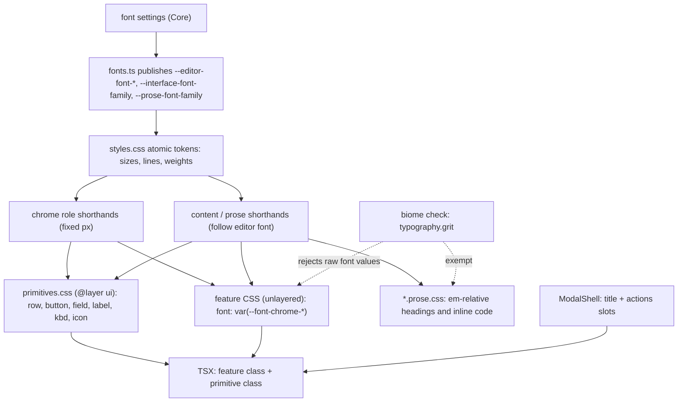

# Design system — design

Design for [brief.md](brief.md). Evidence: the rendered census in `temp/design-census/REPORT.md`.

## Summary

**What changes for the user.** Chrome text settles on five sizes (10, 11, 12, 13, 20px) and one bold.
Menus, palettes and file lists share one row height; buttons share two heights; every dialog has the same
title, padding and button style. Text in a row sits on one baseline. Visible differences from today:

- Context-menu rows go from 32.5px to 26px and 13px text to 12px.
- Grey section headings and metadata in pickers go from 13px to 11px (today they outsize the items).
- Diff Against, Open PR, Register Agent and Source Token lose their 16px scale; their buttons change from
  stacked label-over-shortcut (45px) to one line (28px).
- Folder and file rows in the file tree become the same height (24.5 / 26 → 26).
- The agent pane's transcript, labels, composer and its buttons are unchanged in size: they stay tied to the
  editor font. Its approval and question cards stay 12px chrome.
- The welcome window keeps its larger landing scale.

**Main pieces.**

1. Role tokens in `styles.css`: one `font` shorthand per role, built from atomic size/line/weight tokens.
2. `primitives.css`: shared classes for row, button, field, section label, key hint and icon box, in a CSS
   cascade layer so feature CSS always overrides them.
3. `ModalShell` owns every dialog's title and action row.
4. Every stylesheet migrates to the roles; prose rules move to `*.prose.css` files.
5. A Biome plugin rejects raw font declarations; AGENTS.md and the reviewer agent carry the rest.

**Open questions for the user.** None. Judgement on visuals was delegated; the calls made here are listed
under [Decisions made in design](#decisions-made-in-design).

## Flow



## Formats by example

**Tokens** — final typography block in `src/web/src/styles.css` (replaces lines 27-40):

```css
  --font-chrome-family: var(--interface-font-family);
  --font-content-family: var(--editor-font-family, ui-monospace, monospace);
  --font-prose-family: var(--prose-font-family);

  --font-weight-regular: 400;
  --font-weight-emphasis: 600;
  --font-weight-mono-bold: 700; /* Go Mono ships 400/700 only */

  --font-chrome-hero-size: 36px;
  --font-chrome-display-size: 20px;
  --font-chrome-lead-size: 16px;
  --font-chrome-title-size: 13px;
  --font-chrome-size: 12px;
  --font-chrome-secondary-size: 11px;
  --font-chrome-badge-size: 10px;
  --font-chrome-line: 16px;       /* every single-line chrome role */
  --font-chrome-line-wrap: 18px;  /* wrapping body text; the inherited default */
  --font-chrome-display-line: 24px;
  --font-chrome-hero-line: 40px;
  --font-label-tracking: 0.06em;

  --font-chrome-hero: var(--font-weight-emphasis) var(--font-chrome-hero-size) / var(--font-chrome-hero-line) var(--font-chrome-family);
  --font-chrome-display: var(--font-weight-emphasis) var(--font-chrome-display-size) / var(--font-chrome-display-line) var(--font-chrome-family);
  --font-chrome-lead: var(--font-weight-regular) var(--font-chrome-lead-size) / var(--font-chrome-display-line) var(--font-chrome-family);
  --font-chrome-title: var(--font-weight-emphasis) var(--font-chrome-title-size) / var(--font-chrome-line) var(--font-chrome-family);
  --font-chrome-body: var(--font-weight-regular) var(--font-chrome-size) / var(--font-chrome-line) var(--font-chrome-family);
  --font-chrome-body-wrap: var(--font-weight-regular) var(--font-chrome-size) / var(--font-chrome-line-wrap) var(--font-chrome-family);
  --font-chrome-secondary: var(--font-weight-regular) var(--font-chrome-secondary-size) / var(--font-chrome-line) var(--font-chrome-family);
  --font-chrome-badge: var(--font-weight-emphasis) var(--font-chrome-badge-size) / var(--font-chrome-line) var(--font-chrome-family);
  --font-chrome-mono: var(--font-content-weight) var(--font-chrome-size) / var(--font-chrome-line) var(--font-content-family);

  --font-content-size: var(--editor-font-size, 14px);
  --font-content-weight: var(--editor-font-weight, 400);
  --font-content-secondary-size: calc(var(--font-content-size) * 0.8125);
  --font-content-title-size: calc(var(--font-content-size) * 1.3);
  --font-content-line: 1.24;
  --font-content-row-line: calc(var(--font-content-size) * 1.5);
  --font-content: var(--font-content-weight) var(--font-content-size) / var(--font-content-line) var(--font-content-family);

  --font-prose-size: var(--font-content-size);
  --font-prose-weight: 400;
  --font-prose-line: 1.5;
  --font-prose: var(--font-prose-weight) var(--font-prose-size) / var(--font-prose-line) var(--font-prose-family);

  --row-pad-y: 5px;          /* 16 + 2×5 = 26 */
  --row-pad-y-compact: 4px;  /* 24 */
  --row-pad-x: 8px;
  --row-gap: 8px;
  --control-height: 24px;
  --control-height-lg: 28px;
  --control-height-xl: 40px; /* landing surfaces */
  --touch-target: 44px;
  --icon-size-sm: 12px;
  --icon-size: 14px;
  --icon-button-size: 20px;
```

Removed: `--ui-font` (duplicate of `--font-chrome-family`), `--font-metadata-size`, `--font-hint-size`.

**Consumer CSS** — a feature rule after migration:

```css
.tb-row-dir { color: var(--dim); font: var(--font-chrome-secondary); }
.search-row-line { font-size: var(--font-content-secondary-size); }   /* content scope: follows zoom */
.pane-label { font-weight: var(--font-weight-emphasis); }             /* emphasis = same role, 600 */
```

**Markup** — the primitive class sits beside the existing class:

```tsx
<button class="context-menu-item ui-row">
  <span>{item.label}</span>
  <span class="context-menu-keys ui-kbd ui-kbd-plain ui-row-end">{formatKey(item.keys)}</span>
</button>
```

**Lint diagnostic:**

```
src/chrome/foo.css:8:9 plugin
  × Typography must use a --font-* role token (docs/concepts/design-system.md)
```

## Interfaces and types

`src/web/src/chrome/ModalShell.tsx`:

```tsx
type ModalHeading =
  | { title: JSX.Element; titleEnd?: JSX.Element }
  | { labelledBy: string }; // the surface draws its own display heading (Getting Started)

export function ModalShell(
  props: ModalHeading & {
    children: JSX.Element;
    actions?: JSX.Element;
    onDismiss: () => void;
    class?: string;
    onKeyDown?: (event: KeyboardEvent) => void;
  },
): JSX.Element;

export function PromptButton(props: {
  label: JSX.Element;
  shortcut: string; // "" renders no hint
  title: string;
  onClick: () => void;
  primary?: boolean;
  danger?: boolean;
  disabled?: boolean;
  class?: string;
  ref?: (element: HTMLButtonElement) => void;
}): JSX.Element;
```

`PromptActions` is deleted. No wire, settings or Core changes: `fonts.ts` and `FontSettings.cs` are untouched.

## Components

### 1. Tokens and base rules (`styles.css`)

- Atomic tokens are the truth; consumers write the role shorthand. A shorthand reaches shadow roots and CSS
  held in TypeScript strings, which classes cannot.
- Rules for consumers:
  - `font:` goes first in a rule, because the shorthand resets style and numeric variants.
  - Emphasis is `font-weight: var(--font-weight-emphasis)` after the shorthand (`--font-weight-mono-bold` in
    the mono face).
  - Mono text in chrome uses `--font-chrome-mono`, never a second `font-family`.
- Line heights: single-line roles use 16px so 10–13px text shares a line box. The inherited default stays
  18px, which is what `body` computes today, so unmigrated wrapping text does not move.
- Base rules join a declared layer:

```css
@layer base, ui;
@layer base {
  body { font: var(--font-chrome-body-wrap); }
  button, input, select, textarea { font: inherit; }
  strong, b { font-weight: var(--font-weight-emphasis); }
}
```

  Controls now inherit size and line height, which removes the 13.33px browser default. The redundant `font`
  on `.app` and the 71 per-control `font: inherit` declarations are deleted.

### 2. Primitives (`src/web/src/primitives.css`, new)

Imported right after `styles.css` in `main.tsx` and `welcome/index.tsx`, all inside `@layer ui`. Primitives
own geometry and type, plus the button and field states (hover, disabled, focus); row hover and selected
colours stay in feature CSS.

```css
@layer ui {
  .ui-row {
    --row-line: var(--font-chrome-line);
    --row-pad: var(--row-pad-y);
    display: flex; align-items: baseline; gap: var(--row-gap);
    box-sizing: border-box; width: 100%;
    height: calc(var(--row-line) + 2 * var(--row-pad));
    padding: var(--row-pad) var(--row-pad-x);
    border: 0; background: none; color: inherit;
    font: var(--font-chrome-body);
    text-align: left; white-space: nowrap; cursor: pointer;
  }
  .ui-row-compact { --row-pad: var(--row-pad-y-compact); }
  .ui-row-content { --row-line: var(--font-content-row-line); --row-pad: 2px; font: var(--font-content); line-height: var(--font-content-row-line); }
  .ui-row-stack { height: auto; min-height: calc(var(--row-line) + 2 * var(--row-pad)); white-space: normal; }
  .ui-row-text { display: flex; flex: 1 1 auto; flex-direction: column; min-width: 0; }
  .ui-row-desc { color: var(--dim); font: var(--font-chrome-secondary); }
  .ui-row-end { flex: none; margin-left: auto; }
  .ui-icon {
    display: inline-flex; flex: none; align-items: center; justify-content: center;
    align-self: flex-start; height: var(--row-line, var(--font-chrome-line));
  }
  .ui-icon > svg { width: var(--icon-size); height: var(--icon-size); }

  .ui-button {
    --control-h: var(--control-height);
    --control-line: var(--font-chrome-line);
    display: inline-flex; align-items: baseline; justify-content: center; gap: 6px;
    box-sizing: border-box; height: var(--control-h);
    padding: calc((var(--control-h) - var(--control-line)) / 2 - 1px) 10px;
    border: 1px solid var(--border); border-radius: 4px;
    background: transparent; color: var(--fg);
    font: var(--font-chrome-body); white-space: nowrap; cursor: pointer;
  }
  .ui-button-lg { --control-h: var(--control-height-lg); }
  .ui-button-xl { --control-h: var(--control-height-xl); --control-line: var(--font-chrome-display-line); padding-inline: 16px; font: var(--font-chrome-lead); }
  .ui-button-content { --control-line: var(--font-content-row-line); --control-h: calc(var(--control-line) + 6px); font: var(--font-content); line-height: var(--control-line); }
  .ui-button-primary { border-color: var(--button-bg); background: var(--button-bg); color: var(--button-fg); font-weight: var(--font-weight-emphasis); }
  .ui-button-danger { border-color: transparent; background: var(--danger); color: #fff; }
  .ui-icon-button { display: inline-grid; place-items: center; width: var(--icon-button-size); height: var(--icon-button-size); padding: 0; border: 0; background: none; }

  .ui-section-label {
    color: var(--dim); font: var(--font-chrome-secondary);
    font-weight: var(--font-weight-emphasis);
    letter-spacing: var(--font-label-tracking); text-transform: uppercase;
  }
  .ui-kbd { padding: 0 4px; border: 1px solid var(--border); border-radius: 3px; color: var(--dim); font: var(--font-chrome-badge); white-space: nowrap; }
  .ui-kbd-plain { padding: 0; border: 0; }

  .ui-field {
    box-sizing: border-box; width: 100%; height: var(--control-height-lg); padding: 0 8px;
    border: 1px solid var(--border); border-radius: 4px;
    background: var(--bg); color: var(--fg); font: var(--font-chrome-body);
  }
  .ui-field-mono { font: var(--font-chrome-mono); }
  .ui-field-content { height: calc(var(--font-content-row-line) + 10px); font: var(--font-content); }
}
```

Rules the primitives encode:

- **Fixed height, baseline alignment.** Text of different sizes on one baseline makes an auto-height row
  grow by a sub-pixel (the census shows omnibar rows at 26 and 26.5). A fixed height absorbs it.
- **Icons** sit in `.ui-icon`, a box one line tall, top-aligned so they stay on the first line of a wrapping
  row.
- **Content rows and buttons** (`-content` variants) take their height from the editor font, so they grow
  with zoom instead of clipping.
- **Touch** overrides set the variable (`--row-pad`, `--control-h`) on the selectors `mobile.css` already
  targets; `min-height` on a fixed-height row would leave the text top-aligned.

### 3. Dialog shell (`ModalShell.tsx`, `editor/confirm-dialog.css`)

```
ModalShell renders:
  backdrop
    div.confirm-dialog[.class][role=dialog]  aria-labelledby = generated id | props.labelledBy
      if title:  header.confirm-head > h2.confirm-title#id {title} + {titleEnd}
      {children}
      if actions: footer.confirm-actions {actions}
PromptButton renders:
  button.session-prompt-btn.ui-button.ui-button-lg[.ui-button-primary|.ui-button-danger][.class]
    {label}
    if shortcut != "": span.ui-kbd.ui-kbd-plain[aria-hidden] {shortcut}
```

- `aria-hidden` on the hint keeps accessible names equal to the label (specs match button names exactly).
- `confirm-dialog.css` becomes the one dialog stylesheet: 16px padding, 12px gap, title role, right-aligned
  actions. `.modal-backdrop` loses its 13px font. `.confirm-btn*`, `.confirm-select`, `.session-prompt-actions`
  and the `.session-prompt` font scale are deleted; `.session-prompt` stays as a width-only marker class
  because seven specs select it.
- All 15 users pass `title` (Getting Started uses the `labelledBy` variant); per-dialog title divs go away.

### 4. Adoption across surfaces

Existing class names stay on every element that survives; the primitive class is added beside them.

| Surface | Change |
|---|---|
| `ControlMenu` | Head and group label become `.ui-section-label`; the group label moves out of the option into an `aria-hidden` sibling (today it highlights with the first option). Options are stack rows with `.ui-row-desc`. |
| `ContextMenu` | Items are `.ui-row`; keys are `.ui-kbd-plain` at the row end. Submenu offsets follow the new padding. |
| Omnibar / palette | Rows are `.ui-row`; keys `.ui-kbd-plain`; symbol and tree icons in `.ui-icon`. The centre-alignment override at `omnibar.css:132-137` is deleted. |
| File tree, filter results | Rows `.ui-row`; twisty and icon in `.ui-icon`; folder names keep their label style through `.ui-section-label`. |
| Search panel | Group head `.ui-row`; result rows `.ui-row-content`; group name is chrome body + emphasis; line numbers content-secondary. |
| Session panel / rail | Rows are stack rows; group heads `.ui-section-label`; key hints `.ui-kbd`. |
| Theme picker, ACP registry | Header moves into the `ModalShell` title/`titleEnd`; lists use rows; buttons and inputs use primitives. |
| Agent pane | Transcript, entry labels, status and composer stay content-relative. Composer buttons are `.ui-button-content`; approval and question cards are chrome (`.ui-button`, `.ui-field`). Choice cards, usage tooltip and model picker use chrome roles and rows. Slash menu rows are `.ui-row-content`. |
| Review / diff | Inline tags and toolbar take the chrome family through the shorthand (the two `ui-sans-serif` declarations go). File header is a fixed 32px. |
| Onboarding | Getting Started `h2` and the editor empty-state wordmark are display; eyebrows are `.ui-section-label`; nav buttons `.ui-button-lg`. |
| Welcome | Wordmark hero; tagline and row names lead; CTAs `.ui-button-xl`; recent label `.ui-section-label`. |
| Mobile | Touch heights through the variables; inbox `h1` is display; focusable fields keep the content font. |

Glyph-as-icon buttons ("+", "×", "■") become lucide icons at `--icon-size`. `WeavieIcon` is sized with its
`size` prop instead of `font-size`.

### 5. Chrome / content / prose boundary

| Scope | Root selectors | Roles allowed |
|---|---|---|
| Chrome | everything else | `--font-chrome-*` |
| Content | `.agent-body`, `.agent-compose`, `.agent-status-line`, `.session-composer textarea`, `.search-row`, `.agent-slash-option`, `.session-prompt-suggestion`, Fix/Revise inputs, inline blame, removed-line zones | `--font-content`, `--font-content-secondary-size`, `--font-content-title-size` |
| Prose | `.agent-markdown`, `.editor-preview-body`, `.editor-plan`, `.wv-source`, PR comment bodies, hint text | `--font-prose`; `em` only in `*.prose.css` |

`.agent-status-line` is content-relative in the chrome face, written as three longhands (family, size, line).

### 6. Lint (`src/web/lint/typography.grit`, new; `src/web/biome.json`)

```grit
language css

CssGenericProperty(name = $p, value = $v) as $d where {
  or {
    and { $p <: r"^font-size$", not $v <: r"^(?:inherit|var\(--font-(?:chrome-hero|chrome-display|chrome-lead|chrome-title|chrome|chrome-secondary|chrome-badge|content|content-secondary|content-title|prose)-size\))$" },
    and { $p <: r"^font-weight$", not $v <: r"^(?:inherit|var\(--font-(?:weight-regular|weight-emphasis|weight-mono-bold|content-weight|prose-weight)\))$" },
    and { $p <: r"^line-height$", not $v <: r"^(?:inherit|var\(--font-(?:chrome-line|chrome-line-wrap|chrome-display-line|chrome-hero-line|content-line|content-row-line|prose-line)\))$" },
    and { $p <: r"^font$", not $v <: r"^(?:inherit|var\(--font-(?:chrome-hero|chrome-display|chrome-lead|chrome-title|chrome-body|chrome-body-wrap|chrome-secondary|chrome-badge|chrome-mono|content|prose)\))$" }
  },
  register_diagnostic(span = $d, message = "Typography must use a --font-* role token (docs/concepts/design-system.md)", severity = "error")
}
```

```json
"plugins": [
  { "path": "./lint/typography.grit", "includes": ["**/src/**/*.css", "!**/fonts.css", "!**/*.prose.css"] }
]
```

- The allow-list is closed, so the plugin is the token registry: an invented `--font-my-thing` fails.
- Token definitions are custom properties and do not match; `primitives.css` consumes tokens only. Neither
  needs an exemption.
- Exempt: `fonts.css` (`@font-face` descriptors) and `*.prose.css`. Prose rules move into four such files:
  `agent/agent-markdown.prose.css`, `editor/preview/preview.prose.css`, `editor/plan.prose.css`,
  `editor/comment.prose.css`. Each restates `strong, b, th { font-weight: 700 }` so the base rule does not
  thin rendered markdown.
- Verified on this repo's Biome 2.5.2 with a spike: 7 of 7 planted violations flagged, none on token
  definitions or allowed values, prose file skipped.

### 7. Rules and docs

- **AGENTS.md** — the typography bullet is replaced by four: type comes from roles; build chrome from the
  primitives; alignment and height by construction; UI text is a title and control labels (other lines need
  a reason: warning, input format, limitation, keyboard hint; data-supplied descriptions exempt). One
  Concepts line links the new doc.
- **`.claude/agents/weavie-reviewer.md`** — one hard rule covering what the lint cannot see: hand-styled
  buttons/rows/fields/labels, dialog titles outside `ModalShell`, centred rows mixing text sizes, heights
  from `em` padding or literals, typography in CSS-in-TS and inline `style`, and unexplained UI text.
- **`docs/concepts/design-system.md`** (new) — roles table, content/prose rules, primitives, alignment
  rules with a row-anatomy diagram, layers, enforcement, how to add a role (edit `styles.css` and the plugin
  together).
- **`docs/specs/settings.md`** — note that chrome sizes are fixed; correct the `font.size` default (the doc
  says 13, `FontSettings.DefaultSize` is 16).

## Decisions made in design

| Decision | Reason |
|---|---|
| Rows are 26px (24px compact, 42px two-line) | 26 is already the palette, app-menu and file-row height, so the most-seen lists do not move. |
| Pane header labels stay 12px semibold, not the 13px title role | They are the densest always-visible chrome; title is for dialogs, popovers and cards. |
| Agent composer buttons stay editor-font sized; approval and question cards stay 12px chrome | Both match today: the composer sits in the transcript's mono, zoomable context, and the cards are chrome. |
| Welcome window keeps a landing scale (hero 36, lead 16, 40px CTA) | It is a near-empty first-impression window; 12px chrome there reads as broken. Costs two roles and one control height. |
| Session inbox `h1`, Getting Started `h2`, empty-state wordmark share one 20px display role | Replaces 18/700, 20.4/650 and 20.4/650. |
| Shared button/field radius is 4px | Most common value today; no radius scale is introduced. |
| `.search-group-name` becomes fixed chrome | It is a file name heading a result group; today it renders at 13px above 12px chrome. |

## Error handling

There is no runtime failure path: this is CSS and markup. Failure modes are build-time or visual:

- **Raw font value** — `biome check` fails in CI; no suppression is used in the migration.
- **Unknown token** (typo in `var(--font-…)`) — rejected by the plugin's closed list.
- **Layer order** — `@layer base, ui;` sits at the top of `styles.css`, the first layered file. The built
  bundle is checked to confirm the statement precedes every `@layer` block.
- **No fallbacks** — the browser-default sizes are removed at the base rule, not papered over per control.

## Testing strategy

1. **Static gates**: `pnpm verify` (tsc + Biome with the plugin), `vitest`.
2. **Census re-run** (build-time acceptance, not committed). The harness in `temp/design-census/harness/` is
   copied into `e2e/functional/` for the run and removed after. It gains:
   - a scope tag per record (chrome / content / prose by nearest scope root), so assertions run on chrome;
   - the unreached surfaces: mobile shell and inbox, PR comments, finish-review, workflow cards, background
     tray and stop prompt, remote panel, update card, and the remaining dialogs (register agent, source
     token, save-as, fix, revise, recreate, open PR, URL prompt), plus blame popover, recent-files menu,
     model picker and usage tooltip.
3. **Acceptance numbers** (chrome scope, default settings):

   | Measure | Must be |
   |---|---|
   | Font sizes | within {10, 11, 12, 13, 20}; {16, 36} only on the welcome window; none at 13.33 |
   | Weights | {400, 600}; 700 only in the mono face |
   | Families | interface and editor faces only |
   | Line heights | {16, 18, 24, 40}px; no `normal` |
   | Uppercase styles | one in chrome (11px / 600) |
   | Key hints | one size (10px) |
   | Single-line rows | {24, 26}; two-line 42; touch 44 |
   | Text buttons | {24, 28}, 40 on welcome, 44 touch; icon buttons 20; fields 28 |
   | Baseline drift in rows | 0 above 0.5px |
   | Icon vs text centre | 0 above 1px |

4. **Before/after screenshots** of every census surface, inspected by the implementer.
5. **e2e**: full `headless` suite, plus `mobile` and the `remote` delta, after `vite build` and
   `dotnet build src/Weavie.Headless` (the host serves a wwwroot copied at build time). Known edits:
   - `functional/find-in-files.spec.ts:247,253` — retarget the editor-relative assertion from
     `.search-group-name` to `.search-row-line`.
   - `bridge.spec.ts:417-458` (source-token input keeps the content family) and `:945-975,1094-1120` (mobile
     targets ≥44px) must still hold; re-run.
   - `workflow-status-line.spec.ts:144-153` and `agent-composer.spec.ts:445-488` hold by design; re-run.
6. **Perf gate**: `pnpm e2e:perf`, since files under `src/web/src/editor` change.
7. **Agents**: `weavie-reviewer` on the diff, then `weavie-tester` driving the real app.

## Files that change

| File | Change |
|---|---|
| `src/web/src/styles.css` | Token block, layer declaration, base rules |
| `src/web/src/primitives.css` (new) | Primitive classes |
| `src/web/src/main.tsx`, `welcome/index.tsx` | Import `primitives.css` and the prose files |
| `src/web/src/chrome/ModalShell.tsx` | Title/actions slots; `PromptButton` variants; `PromptActions` removed |
| `src/web/src/editor/confirm-dialog.css` | Single dialog stylesheet; button/select rules removed |
| `src/web/src/chrome/session-prompt.css` | Font scale and action styles removed; em spacing pinned to px |
| 15 `ModalShell` users (`ConfirmDialog`, `DeleteSessionDialog`, `UrlPrompt`, `RecreateSessionDialog`, `BackgroundStopPrompt`, `SaveAsPrompt`, `RevisePrompt`, `FixPrompt`, `DiffAgainstPrompt`, `OpenPrPrompt`, `RegisterAgentModal`, `SourceTokenPrompt`, `AcpRegistryModal`, `ThemePicker`, `GettingStarted`) | Use the slots and primitives |
| `chrome/ControlMenu.tsx`, `ContextMenu.tsx`, `OmnibarResults.tsx`, `SearchPanel.tsx`, `SessionPanel.tsx`, `BranchTypeahead.tsx`, `files/*.tsx`, `agent/AgentSlashMenu.tsx`, `agent/AgentChoiceRequest.tsx` | Add primitive classes |
| `chrome/*.css`, `files/*.css`, `layout/*.css`, `notify/*.css`, `theme/theme-picker.css`, `terminal/terminal.css` | Roles; em geometry pinned to px |
| `agent/agent.css` → + `agent/agent-markdown.prose.css` (new) | Roles; prose block moved out |
| `editor/editor.css` → + `editor/plan.prose.css` (new) | Roles; plan block moved out |
| `editor/preview/preview.css` → + `preview.prose.css` (new) | Document rules moved out |
| `editor/comment-prose.css` → `editor/comment.prose.css` | Rename |
| `editor/diff.css`, `editor/review/**`, `review-hints/*`, `pr-comments/*`, `git-blame.css`, `revise.css` | Roles and primitives |
| `editor/review/UnifiedReview.tsx` | `SECTION_HEADER_HEIGHT` 42 → 34 (32px header + 2px border) |
| `editor/source/source-styles.ts` | Two chrome declarations use `--font-chrome-secondary` |
| `getting-started/*`, `welcome/*`, `mobile/*` | Roles, primitives, touch variables |
| `src/web/lint/typography.grit` (new), `src/web/biome.json` | Plugin |
| `src/web/e2e/functional/find-in-files.spec.ts` | Retargeted assertion |
| `AGENTS.md`, `.claude/agents/weavie-reviewer.md`, `docs/concepts/design-system.md` (new), `docs/specs/settings.md` | Rules and docs |

## Where the code makes the brief awkward

- **"Roles share one line height" does not give equal row heights** under baseline alignment; rows need a
  fixed height as well. The design adds it.
- **"Row height = line box + padding" and "fixed heights" are the same thing here**: the tokens express the
  first, and at default settings resolve to the second.
- **Stylesheet order is not reliable.** The built bundle emits component-imported CSS (control menu, theme
  picker, getting started) before `styles.css`. Primitives therefore live in a cascade layer; otherwise a
  feature rule could lose to a primitive by load order.
- **"One display role" is too tight for the welcome window**; it gets a hero and a lead role.
- **An existing test pins the behaviour the brief calls a defect** (`.search-group-name` following the editor
  font); the test is retargeted.
- **`.session-prompt` cannot be deleted**: seven specs use it as a dialog root.

## Risks

1. **Third-party unlayered CSS beats layered primitives.** Monaco's bundle has no bare `button` font rule
   (checked), but Weavie widgets hosted inside Monaco (inline toolbar, hunk tags, PR cards) are verified
   first in the census. Mitigation if one is overridden: an unlayered rule for that widget.
2. **Scale of visual change with no human review.** Mitigated by the acceptance numbers, per-surface
   before/after inspection and the tester agent; still the largest risk.
3. **e2e coupling.** About 540 class selectors across 82 untyped spec files touch the row and menu families.
   The rule "never rename or remove a class from a surviving element" contains it; geometry assertions may
   still move.
4. **`font` shorthand resets** `font-variant-numeric` and `font-style`. Rules using `tabular-nums` or italics
   must restate them after the shorthand.
5. **Controls inheriting the full font** changes `em`-sized padding on controls not individually listed
   (`.search-toggle`, `.search-icon-btn`, `.tool-head button`). Caught by the census height check.
6. **Review layout constants** in code (`SECTION_HEADER_HEIGHT`, `GAP_HEIGHT`, `NEW_FILE_BADGE_HEIGHT`) drift
   from CSS if a header changes height without them.
7. **User-set interface fonts** with tall metrics may clip in 16px lines; measured only for the bundled faces.
8. **Parallel packages share selectors** (`.tb-omnibar-row` restyled in review CSS, `.agent-markdown` reused
   by PR comments, `.acp-registry-*` restyled in getting-started). Listed in the checklist so owners coordinate.

## Build checklist

Implementation runs on Opus subagents. Foundation is serial; packages A–I then run in parallel on disjoint
files.

**Foundation**

- [x] F1 `styles.css`: new tokens, layer declaration, base rules. Keep the three legacy tokens until close.
- [x] F2 `primitives.css` and its imports; confirm in the built CSS that `@layer base, ui;` comes first.
- [x] F3 `ModalShell.tsx` and `confirm-dialog.css`.
- [x] F4 Move the four prose blocks into `*.prose.css` with no rule edits.

**Parallel packages**

- [x] A Dialogs: the 15 `ModalShell` users, `BranchTypeahead.tsx`, `AcpRegistryList.tsx`, `session-prompt.css`, `theme/*`.
- [x] B Menus and lists: context menu, control menu, omnibar, title bar, `files/*`, search panel, `tool-panel.css`.
- [x] C Shell chrome: `layout.css`, tabs, terminal, session rail and panel, remote panel, `notify/*`.
- [x] D Agent pane: `agent.css`, `agent-markdown.prose.css`, `agent/*.tsx` (except `BackgroundStopPrompt.tsx`).
- [x] E Editor chrome: `editor.css`, plan prose, blame, revise, comment prose, `preview/*`, `source-styles.ts`, empty state, tab strip.
- [x] F Review: `diff.css`, `editor/review/**`, review hints, PR comments, the review height constants.
- [x] G Onboarding: `getting-started/*`, `welcome/*`.
- [x] H Mobile: `mobile/*`, plus the touch block in `context-menu.css` handed over by B.
- [x] I Lint and docs: plugin, `biome.json`, AGENTS.md, reviewer agent, concept doc, `settings.md`.

Shared selectors to coordinate: `.tb-omnibar-row` and `.file-tree-*` (B, F); `.acp-registry-*` (A, G);
`.session-panel-text` (C); `.agent-markdown` (D, F); `.weavie-pr-avatar` (F); `.session-prompt-error` (A).

**Close**

- [x] Delete `--font-metadata-size`, `--font-hint-size`, `--ui-font`; grep returns zero.
- [x] Enable the plugin; `biome check --write`; zero diagnostics, zero suppressions.
- [x] Dedup pass over the whole diff (duplicate rules, leftover dead selectors such as `mobile.css:242-243`).
- [x] Update e2e; `vite build` + `dotnet build src/Weavie.Headless`; run headless, mobile and remote delta.
- [x] Census re-run with the extended surfaces; acceptance table met; before/after screenshots inspected.
- [x] `pnpm e2e:perf`.
- [ ] `weavie-reviewer`, then `weavie-tester`; act on findings.
- [x] Open the PR.
