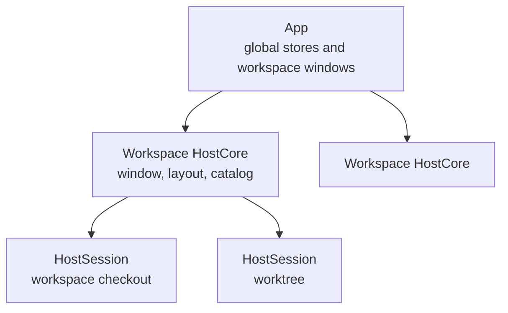
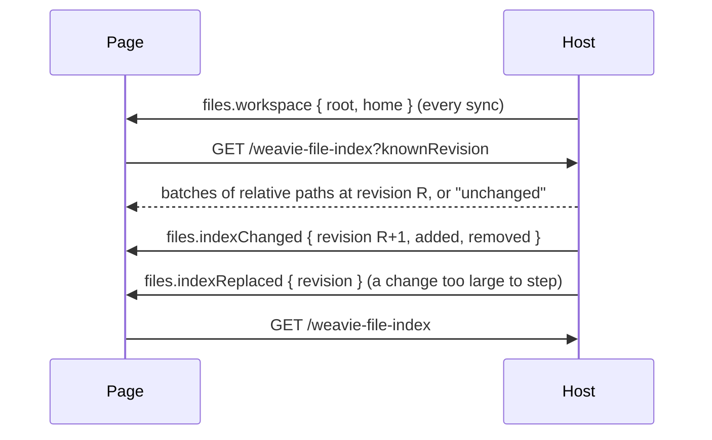

# Workspaces, files, and sessions

**Status:** implemented.

Weavie's runtime has three ownership levels:

- **App:** process-wide settings, recents, native application lifecycle, and open workspace windows.
- **Workspace:** one `HostCore`, window/page, layout, HTTP origin, and session catalog.
- **Session:** one working directory plus agent, terminals, editor state, files, LSP, hooks, reviews, and
  exact message endpoint.

A workspace is a place. A session is a unit of agentic work in that place.

## Layout and presentation

Pane layout and window geometry belong to the workspace. Session contents belong to `ClientSession`
objects. The page renders the selected session's editor and terminal/agent panes into the shared layout.

Sharing the frame or Monaco widget does not rebind ownership. Background sessions continue updating their
own state, and selecting one presents the state it already has.

## File provider

Monaco file working copies use the owning session's `files` feature:

| operation | kind | payload/result |
| --- | --- | --- |
| `files.stat` | request | path → file metadata |
| `files.read` | request | path → contents and metadata |
| `files.write` | request | path/content → write result |
| `files.listDirectory` | request | directory entries or request error |
| `files.changed` | event | session file-activity projections |
| `files.reveal` | event | validated path open |

The session envelope is the route. Paths are domain values and never select a backend.

`FileProviderService` allows the worktree root and that session's scratch root. It refuses other paths.
Every model URI includes the session incarnation, and `HostFileProvider` resolves the owner from that URI
before sending a request. A delayed response therefore returns to the original model/session even after a
selection change.

## File browser

The contextual file browser is rooted at the selected session's worktree. Directory state is cached by
`ClientSession`; switching presentation reads the target owner's cache and requests missing directories on
that owner's bus.

The browser is UI chrome, not another filesystem owner. Open actions capture the relevant `ClientSession`
and forward to its editor controller.

## Watchers and edits

Each `HostSession` owns one `WorkspaceInventory` and one `SessionFileActivity`. The activity owns an
inventory-driven `WorkspaceInvalidationWatcher`; completed buffer saves, known file changes/deletions, and
debounced watcher batches enter its ordered stream. The asynchronous Git inventory supplies tracked and
untracked, non-ignored paths. Linux uses one shared inotify instance with flat watches only for inventoried
directories; Windows and macOS use one kernel-recursive root subscription and filter every event through the
inventory. It periodically refreshes the authoritative inventory and refreshes immediately when directory
topology changes, so Linux startup and change capture never walk ignored trees such as `.git/objects`.

A plain folder has the same inventory from a different listing: its own files come from a walk that prunes the
noise directories and follows no directory link, and each repository beneath it is listed by that repository's
git, so its ignore rules decide its files. A change re-lists only the changed paths through whichever of the two
owns them; a `.git` entry arriving or leaving, or an ignore-rule edit, re-lists the folder that holds it.

Every refresh returns what it changed (files created and deleted, directories added and removed), and the
watcher records its invalidations from that, so a refresh costs what it lists and never the size of the
workspace. Each non-empty change is one revision of the inventory.

Its registered projections:

- the file list a page holds is stepped by each inventory change (see File list below);
- file-provider change events refresh matching Monaco working copies;
- LSP `workspace/didChangeWatchedFiles` updates that session's servers;
- review presentation follows already-updated tracker state.

Facts carry no actor or cause. A provider-reported change and a later watcher invalidation can coexist without
inference or deduplication. No callback scans or routes through the selected workspace. Session teardown
flushes watcher admission and drains file activity before its worktree can be removed.

## File list

A page holds each loaded session's file list, which Go to File, the file filter and recent files search. It is
never sent whole over the message bus.

- The list downloads as a gzipped stream of newline-delimited batches from the session's own address, so the
  host never builds it as one message and a slow page applies backpressure.
- A page gets the first listing as soon as its watches are armed. The pass that verifies it reports anything it
  finds as a change; a reader that looks once (path recovery) waits for that pass.
- Each inventory change is published once as the step from the revision before it. A page applies a step only as
  the exact next revision. A step it already holds is ignored, steps that arrive during a download wait for it,
  and anything else makes the page download again.
- A change touching more paths than `MaxFileIndexChangePaths` is announced without its paths, and the page
  downloads the list.
- A reconnecting page asks with the revision it holds and is told "unchanged" when the list is.
- Paths are relative to the workspace root; the page spells the absolute path once per file, with the
  separator the host names.
- The page keeps each folder's own files and child folders, so Go to File's tree lists only the levels that are
  open.
- A download that fails leaves the surfaces saying so, with Retry on the error; Reload File List
  (`weavie.files.reloadList`) downloads again for the session it is run in.

## Persistence

| state | scope |
| --- | --- |
| settings, keybindings, remote-agent registry, recents | app |
| layout and window geometry | workspace |
| session slot/load overlay | workspace host |
| per-slot editor sessions and scratch references | workspace host |
| live editor/terminal/agent/LSP/review state | exact session incarnation |

Persisted editor state contains paths and view metadata, not file contents. Disk remains authoritative for
contents.

## Windows and hosts

Native app controllers may own multiple workspace windows in one process. Each window creates its own
`HostCore`, transport, host incarnation, catalog, and session set. Process-wide stores may be shared, but
message buses never are.

Headless represents one workspace host without a native window. A remote page connects to it through the
same exact host/session envelope protocol.

## Invariants

- A session feature receives its bus from its owning `HostSession` or `ClientSession`.
- File requests contain no host, slot, current-session, or selected-session routing fields.
- Equal paths in different sessions are distinct models and operations.
- Host selection never gates file, watcher, editor, or LSP state mutation.
- Rendering checks happen only after owner state is updated.
- Unload removes the endpoint and drains file/watcher work before worktree teardown.

See [session-message-bus.md](session-message-bus.md),
[session-file-activity.md](../concepts/session-file-activity.md),
[editor-session.md](editor-session.md), and
[multi-session-and-worktrees.md](multi-session-and-worktrees.md).
