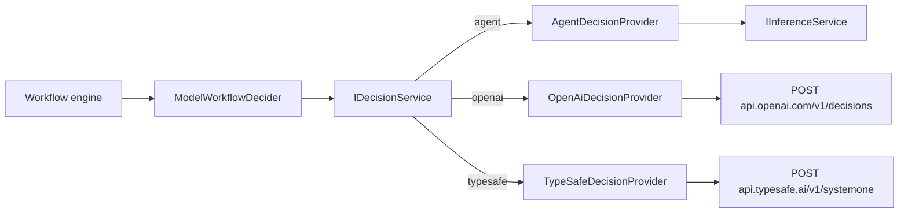

# Decision providers

**Status:** design. Builds on the decision contract from `feature/workflow-decision-evidence`
([workflows.md](workflows.md)): a workflow decider receives a question, described choices, and prepared evidence,
and returns a choice with a confidence the engine compares against `workflow.decisionConfidence`.

Ad-hoc inference gains a decision surface: one choice question over typed evidence, answered with a probability per
choice by a pluggable **decision provider** — the configured agent, OpenAI Decisions (`gpt-6-luna`), or TypeSafe
Jev. Decision models never write text: they take shared evidence plus named questions and return a probability for
every choice. That is the exact shape of a workflow decision, and the probability is calibrated
rather than the self-reported number a chat model invents. Workflow decisions are the first consumer.

## Why decision models, and not direct chat APIs

Measured on 2026-11-08 from the Debian worker, three review-routing cases (clean review, real bug + red CI, one
unreproduced warning), three runs each, identical evidence:

| Provider | Latency | Clean | Bug | Unreproduced warning |
|---|---|---|---|---|
| ACP Claude Agent (Haiku), transient process | 1.25–1.45s | approve "0.93–0.95" | revise "0.97" | revise "0.3" (incoherent) |
| OpenAI Decisions `gpt-6-luna` | 0.17–0.25s (cold 0.99s) | approve p=1.00 | revise p=1.00 | approve p=0.85 |
| TypeSafe Jev 1.14 | 0.06–0.10s | approve p=1.00 | revise p=1.00 | approve p=0.93–0.94 |

Each decision costs about $0.00002 on either vendor (≈230–450 input tokens; output is free).

Direct chat providers (Anthropic Messages, OpenAI Responses) were considered for typed queries such as branch
naming and rejected: a direct call is ~1.5s regardless of model or Fast Mode, against ~2.6s through ACP. Saving a
second on a background suggestion does not justify a credential store and two HTTP clients. Typed inference stays
agent-only ([ad-hoc-inference.md](ad-hoc-inference.md)).

## Layers

Decisions are a second ad-hoc inference surface beside typed queries, owned by Core and usable by any feature.
Workflows are the first consumer, not the owner.

- **`IDecisionService`** (`Weavie.Core.Inference`) is the decision counterpart of `IInferenceService`:
  - It takes an `InferenceOwner`, typed evidence (`TEvidence` + `JsonTypeInfo<TEvidence>`), one choice question, and
    query options with an origin and a time budget.
  - It enforces the `inference.enabled` / `inference.allowAutomatic` gates and the time budget through the same
    policy code as typed queries. It returns a receipt with the same shape.
  - It resolves the live `inference.decisionProvider` setting on every call.
- **`IDecisionProvider`** makes one attempt for one question. It returns a probability for every choice, a refusal,
  or a failure with an `InferenceFailureKind`.
- **The service picks the answer.** The choice is the label with the highest probability, and a tie is an invalid
  response. The service validates that every label is present, each value is finite and within `[0, 1]`, and no
  unknown label appears. It never renormalizes or repairs a distribution.
- **`ModelWorkflowDecider`** is the only workflow code. It translates a `WorkflowDecisionRequest` into a decision
  query, and the answer into `WorkflowDecisionResult`:
  - an answer becomes `Answered(choice, its probability)`;
  - a refusal becomes `Refused`;
  - every failure becomes `Failed` with its reason.
- **The threshold stays feature policy.** The engine compares that probability with `workflow.decisionConfidence`.
  The decision layer knows no thresholds.
- **`InferenceWorkflowDecider` is deleted.** Its job moves into `AgentDecisionProvider`.

The question shape is a choice question: instructions plus labels, each with an optional description. Vendors also
support yes/no and score questions and several questions over the same evidence. Those join the contract when a
feature needs them.

## Providers

| Setting | Values | Default |
|---|---|---|
| `inference.decisionProvider` | `agent`, `openai`, `typesafe` | `agent` |

- **`agent`** runs a typed query through the live inference provider and profile. The reply is one probability per
  label, under a schema with one required number per choice. It replaces today's `{choice, confidence}` reply, which
  let a model answer "revise at 0.3" between two options. A self-reported distribution still isn't calibrated, but
  the service can check it and the chosen label always agrees with its number.
- **`openai`** and **`typesafe`** call the vendor directly:
  - Choosing one is the opt-in to sending decision evidence, including complete referenced file contents, to that
    vendor. The setting's description names the vendor and links its data terms.
  - Each adapter pins its vendor's model: `gpt-6-luna` (OpenAI's only decision model) and `jev-latest` (TypeSafe's
    maintained alias). There is no model setting until a vendor offers a real choice.
  - Each makes one attempt with no retry, using plain `HttpClient` and source-generated contracts (Native AOT, no
    vendor SDK).

Both vendors also return a `confidence` field. It is a rescaling of the top probability, not the chance the answer
is right: TypeSafe documents `(p − 1/n) / (1 − 1/n)`, and OpenAI's values match it. TypeSafe's docs recommend
thresholding the probability of the option acted on. Weavie ignores the vendor `confidence` field. There is one
threshold, and each decision's `confidence:` override still applies.

Evidence is sent as structured data, and the question is one `choice` named `decision`:

| | OpenAI | TypeSafe |
|---|---|---|
| Evidence | `input: [{role: user, content: [{type: input_json, data: <evidence>}]}]` | `state: <evidence>` |
| Question | `questions: [{type: choice, name, instructions, choices: [{value, description}]}]` | `questions: {decision: {type: choice, instructions, criteria: {label: description \| null}}}` |
| Distribution | `answers[]` matched by `name`, `probabilities[]` of `{value, probability}` | `answers.decision.probabilities` keyed by label |
| Refusal | `type: refusal` | not part of the contract |
| Limits | not published | 32k tokens per question, 64k per request |

A choice without a description is sent without one: OpenAI omits the field and TypeSafe sends `null`.

Each HTTP failure maps to a failure kind with a reason naming the cause:
- an authentication failure, naming the connect command;
- rate limiting;
- an oversized request, with the vendor's message;
- an unreachable host;
- a response missing the question's answer.

Weavie never falls back to another provider.

## Credentials

API keys are not settings, since settings are readable through `getSetting`. They use the owner-only token store
and paste-dialog flow that Notion sources use ([notion-source-auth.md](notion-source-auth.md)): one command per
vendor (**Connect OpenAI Decisions**, **Connect TypeSafe**) opens the vendor's key page and a paste dialog. The host
validates the key with one cheap authenticated call before saving it owner-only under `~/.weavie/`. Keys never
appear in receipts, logs, toasts, or MCP replies.

That store and dialog are generalized out of `SourceConnector` rather than copied. Choosing a provider whose key is
missing is allowed; the next decision fails with "Connect OpenAI Decisions to use it" and goes to the user. On a
remote runner the key lives on the worker, which makes the calls.

## Testing

- **Decision service tests** use a fake provider. They cover the policy gates, the timeout, picking the top label,
  rejecting a tie, missing or unknown labels, and out-of-range values.
- **Agent provider tests** check the per-label schema and the translation of typed-query failures.
- **Vendor adapter contract tests** run against a stubbed `HttpMessageHandler`. They cover:
  - request shape, including undescribed choices;
  - probability extraction;
  - refusal;
  - each HTTP failure;
  - a missing answer;
  - a missing key.
- **A Hosting workflow test** routes a model decision through `typesafe` with the stubbed handler. It proves the
  live `inference.decisionProvider` switch and the low-probability escalation.
- **No test calls a real vendor.** A live check against each vendor (the `temp/decision-bench` cases) is a
  per-change manual step.

## Out of scope

- **Direct chat providers for typed inference** — see the measurements above.
- **Azure Foundry.** It uses the same wire format as OpenAI. Its follow-up path is Entra ID tokens from `az login`,
  so no long-lived key is stored.
- **Jev through Cloudflare Workers AI.** Who sees the content on that route isn't documented.
- **Predicate and score questions.** Workflows only ask choice questions.
