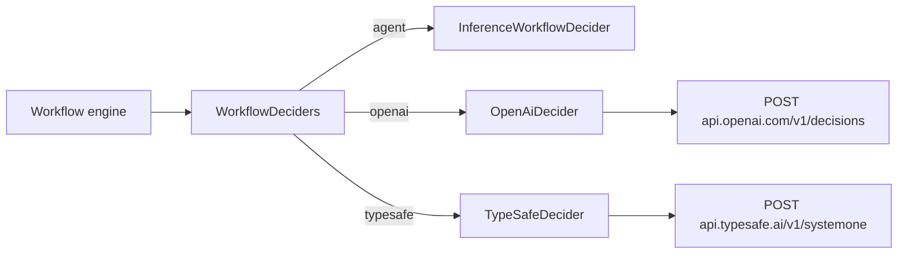

# Decision providers

**Status:** design. Builds on the decision contract from `feature/workflow-decision-evidence`
([workflows.md](workflows.md)): a decider receives a question, described choices, and prepared evidence,
and returns a choice with a confidence the engine compares against `workflow.decisionConfidence`.

Workflow decisions can be answered by a **decision model** — OpenAI Decisions (`gpt-6-luna`) or TypeSafe Jev —
instead of an agent. Decision models never write text: they take shared evidence plus named questions and return a
probability for every choice. That is the exact shape of a workflow decision, and the probability is calibrated
rather than the self-reported number a chat model invents.

## Why decision models, and not direct chat APIs

Measured on 2026-11-08 from the Debian worker, three review-routing cases (clean review, real bug + red CI, one
unreproduced warning), three runs each, identical evidence:

| Provider | Latency | Clean | Bug | Unreproduced warning |
|---|---|---|---|---|
| ACP Claude Agent (Haiku), transient process | 1.25–1.45s | approve "0.93–0.95" | revise "0.97" | revise "0.3" (incoherent) |
| OpenAI Decisions `gpt-6-luna` | 0.17–0.25s (cold 0.99s) | approve p=1.00 | revise p=1.00 | approve p=0.85 |
| TypeSafe Jev 1.14 | 0.06–0.10s | approve p=1.00 | revise p=1.00 | approve p=0.93–0.94 |

Each decision costs about $0.00002 on either vendor (≈230–450 input tokens; output is free).

Direct chat providers (Anthropic Messages, OpenAI Responses) were considered for typed queries such as branch
naming and rejected: a direct call is ~1.5s regardless of model or Fast Mode, against ~2.6s through ACP. Saving a
second on a background suggestion does not justify a credential store and two HTTP clients. Typed inference stays
agent-only ([ad-hoc-inference.md](ad-hoc-inference.md)).

## Selection

| Setting | Values | Default |
|---|---|---|
| `workflow.decisionProvider` | `agent`, `openai`, `typesafe` | `agent` |

- `agent` is today's `InferenceWorkflowDecider`: the live typed-inference provider answers `{choice, confidence}`.
- `openai` and `typesafe` call the vendor directly. Choosing one is the opt-in to sending decision evidence —
  including complete referenced file contents — to that vendor; the setting's description names the vendor and links
  its data terms.
- The setting is live: each decision attempt reads it, like the confidence threshold.
- External providers obey the same `inference.enabled` gate as agent deciding. Both paths share one policy check.

Each adapter pins its vendor's model: `gpt-6-luna` (OpenAI's only decision model) and `jev-latest` (TypeSafe's
maintained alias). No model setting exists until a vendor offers a real choice.

## Confidence

For a decision model, the confidence returned to the engine is **the chosen option's probability**. Both vendors
also return a `confidence` field, but it is a rescaling of the top probability (TypeSafe documents
`(p − 1/n) / (1 − 1/n)`; OpenAI's values match it), not the chance the answer is right. TypeSafe's docs recommend
thresholding the probability of the option acted on. Weavie ignores the vendor `confidence` field.

There is one threshold, `workflow.decisionConfidence`, and each decision's `confidence:` override still applies.
A user changes provider rarely, and a decision model's probability and an agent's self-report both read as "how
sure is the answer" near the default 0.8.

## Adapters

Both adapters implement `IWorkflowDecider` in Core beside `InferenceWorkflowDecider`, translating one prepared
`WorkflowDecisionRequest` into one HTTP request. A `WorkflowDeciders` selector, created once per session in place of
the direct `InferenceWorkflowDecider` construction, reads the setting and delegates. One attempt, no retry, the same
60s budget, plain `HttpClient` with source-generated request/response contracts (Native AOT; no vendor SDK).

The evidence object `{outputs, summary, files: [{path, text}]}` is sent as structured data, and the decision is one
`choice` question named `decision` whose instructions are the question text.

| | OpenAI | TypeSafe |
|---|---|---|
| Evidence | `input: [{role: user, content: [{type: input_json, data: <evidence>}]}]` | `state: <evidence>` |
| Question | `questions: [{type: choice, name, instructions, choices: [{value, description}]}]` | `questions: {decision: {type: choice, instructions, criteria: {label: description \| null}}}` |
| Answer | `answers[]` matched by `name` | `answers.decision` |
| Probability | `probabilities[]` entry whose `value` is `choice` | `probabilities[choice]` |
| Refusal | `type: refusal` → `Refused` | not part of the contract |
| Limits | not published | 32k tokens per question, 64k per request |

Choices without descriptions are sent without one (OpenAI omits the field; TypeSafe sends `null`).

Results map to `WorkflowDecisionResult`:
- `Answered(choice, probability)`; the engine still validates membership and range.
- A refusal becomes `Refused`.
- Every HTTP failure becomes `Failed` with a reason naming the cause: an authentication failure naming the connect
  command, rate limiting, an oversized request with the vendor's message, an unreachable host, or a response
  missing the question's answer.

Every failure puts the question to the user, as today. Weavie never falls back to the agent.

## Credentials

API keys are not settings, since settings are readable through `getSetting`. They use the owner-only token store
and paste-dialog flow that Notion sources use ([notion-source-auth.md](notion-source-auth.md)): one command per
vendor (**Connect OpenAI Decisions**, **Connect TypeSafe**) opens the vendor's key page and a paste dialog. The host
validates the key with one cheap authenticated call before saving it owner-only under `~/.weavie/`. Keys never
appear in receipts, logs, toasts, or MCP replies.

That store and dialog are generalized out of `SourceConnector` rather than copied. Choosing a provider whose key is
missing is allowed; the next decision fails with "Connect OpenAI Decisions to use it" and goes to the user. On a
remote runner the key lives on the worker, which makes the calls.

## Testing

- **Adapter contract tests** run against a stubbed `HttpMessageHandler`. They cover:
  - request shape, including undescribed choices;
  - probability extraction;
  - refusal;
  - each HTTP failure;
  - a missing answer;
  - a missing key.
- **A Hosting workflow test** routes a model decision through `typesafe` with the stubbed handler. It proves the
  live setting switch and the low-probability escalation.
- **No test calls a real vendor.** A live check against each vendor (the `temp/decision-bench` cases) is a
  per-change manual step.

## Out of scope

- **Direct chat providers for typed inference** — see the measurements above.
- **Azure Foundry.** It uses the same wire format as OpenAI. Its follow-up path is Entra ID tokens from `az login`,
  so no long-lived key is stored.
- **Jev through Cloudflare Workers AI.** Who sees the content on that route isn't documented.
- **Predicate and score questions.** Workflows only ask choice questions.
