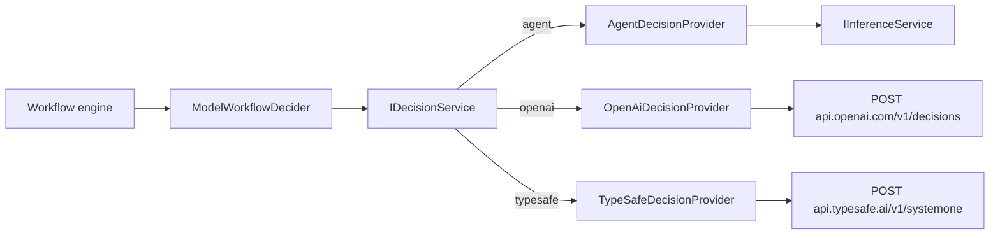

# Decision providers

**Status:** implemented. Builds on the workflow decision contract ([workflows.md](workflows.md)): a decider receives a
question, described choices, and prepared evidence, and returns a choice with a confidence the engine compares against
`workflow.decisionConfidence`.

Ad-hoc inference has a decision surface: one choice question over evidence, answered with a probability per choice by
a pluggable **decision provider**: the configured agent, OpenAI Decisions (`gpt-6-luna`), or TypeSafe Jev. Decision
models never write text; they take evidence plus named questions and return a probability for every choice, which is
exactly a workflow decision, and the probability is calibrated rather than a number a chat model invents.

The new-session composer is the second consumer: it asks which startable workflow fits the drafted prompt, as an
automatic query (`inference.allowAutomatic`), so a vendor provider receives the draft before the session is started.
See [new-session-workflow-picker/design.md](new-session-workflow-picker/design.md).

## Why decision models, and not direct chat APIs

Measured on 2026-11-08 from the Debian worker, three review-routing cases (clean review, real bug + red CI, one
unreproduced warning), three runs each, identical evidence:

| Provider | Latency | Clean | Bug | Unreproduced warning |
|---|---|---|---|---|
| ACP Claude Agent (Haiku), transient process | 1.25–1.45s | approve "0.93–0.95" | revise "0.97" | revise "0.3" (incoherent) |
| OpenAI Decisions `gpt-6-luna` | 0.17–0.25s (cold 0.99s) | approve p=1.00 | revise p=1.00 | approve p=0.85 |
| TypeSafe Jev 1.14 | 0.06–0.10s | approve p=1.00 | revise p=1.00 | approve p=0.93–0.94 |

Each decision costs about $0.00002 on either vendor (≈230–450 input tokens; output is free).

Direct chat providers (Anthropic Messages, OpenAI Responses) were rejected for typed queries such as branch naming: a
direct call is ~1.5s regardless of model or Fast Mode, against ~2.6s through ACP, which does not justify a credential
store and two HTTP clients. Typed inference stays agent-only ([ad-hoc-inference.md](ad-hoc-inference.md)).

## Layers



- **`IDecisionService`** (Core) takes one `DecisionRequest`: owner, serialized evidence, a choice question, origin,
  and time budget. It applies the `inference.enabled` / `inference.allowAutomatic` gates and the single time-bounded
  attempt through the same `InferencePolicy` as typed queries, resolves the live `inference.decisionProvider` on every
  call, and returns `InferenceResult<DecisionAnswer>` with the typed-query receipt (`ProviderId` is the decision
  provider id).
- **`IDecisionProvider`** makes one attempt and returns an `InferenceProviderResult`: a `DecisionDistribution`, or an
  `InferenceProviderFailure` for a refusal or any other failure. It exposes the `CredentialDefinition` it calls with,
  or null (the agent).
- **The service picks the answer**: the label with the highest probability. Every label must be present, none
  unknown, each finite within `[0, 1]`, with one unique maximum; anything else is `InvalidResponse`. It never
  renormalizes or repairs a distribution.
- **`ModelWorkflowDecider`** is the only workflow code. An answer becomes `Answered(choice, its probability)`, a
  refusal `Refused`, and every other failure `Failed` with its kind and reason. The engine compares the probability
  with `workflow.decisionConfidence`; the decision layer knows no thresholds.
- **Decision history.** Each agent-answered decision's duration goes to the workspace's `WorkflowDecisionHistory`
  (`~/.weavie/workspaces/<id>/decision-history.json`, the last 20); a change re-evaluates the suggestion cards.

Vendors also support yes/no and score questions and several questions per request; those join the contract when a
feature needs them.

## Providers

`inference.decisionProvider` is one of `agent` (default), `openai`, `typesafe`.

- **`agent`** runs a `Utility` typed query through the live inference provider and profile, under a schema with one
  required number in `[0, 1]` per label and no other properties. The schema travels in the query's
  `InferenceResponseType<T>` beside its `JsonTypeInfo<T>`, because the labels change per decision. The distribution
  isn't calibrated, but the service checks it and the chosen label always agrees with its number.
- **`openai`** and **`typesafe`** call the vendor directly. Choosing one is the opt-in to sending it the decision
  evidence, including complete referenced file contents; the setting's description names the vendor and links its
  data terms. Each pins its model (`gpt-6-luna`, OpenAI's only decision model; `jev-latest`, TypeSafe's maintained
  alias) and makes one attempt with no retry over plain `HttpClient` and source-generated contracts (no vendor SDK).

Both vendors' `confidence` field rescales the top probability (TypeSafe documents `(p − 1/n) / (1 − 1/n)`; OpenAI's
values match) rather than giving the chance the answer is right, so Weavie ignores it and thresholds the chosen
label's probability, as TypeSafe recommends. Each decision's `confidence:` override still applies.

The question is one `choice` named `decision`:

| | OpenAI | TypeSafe |
|---|---|---|
| Evidence | `input: [{role: user, content: [{type: input_json, data: <evidence>}]}]` | `state: <evidence>` |
| Question | `questions: [{type: choice, name, instructions, choices: [{value, description}]}]` | `questions: {decision: {type: choice, instructions, criteria: {label: description \| null}}}` |
| Distribution | `answers[]` matched by `name`, `probabilities[]` of `{value, probability}` | `answers.decision.probabilities` keyed by label |
| Refusal | `type: refusal` | not part of the contract |
| Limits | not published | 32k tokens per question, 64k per request |

`VendorDecisionProvider` is the one HTTP path: it reads the key, sets the bearer header (the only vendor `Reveal()`),
posts once, and maps each failure to a kind whose reason never carries the body:

| Cause | Kind | Reason |
|---|---|---|
| no key | `NotConfigured` | "Connect OpenAI to use it (run Connect Service…)." |
| an unreadable key | `NotConfigured` | the store's reason, then "Connect OpenAI again…" |
| 401, 403 | `AuthenticationFailed` | names Connect Service… for the vendor |
| 429 | `RateLimited` | |
| 400, 413, 422 | `InputRejected` | with only the vendor's message: OpenAI's `error.message` or TypeSafe's string `detail` |
| other status | `ProviderUnavailable` | the status code |
| `HttpRequestException` | `ProviderUnavailable` | the host is unreachable |
| malformed body, or no answer named `decision` | `InvalidResponse` | |
| OpenAI `type: refusal` | `Refused` | |

Weavie never falls back to another provider.

## Credentials

API keys are not settings, since settings are readable through `getSetting`. Every Weavie-held secret goes through
one Core interface:

```csharp
public interface ICredentialStore {
	CredentialSecret? Read(string id);              // null when absent; throws when present but unreadable
	void Save(string id, CredentialSecret secret);
	bool Delete(string id);                         // false when none was saved
}
```

- **Secrets are `CredentialSecret`, never a bare string.** It prints `[redacted]`, and its type-level
  `[JsonConverter]` throws from both `Read` and `Write` (source-generated contexts honor it, so it is Native AOT
  safe); without it the generator would silently write `{}`. `Reveal()` is called only where an authorization header
  is set. The model is Rust's `secrecy`; Pydantic's masking `SecretStr` would turn a mistake into a silently wrong
  payload, and `SecureString` is discouraged, unencrypted off Windows, and needs a plain string per request anyway.
- **Each host supplies the store** through `HostServices.CreateDefault(ICredentialStore)` (app-wide, so not on
  `IHostPlatform`). The only implementation, `FileCredentialStore`, writes one owner-only file per id,
  `~/.weavie/credentials/<id>.key`; a Keychain or Credential Manager store plugs in with no caller change.
- **Each service is declared once** as a `CredentialDefinition` by the code that calls it (`NotionSource`, each vendor
  adapter), and `ConnectedServicesComposition` collects them into one `CredentialService`. A definition holds the id,
  display name, the vendor's name for the key, its key page, and the cheap authenticated check that returns the
  account it authorizes (possibly empty). `IGitHubTokenSource` stays separate: it discovers credentials other tools
  own and stores nothing.

| Id | Key page | Check |
|---|---|---|
| `notion` | https://app.notion.com/developers/tokens | `GET /v1/users/me` |
| `openai` | https://platform.openai.com/api-keys | `GET https://api.openai.com/v1/models` |
| `typesafe` | https://console.typesafe.ai/keys | `GET https://api.typesafe.ai/v1/models` |

Two commands serve every definition, each taking the service id or, from the palette, offering a picker:

- **Connect Service…** (`weavie.credentials.connect`) opens the key page and the shared paste dialog, which also links
  it (a headless host opens no browser). The picker lists connected services first. Opening a Notion link with no
  token runs it for `notion`; a decision failure names it.
- **Disconnect Service…** (`weavie.credentials.disconnect`) deletes the key, even an unreadable one, and says so when
  none was saved. The picker lists connected services.

Each session holds at most one pending connect prompt and one open picker, and the answer runs its continuation on
that session, never on whichever is selected. The picker is a modal listbox: arrows move, Enter picks, Escape or a
click outside dismisses, and a window blur does not.

The host checks a pasted key before saving it; a rejected key is shown in the dialog and never saved. The agent can
run either command but never sees a key: no tool or setting accepts one, and keys never appear in receipts, logs,
toasts, transcripts, or MCP replies. On a remote runner the key is pasted in the client, sent once over the encrypted
bridge, and stored on the worker that makes the calls.

## Choosing the default

Connecting never changes which provider decides. **Choose Decision Model…** (`weavie.inference.chooseDecisionProvider`)
sets `inference.decisionProvider`:

- Its picker lists **Agent**, then connected vendors, then unconnected ones, and marks the current default.
- Picking an unconnected vendor runs Connect Service… first; the setting changes only when that connect succeeds.
- With the `provider` argument it skips the picker. The result says when `inference.enabled` is off, which choosing
  a vendor does not change.
- Disconnecting the current default resets it to `agent`; disconnecting any other service leaves it alone. A vendor
  whose key is revoked stays chosen, and the next decision fails with "Connect OpenAI to use it" and goes to the user.

## Discovery

- **A suggestion card** (`decisions.model`, [suggestions.md](../concepts/suggestions.md)) appears while
  `inference.decisionProvider` is `agent` and the history holds at least five agent-answered decisions with a median
  of at least a second. Its body quotes the count and median (so a cold start doesn't skew it): "Your last 12
  workflow decisions took ~1.3s each through the agent. A decision model answers in ~0.2s with calibrated
  confidence." A card's body renders from its context, whose `SuggestionSignals` supply the history summary and
  correction count. Its button runs Choose Decision Model…, beside Snooze and Don't ask again.
- **A startup tip** ("Give workflow decisions a decision model") runs Choose Decision Model…. Every tip with a command
  shows a toast button labelled with the command's catalog title, waits for the catalog that names it, stays a timed
  toast, and appends the keybinding only when bound.
- **The agent finds it** through the setting's description and aliases ("decision model", "faster workflow
  decisions", "gpt-6-luna", "Jev").
- Getting started never asks about decision models, and a question a decision hands to the user carries no
  advertising.

## Testing

- **Decision service tests** (fake provider): policy gates, timeout, cancellation, live routing, the top label, and
  each invalid distribution.
- **Agent provider tests**: the per-label schema and prompt, failure pass-through, and shape-invalid replies.
- **Vendor contract tests** over `RecordingHttpHandler` (`Weavie.TestSupport`): request shape including undescribed
  choices and the bearer key, distribution and usage, refusal, every failure row above, and the key check.
- **Credential tests**: `CredentialSecret` redaction and refused serialization; `FileCredentialStore` round trip,
  owner-only permissions, absent versus unreadable, and delete.
- **Hosting tests**: a model decision answered by `typesafe` through the stubbed handler with low-probability
  escalation; Connect and Disconnect Service… through the prompt, picker, and a rejected key; Choose Decision Model…
  through connect, the agent, and the disconnect reset; and the card after the fifth slow agent-answered decision.
- **No test calls a real vendor.** A live check against each vendor (the `temp/decision-bench` cases) is a
  per-change manual step.

## Out of scope

- **Direct chat providers for typed inference** (see the measurements above).
- **Azure Foundry.** Same wire format as OpenAI; its path is Entra ID tokens from `az login`, so no stored key.
- **Jev through Cloudflare Workers AI.** Who sees the content on that route isn't documented.
- **Predicate and score questions.** Workflows only ask choice questions.
