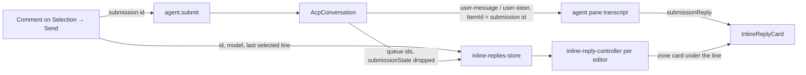

# Inline replies

A comment sent from an editor selection is answered under that selection, so the reply is readable with the
agent pane hidden or the editor full screen. The prompt still goes to the session's main conversation and
the reply still shows in the agent pane; the card is a second view of it.

## Finding the reply

The host journals a submitted prompt's text with `ItemId` set to the client's submission id, so the transcript
row that holds it carries `submissionId`. `submissionReply(snapshot, id, followUps)` reads the card's rows from
the pane's own transcript: what follows that row, and each follow-up's row, up to the user's next unrelated
input. Turns the user had with the agent in between are gaps, not the end of the card. A prompt's own
attachments and a `/btw` asked meanwhile are left out. The reply is still being written while the transcript
ends inside one of those spans and the turn is active. Output the agent adds
to the turn later with no new user input, such as after a background task finishes, continues the card as it
continues the turn.

A comment sent into a running turn is steered into it or queued, as any prompt is. The `queue` feed names each
waiting submission by id, so a queued comment reads `Queued`; any other undelivered one reads `Sending`.

The host reports a submission's fate on `submissionState`: `accepted`, `rejected` with a reason, or `dropped`
when an accepted prompt leaves the queue and never reaches the transcript: Restart Agent or `/clear` with it
queued or steering unanswered, or a delivery that fails before the prompt is journaled. A steer the agent has
not answered returns to the queue when its conversation ends, so it is dropped or handed to the successor
with the rest; the old process may already have injected it, so the agent can see such a steer twice.
`dropped` is an event, so a page disconnected when it is sent keeps the card until dismissed.

## The card

A zone card (`zone-cards.tsx`, as PR threads use) below the selection's last line, so it pushes code down
instead of covering it. It is the pane's own card, not a second renderer:

- **Shell:** `AgentCardShell`, the box of a `/btw` or dashboard card. The head is the question (one line
  collapsed, wrapped when open), the status (`Working`, `Waiting on your approval`, `Queued`, `Sending`,
  `No reply`, `Not sent`) and ✕. Clicking the head collapses the card to that line; a collapsed card still
  shows a request waiting on the user.
- **Body:** `NestedTranscript` over the card's rows, so markdown, tool activity, thinking, earlier-update
  folding, charts, tables, approvals and questions render and act as they do in the pane. It scrolls inside
  itself past 60% of the editor's height.
- **Reply:** the card reply box (`AgentCardReplyBox`, as a `/btw` uses) over `followUpComposer`. It opens
  holding the card's code as it stands now, sends to the main conversation, and its prompt joins the card as
  a follow-up, shown as the user's row without Rewind. It counts as a comment box, so typing in it never
  acts on the editor's review.

A refused first prompt shows the host's reason in the card and returns its comment and excerpt to the
composer; a refused follow-up shows the reason in its box.

The selection toolbar clears when its selection moves on screen (a scroll, a resize, a card growing above
it); a comment being written stays through all of them.

## Commands

All web-run, unbound, and offered only while the session has an inline reply (`agentInlineReplies`). Each of
the first three acts on the reply named by `id`, else the one in view nearest the cursor. The card's head and
✕ show the bound shortcut.

| Id | Title |
|---|---|
| `weavie.agent.toggleInlineReply` | Toggle Inline Reply |
| `weavie.agent.replyToInlineReply` | Reply to Inline Reply |
| `weavie.agent.dismissInlineReply` | Dismiss Inline Reply |
| `weavie.agent.dismissInlineReplies` | Dismiss Inline Replies |

## Lifetime

Inline replies are client state owned by the session. Each holds a decoration on the text model over the
code it is about, which follows that code through edits; the card sits under its last line. A reply ends when:

- the user dismisses it (the card's ✕ or a Dismiss command),
- its model is disposed (the file's last tab closes) or its whole text is replaced, which discards the mark,
- its first prompt leaves the loaded transcript (`/clear`, Rewind); a follow-up that leaves only drops out
  of the card,
- the host drops its first prompt undelivered (a dropped follow-up only leaves the card),
- the page reloads.

Every editor showing the model shows its cards. The card layer exists only while a model has a reply.

## Setting

`editor.inlineReplies` (default `true`). Off, a sent comment is answered in the agent pane only.
