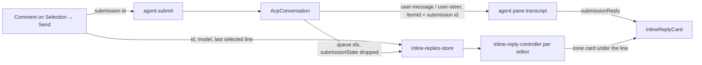

# Inline replies

A comment sent from an editor selection is answered under that selection, so the reply is readable with the
agent pane hidden or the editor full screen. The prompt still goes to the session's main conversation and
the reply still shows in the agent pane; the card is a second view of it.

## Finding the reply

The host journals a submitted prompt's text with `ItemId` set to the client's submission id, so the transcript
row that holds it carries `submissionId`. `submissionReply(snapshot, id)` reads the reply from the pane's
unfolded transcript (every reply, whatever `agent.progressDisplay` folds away): the agent's messages and error
notices after that row and its attachments, up to the user's next input. The reply is still being written
while that span is the transcript's last and the turn is active. Output the agent adds to the turn later with
no new user input, such as after a background task finishes, continues the card as it continues the turn.

A comment sent into a running turn is steered into it or queued, as any prompt is. A steer's reply is what the
agent says after the steer. The `queue` feed names each waiting submission by id, so a queued comment reads
`Queued`; any other undelivered one reads `Sending`.

The host reports a submission's fate on `submissionState`: `accepted`, `rejected` with a reason, or `dropped`
when an accepted prompt leaves the queue and never reaches the transcript: Restart Agent or `/clear` with it
queued or steering unanswered, or a delivery that fails before the prompt is journaled. A steer the agent has
not answered returns to the queue when its conversation ends, so it is dropped or handed to the successor
with the rest. `dropped` is an event, so a page disconnected when it is sent keeps the card until dismissed.

## The card

A zone card (`zone-cards.tsx`, as PR threads use) below the selection's last line, so it pushes code down
instead of covering it, and scrolls inside itself past 60% of the editor's height. It shows the comment, each
message of the reply as it streams, and the pane's working status while the turn runs, including when the
agent is waiting on an approval or an answer. A refused prompt shows the host's reason; its comment and
excerpt return to the composer as before.

The selection toolbar clears when its selection moves on screen (a scroll, a resize, a card growing above
it); a comment being written stays through all of them.

## Lifetime

Inline replies are client state owned by the session. Each holds a decoration on the text model that follows
its line through edits. A reply ends when:

- the user dismisses it (the card's ✕, or **Dismiss Inline Replies**, `weavie.agent.dismissInlineReplies`,
  web, unbound, `When = "agentInlineReplies"`, which clears the session's),
- its model is disposed (the file's last tab closes) or its whole text is replaced, which discards the mark,
- its prompt leaves the loaded transcript (`/clear`, Rewind),
- the host drops its prompt undelivered,
- the page reloads.

Every editor showing the model shows its cards. The card layer exists only while a model has a reply.

## Setting

`editor.inlineReplies` (default `true`). Off, a sent comment is answered in the agent pane only.
