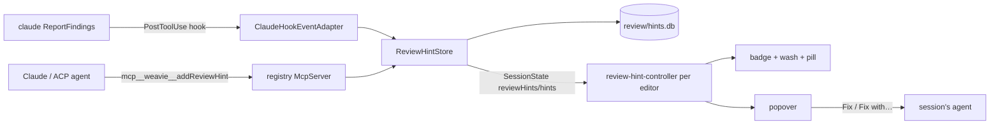

# Inline review hints

Any agent's line-anchored review findings render inline in every editor — turn review, Diff Against, PR review,
and plain file tabs. Hints are agent output that informs the human; they never post to the forge.

> Status: **building**. Feature 1 of [pr-review-roadmap.md](pr-review-roadmap.md).

## Capture

- **`addReviewHint(path, line, severity, text)`** — a registry tool (not a command: agent-only arguments, no
  palette meaning), advertised to Claude and ACP agents alike. `severity` is `bug | warn | nit`; `text`'s first
  line is the summary. Agents learn it from its imperative description and one paragraph in
  `weavie://instructions`, so a generic "review this branch" produces hints. The PR auto-review seed prompt
  reports through it and keeps the summary in chat.
- **Claude's `ReportFindings`** — fires PreToolUse/PostToolUse (never PermissionRequest) through the hook bridge's
  catch-all matcher; verified against claude 2.1.296. Weavie consumes PostToolUse. Severity: `verdict`
  `CONFIRMED` or absent → **bug**, `PLAUSIBLE` → **warn**. Title is `short_summary` else `summary`; body adds
  `failure_scenario`.
- Paths resolve against the session worktree exactly as change tracking resolves them. A path outside the
  worktree or a line past EOF is rejected loudly (tool error / toast); a malformed `ReportFindings` payload is
  surfaced, never dropped.
- Agents are told to report each finding once, through either tool. Weavie skips only exact duplicates (see
  below); it never dedupes by similar text.

## Ownership and lifetime

One `ReviewHintStore` per session. **Every reported hint accumulates**, so a follow-up review that reports only new
findings keeps the earlier ones. A hint whose worktree-relative path, line, and title equal an existing hint's,
captured against identical file text, is not added again — the existing one stays. Hints leave only through
Dismiss (one hint) or Clear Review Hints (all).

Hints persist in `review/hints.db` (the existing keyed-record store; separate from `state.db`, whose validator
owns its own record types). Each hint keeps the file text it was captured against, deduplicated by hash, so it
anchors after reloads.

## Presentation

- **Default:** a solid severity badge in the glyph margin (`!` bug, `i` otherwise), a severity wash on the line,
  and a tinted pill after the line end (`✦ Bug 
`) — one content widget, ellipsized at the editor's
  visible edge; several hints on a line sit side by side. Adds no height.
- **Expanded:** a Monaco content-widget popover just below the line — overlays code, never shifts it. Opens on
  hover/click of the badge or pill, or Next/Previous Hint. Shows severity, `✦ <agent>`, full text, and
  Fix, Fix with…, Previous, Next, Dismiss with keybinding tooltips from the command catalog. The popover holds
  only buttons; every keyboard action is a command.
- Colours: bug `--bad`, warn `--warn`, nit `--busy`.
- **Anchoring** shares PR threads' line mapping (captured text → live buffer); a hint whose line changed fades.

## Fix

A line-anchored item — a review hint or a PR thread — can be sent to the session's agent.

- **Fix** submits a prompt naming `path:line`, the quoted line, and the item's text.
- **Fix with…** opens an app-level prompt modal (as Revise Selection does) for the user's own instruction, then
  submits the same prompt plus that instruction.
- Both go through the session's agent input path (terminal Claude or structured agent). The fix lands as normal
  agent changes in turn review. Linking the hunk back to a PR thread and replying "Fixed in `<sha>`" is
  roadmap feature 4.

## Commands

All unbound except Escape, which closes the session's open popover after the editor's own widgets decline it.

| Id | Runs in | Does |
|---|---|---|
| `weavie.reviewHints.next` / `.previous` | web | Next/previous hint across files; opens its popover |
| `weavie.reviewHints.toggle` | web | Show/hide all hints |
| `weavie.reviewHints.dismiss` | web | Dismiss the open hint, else the one on the cursor line |
| `weavie.reviewHints.fix` / `.fixWith` | web | Fix the open hint (or cursor-line hint/thread) |
| `weavie.reviewHints.close` | web | Escape: close the popover |
| `weavie.reviewHints.clear` | core | Remove all hints |

## Testing

Fake claude emits a `ReportFindings` PostToolUse hook; fake ACP calls `addReviewHint`. Headless e2e covers render
in turn review, Diff Against and PR review, anchoring, navigation, dismiss, toggle, Fix/Fix with…, and replay
after reload; the remote leg covers replay on reconnect. Done when an unmodified review run against real Claude
and a real ACP agent produces inline hints.
