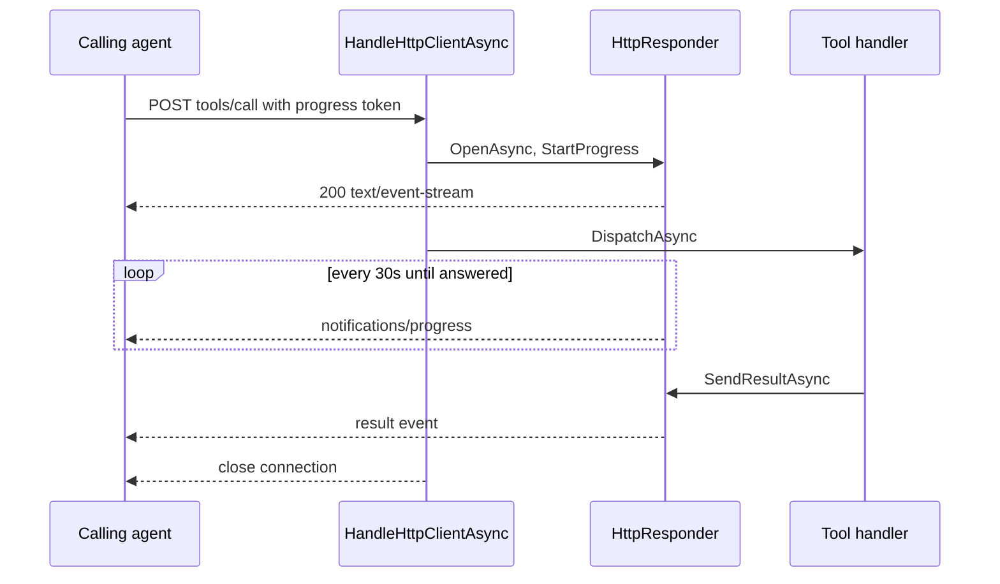

# Long tool calls: design overview

Every HTTP MCP request is answered as an event stream that opens at once. While a tool runs, the same stream carries
periodic progress, then the result. See the [brief](brief.md). Code below is pseudo-implementation: it shows the
shape and the rules, not final text.

## Flow



On the wire, one tool call looks like this:

```text
HTTP/1.1 200 OK
Connection: close
Mcp-Session-Id: 5f2c...
Content-Type: text/event-stream
Cache-Control: no-cache

event: message
data: {"jsonrpc":"2.0","method":"notifications/progress","params":{"progressToken":1,"progress":1}}

event: message
data: {"jsonrpc":"2.0","id":2,"result":{"content":[{"type":"text","text":"Looks right."}]}}
```

## Interfaces

Tool handlers keep talking to `IMcpResponder`, so no tool changes. It loses `SendRawAsync`, which only the deleted
progress layer called.

```csharp
internal interface IMcpResponder {
	object Client { get; }
	Task SendResultAsync(string? idRaw, string resultJson, CancellationToken ct);
	Task SendErrorAsync(string? idRaw, int code, string messageText, CancellationToken ct);
}

// McpServer.Responders.cs: the two JSON-RPC envelopes, shared by both responders.
static string ResultJson(string idRaw, string resultJson);
static string ErrorJson(string? idRaw, int code, string messageText);

// WebSocketHandshake.cs: replaces WriteJsonAsync.
static Task WriteEventStreamHeadAsync(NetworkStream stream, string sessionId, CancellationToken ct);

// McpServer: how often a running call reports progress; tests shorten it.
internal TimeSpan ProgressInterval { get; set; } = TimeSpan.FromSeconds(30);
```

## HTTP endpoint

`DispatchAsync` splits into a parsing overload, which the WebSocket loop keeps calling, and one taking the parsed
root, so an HTTP request is parsed once.

```csharp
async Task HandleHttpClientAsync(stream, request, ct) {
	// auth, target, and session id checks are unchanged
	using var responder = new HttpResponder(stream, sessionId, ProgressInterval);
	using var connection = LinkedTokenSource(ct);
	var watch = CancelOnDisconnectAsync(stream, connection);
	try {
		using var document = Parse(body);        // malformed: answer -32700 on the stream and return
		var root = document.RootElement;
		if (IsRequest(root)) await responder.OpenAsync(connection.Token);
		if (ProgressToken(root) is { } token) responder.StartProgress(token, connection);
		await DispatchAsync(responder, root, connection.Token);
	} catch (OperationCanceledException) when (!ct.IsCancellationRequested) {
		// the caller cancelled or hung up; it expects no reply
	} finally {
		await connection.CancelAsync();
		await responder.Progress;
		await watch;
	}
	if (!responder.Opened) await WriteStatusAsync(stream, "202 Accepted", ct);
}
```

`ProgressToken` returns a token only for `tools/call`, so a quick request never starts a timer.

## HttpResponder

One object per POST owns everything that writes to that connection, so ordering holds by construction.

```csharp
sealed class HttpResponder(NetworkStream stream, string sessionId, TimeSpan interval) : IMcpResponder, IDisposable {
	SemaphoreSlim _gate;     // orders every write
	bool _answered;          // set under _gate; ends progress

	public bool Opened { get; private set; }
	public object Client => sessionId;

	public Task OpenAsync(ct) => Locked(WriteHeadIfNeeded, ct);

	public Task SendResultAsync(idRaw, resultJson, ct) =>
		idRaw is null ? Task.CompletedTask : AnswerAsync(ResultJson(idRaw, resultJson), ct);

	public Task SendErrorAsync(idRaw, code, message, ct) => AnswerAsync(ErrorJson(idRaw, code, message), ct);

	public Task Progress { get; private set; } = Task.CompletedTask;

	public void StartProgress(string tokenJson, CancellationTokenSource connection) =>
		Progress = HeartbeatAsync(tokenJson, connection);

	async Task AnswerAsync(json, ct) => await Locked(async () => {
		if (_answered) return;                   // a call has one answer
		_answered = true;
		await WriteEventAsync(json, ct);
	}, ct);

	async Task HeartbeatAsync(tokenJson, connection) {
		using var timer = new PeriodicTimer(interval);
		int progress = 0;
		try {
			while (await timer.WaitForNextTickAsync(connection.Token)) {
				await Locked(async () => {
					if (!_answered) await WriteEventAsync(ProgressJson(tokenJson, ++progress), connection.Token);
				}, connection.Token);
			}
		} catch (OperationCanceledException) {
			// the call ended
		} catch (IOException) {
			await connection.CancelAsync();      // a failed write means the caller is gone
		}
	}

	async Task WriteEventAsync(json, ct) {
		await WriteHeadIfNeeded(ct);
		// JSON whitespace may contain newlines; an SSE data line may not.
		string line = json.ReplaceLineEndings(" ");
		await stream.WriteAsync(Utf8($"event: message\ndata: {line}\n\n"), ct);
		await stream.FlushAsync(ct);
	}
}
```

## Hang-ups

A reset connection now cancels the call, like a clean close does. The stream makes this reachable, because closing a
socket with unread progress sends a reset.

```csharp
static async Task CancelOnDisconnectAsync(stream, connection) {
	try {
		await stream.ReadAsync(new byte[1], connection.Token);
	} catch (OperationCanceledException) {
		return;                                  // the request finished first
	} catch (Exception e) when (e is IOException or ObjectDisposedException) {
		// a reset is a hang-up too; fall through
	}
	await connection.CancelAsync();
}
```

## Clients

The stdio proxy already relays events, so it loses its JSON branch. `Weavie.FakeAcp` and the tests read event streams
through one helper each.

```csharp
// McpStdioProxy.RelayAsync
if (response.StatusCode == HttpStatusCode.Accepted) return;
response.EnsureSuccessStatusCode();
await RelayEventsAsync(response, outputGate, cancellationToken);
```

## Files

| File | Change |
|---|---|
| `McpServer.Http.cs` | Endpoint and `HttpResponder` |
| `McpServer.Cancellation.cs` | Reset counts as a hang-up |
| `McpServer.Responders.cs` | Shared envelopes; `SendRawAsync` removed from the interface |
| `McpServer.cs` | `DispatchAsync` split; HTTP code moved out |
| `WebSocketHandshake.cs` | `WriteEventStreamHeadAsync` replaces `WriteJsonAsync` |
| `McpStdioProxy.cs` | JSON branch removed |
| `FakeAcpAgent.WeavieTools.cs`, MCP and proxy tests | Read event streams |
| `agent-consultation.md` | Real caller limits |

The WebSocket transport and the consult runtime don't change.

## Risks

- **Silent end of stream:** real Claude doesn't notice a closed stream and waits out its 5-minute limit, even after a
  reset. Every call Weavie ends itself over HTTP therefore gets an answer. A cancel is safe: Claude ends the turn without
  waiting for the stream.
- **Disconnects cancel:** the MCP spec says a disconnect shouldn't imply cancellation. Weavie cancels anyway, because
  it can't resume a stream and nobody could receive the result.
- **Hung consults:** progress only proves Weavie is alive, so a stuck consult runs until the caller cancels it.
- **Other HTTP clients:** only Claude and Codex have been tested against streamed replies.
- **Codex limit:** a Codex caller still stops at about 5 minutes, which the brief accepts.
