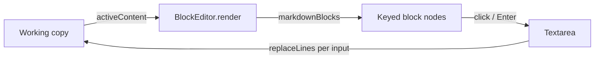

# Editable Markdown preview

Markdown is how plans and specs get reviewed, so it opens rendered (`editor.markdownView`, default `preview`)
and stays editable there. Clicking a block shows its Markdown in place; the rest of the document stays rendered.
The Source/Preview toggle overrides the default per file.
A file with pending agent changes stays rendered and is reviewed there; see
[Pending changes in the rendered Markdown preview](markdown-preview-changes.md).

## Model

The Monaco working copy stays the only document. There is no draft: the block's textarea writes each input
through to the model, so autosave, dirty state, undo, change tracking and correction capture see ordinary edits.
An open block is one undo step; Escape finishes it and undo reverts it.

## Rendering

`markdownBlocks` parses once and renders each top-level block separately, so reference links still resolve. A
block's HTML is its key: unchanged blocks keep their node, which keeps diagrams hydrated and sanitizes only what
changed. Offsets inside a block are relative, so lines moving above it don't change its key. An HTML block left
open (`
`) joins everything up to its closing tag.

The unit of editing is a top-level block, or a list item's own lines (its nested list stays rendered).

## Other writers

An agent can write while a block is open. Every render re-locates the block's exact lines (`relocate`): if they
moved the editor follows; if they're gone the editor closes with a toast, because the other writer's text is
what's on disk. The block's own keystrokes skip rendering entirely.

## Keyboard

Enter opens a focused block (`weavie.editor.previewEditBlock`) and Escape finishes it
(`weavie.editor.previewFinishBlock`). Inside a block, Enter at the end continues the list or adds a block below
(fences, tables and HTML keep a plain newline), Shift+Enter is a newline, the arrows at either end walk to the
adjacent block, and Backspace in an empty block leaves it. A block left empty is removed.

## Limits

Reference definitions and other lines that render nothing have no block; edit them in Source. Review hints and
PR comments are Monaco-only, so stepping to a hint switches the file to Source; Find and Go to Symbol need Source
too.
