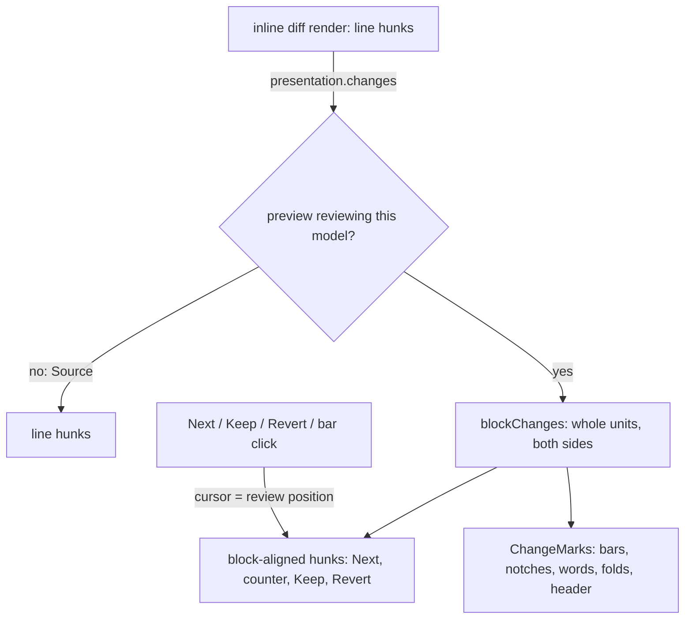

# Pending changes in the rendered Markdown preview

A Markdown file with pending agent changes stays rendered, and the preview is where those changes are reviewed.
It builds on [the editable preview](markdown-editable-preview.md).

## What the user sees

- **Reading:** a thin bar left of each changed block (amber for changed, green for new) and a red notch where a
  block was removed. The page otherwise reads as the final document. A header line counts the changes.
- **The current change:** one block at a time shows its words marked, old struck through and new highlighted, in
  the rendered text. Clicking a bar, or Next/Previous Change, makes a change current; a current removal shows its
  old content struck through. Hide Change Marks (Escape) returns it to a bar. `editor.markdownChangeMarks = "all"`
  marks every changed block at once; there is no button or shortcut for it.
- **Changes only:** the header's toggle (and Toggle Changes Only) folds runs of untouched blocks into
  "… N unchanged blocks · Show".
- **Mostly rewritten:** when more than half the blocks changed, or the file is new, one banner replaces the
  per-block marks and offers the line diff in Source. Change-level steps then switch to Source.
- **Editing a changed block:** the edit box footer reads "Changed by agent · Show original · Done (Esc)"; Show
  original puts the agent's original inside the same box, its removed words marked.

## Model

The inline diff stays the one review engine; the preview is another presentation of it, as the unified review is.

- `blockChanges` widens each line hunk to every unit it touches on either side (a top-level block, or a list
  item's own lines), mapping edges across unchanged lines, and merges overlaps. Every line hunk lands in exactly
  one change, so keeping every change keeps the file. Lines that render nothing join the next block's change.
- The Monaco cursor under the preview is the review position. `confirmTarget` makes Keep and Revert act only on
  the change on screen: a first press on any other change shows it instead.
- Marks are DOM the preview adds after each render and removes before the next, so keyed block nodes and
  hydrated diagrams are untouched. While a block is open the page is frozen and marks wait for it to close.
- Old content renders through the same sanitizer as every preview block and is never registered as editable.

## Limits

- One line hunk spanning two blocks makes one change; Keep keeps both.
- A change only to Markdown syntax (`*a*` to `**a**`) shows a bar with no word marks.
- Folding works on top-level blocks, so a list with one changed item stays whole.
- Review hints and PR comments are still Monaco-only; stepping to a hint switches the file to Source.
