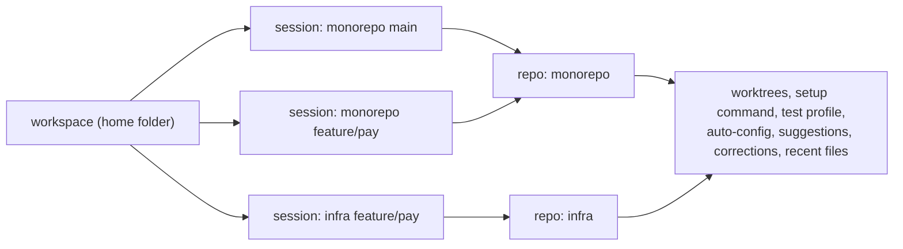

# Multi-repo workspaces

**Status:** building.

A workspace holds sessions from any number of git repositories. A monorepo session and an infra session sit on
one rail, read each other's worktrees, message each other, and each opens its own pull request.

## Terms

- **Workspace** — the window, one to one. It has a **home folder**: the folder that was opened, a git repository
  or a plain folder such as `~/Code`. Its identity, layout, session list, and runner token come from the home folder.
- **Repo** — a git repository some session of the workspace lives in. There is no list of repos to maintain: a
  workspace's repos are the repos of its sessions. No repo is the main one.
- **Session** — one worktree of one repo, or the plain session on a home folder that is not a repository. A
  session never spans repos.

## Ownership

`HostCore` owns the workspace: the bus, the session catalog, layout, command usage, workflow documents, and
decision history. A `Repo` owns everything a git or repo-settings question is asked of: its root, its worktree
manager and setup/teardown commands, its auto-config, suggestions, corrections corpus, and recent files. Repo
state lives under `~/.weavie/workspaces/<id of the repo root>/`, the key the repo's settings overlay already
uses, so a repo has the same state whichever workspace reaches it.

A repo's test profile, suggestions, and recent files reach the page under the repo's root: all of them in the
hello, then each as it changes. A `ClientSession` knows its repo, so the page reads a session's state by it.

Every `SessionSlot` names its `Repo`. The host has no root to ask git about: pull request lookup and Open PR,
branch listing and naming, the default-branch fetch, the worktree setup command, the test profile, and the
default workflow all resolve from the session's repo. A plain home folder is a repo without a worktree manager,
so a worktree session there is refused by name.

The repo of a worktree is git's answer (`git worktree list` from that worktree), never a stored copy. Restoring
a workspace asks it for each saved session outside the home repo. A saved session git can't answer for, whose
worktree is still on disk, stays in the store for a later start and is named in a startup notice.

## Sessions

- The home folder keeps one always-present session. When it is a repository, its existing worktrees are listed
  as dormant sessions.
- Any other repo shows only the sessions created in this workspace.
- `weavie.session.new` takes `repo`, a path to any repository on the host (relative to the invoking session's
  worktree, `~` allowed), defaulting to the invoking session's repo. An agent asked to "create a session for the
  infra changes" passes the infra path. The new-session composer lists the workspace's repos, preselecting the
  selected session's, and takes a typed path for any other; it always sends the repo it shows.
- A repo joins the workspace once a session's worktree exists in it and leaves with its last session, so a
  refused start configures nothing.
- Fork, Open PR, and `base: "source"` stay in the source session's repo.
- A slot's id is the digest of its worktree path, so two repos with the same branch name are two sessions with
  two addresses. A session is found by `(repo, branch)`, never by treating the id as a branch.
- Chips show a repo label only when the workspace's sessions span more than one repo, and then every chip does.

## Across sessions

`listSessions` reports each session's `repo` and `worktree`, so an agent can read a sibling session's files. `readSession` and `messageSession` are unchanged: one workspace is one host and one catalog.

Reading needs no permission machinery. Measured against Claude Agent 0.107 and Codex 2.6: Codex reads outside
its folder in every mode; Claude asks outside bypass mode, and `agent.allowAllPermissions` answers it, after
which Claude allows that directory for the rest of the session. ACP `additionalDirectories` is not used: on
Codex it also grants unprompted writes.

Changes to another repo go through a session in that repo. An agent that edits a sibling worktree directly is
not stopped, and that edit is outside its own session's review, like any edit outside a session's worktree; it
appears in the owning session's branch diff.

## A plain home folder

Opening `~/Code` gives one session rooted there, with no branch, pull request, or worktree. Its agent sees the
repositories beneath it and creates sessions in them. Files it edits in those repositories are reviewed in its
own turn review and land in each repository's own checkout.

## Limits

- Same machine only. A runner serves one workspace.
- A worktree loaded in two workspaces at once runs two agents on one saved conversation. Nothing prevents it.
- Two workspaces holding the same repo each keep the worktree registry in memory; reconciliation against git
  repairs a row one of them overwrote.
- A session on another repo's own checkout is not offered; its branch can't be checked out a second time.

## Required coverage

- the same branch name in two repos gives two sessions with distinct addresses;
- setup command, teardown command, test profile, and auto-config come from the session's repo;
- pull request status and Open PR use the session's repo's origin;
- a restart restores a session in another repo and lists none of that repo's other worktrees;
- deleting a session in another repo removes that repo's worktree;
- a plain home folder hosts a session in a repository beneath it;
- the first session in a repo runs its auto-configured setup command;
- a refused start leaves the repo out of the workspace, and a repo leaves with its last session;
- a saved session whose repo is unreachable at startup is restored by a later start;
- repo labels appear on every chip with two repos and on none with one;
- an agent creates a session in another repo with `weavie.session.new` and reads it through `listSessions`.
