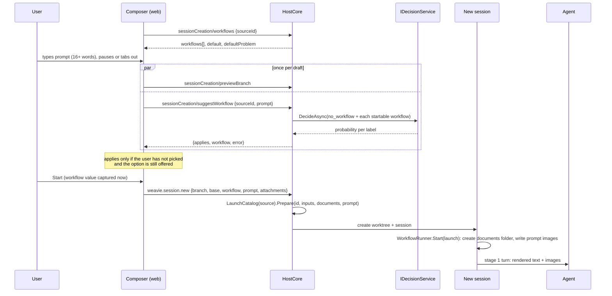

# New-session workflow picker — design

Design for [brief.md](brief.md). Names and line references are from the code as of `82f41e75` (workflow shared
documents, #1173, and workflow agent selection, #1168, are in).

## Summary

**What changes for the user**

- The new-session composer (desktop Sessions modal and mobile) gets a **Workflow** dropdown after the branch
  field. It lists the workflows this start could run, defaults to *No workflow* (or `workflow.default`), and is
  there whether or not inference is on.
- Once the prompt has 16 words and pauses or loses focus, a decision model suggests a workflow once. It fills the
  field only when confident, and never after the user has picked.
- Starting with a workflow hands it the prompt and pasted images as written. Workflows read them as `{{run.prompt}}`.
- Every entry reads as a name and one line under it. A broken workflow is greyed with an unavailable mark and its
  error as that line; a workflow that declares inputs is not listed.

**Main pieces**

| Piece | Where | Job |
| --- | --- | --- |
| Run prompt | `Weavie.Workflows` | A run stores its prompt (text + image names), writes the images into its documents folder at start, renders `{{run.prompt}}`, and marks which turns carry the images |
| Turn delivery | `Weavie.Hosting`, `Weavie.AgentClientProtocol` | Stage turns carry images for prompt and skill stages, on ACP and terminal Claude |
| Start options + suggester | `Weavie.Core/Workflows` | The composer's list, the default and its problem, and the decision |
| Two requests | `HostCore.WorkflowStart.cs` | `sessionCreation/workflows` and `sessionCreation/suggestWorkflow` |
| Draft-settle trigger | `src/web/src/chrome` | One timer/word-gate/focus trigger feeding both the branch preview and the workflow suggestion |
| Workflow field | `src/web/src/mobile` | The dropdown, built on `ControlMenu` |

**Decisions**

- The reference is `{{run.prompt}}`, beside `{{run.documents}}`.
- `workflow.default` is workspace-scoped: a repo can set its own, and the user-wide value applies elsewhere.
- Your `feature-build.yaml` is edited as shown in [Workflow migration](#workflow-migration).
- The prompt's images are sent once per run, not on every stage that uses `{{run.prompt}}`.

**Checked against real agents during the build**

An image that follows a slash command on a skill stage, sent to a skill that reports the image's colour:

| Agent | Result |
| --- | --- |
| claude-agent-acp 0.102.0 | the skill sees the image |
| codex-acp 2.6.0 | the skill sees the image |
| terminal Claude 2.1.322, a turn typed at the running agent | the skill sees the image |
| terminal Claude 2.1.322, the opening turn of a new session | **not attached**: Claude reads a launch prompt that starts with a slash command as command text, so the image arrives as its file path in the skill's arguments |

The last row is the one gap: a new terminal-Claude session whose workflow's *first* stage is a skill, started
with images. The agent still receives each image's path and can open it; it is not shown inline. Typing the
turn after launch instead would race the agent's startup, which is why opening turns are launch arguments.

**Where the code corrects the brief**

- Prompt images live in the run's shared documents folder (#1173) under `prompt/<run-id>/`, not in a folder of
  their own. The folder already exists before the first stage, survives unload and restart, and is deleted with its
  last referencing session, so this design adds no storage class and no cleanup rule. Sessions started from the
  run share the folder and can read the images.
- Main's #1168 and #1173 each added a required field to the saved run, so runs saved before them are already set
  aside. The agreed "older runs load with an empty prompt" rule still holds and now only matters for runs started
  between those changes and this one.

- The brief names `chrome/Menu.tsx`. That is the application menubar; it sits on `ContextMenu`, which closes
  itself whenever a modal is open (`ContextMenu.tsx:339-343`), and the desktop composer is a modal. The component
  that fits is `chrome/ControlMenu.tsx` (the agent pane's model/effort picker), which already works inside modals.
- The suggestion is an *automatic* query, so it needs `inference.allowAutomatic` as well as `inference.enabled`.
- `weavie.workflow.run` gains `prompt` as text only. Nothing that invokes it holds image bytes.

## Flow



## Formats by example

**Saved run** (`~/.weavie/workspaces/<worktreeId>/workflow-run.json`). Image files are relative to
`documentsDirectory`:

```json
{ "run": {
  "id": "r-3f9a1c0b7e42", "workflowId": "quick-fix", "sourcePath": "built-in:quick-fix.yaml",
  "documentsDirectory": "/home/me/.weavie/workspaces/3b42…/workflow-documents/r-3f9a1c0b7e42",
  "sourceText": "id: quick-fix\n…",
  "inputs": {},
  "prompt": { "text": "The WebM video in the review pane fails to load…",
              "images": [ { "file": "prompt/r-3f9a1c0b7e42/image-1.png", "mime": "image/png" } ] },
  "promptImagesSent": false, "stage": "implement", "phase": "Open", "…": "…",
  "kickoff": { "text": "Implement the task below…", "command": "", "opens": "implement", "carriesPromptImages": true }
} }
```

A run saved before this change has none of `prompt`, `promptImagesSent`, or `carriesPromptImages`. It loads with
`WorkflowPrompt.None` and `false`; its definition snapshot cannot contain `{{run.prompt}}`, so the empty prompt is
never read.

**`sessionCreation/workflows`**

```json
{ "sourceId": "feature-x" }
```
```json
{ "workflows": [
    { "id": "broken", "description": "", "error": "run needs exactly one of prompt or skill at stages[0].run (line 5, column 5)" },
    { "id": "quick-fix", "description": "A small, well-understood change. …", "error": null } ],
  "default": "quick-fix", "defaultProblem": null }
```

`sourceId` is the selected session's slot when the composer's *From* is *Current session*, else `null`.

**`sessionCreation/suggestWorkflow`**

```json
{ "sourceId": null, "prompt": "The WebM video in the review pane fails to load…" }
```

| Response | Meaning |
| --- | --- |
| `{ "applies": true, "workflow": "quick-fix", "error": null }` | reached the threshold |
| `{ "applies": true, "workflow": null, "error": null }` | *no workflow* reached the threshold |
| `{ "applies": false, "workflow": null, "error": null }` | below threshold, inference off or automatic denied, or nothing startable |
| `{ "applies": false, "workflow": null, "error": "The decision exceeded its time budget." }` | failed |

**The decision**

```json
{ "question": "Which workflow should run the request in the prompt? Choose no_workflow unless one clearly fits.",
  "choices": [
    { "label": "no_workflow", "description": "No listed workflow clearly fits; the session starts with the prompt alone." },
    { "label": "quick-fix", "description": "A small, well-understood change. …" },
    { "label": "spec-driven", "description": "Requirements, design, and a task list, …" } ],
  "evidence": { "prompt": "The WebM video…" } }
```

`no_workflow` cannot be a workflow id: ids match `^[a-z0-9]+(-[a-z0-9]+)*$` (`WorkflowSchema.cs:17`).

**Commands**

```json
{ "branch": "fix/webm-reload", "base": "main", "workflow": "quick-fix", "prompt": "The WebM video…",
  "attachments": [ { "id": "a1", "mime": "image/png", "dataB64": "iVBOR…" } ], "agentProviderId": "claude" }
```
```json
{ "workflow": "quick-fix", "prompt": "Fix the flaky reload test" }
```

The first is `weavie.session.new`; with a workflow, `prompt` and `attachments` are the run's prompt and no separate
first message is sent. The second is `weavie.workflow.run`. Both still accept `inputs`.

## Types

**Engine (`src/Weavie.Workflows`)**

```csharp
/// <summary>What a run was started with: the user's text and images. Templates read the text as <c>{{run.prompt}}</c>.</summary>
public sealed record WorkflowPrompt {
	public required string Text { get; init; }
	public required IReadOnlyList<WorkflowPromptImage> Images { get; init; }
	public static WorkflowPrompt None { get; } = new() { Text = "", Images = [] };
}

/// <summary>One saved image of a run's prompt: its path relative to the run's documents directory, and its MIME type.</summary>
public sealed record WorkflowPromptImage {
	public required string File { get; init; }
	public required string Mime { get; init; }
}

/// <summary>The prompt a start is given, images still in memory; <see cref="WorkflowRunner.Start(WorkflowLaunch)"/> saves them.</summary>
public sealed record WorkflowStartPrompt(string Text, IReadOnlyList<WorkflowStartImage> Images) {
	public static WorkflowStartPrompt None { get; } = new("", []);
	public bool IsEmpty => Text.Length == 0 && Images.Count == 0;
}
public sealed record WorkflowStartImage(string Extension, string Mime, byte[] Bytes);

/// <summary>An image a turn carries, by absolute path.</summary>
public sealed record WorkflowTurnImage(string Path, string Mime);

// WorkflowRun: the two members that are not `required`, so a document without them reads the initializers.
public WorkflowPrompt Prompt { get; set; } = WorkflowPrompt.None;

/// <summary>Whether the agent has been sent the prompt's images.</summary>
public bool PromptImagesSent { get; set; }

// WorkflowKickoff
public bool CarriesPromptImages { get; init; }

// WorkflowReference, beside IsDocuments
public bool IsPrompt => Scope == "run" && Name == "prompt";

// WorkflowDefinition
public bool UsesPrompt { get; }

// WorkflowCatalogEntry
public string Error => string.Join("; ", Diagnostics.Where(d => !d.IsWarning));
public bool OfferedForPrompt => ShadowedBy is null && Definition is not { Inputs.Count: > 0 };

// WorkflowCatalog, WorkflowRunner, IWorkflowRunPort
public WorkflowLaunch Prepare(string id, JsonElement inputs, string? documentsDirectory, WorkflowStartPrompt prompt);
public sealed record WorkflowLaunch(WorkflowDefinition Definition, string SourcePath,
	Dictionary<string, WorkflowValue> Inputs, WorkflowStartPrompt Prompt);
public void FailTurn(WorkflowKickoff turn, string reason);   // WorkflowRunner: a claimed turn never reached the agent
void Kickoff(WorkflowKickoff turn, IReadOnlyList<WorkflowTurnImage> images);
```

**Core**

```csharp
// Workflows/WorkflowKickoffTurns.cs
public static AgentTurnSubmission Submission(this WorkflowKickoff kickoff, IReadOnlyList<WorkflowTurnImage> images);

// Agents/AgentTurnSubmission.cs
public IReadOnlyList<string> TerminalParts();     // a command: text, then paths; anything else: paths, then text

// Workflows/WorkflowStartOptions.cs
public sealed record WorkflowStartOptions(IReadOnlyList<WorkflowCatalogEntry> Offered, string? Default, string? DefaultProblem) {
	public static WorkflowStartOptions From(WorkflowCatalog catalog, string defaultId);
	public IEnumerable<WorkflowDefinition> Startable { get; }
}

// Workflows/WorkflowSuggester.cs
public abstract record WorkflowSuggestion {
	public sealed record Chosen(string? WorkflowId) : WorkflowSuggestion;
	public sealed record Unchanged : WorkflowSuggestion;
	public sealed record Failed(string Reason) : WorkflowSuggestion;
}
public sealed class WorkflowSuggester(IDecisionService decisions, WorkflowDecisionHistory history) {
	public const string NoWorkflow = "no_workflow";
	public Task<WorkflowSuggestion> SuggestAsync(IReadOnlyList<WorkflowDefinition> startable, string prompt,
		string worktree, double minimumConfidence, CancellationToken ct);
}

// Configuration/WorkflowSettings.cs
public const string Default = "workflow.default";
```

**Hosting** (wire records registered in `WireJson`)

```csharp
internal sealed record WorkflowStartTarget(string? SourceId);
internal sealed record WorkflowSuggestionRequest(string? SourceId, string Prompt);
internal sealed record WorkflowOptionWire(string Id, string Description, string? Error);
internal sealed record WorkflowStartCatalog(IReadOnlyList<WorkflowOptionWire> Workflows, string? Default, string? DefaultProblem);
internal sealed record WorkflowSuggestionResult(bool Applies, string? Workflow, string? Error);

// MessageFeatureChannel: concurrent twin of HandleWithCallerProgress
internal IDisposable HandleConcurrentWithCallerProgress<TRequest, TResponse>(string name, MessageActivity activity,
	JsonTypeInfo<TRequest> requestType, JsonTypeInfo<TResponse> responseType,
	Func<TRequest, CancellationToken, Task<TResponse>> handler);

// HostSession.Workflow.cs — what IdleTurnDelivery<T> queues, in place of the bare kickoff
private sealed record OwedWorkflowTurn(WorkflowKickoff Kickoff, IReadOnlyList<WorkflowTurnImage> Images);
```

## Components

### Engine: the run's prompt

- **Parse.** No grammar change: `{{run.prompt}}` already matches `scope.name`, and `run` is a reserved stage id.
  `WorkflowReference.IsPrompt` sits beside `IsDocuments`, and the parse error names it with the other forms.
- **Validate.** `{{run.prompt}}` is legal wherever `{{run.documents}}` is (`run.prompt`, `run.args`, `if`,
  `then.ask`), typed as text. In a decision's `ask` it is text only. A leftover `{{inputs.task}}` in a workflow
  with no inputs already fails with "names no declared input".
- **Render.** `ResolveValue` (`WorkflowTransitions.Values.cs:82`) returns the run's prompt text; `TryRender`
  excludes it from the "stage hasn't reported" check as it does `IsDocuments`.
- **Save the images.** `WorkflowRunner.Start` (`WorkflowRunner.cs:111-137`) already mints the run id and creates
  the documents directory under its lock. Right after, it writes each start image to
  `<documents>/prompt/<run-id>/image-<n><ext>` and passes the resulting `WorkflowPrompt` to `Transitions().Start`.
  A write failure throws `WorkflowException` naming the path, exactly as a directory failure does, so the run does
  not start. The run id in the path keeps a child run's images apart when it inherits its parent's folder.
- **Which turn carries the images: the first one that uses the prompt, once.** `{{run.prompt}}` text appears
  wherever the author wrote it; the images ride only the first such turn the agent actually receives, because a
  `continue` conversation keeps them from then on and they stay on disk in the documents folder. In `Open`
  (`WorkflowTransitions.cs:201-212`):

  ```csharp
  CarriesPromptImages = !run.PromptImagesSent
  	&& (stage.Run.Prompt ?? stage.Run.Args)?.References.Any(r => r.IsPrompt) == true
  ```

  `TryClaimKickoff` sets `PromptImagesSent` in the same commit that stops owing a turn carrying them, so a turn
  retired before it was sent (cancel, jump, pause) leaves the next one to carry them. A claimed turn whose send
  then fails is reported through `FailTurn`, which pauses the run and clears the flag in one commit, so resuming
  sends the images again. Question and revise turns never carry them. A later `fresh` or `fork` context will need its own rule when those are built.
- **Handing a turn out.** The runner resolves the paths, so the host never reads run state. Both call sites
  (`WorkflowRunner.cs:93`, `:268`):

  ```csharp
  _port.Kickoff(turn, turn.CarriesPromptImages
  	? [.. run.Prompt.Images.Select(i => new WorkflowTurnImage(Path.Combine(run.DocumentsDirectory, i.File), i.Mime))]
  	: []);
  ```

- **Claiming a turn.** `TryClaimKickoff` keeps record equality; every kickoff member is a value, so the new flag
  holds across a reload. The host already queues the kickoff the runner handed out (`HostSession.Workflow.cs:50-67`);
  it now queues it with its images as `OwedWorkflowTurn` and claims `owed.Kickoff`.
- **Starting without a prompt.** In `Prepare`, before any worktree exists:

  ```csharp
  if (definition.UsesPrompt && prompt.IsEmpty)
  	throw new WorkflowException($"Workflow {id} can't start: it uses {{{{run.prompt}}}}, and no prompt was given.");
  ```

  Images alone count as a prompt. A workflow that never references `{{run.prompt}}` starts either way.
- **The "startable from the composer" rule** is `WorkflowCatalogEntry.OfferedForPrompt` plus `Error`. An invalid
  winner is offered as unavailable (its inputs are unknowable). `listWorkflows`
  (`McpServer.WorkflowTools.cs:34-69`) stays the full authoring view; the composer's rows are a filter over the
  same catalog entries, and `Error` is the one line the catalog itself reports for an invalid workflow.

### Where the images live

Nothing new owns them. They are files in the run's documents folder (`docs/specs/workflows.md`, "Shared
documents"), so its rules are theirs:

- **Created** with the run, before the first stage's turn exists (see *Save the images* above).
- **Survive** completion, cancellation, unload, reload, and restart; `Activate` re-delivers an owed turn with
  them.
- **Deleted** when the last session referencing the folder is deleted or replaces its run
  (`WorkflowDocumentFolders`). A start that fails after writing leaves an unowned folder, which the same owner
  collects.
- **Shared** with sessions started from the run, which see `prompt/<run-id>/` beside the run's documents.

### Turn delivery

`HostSession.DeliverWorkflowTurn(kickoff, images)` seeds a not-yet-launched terminal or queues the owed pair, as
today; `kickoff.Submission(images)` makes one `AgentInputAttachment` per image from its path and MIME type.

| Path | Today | Change |
| --- | --- | --- |
| ACP, prompt stage | attachments become image blocks (`AcpConversation.PromptBuilder.cs:32-40`) | none |
| ACP, skill stage | `AcpConversation.Turns.cs:168` throws "Provider commands cannot include attachments"; the builder returns text blocks only | drop that guard; emit `[command text, image…, stage block]` through one attachment helper shared with the prompt branch |
| Terminal Claude, prompt stage | paths first, then text (`HostSession.cs:632`, `ClaudeTerminalLifecycle.cs:63`) | none in effect; both sites call `TerminalParts()` |
| Terminal Claude, skill stage | paths would lead, pushing `/skill` off the start | `TerminalParts()` puts a command's text first |

The user-submission guard at `HostSession.Messages.cs:284` stays, so the standard composer still refuses images on
slash commands. An agent without image support throws "does not accept image prompts", which `FailWorkflowTurn`
turns into a paused run with that reason.

### Host

- **One resolver.**

  ```csharp
  private WorkflowCatalog LaunchCatalog(SessionSlot? source) =>
  	WeavieWorkflows.Catalog(source?.WorktreePath ?? WorkspaceRoot);
  ```

  It replaces the catalog half of `PrepareWorkflow` (`HostCore.Workflows.cs:66`) and serves the list, the
  suggestion, and Start. The web sends a source only when
  *From* is *Current session*: one `launchSource(backendId, base)` helper in `bridge.ts`, used by
  `createSessionAt` (`App.tsx:920-924`) and both new requests.
- **`NewSessionAsync`** loses the either/or failure (`HostCore.Sessions.cs:690-692`). Attachments are decoded up
  front as today; with a workflow they become the launch's prompt instead of a first message:

  ```csharp
  var launch = LaunchCatalog(source).Prepare(workflow, request.Inputs ?? EmptyInputs, documents.Directory,
  	new WorkflowStartPrompt(text, [.. images.Select(i => new WorkflowStartImage(i.Extension, i.Mime, i.Bytes))]));
  input = InitialSessionInput.ForWorkflow(launch);
  ```

  The slot then starts it unchanged (`slot.Session.Workflow.Start(workflow)`, `HostCore.Sessions.cs:1305`).
- **`weavie.workflow.run`** passes `new WorkflowStartPrompt(prompt, [])`.
- **Catalog request.** `HandleConcurrent("workflows", MessageActivity.Droppable("Listing workflows"), …)`. The
  slot is resolved on the UI thread; `WorkflowStartOptions.From(...)` runs under `Task.Run` because listing reads
  files.
- **Suggestion request.** `HandleConcurrentWithCallerProgress("suggestWorkflow",
  MessageActivity.Droppable("Suggesting a workflow"), …)`. Both must be concurrent: the `sessionCreation` handlers
  are serialized today (`MessageFeatureChannel.cs:35-41`), so a suggestion would otherwise wait behind a 24s
  branch query, and Start's branch resolve behind a suggestion.

  ```text
  SuggestAsync(startable, prompt, worktree, threshold):
    startable is empty                    -> Unchanged            (no query)
    answer = DecideAsync(Owner = worktree, Evidence = {"prompt": prompt},
                         Question = (instructions, [no_workflow] + [(id, description)…]),
                         Origin = Automatic, TimeBudget = 24s)
    success                               -> history.Record(receipt)
                                             p >= threshold ? Chosen(label == no_workflow ? null : label) : Unchanged
    failure Disabled | PolicyDenied       -> Unchanged
    any other failure                     -> Failed(detail)
  ```

  The threshold is `workflow.decisionConfidence`, read before the query. The receipt is recorded through
  `WorkflowDecisionHistory.Record`, which `ModelWorkflowDecider` switches to as well.
- **Where an agent's workspace-scoped settings go.** A session's registry was writing `test.profile`, `worktree.*`
  and now `workflow.default` to an overlay keyed by its own worktree, which nothing reads. `McpServer` takes the
  workspace those settings belong to (`settingsWorkspaceRoot`, the host's `WorkspaceRoot`) and routes `setSetting`,
  `getSetting`, `listSettings`, and `clearSetting` there, so a default set from any session is the one the composer
  reads.
- **`workflow.default`.** String, `ApplyMode.Live`, default `""`, `SettingScope.Workspace`. It
  is checked when read; the catalog response carries the value and, when it can't be used, `defaultProblem`:
  `The default workflow "x" isn't a workflow here.`, `… is invalid: <error>.`, or `… declares inputs, so a prompt
  alone can't start it.`

### Web

**Draft-settle timer** (`chrome/new-session-draft-settle.ts`) is the one definition of "a draft worth querying
has sat unchanged": the idle delay, the 16-word gate, and the timer, moved out of
`new-session-branch-preview.ts`.

```ts
export const DRAFT_SETTLE_IDLE_MS = 1200;
export const DRAFT_SETTLE_MIN_WORDS = 16;
export const draftWorthQuerying = (prompt: string): boolean => …;
export class DraftSettleTimer {
  constructor(settled: () => void);
  arm(prompt: string): void;   // restarts; a draft with too few words never arms it
  clear(): void;
}
```

The branch preview and the workflow owner each hold one, armed by the same prompt edits, so they fire together,
and each still decides for itself, when it arms, whether it is waiting for anything. Focus leaving the prompt reaches both through the composer's `onFocusOut`: the branch preview names
a draft of any length, the workflow owner asks only for one worth judging.

**Workflow owner** (`chrome/new-session-workflow-choice.ts`), a plain class like the branch preview:

| Event | Rule |
| --- | --- |
| target `{backendId, sourceId}` changes | abort; reload the catalog; keep the value if the new catalog offers it, else its default; no new suggestion is asked |
| the host becomes unreachable, then returns | nothing is reset; the catalog is re-read and an applied suggestion stays |
| a draft worth judging settles | ask once, if the catalog is loaded and the user has not picked; a failure or a below-threshold answer still spends it |
| a shorter draft settles, or a settled draft is edited before the ask | nothing; an edited draft has to settle again |
| user picks or clears | value is theirs; abort any request in flight; no suggestion is asked for this draft again |
| focus moves onto the workflow field | no suggestion is asked: the user is choosing it themselves |
| the catalog can't be read | what was read before, and the value, stand; the reason shows by the field |
| the catalog has not been read yet | Start waits, so it never runs without the configured default |
| a suggestion lands | applied only if still current, the user has not picked, and the id is *No workflow* or a valid listed option; an `error` shows `Workflow suggestion failed: <error>` |
| Start | `capture()` returns the value now and discards anything in flight; called before the branch resolve (`SessionInbox.tsx:196`) |

**Field** (`mobile/NewSessionWorkflowField.tsx`): a toggle button showing the value or "No workflow" ("Suggesting…"
while asking) that opens a `ControlMenu`, positioned as `SuggestionProfile.tsx:45-108` does (its `placement` helper
moves into `ControlMenu.tsx` instead of being copied).

- `ControlMenu` options gain `unavailable?: boolean`: the row is `aria-disabled` and greyed, with a lucide `Ban`
  mark after its name; its description says why. Accepting it does nothing. *No workflow* carries a description
  too, so every row has the same two lines.
- Keys: Enter, Space, or ArrowDown opens; arrows move; Enter or Tab picks; Escape closes the menu only.
- `SessionInboxSurface.onKeyDown` (`SessionInboxSurface.tsx:29-55`) must return early while `controlMenuOpen()`,
  or Escape closes the whole Sessions modal and Tab is trapped. `GettingStarted.tsx` already does this.
- Tab order is DOM order: branch, suggest-again, **workflow**, location, agent, Start.
- Built from the design-system primitives: the toggle is a `.ui-field` (so touch sizing comes from
  `--control-h`), its status text `.ui-row-desc`, its chevron and the unavailable mark `.ui-icon`; menu rows are
  `ControlMenu`'s `.ui-row`s. No font is set in feature CSS.

`SessionInbox.tsx` is 556 lines and holds the new-session composer, the open-existing form, and the list. The
composer `<form>` and its state move to `NewSessionComposer.tsx` first, as a pure move.

### Workflow migration

`BuiltIn/quick-fix.yaml` drops `inputs`:

```yaml
      prompt: >
        Implement the task below. Run the relevant tests and the linter, fix what fails, and commit. Call
        completeStage only once both are green and the work is committed.

        {{run.prompt}}
```

`BuiltIn/spec-driven.yaml` drops `inputs`; its inline `"{{inputs.feature}}"` slug source cannot hold a
multi-paragraph prompt:

```yaml
      prompt: >
        Interview me as needed about the feature described below, then choose a short kebab-case slug for
        it and write EARS-style user stories with acceptance criteria to docs/specs/<slug>/requirements.md.
        Report the directory you wrote to as the dir output.

        {{run.prompt}}
```

`~/.weavie/workflows/feature-build.yaml` (yours, outside the PR):

| Line | Now | Becomes |
| --- | --- | --- |
| 3-4 | `inputs: feature: text` | removed |
| 9 | `I want to build this feature: {{inputs.feature}}` | `I want to build this feature:` then `{{run.prompt}}` on its own paragraph |
| 75 | `… for {{inputs.feature}}` | `… for the feature in {{interview.dir}}/brief.md` |
| 115 | `Prove {{inputs.feature}} works` | `Prove the feature works` |

### Docs and guidance

- `docs/specs/workflows.md`: Built so far, Starting a run, the template line, Running a stage (images), Settings,
  and the built-in examples.
- `docs/specs/inference-providers.md`: the composer suggestion as a second consumer; a vendor receives the draft
  prompt.
- `AuthorWorkflowPrompt.cs`, `WorkflowSchema.cs` field descriptions, and the `weavie.session.new` /
  `weavie.workflow.run` descriptions teach `{{run.prompt}}` and that a composer-startable workflow declares no inputs.
- Setting descriptions for `workflow.decisionConfidence`, `inference.decisionProvider`, and
  `inference.allowAutomatic` name the composer suggestion.
- `AGENTS.md`: the Workflows and Decision providers concept lines.

## Error handling

| Failure | Where the user sees it |
| --- | --- |
| Catalog request fails (host offline, source session gone) | By the field: "Couldn't list workflows: …". The field keeps what it had; Start still works |
| `workflow.default` missing, invalid, or input-declaring | By the field, from `defaultProblem` |
| Invalid workflow file | Greyed row with an unavailable mark and its error as the row's description |
| Suggestion provider error, timeout, or refusal | By the field: "Workflow suggestion failed: …". Value unchanged |
| Inference off, automatic denied, nothing startable, below threshold | Nothing. Value unchanged |
| Workflow uses `{{run.prompt}}` and none was given | The command fails naming the prompt; no session is created |
| Unknown or invalid workflow, or bad inputs, at Start | Existing `WorkflowException` → command failure; no session |
| Bad attachment (type, size, duplicate id) | Existing decode failure, before anything is created |
| Image write or run start throws after the session exists | Existing `RollbackSessionLoad` → failure toast naming the path; the unowned folder is collected by `WorkflowDocumentFolders` |
| The agent refuses the turn (it doesn't accept images, or no longer has the skill), or a prompt image file is missing | The turn is not sent; the run pauses with the reason in the session's run line, still owing the images. An ACP agent's image support is known once its conversation is ready; a turn queued before that fails the agent runtime instead |
| Run saved before this change | Loads with an empty prompt; nothing shown |

## Testing

| Layer | Cases |
| --- | --- |
| `tests/Weavie.Workflows.Tests` | `{{run.prompt}}` parse and validation in prompt, args, `if`, `ask`; render; the image flag only on the first `Open` of a referencing stage, again after an unsent turn is retired, and never after one was claimed; `Start` writes the images under `prompt/<run-id>/` and refuses to start when it can't; the port receives absolute image paths; an owed turn re-delivers with images after a JSON round trip; a child run in an inherited folder keeps its images apart; a literal pre-change run document loads through the source-generated context; `Prepare` refuses a missing prompt; `OfferedForPrompt` for built-in, input-declaring, invalid, and shadowed entries |
| `tests/Weavie.Core.Tests` | `Submission(images)`; `TerminalParts`; `WorkflowSuggesterTests` (choices, evidence, origin, threshold boundary, none label, Disabled/PolicyDenied, failure, zero startable, history); `WorkflowStartOptionsTests` (the three default problems); built-in inputs now empty |
| `tests/Weavie.Hosting.Tests` | workflow + prompt + image creates a session whose stage turn carries both; files survive unload/load and cancel, and are gone once the session is deleted; a missing prompt leaves no session; `weavie.workflow.run` takes `prompt`; an ACP skill stage sends command, image, stage block; terminal launch-argument and typed-turn order; new `HostCoreWorkflowStartTests` for the catalog's wire shape and source root, a suggestion's choice or failure on the wire, and `suggestWorkflow` answering while a `previewBranch` is held |
| Web unit | `new-session-branch-preview.test.ts` unchanged but for the constant's name; `new-session-workflow-choice.test.ts` owns the field's rules: once only, a short flush does not spend it, a failed or unoffered suggestion, a pick blocks landing, a result after `capture()` is dropped, retarget and reconnect |
| E2E mock-host | `mock-host.ts` answers `sessionCreation/workflows` by default; `new-session-workflow.spec.ts` covers the one suggestion, Tab reach, menu keys, Escape closing only the menu, the unavailable row, and `workflow` in the submit payload |
| E2E functional (headless) | new `functional/new-session-workflow.spec.ts` with the fake decision provider: the suggestion applied, then Start with a pasted image and the stage turn showing prompt and image in a fake-ACP session. The fakes' `workflow` inference mode falls through to the branch reply for non-decision queries so one spec shows both fields |
| Real agents | Done once by hand with claude-agent-acp, codex-acp, and terminal Claude (results in the summary). The fakes cannot show this |

## Files

| File | Change |
| --- | --- |
| `src/Weavie.Workflows/WorkflowPrompt.cs` (new) | `WorkflowPrompt`, `WorkflowPromptImage`, `WorkflowStartPrompt`, `WorkflowStartImage`, `WorkflowTurnImage` |
| `src/Weavie.Workflows/WorkflowRun.cs` | `Prompt` on the run; kickoff flag |
| `src/Weavie.Workflows/WorkflowTemplate.cs`, `WorkflowReferences.cs`, `WorkflowDefinition.cs` | parse and type `{{run.prompt}}`; `UsesPrompt` |
| `src/Weavie.Workflows/WorkflowTransitions.cs`, `WorkflowTransitions.Values.cs` | start with a prompt, render, set the flag |
| `src/Weavie.Workflows/WorkflowRunner.cs`, `WorkflowCatalog.cs`, `WorkflowSchema.cs` | signatures; images written at start; entry `Error` / `OfferedForPrompt`; field descriptions |
| `src/Weavie.Workflows/BuiltIn/quick-fix.yaml`, `spec-driven.yaml` | migration |
| `src/Weavie.Core/Workflows/WorkflowKickoffTurns.cs`, `Agents/AgentTurnSubmission.cs` | images in; `TerminalParts()` |
| `src/Weavie.Core/Workflows/WorkflowStartOptions.cs`, `WorkflowSuggester.cs` (new) | composer list and default; the decision |
| `src/Weavie.Core/Workflows/WorkflowDecisionHistory.cs`, `ModelWorkflowDecider.cs` | `Record(receipt)` |
| `src/Weavie.Core/Configuration/WorkflowSettings.cs`, `InferenceSettings.cs` | `workflow.default`; descriptions |
| `src/Weavie.Core/Commands/SessionCommands.cs`, `CoreCommands.Workflows.cs`, `Mcp/AuthorWorkflowPrompt.cs` | `prompt` argument; guidance |
| `src/Weavie.AgentClientProtocol/AcpConversation.PromptBuilder.cs`, `AcpConversation.Turns.cs` | images on command turns; an agent without image support refuses the turn before taking it |
| `src/Weavie.Hosting/HostSession.Workflow.cs`, `HostSession.cs`, `Agents/Claude/ClaudeTerminalLifecycle.cs` | owed pair with images, terminal order |
| `src/Weavie.Hosting/HostCore.WorkflowStart.cs` (new) | `LaunchCatalog`, both handlers, wire records |
| `src/Weavie.Hosting/HostCore.Workflows.cs`, `HostCore.Sessions.cs`, `HostCore.Messages.cs`, `HostCore.SessionLifecycle.cs`, `Messaging/MessageFeatureChannel.cs`, `Messaging/WireJson.cs` | start path, registrations, concurrent handler, contracts |
| `src/web/src/chrome/new-session-draft-settle.ts`, `new-session-workflow-choice.ts` (new) | settle timer; suggestion owner with tests |
| `src/web/src/chrome/new-session-branch-preview.ts` (and test) | timer and word gate removed |
| `src/web/src/chrome/ControlMenu.tsx`, `control-menu.css`, `getting-started/SuggestionProfile.tsx` | unavailable rows; shared placement |
| `src/web/src/mobile/NewSessionComposer.tsx`, `NewSessionWorkflowField.tsx` (new), `NewSessionBranchField.tsx`, `SessionInbox.tsx`, `SessionInboxSurface.tsx`, `session-inbox.css` | composer extraction, field, modal key guard, styles |
| `src/web/src/bridge.ts`, `App.tsx` | requests, `launchSource`, `workflow` in the create call |
| `src/web/e2e/mock-host.ts`, `new-session-workflow.spec.ts` (mock host and functional); `tools/Weavie.FakeClaude`, `tools/Weavie.FakeAcp` | tests and fakes |
| `docs/specs/workflows.md`, `inference-providers.md`, `AGENTS.md` | docs |

`HostCore.Sessions.cs` is already 1,495 lines, so all new host code lives in the new partial.

## Risks

1. **Skill-stage images on a terminal-Claude opening turn** arrive as file paths, not inline (see the table in
   the summary). Other agents and later turns were checked with real agents at one version each; an adapter update
   could change them, and nothing in Weavie would see it.
2. **Images are sent once per run.** After `/clear` or a rewind past that turn the conversation no longer holds
   them; they are still on disk under the documents folder, which every stage block names.
3. **A forked built-in that still declares `inputs`** wins its id and disappears from the composer with no hint.
4. **An agent's `weavie.session.new` reads a different catalog root than the composer.** `BoundSessionHost`
   always passes the invoking session as source (`HostCore.SessionMessages.cs:264`), so with base `main` it reads
   that session's worktree, where the composer reads the workspace checkout. Unchanged here.
5. **The two composer fields read different roots.** Branch preview uses the selected session whatever *From*
   says (`bridge.ts:551`); the workflow requests use it only when *From* is *Current session*. Unchanged here.
6. **Inference on, automatic off** gives no suggestion and no message, which may read as broken.
7. **A Start pressed before the suggestion lands spends it.** If that Start then fails, no second suggestion is
   asked.
8. **The agent decision provider's preamble** says "one step of a software workflow"
   (`AgentDecisionProvider.cs:11`): slightly off for this question, left alone.

## Build checklist

Each step leaves the tree green.

1. ✅ Extract `NewSessionComposer.tsx` from `SessionInbox.tsx` (pure move).
2. ✅ Engine prompt: types, `{{run.prompt}}` render/validate, `UsesPrompt`, the kickoff flag, the `Prepare` /
   `Start` / port signatures. Callers pass `WorkflowStartPrompt.None`. Engine tests, including the old-document
   test.
3. ✅ Images: `Start` writes them into the documents folder; `Submission(images)` and the owed pair in
   `HostSession.Workflow.cs`. Engine and Hosting tests.
4. ✅ Delivery: `TerminalParts()` at both sites, ACP command-turn images, guard removed. Tests, then the real-agent
   check.
5. ✅ Host start: `LaunchCatalog`, `NewSessionAsync` without the either/or, `weavie.workflow.run` `prompt`, command
   descriptions. Hosting tests.
6. ✅ Migrate the built-ins and their tests.
7. ✅ Core composer rules: entry `Error` / `OfferedForPrompt`, `WorkflowStartOptions`, `WorkflowSuggester`,
   `history.Record`, `workflow.default`. Tests.
8. ✅ Host requests: `HandleConcurrentWithCallerProgress`, `HostCore.WorkflowStart.cs`, `WireJson`,
   `HostCoreWorkflowStartTests`.
9. ✅ Web trigger: `DraftSettleTimer`; branch preview moved onto it with its assertions unchanged.
10. ✅ Web menu: `ControlMenu` unavailable option, shared placement, the `SessionInboxSurface` key guard.
11. ✅ Web field: bridge requests, `NewSessionWorkflowChoice` with tests, `NewSessionWorkflowField`, composer and
    `App.tsx` wiring, CSS, the mock-host default.
12. ✅ E2E: the fake-inference fall-through, the functional spec, mock-host spec additions (`vite build` and
    `dotnet build` first; headless serves the copied wwwroot).
13. Docs, guidance, and setting descriptions. `biome check --write` and `dotnet format`. `weavie-reviewer`, then
    `weavie-tester` with a video. Edit the personal `feature-build.yaml`.
