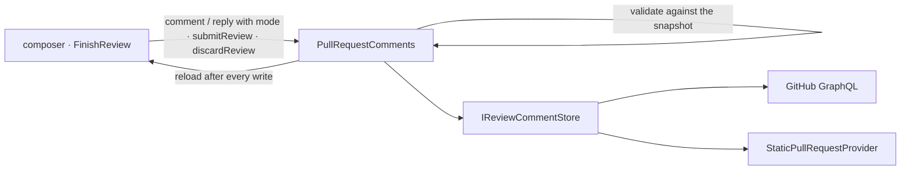

# Finish a review

Feature 8 of the [PR review roadmap](pr-review-roadmap.md). New PR comments and replies queue into a **pending
review**, render as drafts in place, and submit once as **Comment**, **Approve**, or **Request changes** with an
optional summary. Posting a single comment immediately stays available while nothing is pending. Builds on
[pr-comments.md](pr-comments.md).

## The forge holds the pending review

Drafts live in the forge's own pending review, not in Weavie: they survive restarts, show on the forge's site and
other machines, and a review started on github.com appears in Weavie (its summary prefills the panel). GitLab
(draft notes) and Gitea/Forgejo (pending reviews) model the same thing, so `IReviewCommentStore` stays forge-neutral:
load, create a review (pending when it has no verdict), add a thread, reply, edit, delete a draft, submit, discard.
Ids are opaque strings.

GitHub's REST API can't serve this: it hides pending drafts, can't add to an existing pending review, and refuses
replies while one exists (422 "one pending review per pull request"). So every comment read and write goes through
GraphQL, private to `GitHubReviewProvider`. Verified against a live PR:

- A reply joins the viewer's pending review whether or not it names it, and posts immediately when none exists.
- One pending review per viewer per PR; a second is refused.
- After a push, GitHub moves pending threads to their new lines, and a thread added to an older review anchors to
  the current head.
- GitHub refuses both Approve and Request changes on the viewer's own PR, and a Comment review with no summary and
  no comments.

## Rules (Core)

- A comment's or reply's `mode` is `review` (queue; starts a pending review when none exists) or `now`. `now` is
  refused while a review is pending, since the forge would file it into the review anyway.
- Only the viewer's pending drafts can be discarded; edits work on drafts and posted comments alike.
- Submitting checks the head the user saw. With nothing pending, a verdict posts a review of its own; an empty
  Comment is refused. On the viewer's own PR only Comment is offered or accepted.
- A failed write still reloads, since the forge may have changed (a review created before its reply failed).

## Surface

- **Drafts in place:** the thread card with a dashed amber outline and a **Pending** tag; edit and discard on hover;
  a collapsed thread counts its pending replies.
- **Composer:** **Start review** / **Add to review** (`$mod+Enter`) and, only while nothing is pending, **Comment now**
  (`weavie.pullRequest.postCommentNow`, unbound).
- **Finish review control** (`FinishReview.tsx`): self-contained, takes only the session, so the session overview
  (feature 7) can host it. The review header hosts it for now. It shows the pending count and opens a panel: summary,
  verdict (hidden on the viewer's own PR), the pending drafts (click to jump), Discard review… (confirms), Submit
  (`$mod+Enter`, Escape closes).
- **Commands:** `weavie.pullRequest.finishReview` "Finish Review…" (`prReviewable`) and
  `weavie.pullRequest.discardReview` "Discard Pending Review" (`prReviewPending`), both unbound; each shows the review
  that hosts the control first. Submit and discard are wire messages, not commands, so an agent can open the panel
  but never submits a review in the user's voice.
