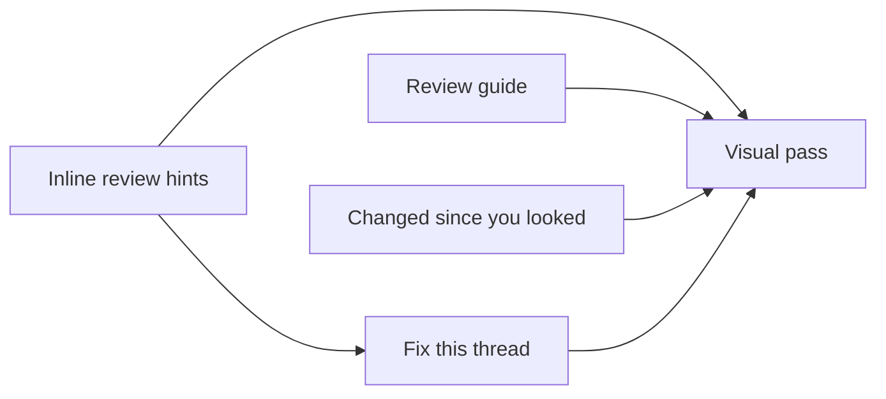

# PR review roadmap

Weavie's review surface is functionally ahead of GitHub's (editable diffs, durable Keep/Revert, comments that
follow local edits) but looks and feels worse. This roadmap splits the fix into independent features, each its
own session, branch, and PR. Reviews stay **for humans**: agent output informs the reviewer and never speaks in
their voice.

> Status: **building**. Shipped: 1 (#1021), the file tree from 5 (#1023); 6 in review (#1024). Next: 7 then 8. Builds on [turn-review.md](turn-review.md), [diff-against.md](diff-against.md),
> [incremental-review-persistence.md](incremental-review-persistence.md), [open-pr.md](open-pr.md), and
> [pr-comments.md](pr-comments.md).

The four features run in parallel; the visual pass runs last, in the coordinating session, because it restyles
the same file headers and margins the others touch.

## Sessions, not PRs

A review *is* a session: the user reviews whatever a session's branch holds, whether it was opened from a PR, a
branch, or created locally. Review features key off the **session** and treat PR data (threads, state, head
updates) as optional enrichment of that session's data — never as the thing being reviewed. A feature that only
works "when opened as a PR" is a design smell. The direction this implies: Open PR becomes a generic **open
branch** whose session picks up PR data when the branch has one.

## 1. Inline review hints

Any agent's line-anchored review findings render inline in every review surface (turn, Diff Against, PR) —
subtler than a PR thread, but not invisible.

- **Capture.** A registry tool, `addReviewHint(path, line, severity, text)`, works for Claude and ACP agents
  alike. Agents learn to use it without Weavie-specific prompts through the ambient instructions
  (`weavie://instructions`) and an imperative tool description, so a generic "review this branch" skill
  produces hints. Claude Code's own `ReportFindings` tool (file + line per finding) is captured through the hook
  relay with no agent cooperation (proven against claude 2.1.296).
- **PR auto-review.** The existing seed prompt (`pr.autoReviewPrompt`) reports findings through the tool and
  keeps the summary in chat.
- **Presentation and Fix.** Decided by mockup: margin badge + line wash + end-of-line pill, expanding to a
  popover with Fix / Fix with… (shared with PR threads). See [inline-review-hints.md](inline-review-hints.md).
- **Done when** an unmodified review skill run against a real agent produces inline hints.

## 2. Review guide

Turns a diff into a reading path: named groups of related hunks, in dependency order, with attention flags.

**Noise is the main risk, tokens a minor one.** Flag only the two or three outliers worth slowing down on — never a
gradient over every file. Groups reorder the file list rather than add annotations; reasons live behind hover.
Small diffs get no guide. The model runs once per diff revision on PR / Diff Against reviews or on demand — never
per agent turn — and sees hunk headers and changed symbols, not the full diff. Wrong groupings mislead, so ship in
two phases:

1. **Phase 1, zero tokens:** deterministic reading order + outlier flags.
2. **Phase 2, only if phase 1 leaves the want:** model grouping.

- **Deterministic first.** Changed hunks; a dependency graph over *changed symbols only* from the running
  language servers (references/call hierarchy — never a workspace walk); signals: caller fan-out, public/exported
  surface changes, code changed without a test change, added branching, git churn. A file without a language
  server reports that its dependency signal is missing; it is never guessed.
- **Model second.** One typed ad-hoc inference call ([ad-hoc-inference.md](../concepts/ad-hoc-inference.md))
  per diff revision groups hunks by intent ("Add retry policy", "Thread it through 4 callers", "Mechanical
  rename"), orders the groups, and gives a one-line reason per score. Output is validated: every hunk in exactly
  one group, nothing invented; a failed validation is surfaced.
- **Surface.** Groups become review units (step, Keep/Revert a group); outlier flags show on the file map and
  explain themselves through the hint popover; the file switcher follows reading order.
- Use `weavie-architect` before building.

## 3. Changed since you looked

When a session's branch moves (new commits or force-push upstream), show only the new work since the user last
looked at that session. Session-keyed, per *Sessions, not PRs*. Mockups before architecture.

- **Pulling.** A persistent "Branch updated upstream — Pull?" prompt stays until the user answers yes or no;
  nothing pulls automatically, since the session may hold local edits.
- **Entry.** After pulling, a quiet banner: "3 new commits since you last looked (2 days ago) · 4 files" with
  **Review new changes** (default) or **Full diff**; a header toggle flips between the two with one key.
- **Untouched files** stay reviewed, folded into "Unchanged since you last looked (12)".
- **Your threads.** Threads whose lines changed since the user's comment read "changed since your comment",
  reachable in one step (a command plus a header entry) — the question every re-reviewer has.
- **Rebase noise** is hidden behind a quiet, expandable count of base changes.

- The persisted Keep baseline is already "what you looked at", so the incremental diff is baseline → new head.
- Rebases would show base-branch changes as new work. Per changed file, replay the base movement
  (old merge-base → new merge-base) onto the reviewed content with `git merge-file`, then diff that against the
  new head. Files whose base→head patch is unchanged stay reviewed. No history walking.

## 4. Fix this thread (deferred)

Feature 1 ships Fix / Fix with… for PR threads (send the thread to the session's agent). This feature links the
resulting pending hunk to the thread, and keeping it posts a "Fixed in `<sha>`" reply.

## 5. Visual pass (coordinating session, last)

GitHub reads calmer; Weavie's review makes everything pop. The diff washes are already soft, so the suspects are
competing chrome and an uncentered layout. Decide with one-factor side-by-side sheets in real fonts, against a
GitHub screenshot of the same PR:

- **Chrome contrast:** card borders, header actions on hover/focus only, dimmed directories.
- **Centered column:** a max-width content column vs full pane width.
- **Diff colors:** word-level highlight strength, removed lines as first-class lines rather than ghost rows,
  old/new line-number gutters.

The file tree above the review shipped in #1023.

## 6. Hint to PR comment

On a PR, a hint's popover offers **Comment**: the PR comment composer opens on the hint's line, prefilled with
the hint's text, for the user to edit and post as themselves. Nothing posts without the user submitting it, so
the review stays in their voice.

## 7. Front door

Reviewing starts with context, not a wall of diffs. Each session gets an overview: branch, base, commits, and the
change summary, enriched — when the branch has a PR — with title, description, author, CI checks, reviewers, and
PR-level conversation. Per *Sessions, not PRs*, it works for any session; PR data only adds sections. It leads into
the diffs (and later the review guide's reading order) in one step. [open-pr.md](open-pr.md) deferred a PR
overview tab until source tabs land; the review tab already proves non-file tabs, so that wait no longer applies.
Mockups first.

## 8. Finish a review

Comments queue into a pending review instead of posting one by one; the user submits once as **Comment**,
**Approve**, or **Request changes**, with an optional summary. Pending comments render as drafts in place, survive
restarts, and can be edited or discarded before submitting. Posting a single comment immediately stays available.
The submit control lives in the front door (7) and the review header, so the two sessions agree on placement.

## Under consideration

- **Second opinion.** A command asks another configured agent ([agent-consultation.md](agent-consultation.md))
  to review the same diff; its hints render beside the first agent's, and a line both flagged reads as agreed.

## Out of scope

CI failure annotations on lines; feeding review comments into Learn From Corrections; moved-code detection
(cheap via `git diff --color-moved`, revisit after the above); an "ask about this hunk" action (highlight-and-ask
already covers it).
