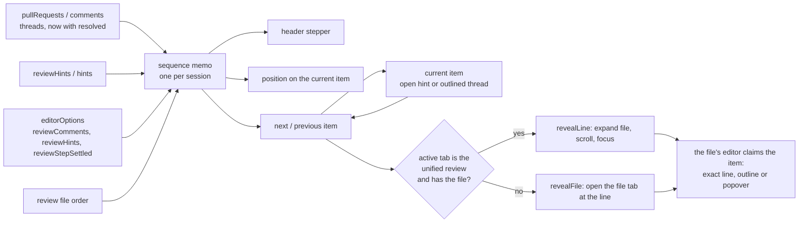

# Design: step through comments and hints

Design for [brief.md](brief.md). Names and signatures were read in the code; anything not checked is marked *not
verified*. [challenge.md](challenge.md) argues for a host-owned design that was costed and scrapped; it no longer
describes this work.

## Summary

**What changes for the user**

- `Ctrl+Alt+]` / `Ctrl+Alt+[` step through every PR thread and agent hint in the session, across files, in diff
  order. Today those keys step PR threads inside one file only.
- The unified review header shows `‹ 3 of 8 ›` and a filter button. The item you are on shows the same position:
  on the thread card, or in the hint popover.
- Dismissing a hint, or a thread being resolved or outdated on GitHub, drops it from the count.
- Hide Comments and Hide Hints are remembered across restarts, and are the first two rows of the filter.

**Main pieces**

1. **One sequence in the app**: the two lists the app already holds (threads, hints), merged, filtered and sorted.
   It replaces the hint-only ordering in `hint-order.ts`.
2. **Two commands** that find the neighbour of the current item, or of the cursor, and open its file at its line
   through the reveal the hint stepper already uses. They replace four commands.
3. **A small header control**, the same position on the item, and a three-row filter menu.
4. **On the host**: GitHub's resolved flag, and three settings behind the filter. Nothing else.

**Expected size** (estimate): about 450 lines added and 120 deleted in product code, plus about 250 lines of tests.

**Open questions**: none. The view a step lands in and counting your own drafts are settled in the brief.

## What the code makes awkward

- **Lines are "as made", not "as now".** A hint's `line` is numbered against the file text it was captured from
  (`src/web/src/editor/review-hints/review-hints-store.ts:13`); a thread's against the PR head, or the merge-base for
  a left-side thread (`src/web/src/editor/pr-comments/anchor-map.ts:34`). The sequence sorts by those numbers, so in
  a file with local edits the order, and the line a step first lands on, can be a few lines off. Once the file's
  editor is up, its own placement moves the cursor to the exact line (below). The brief accepts this.
- **Outdated threads carry line 0** (`src/Weavie.Core/Review/GitHubReviewProvider.GraphQl.cs:107`). With
  "Resolved and outdated" on they come first in their file and reveal at line 1.
- **Hidden lines in the unified review.** It hides lines more than three from a change
  (`src/web/src/editor/review/review-context.ts:6`). PR threads sit on diff lines, but a hint can be anywhere.
  Whether revealing a hidden line already un-hides it is *not verified*; if it does not, the step adds a span with
  the existing `review.revealFileContext`.
- **The review's file order is private to the editor controller** (`reviews`, a `createReviewStore` instance in
  `src/web/src/editor/editor-controller.ts`). The sequence needs it from a thread card in a plain tab, so the
  controller hands it over when it registers the session.
- **A thread on a file missing from the worktree** cannot be opened. The step shows the existing open error.

## Flow



## Data formats

`pullRequests` / `comments`: each thread gains `resolved`. `ReviewThread` is serialized as it is, so the field
appears on the wire by adding it to the record.

```json
{ "id": "t1", "path": "/work/hello.ts", "line": 2, "side": "right",
  "outdated": false, "resolved": true, "comments": [ … ] }
```

`settings` / `editorOptions` gains three flags.

```json
{ "reviewComments": true, "reviewHints": true, "reviewStepSettled": false }
```

Nothing else on the wire changes. Hints are untouched.

## Types

### Host

- `ReviewThread` (`src/Weavie.Core/Review/ReviewThread.cs:12`): add `bool Resolved`, included in `Equals`, so a
  thread resolved on GitHub republishes.
- GraphQL (`src/Weavie.Core/Review/GitHubReviewProvider.GraphQl.cs:15`): add `isResolved` to the thread fields;
  `ParseThread` passes `Bool(thread, "isResolved")`.
- `StaticPullRequestProvider.Reviews.cs` and `src/Weavie.Headless/FakePullRequests.cs`: carry `resolved`, read as
  `outdated` is.
- `EditorSettings` (`src/Weavie.Core/Configuration/EditorSettings.cs`): three `Toggle` settings, written by
  `WriteOptions`.

| Key | Default | Meaning |
| --- | --- | --- |
| `editor.reviewComments` | `true` | Show PR threads, and step through them |
| `editor.reviewHints` | `true` | Show review hints, and step through them |
| `editor.reviewStepSettled` | `false` | Step through resolved and outdated threads too |

### Commands

| Id | Title | Runs in | Change |
| --- | --- | --- | --- |
| `weavie.review.nextItem` | Next Comment or Hint | web | new, `$mod+alt+]` |
| `weavie.review.previousItem` | Previous Comment or Hint | web | new, `$mod+alt+[` |
| `weavie.review.toggleSettledItems` | Toggle Resolved and Outdated in Stepping | core, client-owned | new, unbound |
| `weavie.pullRequest.toggleComments` | unchanged | core, client-owned | now flips `editor.reviewComments` |
| `weavie.reviewHints.toggle` | unchanged | core, client-owned | now flips `editor.reviewHints` |
| `weavie.reviewHints.close` | unchanged | web | also clears a current thread |
| `weavie.pullRequest.nextComment` / `prevComment` | | | deleted |
| `weavie.reviewHints.next` / `previous` | | | deleted |

- The two new commands: `When = "reviewItemsAvailable"`, keybinding `When = "reviewItemsAvailable &&
  editorFocused"`. `editorFocused` already excludes comment boxes (`src/web/src/commands/context.ts:45`).
- `reviewItemsAvailable` is a new context key: the selected session has at least one thread or hint, before
  filtering. Set by an effect on `selectedSession()`, as `trackReviewContext` does
  (`src/web/src/editor/pr-comments/pr-comment-commands.ts:13`).
- The three toggles follow `weavie.git.toggleBlame` (`src/Weavie.Core/Commands/CoreCommands.cs:1634`,
  `src/Weavie.Core/Configuration/GitBlameCommands.cs`): the command flips the setting, so the menu, the palette, and
  an agent changing the setting cannot disagree. Their handlers live in a new
  `src/Weavie.Core/Configuration/ReviewItemCommands.cs`, registered beside `GitBlameCommands.RegisterHandlers`.

### App

`src/web/src/editor/review-items/review-sequence.ts` (new, pure; replaces `review-hints/hint-order.ts`).

```ts
export type ItemKey = `hint:${number}` | `thread:${string}`;

export interface ReviewItem {
  key: ItemKey;
  path: string;
  line: number;
}

export interface ItemFilter { comments: boolean; hints: boolean; settled: boolean }

export function buildSequence(
  threads: readonly PrThread[],
  hints: readonly ReviewHint[],
  reviewPaths: readonly string[],
  filter: ItemFilter,
): ReviewItem[];

export function stepItem(
  sequence: readonly ReviewItem[],
  origin: ItemKey | { path: string; line: number } | null,
  direction: 1 | -1,
): ReviewItem | undefined;
```

`src/web/src/editor/review-items/review-items.ts` (new): the per-session owner.

```ts
export const reviewItems: {
  own(session: ClientSession, reviewPaths: () => readonly string[]): () => void;
  sequence(session: ClientSession): readonly ReviewItem[];
  position(session: ClientSession): { index: number | null; total: number };
  counts(session: ClientSession): { comments: number; hints: number; settled: number };
  current(session: ClientSession): ItemKey | null;
  setCurrent(session: ClientSession, key: ItemKey | null): void;
  /** The current thread a displayed editor has not yet moved its cursor to. */
  unclaimedThread(session: ClientSession): string | null;
  claimThread(session: ClientSession): void;
};
```

- `PrThread` (`src/web/src/editor/pr-comments/pr-comments-store.ts:27`) gains `resolved: boolean`.
- `ContextMenuItem` (`src/web/src/chrome/ContextMenu.tsx:21`) gains `checked?: boolean` and `detail?: string`.
- `EditorOptionsSpec` (`src/web/src/messaging/protocol-types.ts`) and `editor-options-defaults.ts` gain the three
  flags.

## Components

### The sequence and the current item

`reviewItems.own` is called where `editorContexts.own` is
(`src/web/src/editor/editor-controller.ts:1392`), with the review's file paths, and its disposer is returned to
`registerSessionFeature`. It creates one reactive root per session, kept in a `WeakMap`, so one session's change
never recomputes another's and everything is released with the session.

```
root(session):
  thread    = signal<{ id, claimed } | null>(null)            // the outlined thread
  filter    = memo(the three editor options)
  paths     = memo(reviewPaths(), equal by content)           // file summaries bump on every diff push
  sequence  = memo(buildSequence(threads, hints, paths(), filter()))
  current   = memo(pinned open hint ? `hint:${id}` : thread ? `thread:${id}` : null)
  position  = memo({ index: sequence.findIndex(current), total: sequence.length })
  effect: thread not in sequence -> thread = null             // hints already prune themselves

setCurrent(key):
  hint   -> openHint(session, { id, owner: null, pinned: true }); thread = null
  thread -> openHint(session, null); thread = { id, claimed: false }
  null   -> openHint(session, null); thread = null

buildSequence:
  threads when filter.comments; drop resolved or outdated ones unless filter.settled
  hints when filter.hints
  sort by: index in reviewPaths, else after them by path; then line; then thread before hint; then id

stepItem(sequence, origin, direction):
  origin is a key in the sequence -> its neighbour, wrapping
  origin is a location            -> first item after it (or last before it), wrapping
  origin is null                  -> first (or last)
```

The current hint is the existing pinned open hint (`openedHint`,
`src/web/src/editor/review-hints/review-hints-store.ts:69`), not a second copy of it. A hover popover is unpinned
and is not the current item.

### Stepping

`src/web/src/editor/review-items/review-item-commands.ts`, registered where `registerReviewHintCommands` is
(`src/web/src/App.tsx:1720`) with the same `revealFile`.

```
step(session, direction):
  origin = current(session) ?? activeTabFor(session)?.presentation?.capture().text ?? null
  target = stepItem(sequence(session), origin, direction)
  if target is undefined:
    notify("info", "There are no comments or hints to step through."); return
  setViewMode(session, target.path, "source")
  setCurrent(session, target.key)
  line = max(1, target.line)
  if activeTabFor(session)?.presentation?.actions()?.revealLine?.(target.path, line): return   // unified review
  revealFile(session, target.path, line)                                                       // file tab
```

This is the reveal the hint stepper uses today
(`src/web/src/editor/review-hints/review-hint-commands.ts:81`): the unified review answers `revealLine` only for a
file it holds (`src/web/src/editor/review/UnifiedReview.tsx:298`), and its reveal expands a collapsed file
(`src/web/src/editor/review/review-surface.ts:150`).

### Claiming: the exact line

When the item's editor is displayed, it moves the cursor to where the item really sits and focuses.

- **Hints** keep the existing claim effect
  (`src/web/src/editor/review-hints/review-hint-controller.tsx:190`): the first displayed binding that has placed
  the open hint takes ownership, sets the cursor to the placed line, reveals and focuses.
- **Threads** get the same effect in `pr-comment-controller.tsx`:

```
effect:
  id = reviewItems.unclaimedThread(session)
  card = cards().find(thread card with that id)
  if id is null, card is missing, or the editor has no client rects: return
  reviewItems.claimThread(session)
  collapse(id, false)                                        // a step always shows the thread
  editor.setPosition({ lineNumber: max(1, card.afterLine), column: 1 })
  editor.revealLineInCenterIfOutsideViewport(that line)
  editor.focus()
```

`navigate` (`pr-comment-controller.tsx:291`) and its command bindings
(`src/web/src/editor/editor-command-bindings.ts:109`) are deleted.

### Clearing the current item

- **Escape**: `weavie.reviewHints.close` clears the current item of either kind.
- **A click in the code**: the hint controller already closes its open hint on a mouse-down elsewhere
  (`review-hint-controller.tsx:182`). The thread controller does the same for the current thread. Cards sit in a
  layer beside Monaco, so a click inside a card is not a click in the code.
- **The item leaves the sequence**: the prune effects above.

Moving the cursor with the keyboard does not clear it. The open popover or the outline shows where Next continues
from.

### Rendering

- **Thread card** (`PrThreadCard.tsx`): a `current` prop adds `weavie-pr-card-current` (accent border) and shows the
  position control in `.weavie-pr-thread-actions`, which is otherwise hover-only. A resolved thread starts
  collapsed, as an outdated one does (`pr-comment-controller.tsx:146`), and its summary row carries a Resolved
  badge.
- **Hint popover** (`HintPopover.tsx`): its two arrow rows run the new commands, with `N of M` between them.
- **Header** (`UnifiedReviewHeader.tsx`): `ReviewItemStepper` as the first child of
  `.unified-review-header-actions`, rendered when the session has a pull request or a hint. It shows a comment
  icon, the position control, and the filter button. Scrolled into the diffs, the header condenses so the PR's
  name keeps its room: Overview, Undo rejection, Revert pending and Keep all become borderless icons (Undo and
  Revert no longer share an icon), failing checks read as ⊗ with a count, and Review ▾ is the one labelled
  button.
- **Position control**: one component, `‹ N of M ›`, used by the header and the thread card. Its look is the
  per-file stepper's, so `.unified-review-file-step` (`src/web/src/editor/review/unified-review.css:224`) moves to
  `primitives.css` as `.ui-stepper`, used by all three; the card renders in plain tabs, where review CSS may not be
  loaded.
- **Filter menu**: `ContextMenu` with three rows, each dispatching its toggle command, `checked` from the option
  and the count as `detail`. It closes on each click, as every context menu does. It opens from a local
  `ContextMenuState` signal, as the status line's diff menu does (`src/web/src/agent/AgentStatusLine.tsx:64`).
- **Visibility**: `prCommentsVisible` and `reviewHintsVisible` read the editor options, as
  `review/overview/overview-collapse.ts:14` reads its option. Their setters go. `comment()`
  (`pr-comment-controller.tsx:266`) runs the toggle command when comments are hidden, where it calls
  `showPrComments()` today. The step no longer forces hints visible: a hidden kind is not in the sequence.

## Error handling

No fallbacks are added.

- **Empty sequence**: an info toast; the header arrows are disabled.
- **The item's file cannot be opened**: the existing open error from `revealFile`.
- **The file left the review mid-reveal**: `surface.reveal` already rejects with "This file is no longer in the
  review." and toasts.
- **A settings write fails**: the toggle command returns the failure, as the blame toggle does.
- **`isResolved` missing from a forge response**: `Bool` reads a missing property as false
  (`src/Weavie.Core/Review/GitHubReviewProvider.GraphQl.cs:137`), as it does for `isOutdated`. The query asks for the
  field, so GitHub always returns it.

## Testing

| Layer | Covers | Where |
| --- | --- | --- |
| App unit | `buildSequence`: review order then path, filter rows, resolved and outdated. `stepItem`: neighbour, wrap, location origin, empty | new `review-sequence.test.ts` |
| Core unit | `isResolved` parsed; a resolve republishes | `tests/Weavie.Core.Tests/Review/GitHubReviewCommentsTests.cs`, `PullRequestCommentsTests.cs` |
| Core unit | The three settings and their toggle handlers | beside the blame toggle's tests |
| Headless e2e | Step by key across files in the unified review, in a single-file review and in a plain tab; header and on-item position; the total unchanged while scrolling; each filter row, and that it survives a reload; Dismiss drops the count; a resolved thread is skipped and collapsed; Escape then Next starts from the cursor | new `src/web/e2e/functional/review-items.spec.ts` |
| Headless e2e | Journeys that used the deleted commands | `review-hints.spec.ts` ("across files"), `pr-comments.spec.ts` |
| Perf | `pnpm e2e:perf`: the change touches `src/web/src/editor` | `editor-render-budget.spec.ts` |

The fake PR scenario (`src/web/e2e/harness/git-workspace.ts`) seeds one live thread on PR #101 and one outdated
thread on #102. It needs several threads on #101 across files, one of them resolved, and a `resolved` field on
`ThreadSeed`. The mock-host thread fixture in `src/web/e2e/agent-composer.spec.ts:1673` needs the field too; e2e is
not typechecked.

No host budget changes: no git process and no page message is added to any operation.

## Files

| File | Change |
| --- | --- |
| `src/Weavie.Core/Review/ReviewThread.cs`, `GitHubReviewProvider.GraphQl.cs`, `StaticPullRequestProvider.Reviews.cs` | `Resolved` |
| `src/Weavie.Headless/FakePullRequests.cs` | read `resolved` |
| `src/Weavie.Core/Configuration/EditorSettings.cs`, `ReviewItemCommands.cs` (new) | three settings, toggle handlers |
| `src/Weavie.Core/Commands/CoreCommands.cs`, `CoreCommands.ReviewHints.cs` | add three commands, delete four, re-home two toggles |
| `src/Weavie.Hosting/HostCore.cs` | register the toggle handlers |
| `src/web/src/editor/review-items/` (new): `review-sequence.ts`, `review-items.ts`, `review-item-commands.ts`, `ReviewItemStepper.tsx` | sequence, owner, commands, controls |
| `src/web/src/editor/review-hints/`: `review-hint-commands.ts`, `review-hints-store.ts`, `HintPopover.tsx`; delete `hint-order.ts` | drop the hint-only step, visibility from options, count |
| `src/web/src/editor/pr-comments/`: `pr-comments-store.ts`, `pr-comment-controller.tsx`, `pr-comment-commands.ts`, `PrThreadCard.tsx`, `pr-comments.css` | `resolved`, claim, outline, badge, drop `navigate` |
| `src/web/src/editor/editor-controller.ts`, `editor-command-bindings.ts` | `reviewItems.own`, drop old bindings |
| `src/web/src/editor/review/UnifiedReviewHeader.tsx`, `ReviewFileSection.tsx`, `unified-review.css`, `src/web/src/primitives.css` | header control, `.ui-stepper` |
| `src/web/src/chrome/ContextMenu.tsx`, `commands/types.ts`, `messaging/protocol-types.ts`, `editor-options-defaults.ts`, `App.tsx` | checkable rows, ids, options, registration |
| `src/web/e2e/harness/git-workspace.ts`, `e2e/functional/*.spec.ts`, `e2e/agent-composer.spec.ts` | seeds, journeys, fixture |
| `tests/Weavie.Core.Tests` | as in Testing |
| `docs/specs/pr-comments.md`, `docs/specs/inline-review-hints.md` | command tables; resolved is read |

## Risks

- **Stale origin.** Arrow away from the current item and press Next, and the step continues from the item, not the
  cursor. The outline or popover shows that, and Escape resets it. If it reads as wrong in use, the fix is a
  cursor listener that clears the current item.
- **Order in a locally edited file** can differ from what is on screen by the size of the edits above. Accepted.
- **Two editors of one file.** The unified review and a file tab can both hold a file, but only the active tab is
  displayed, so one binding claims. The claim checks client rects, as the hint claim does.
- **The toggles change from page state to settings.** They become shared by every window of the local host, and
  follow the client, not a remote runner, as blame does.
- **A reviewer's own drafts are counted**, so their total grows as they comment. Agreed in the brief.
- **Menu closes per click.** Changing two filter rows means opening it twice.

## Build checklist

1. [x] `isResolved` through the GraphQL query, `ReviewThread`, the static provider, the fake, and the e2e seeds. Core
   tests.
2. [x] The three settings, their toggle handlers, and the command catalog changes on both sides (add three, delete
   four).
3. [x] `review-sequence.ts` with unit tests; delete `hint-order.ts`.
4. [x] `review-items.ts`, wired in the editor controller; `prCommentsVisible` and `reviewHintsVisible` read the options.
5. [x] `review-item-commands.ts`; delete the hint-only step and thread `navigate`; extend Escape.
6. [x] The thread claim effect, the outline, the Resolved badge and default collapse.
7. [x] `.ui-stepper`, the position control, `ReviewItemStepper`, the popover count, the checkable `ContextMenu` rows.
8. [x] Check a hint on a line the unified review hides; add the context span if it stays hidden. It stayed hidden,
   and Monaco also kept the hint's widgets hidden after the fold opened; both are fixed and covered.
9. [x] `review-items.spec.ts`; update the existing specs and the mock-host fixture.
10. [ ] `dotnet format`, `biome check --write`, `pnpm e2e:perf`, then `weavie-reviewer` and `weavie-tester`.
11. [x] Update `pr-comments.md` and `inline-review-hints.md`.
