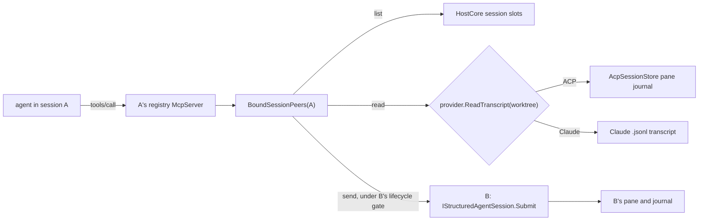

# Session messaging

Status: built

## Purpose

An agent in one session can find the other sessions on its host, read what they have been doing, and send them a
message. The user says *"ask the auth-refactor session how it handled token refresh"* or *"tell the docs session
the API changed"*, and their agent does it.

## Tools

Four tools on each session's registry MCP server, so every provider that connects to the registry — terminal
Claude and every native ACP agent — can use them:

- `currentSession` returns the caller's own session id.
- `listSessions` returns every session on the host: id, title, provider, loaded, status, and `receive` —
  `ready`, `needsLoad` (load it with `weavie.session.load` first), or `unsupported`. `self` is the caller's id.
- `readSession({id, count})` returns the last `count` entries of a session's primary conversation and the `total`.
  `count` is required and has no upper bound.
- `messageSession({id, message})` submits a message to a session's agent and returns once it is delivered, with the
  target's status at that moment. It does not wait for an answer.

Each session's server is bound to that session's `(slot, incarnation)` address when the session is built
(`BoundSessionPeers` in `HostCore.SessionPeers.cs`). A call reaching that server is from that session by
construction, so the sender is never inferred from focus. A send still in flight from a sender incarnation that has since unloaded is refused.

## Reading

Each provider reads its own saved conversation through `IAgentProvider.ReadTranscript(workspace)`, which works
whether the session is loaded or not.

- **ACP**: the pane journal in `AcpSessionStore`, which is written before each message is published, so it is as
  fresh as the live pane. It is folded through `AgentPaneLedger` — the same fold the live pane uses — so streamed
  chunks join and a completed item replaces its stream.
- **Claude Code**: the transcript `.jsonl` for the id `ClaudeSessionStore` tracks. `ClaudeTranscriptReader` follows
  `parentUuid` (or `logicalParentUuid` across compaction) back from the last record, so an abandoned edit branch is
  not returned. A line still being written is ignored; a malformed complete line fails the read. Weavie tracks the
  id only while `claude.resumeSession` is on, so with it off the read fails and names the setting.

The projection is provider-neutral: user prompts, agent replies, tool calls by summary (never their output), and
errors. Thoughts, side conversations, subagents, and Claude sidechain and meta records are not part of it.

Claude's transcript format is undocumented. A malformed line fails loudly, but a record type Claude renames would
project as nothing until the reader is updated.

## Sending

A message is submitted to the target exactly like a prompt the user typed there. A busy ACP agent steers it into the
running turn when it supports steering, otherwise queues it in the target's queue chip; an agent still starting
queues it until ready. Weavie adds no second queue.

The submission carries its sender (`AgentTurnSubmission.Sender`) as data, not text. The ACP client adds
`EmbeddedAgentGuidance.SessionMessage` as an assistant-audience block — the agent learns who sent it and how to
reply, the user never sees it — and the submitted pane message carries the sender, so the target pane heads the plain
message with **From &lt;session&gt;** instead of **Prompt**. `readSession` reports the sender's id as `from` on that
entry.

A send is refused, with a tool error naming the cause, when the target is the caller, the id is unknown, the target
is not loaded, the target runs in a terminal, or Weavie is draining for a restart. The send runs under the target
slot's lifecycle gate, so it cannot race an unload or delete.

**Sending to a terminal Claude session is refused.** Pasting text into Claude's terminal and pressing Enter would
submit it joined to whatever the user has half-typed, and on an open permission prompt or menu Enter picks the
highlighted option. Weavie can't see either state. Claude Code channels are the right delivery mechanism once they
work without a development flag and its startup warning.

Two agents could keep acknowledging each other. The guidance tells the receiver not to reply to acknowledgements,
and every message is visible in the target's pane and status; there is no hop limit.

## Deferred

- Delivery into terminal Claude through Claude Code channels.
- Sessions on other connected backends.
