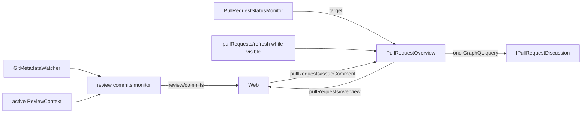

# Session overview

Feature 7 of the [PR review roadmap](pr-review-roadmap.md). Reviewing starts with context: the review tab opens on the
session's overview, and the diffs follow it in the same scroll. Per *Sessions, not PRs*, every session has one; a PR
only adds sections.

## Layout

The overview replaces the file tree at the top of the review tab and contains it as **Changes**. Scrolling down
reaches the diffs; there is no separate "start" step.

| Section | Shown when | Content |
|---|---|---|
| Title | always | PR title with its `#N` link, state, author, "merge head into base", or the branch name; [Finish review](pr-review-finish.md) in the byline |
| Description, Conversation | the branch has a PR | PR body; PR-level comments and review events, with a composer |
| Checks, Reviewers | the branch has a PR | failing checks first; each reviewer's latest state |
| Commits | the branch has commits of its own | from where it left its PR's or the default branch, dimming those the review doesn't span |
| Changes | always | the review's file tree, headed by what it compares (`PR #12`, `vs main`, or agent edits) |

Commits always list the whole branch; when the review is narrower (Uncommitted, Last commit, agent edits) the commits
it doesn't span are dimmed and the heading reads "1 of 7 in this review", so the list never claims more than the
file list shows. Once the overview's title scrolls away, the sticky review header carries the session's identity
(state, title, failing checks) and the Finish review control, with an **Overview** button back to the top.

**Show Session Overview** (`weavie.review.overview`, unbound) opens it for any session, changes or not, and is how
Finish review reaches its control. Finishing a review still closes the tab and returns to the file underneath.

## Opening a diff

Every new diff opens on the overview: Open Pull Request, Diff Against…, and **Review Branch**
(`weavie.diff.againstBranchBase`, unbound), which compares the branch with the remote's default branch
(`origin/main` over a local `main` that may be far behind). Clicking the status bar's diff totals offers Current
review, Uncommitted, Last commit, and Branch. A session holds one review, so switching to a different comparison asks
first: it closes the current review the way Close Diff does.

## Collapsing

Every section collapses. `editor.reviewOverviewCollapse` decides what remembers it: `global` (default; one set for all
sessions, host-owned in `~/.weavie/review-overview-state.json` like the search and rail state) or `session` (saved
with the session's review). The setting has no UI beyond the settings registry.

## Data

- **Commits** come from local git: the branch's range plus the review's range (`base..HEAD` each), refreshed when
  `HEAD` moves or the review changes.
- **PR data** is one GraphQL query per refresh (detail, reviewers, conversation, check rollup), loaded when the
  branch's PR or head changes and on the same visible-session poll that refreshes PR comments. A transient failure
  keeps the last good overview for the same PR and shows the error.
- **The composer** posts a PR-level comment immediately; GitHub never files those into a review.
