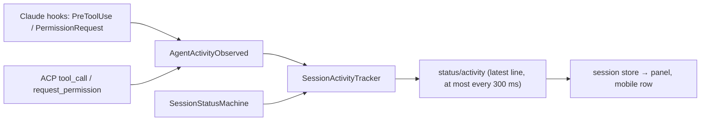

# Session switcher

The left rail (56px) shows every session on every connected backend — this machine's first, then each remote's —
as its status dot over the first two words of its readable name. Loaded sessions come first; parked (unloaded)
ones fold behind one toggle, collapsed by default and shared with the panel's Parked section (`parkedCollapsed` in
`rail-state.json`). Hiding a session means unloading it; there is no separate working set. The session panel
carries the full names and what each agent is doing; the cloud button only adds and disconnects remote agents.

## Surfaces

- **Rail** (`SessionRail.tsx`): dot + short name per session (working pulses, needs-input amber, idle green,
  parked hollow and dimmed; remote sessions carry a small cloud in their agent's hue). The current session has an
  accent bar. Clicking a session switches to it.
- **Session panel** (`SessionPanel.tsx`): each session's stable rail number, readable branch name (its leaf; the
  full branch is in the tooltip), and one line of activity. Unpinned, it is the rail expanded in place: resting the
  pointer on the rail or `weavie.session.panel` (`$mod+e`, everywhere including terminals) widens it over the panes,
  each chip gaining its details without moving, so it stays in rail order. `weavie.session.panelPin` (or the pin
  button) docks it in the rail's place, pushing the panes and grouping sessions as Needs you / Working / Idle /
  Parked; the pin persists in `rail-state.json`. Arrows, Enter, and Escape drive it, and while it's in use
  (hover- or keyboard-opened, or pinned under the pointer or focus) 1–9 switch straight to that numbered session.
- **Mobile** keeps the full list in the Sessions surface (no rail there); on desktop that modal is new-session only.

## Activity line

- Providers report each tool call as a provider-neutral `AgentActivity` (kind + short subject: a file name, the
  first line of a command, a pattern). ACP tools with no structured subject use the agent's own title verbatim.
- `SessionActivityTracker` (Core) shows the latest tool while Working and the pending approval (`wants to …`)
  while NeedsInput; the main turn ending clears it. Subagent tool calls count.
- Hosting publishes the line on the session's own `status` feature, coalesced to the latest value so a busy agent
  can't flood the bridge; reconnect replays it.
- Idle and parked rows show how long ago the agent last started or finished work. `lastActiveAt` is stamped on
  those status transitions only (loading a session doesn't count), persisted in `sessions.json`, and carried in
  the session catalog.
