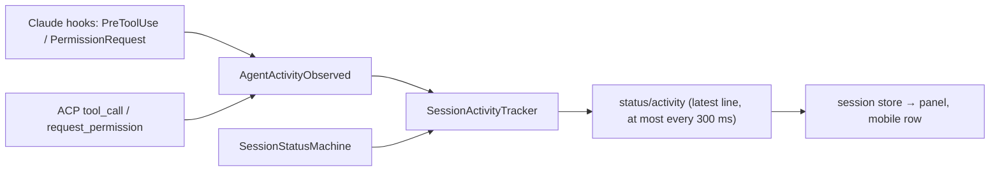

# Session switcher

The left rail is a 22px strip of status dots, one per working-set session, loaded first and parked (unloaded)
after a divider. Names and what each agent is doing live in the session panel.

## Surfaces

- **Rail** (`SessionRail.tsx`): a dot per session (working pulses, needs-input amber, idle green, parked hollow,
  remote sessions ringed in their agent's hue). Hovering the rail opens the panel; a click on a dot switches.
- **Session panel** (`SessionPanel.tsx`): sessions grouped as Needs you / Working / Idle / Parked. Each row shows
  the stable rail number (the `Ctrl+Shift+N` switch), the readable branch name with its type prefix, and one line
  of activity. Opens on rail hover or `weavie.session.panel` (`$mod+e`, everywhere including terminals); arrows,
  Enter, and Escape drive it. `weavie.session.panelPin` (or the pin button) docks it open beside the rail, pushing
  the panes; the pin persists in `rail-state.json`.
- **Mobile** keeps the full list in the Sessions surface (no rail there); on desktop that modal is new-session only.

## Activity line

- Providers report each tool call as a provider-neutral `AgentActivity` (kind + short subject: a file name, the
  first line of a command, a pattern). ACP tools with no structured subject use the agent's own title verbatim.
- `SessionActivityTracker` (Core) shows the latest tool while Working and the pending approval (`wants to …`)
  while NeedsInput; the main turn ending clears it. Subagent tool calls count.
- Hosting publishes the line on the session's own `status` feature, coalesced to the latest value so a busy agent
  can't flood the bridge; reconnect replays it.
- Idle and parked rows show how long ago the agent last started or finished work. `lastActiveAt` is stamped on
  those status transitions only (loading a session doesn't count), persisted in `sessions.json`, and carried in
  the session catalog.
