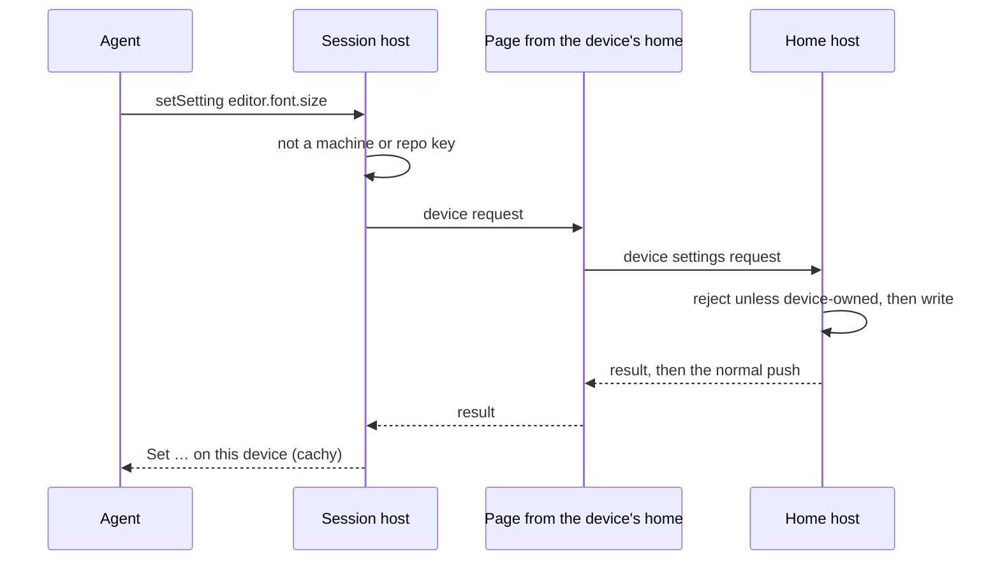

# Settings ownership

Status: steps 1 and 2 implemented; keybindings from home proposed
Last updated: 2026-11-19

Extends [settings.md](settings.md). Storage, kinds, validation, env overrides and the registry tools are
unchanged; this spec adds the one concept they lack: **who owns a setting**.

## Problem

The settings system assumes the machine running a session is also the screen showing it. With a remote
session those are two machines, and only the read side knows:

- The page takes fonts, theme, editor options and notification prefs from the host that serves it and ignores
  every other host, through an `isLocal` guard repeated per feature.
- The agent's `setSetting`/`getSetting` use the store of the host its session runs on. On a remote session a
  font change is written to a file nothing on screen reads, and a read reports a value the user isn't seeing.
- Related display settings disagree: `agent.replyStartOffset` follows the serving host while
  `agent.thoughtDisplay` follows the session's host.
- Spellcheck takes its on/off switch from one machine and its language from the other.

## Rule

**A setting belongs to whoever reads it.** Every `SettingDefinition` declares a required `Owner`, replacing
`Scope`:

| Owner | Means | Stored | Examples |
|---|---|---|---|
| `Device` | the screen in front of the user | the device's home host, `~/.weavie/settings.toml` | fonts, theme, editor options, notifications |
| `Machine` | where a session's processes run | that machine's `~/.weavie/settings.toml` | shell, agent paths, inference, workflows |
| `Repo` | one repo on one machine | `~/.weavie/workspaces/<id>/settings.toml` | setup command, test profile, language servers |

A device's **home** is the host that serves its page: the embedded host of a native app, or the runner a
browser opened. A browser therefore shares its runner's device settings with every other browser on that
runner. Machine settings are never synced; each machine is configured on its own.

A repo key the repo hasn't set reads the machine file's value, so a machine can hold a default for its repos.
A setting's `Resets` only name keys of its own owner.

A setting read on both sides is a defect. Either one side owns it and sends what the other needs with each
request, or it is two settings.

## Classification

99 settings: 63 device, 27 machine, 9 repo.

| Owner | Keys |
|---|---|
| Device | `font.*`, `editor.font.*`, `terminal.font.*`, `interface.font.*`, `prose.font.family`; every `editor.*` option including `editor.spellCheckLocale`; `notifications.*`; `theme.*`; `agent.replyStartOffset`, `agent.thoughtDisplay`, `agent.progressDisplay`; `gettingStarted.completed` |
| Machine | `workspace`, `terminal.shell`, `terminal.persistScrollbackKb`, `terminal.outputCoalesceMs`, `claude.path`, `claude.resumeSession`, `commands.learning`, `pr.autoReviewPrompt`; `agent.defaultProvider`, `agent.allowAllPermissions`, `agent.planReview.autoOpen`, `agent.remoteImages`, `agent.paneCoalesceMs`; `inference.*`; `workflow.decisionConfidence`, `workflow.maxStageAttempts`, `workflow.openReviewItem`; `corrections.*`; `messaging.operationDeadlineSeconds`; `developer.webInspector` |
| Repo | `worktree.setupCommand`, `worktree.teardownCommand`, `test.profile`, `lsp.<id>.command`, `workflow.default` |

Settings that change sides:

- `editor.spellCheckLocale` is a device setting. The page sends the locale with every check and suggestion
  request; the session's host downloads a dictionary it is asked for and doesn't have. `weavie.spell.setLocale`
  is a client command. The words a user adds stay per machine.
- `agent.thoughtDisplay`, `agent.progressDisplay` and `agent.replyStartOffset` leave the per-host agent
  defaults and travel with the other device settings. `agent.defaultProvider` stays per host.
- `commands.learning` is a machine setting; the page keeps following each host's usage snapshot.
- `gettingStarted.completed` is a device setting, so a host offers setup only to pages it is home for.
- Turning on automatic inference changes machine settings, so `Enable Automatic Inference` is a host command of
  the machine that offered it.
- `agent.planReview.autoOpen`, `pr.autoReviewPrompt` and `workflow.openReviewItem` shape what a session does
  and are read by its host, so they are machine settings.

## Reading device settings

The page registers home-only features with `registerHomeFeature`, which installs a feature on the home
connection only. Device settings and the other features that exist only at home (window state, recents, rail,
search prefs, setup) use it.

Each device group is one `deviceSetting` on the page: the value injected at load, replaced by the home's hello
and by each push, so a page that reconnects shows what changed while it was away.

## Routing agent tools

**Home identity.** Each Weavie root has a stable identity `{ id, name }` in `~/.weavie/device.json`. A page
learns its home's identity from the home hello and names it in the hello it sends every other host.

**A session's device** is the home of the page that last gave it input: typing or submitting in its composer,
answering or interrupting its agent, keystrokes into one of its terminals, running one of its commands, or
opening a pull request from it. Input from a page that hasn't said hello claims nothing. A session takes the
device of the page that created it, and a session an agent creates takes its creator's. Wake-ups, workflow
stages and messages from other sessions change nothing. The device is persisted with the session; a session
with none recorded belongs to its own host.

`listSettings`, `getSetting`, `setSetting` and `clearSetting` handle the keys their host owns (machine and
repo) and send every other key to the session's device:

- When the session's device is its own host, the host answers from its store with no page involved.
- The home's registry decides what a device key is, so hosts on different builds agree. The home exposes only
  device settings to this route; a machine or repo key sent through it is refused.
- The page forwards device requests to its home's device feature and nothing else.
- `listSettings` returns machine and repo keys from this host and device keys from the home, each row naming
  its owner. With the device unreachable it lists its own keys and says the device's are unavailable.
- Every write says where it applied, `on this device (cachy)` or `on this machine (remdeb)`, and `listSettings`
  names both.
- With no page from the device's home connected, the tool fails naming the device. It never writes the
  session host's own file instead. A page that doesn't answer within the operation deadline fails the tool the same way.
- A request goes to the page that made the claim when it is still connected, otherwise to any page from that
  home, and is never replayed through a second page.

`McpServer` takes the device as a required per-session dependency (`IDevice`), implemented in `Weavie.Hosting`
over the session's device and answered at home by `HomeDevice`.

## Other device-owned state

The same rule covers state outside the registry. Each is its own change:

- **Themes.** Installed themes and `theme-overrides.json` live at home, and the theme tools route like
  settings. Each page reports to its home which polarity it is showing (`device`/`showing`), so `system` mode
  targets the theme on screen; with no page from the home connected it fails unless a `theme` is named.
- **Client commands an agent runs** go to a page of the session's device (`device`/`command`), never the
  page viewing the session, so zoom or a theme switch works from a session that isn't on screen. A page always
  runs them, even when the device is the session's own host, since web commands need one.
- **Shortcuts the tools report.** `listCommands` and `describeCommand` take client-owned commands' keys from
  the device's home, as the page does, and say why they're missing when the device can't be reached.
- **A service's key page** opens on the session's device.
- **Keybindings.** Every binding comes from the home's `keybindings.json`, for client and backend commands
  alike, and `listCommands` reports those keys.

- **Configure Suggestions** edits the suggestion settings of the machine of the session it was opened from.
  That machine offers automatic inference to a page from another device without waiting for its own setup.

Layout stays per host: it is keyed by workspace and holds native window placement.

## Order of work

1. Owners, the home-only read side, the spellcheck locale, and device routing for the four settings tools.
2. Theme tools, agent-run client commands, reported shortcuts and Configure Suggestions on their owner's side.
3. Keybindings from home: every binding, for client and backend commands alike.

## Tests

- **Core:** the home refuses non-device keys; every `Resets` target shares its definition's owner; the tools
  route by owner over a fake device.
- **Hosting**, over the fake bridge with per-peer delivery: a page naming a home claims a session by
  submitting; the claim survives a host restart; with that page gone the tool fails naming the device; a
  reconnect under a new peer succeeds without a new prompt.
- **E2E**, one `paired` fixture (a headless home attached to a runner, each with its own root): `setSetting
  editor.font.size` from a session on the runner changes the page's font and the home's file and leaves the
  runner's file untouched.
