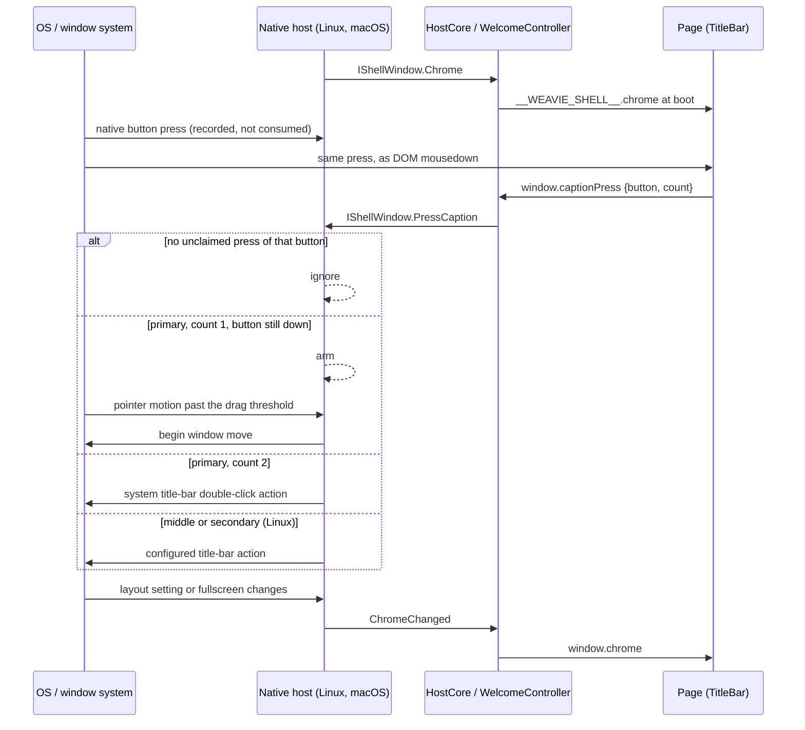

# Unified title bar — design

Implements [brief.md](brief.md). Objections it answers are in [challenge.md](challenge.md).

## What changes for the user

On macOS and Linux the workspace window loses the OS title bar. Weavie's bar is the window's only bar:
search in the centre, the build number on the right, and the window buttons where the system puts them.
macOS keeps its real traffic lights, floated over the bar. Linux gets Weavie-drawn buttons in the order and
on the side the desktop configures. Dragging, double-clicking, and on Linux middle- and right-clicking
empty bar space behave as on a native title bar. The Linux welcome screen gets a slim strip with the same
buttons. The browser client loses three window buttons that never did anything. On every system, Windows included,
the search box is centred in the window.

## How it is built

- **The host describes its window; the page draws it.** Each host sends a small description: whether menus
  show, which window buttons the page draws and on which side, how much room the system's own buttons
  need, how tall the bar is, and how the bar is dragged. It is sent at startup and whenever it changes,
  and replaces the platform name the page branches on today.
- **One bar** renders any description. The second strip used on macOS and Linux is deleted. The Linux
  welcome strip is built from the same button and press pieces.
- **Presses.** The page reports a press on empty bar space: which mouse button, and single or double. The
  host matches the report to the real press it saw from the system and acts on it.
- **Linux** declares that the app draws its own title bar, and reads the button layout and the title-bar
  click actions from GTK, which the desktop keeps current.
- **macOS** makes the title bar transparent with the page beneath it, and reports the bar's height and the
  room the traffic lights take.

## Where the code made the brief awkward

- **A drag cannot start on the press itself.** On Linux the desktop would then swallow the release and a
  double-click could never be recognised. The host starts the move once the pointer has travelled a few
  pixels, as native title bars do.
- **macOS has no "do the title-bar double-click" call.** The host reads the system preference macOS reads
  and performs it: zoom, minimize, or nothing.
- **A web view ignores the first click on an inactive macOS window.** The host accepts that click inside
  the bar strip only, so an unfocused window drags at once.
- **The window-control hook was optional.** Every host now supplies one, and an operation a host does not
  offer fails loudly. Silent dropping is what hid the dead browser buttons.
- **Proof is stronger than the brief assumed.** CI already launches the shipped app on macOS, Linux and
  Windows, so the bar gets real-app checks there, plus a screenshot per system.

## Decisions that are yours

1. **Linux button look.** I recommend the flat, full-height buttons Windows has, with the red close hover,
   on whichever side the desktop puts them: one look to maintain, as VS Code does. The alternative is
   round GNOME-style buttons, a second look for one system.
2. **macOS bar height.** I recommend asking macOS for its compact title bar, which centres the traffic
   lights itself, and letting the bar take that height. It may differ from the 38 pixels used elsewhere by
   a few pixels. The alternative keeps 38 and repositions the lights by hand on every resize and
   fullscreen change, which is fragile.
3. **Linux corners.** GTK may not round the top corners of web content for free. If it does not, I
   recommend square top corners, as VS Code has, over custom clipping.

## Main risks

- **Three native behaviours decide whether the design stands** and are unproven until run on real systems:
  GTK keeping shadow and edge resizing with a hidden title bar; macOS starting a drag from a press
  recorded a moment earlier; macOS's compact title bar letting clicks through to the page. They are built
  first.
- **A report can arrive after the button is up.** The Linux spike showed it for every quick click, so a
  report claims the latest press of its button even after release; only a drag needs the button still
  down. A very fast flick can therefore feel like a missed drag; the hand test checks it.
- **Simulated drags may not work on CI runners.** The layout checks and screenshots do not depend on them.
- **A desktop without a window menu** shows nothing on right-click.

## Plan

1. Prove the three native behaviours on Linux and macOS first. If one fails, I come back to you with the
   alternative before continuing.
2. Add the window description and the single bar; move Windows and the browser client onto them.
3. Linux: own title bar, button layout, press handling, welcome strip.
4. macOS: transparent title bar, measurements, press handling.
5. Tests: bar layouts in the browser tests, host tests, real-app checks with screenshots.
6. You try the branch build on your Mac (windowed and fullscreen) and on cachy. The old strip is deleted
   only after that.

# Reference for the build

## Flow



Windows keeps `caption: "region"`: the page declares the caption with CSS and WebView2 owns the gesture.
No `captionPress` is sent there.

## Wire and data formats

Boot config, Linux:

```js
window.__WEAVIE_SHELL__ = {
  platform: "linux",
  workspaceLabel: "weavie",
  recents: ["/home/me/src/weavie"],
  buildNumber: "0.2.1.2821",
  chrome: {
    menus: true,
    caption: "press",
    resizeHandles: false,
    barHeight: null,
    controls: { start: [], end: ["minimize", "maximize-toggle", "close"] },
    inset: { start: 0, end: 0 }
  }
};
```

`titleBar` is removed from the config. `chrome` per host:

| Host | menus | caption | resizeHandles | barHeight | controls | inset |
| --- | --- | --- | --- | --- | --- | --- |
| Windows | true | `region` | true | null | end: minimize, maximize-toggle, close | 0 / 0 |
| Linux | true | `press` | false | null | from `gtk-decoration-layout` | 0 / 0 |
| macOS | false | `press` | false | measured | none | measured; 0 / 0 in fullscreen |
| Headless (browser) | true | `none` | false | null | none | 0 / 0 |
| macOS and Windows welcome | false | `none` | false | null | none | 0 / 0 |

- `barHeight` and `inset` are CSS pixels. `null` height means the stylesheet default.
- `controls` entries are the `window.control` action names, so the page sends back what it was given.
- The Linux welcome page receives the Linux row as `window.__WEAVIE_WELCOME__.chrome`.

Messages on the host `window` feature:

| Name | Direction | Payload | Notes |
| --- | --- | --- | --- |
| `chrome` | host → page | the `chrome` object | on every `ChromeChanged`; the boot config carries the initial one |
| `captionPress` | page → host | `{ "button": 0, "count": 1 }` | DOM `MouseEvent.button` and `detail` |
| `control` | page → host | `{ "action": "minimize" }` | unchanged shape, typed on the host |
| `resize` | page → host | `{ "edge": "top-left" }` | unchanged, Windows only |
| `state` | host → page | `{ "maximized": false, "focused": true }` | unchanged |

## Types and interfaces

`Weavie.Core.Shell`:

```csharp
public enum CaptionMode { None, Region, Press }

public sealed record WindowControls(IReadOnlyList<WindowControl> Start, IReadOnlyList<WindowControl> End);

public readonly record struct ChromeInset(int Start, int End);

public sealed record WindowChrome(
	bool Menus, CaptionMode Caption, bool ResizeHandles, int? BarHeight, WindowControls Controls, ChromeInset Inset) {
	public static WindowChrome Browser { get; }      // menus, no caption, no controls
	public static WindowChrome NativeFrame { get; }  // the OS draws the title bar; the page draws no bar
}

public readonly record struct CaptionPress(int Button, int Count);

public interface IShellWindow {
	WindowChrome Chrome { get; }
	event Action? ChromeChanged;
	void Minimize() => throw Unadvertised();
	void ToggleMaximize() => throw Unadvertised();
	void Close() => throw Unadvertised();
	void StartResize(ResizeEdge edge) => throw Unadvertised();
	void PressCaption(CaptionPress press) => throw Unadvertised();
}

public sealed class FixedShellWindow(WindowChrome chrome) : IShellWindow;  // headless, native-frame welcome, tests
```

- A host overrides exactly the members its `Chrome` advertises. The default members throw
  `NotSupportedException`, so one interface serves every host with no do-nothing methods. The alternative,
  three role interfaces, needs either type tests or three more required platform properties.
- `WindowControl` and `CaptionMode` serialize as strings through `JsonStringEnumConverter<T>` with
  `JsonStringEnumMemberName` (`maximize-toggle`, lower-case modes). Confirm against an existing wire enum
  and [native-aot.md](../native-aot.md) before choosing the attribute.
- `ShellProtocol.BuildConfigScript` takes `WindowChrome chrome` in place of `string? titleBar`.
  `ShellConfigWire.TitleBar` becomes `Chrome`.
- `ShellProtocol.TryParseWindowControl`, `TryParseWindowResize` and `ShellController` are deleted: the
  handlers take typed payloads (`WindowControlRequest(WindowControl Action)`,
  `WindowResizeRequest(ResizeEdge Edge)`, `CaptionPress`) registered in `WireJson`.

`Weavie.Hosting`:

```csharp
public interface IHostPlatform {
	// removed: string? TitleBar
	IShellWindow Window { get; }   // was IShellWindow?
}
```

Page (`src/web/src/types/global.d.ts`, `src/web/src/chrome/window-state.ts`):

```ts
type WindowControlAction = "minimize" | "maximize-toggle" | "close";

interface WeavieWindowChrome {
  menus: boolean;
  caption: "none" | "region" | "press";
  resizeHandles: boolean;
  barHeight: number | null;
  controls: { start: WindowControlAction[]; end: WindowControlAction[] };
  inset: { start: number; end: number };
}
// WeavieShellConfig: titleBar removed, chrome: WeavieWindowChrome added.
// WeavieWelcomeConfig: chrome: WeavieWindowChrome added.
```

## Components

### `WindowFeature` (new, `Weavie.Hosting`)

One owner of the `window` feature's chrome messages, used by both `HostCore` and
`WelcomeController.Attachment` so the handlers exist once.

```csharp
internal sealed class WindowFeature : IDisposable {
	public WindowFeature(HostMessageBus host, IShellWindow window) {
		var feature = host.Feature("window");
		// control      -> window.Minimize / ToggleMaximize / Close   (ActionFailed "Controlling the window")
		// resize       -> window.StartResize(edge)                    (ActionFailed "Resizing the window")
		// captionPress -> window.PressCaption(press)                  (droppable)
		window.ChromeChanged += PushChrome;
	}
	private void PushChrome();                           // on ChromeChanged: publishes "chrome"
	public void PushState(bool maximized, bool focused); // publishes "state"; HostCore.PushWindowState delegates
	public void Dispose();                               // disposes the handlers, detaches ChromeChanged
}
```

- `HostCore` builds it in its constructor and passes `_platform.Window.Chrome` to `BuildConfigScript`. No
  push at hello: the boot config is the initial chrome, and the page-connect message budget (21) holds.
  The `_shell` field and its null checks go.
- `window.menu` and `PushWindowState` are untouched.

### `WelcomeController`

- Gains the shell window. Its constructor already takes eight parameters; group the four native ones into
  `WelcomeHost(IWebTransportHub Bridge, IWebSurface Surface, IUiDispatcher Ui, IShellWindow Window)`,
  leaving six.
- `Attachment` constructs a `WindowFeature` on its router and disposes it in `Close`.
- `PushWindowState(maximized, focused)` forwards to it, so the Linux welcome strip shows the restore glyph.
- `BuildConfigJson` becomes a source-generated `WelcomeConfigWire(Recents, SetupCompleted, Chrome)`.
- macOS and Windows pass `new FixedShellWindow(WindowChrome.NativeFrame)`. Linux passes its window.

### Page

`window-state.ts` gains the description beside `maximized` and `focused`:

```ts
const [chrome, setChrome] = createSignal<WeavieWindowChrome | null>(
  window.__WEAVIE_SHELL__?.chrome ?? window.__WEAVIE_WELCOME__?.chrome ?? null,
);
// in the existing registerHostFeature block: .on<WeavieWindowChrome>("chrome", setChrome)
export const windowChrome = chrome;
```

`caption-press.ts` (new) is the only place a press becomes a message. It installs once per page (the app and
the welcome screen), like middle-click autoscroll, so neither bar wires handlers or needs a lint suppression:

```ts
// Fires only when the pressed element itself is marked, so a button, input or menu can never start a drag.
function isCaption(e: MouseEvent): boolean {
  return windowChrome()?.caption === "press" && e.target instanceof Element && e.target.hasAttribute("data-caption");
}
export function installCaptionPress(): () => void {
  // document, capture phase: mousedown -> preventDefault (focus stays put) + publish captionPress
  //                          contextmenu -> preventDefault on caption space (the host's window menu owns it)
}
```

- A middle press on the bar never autoscrolls: autoscroll starts only on a scrollable surface, and the bar
  has none. The browser spec checks it.
- `.tb-icon > *` has `pointer-events: none`, so a press on the logo is a press on its caption box.

`WindowControls.tsx` (new) renders one side's buttons from a `WindowControlAction[]`, reusing the `.tb-ctl`
rules, and publishes `window.control` through `localWindowFeature()` (`window-state.ts`), the one lookup of
the local host's `window` feature. Button names come from `window-control-label.ts`, which the specs share.

`TitleBar.tsx` renders any description:

```tsx
<div class="titlebar" data-caption classList={{ blurred: !props.focused, windowed: chrome.caption !== "none" }}
     style={{ ...barStyle(chrome), "--titlebar-left": left, "--titlebar-right": right }}>
  <div class="tb-left" data-caption ref={measure}>
    <WindowControls actions={chrome.controls.start} maximized={props.maximized} />
    <Show when={chrome.menus}><span class="tb-icon" data-caption>…</span><Menu /></Show>
  </div>
  <div class="tb-center" data-caption><Omnibar … /></div>
  <div class="tb-controls" data-caption ref={measure}>
    <Show when={build()}><span class="tb-build" data-caption>…</span></Show>
    <WindowControls actions={chrome.controls.end} maximized={props.maximized} />
  </div>
</div>
```

- `.titlebar` is a three-column grid whose omnibar column is
  `min(omnibar + 16px, max(100% − 2 × wider side, --omnibar-min-width), 100% − both sides)`, and whose left
  column places it as centred as the sides allow. A `ResizeObserver` measures each side's content
  (`--titlebar-left`, `--titlebar-right`; the sides hug it with `justify-self`). So the omnibar is centred
  while that leaves it 320px, then keeps 320px and slides off the wider side, then narrows between the sides;
  the bar never needs more than both sides together. `--omnibar-width` (560px) is the omnibar's own width.
- `barStyle` sets `--titlebar-h` when `barHeight` is non-null and `--titlebar-inset-start` / `-end` from
  `inset`, which pad `.tb-left` and `.tb-controls`, so the omnibar is centred in the window, not in the
  space beside the traffic lights. `.titlebar` reads `height: var(--titlebar-h, 38px)`.
- The Windows `app-region` rules stay as they are; the other engines ignore the property. `.tb-ctl` and
  `.tb-build` are `no-drag`, so on Windows the build number keeps its tooltip as before.
- In the compact (narrow) layout a `windowed` bar stays a bar: without an OS title bar its buttons and caption
  have nowhere else to go. Only the omnibar folds into the compact overlay.

`App.tsx`: `CUSTOM_TITLEBAR`, `MAC_TITLEBAR`, `LINUX_TITLEBAR` and `HAS_TITLEBAR` collapse to
`windowChrome() !== null`; `ResizeFrame` mounts on `chrome.resizeHandles`; the `NativeTitleBar` mount goes.
`NATIVE_SHELL` is unrelated and stays.

`welcome/WelcomeBar.tsx` (new): rendered when `windowChrome()?.caption === "press"`; a `data-caption` strip
with `WindowControls` on each side and the two caption handlers. `welcome/index.tsx` imports `titlebar.css`.

### Linux host

New partial `WorkspaceHost.Chrome.cs`; `WorkspaceHost` implements `IShellWindow`.

Window, in `CreateNativeWindow` before the first `gtk_window_present`:

```
titlebar = gtk_box_new(horizontal, 0); gtk_widget_set_visible(titlebar, false)
gtk_window_set_titlebar(_window, titlebar)          // client-side decorations, no visible header
```

Description:

```
Chrome = new(Menus: true, Caption: Press, ResizeHandles: false, BarHeight: null,
             Controls: DecorationLayout.Parse(setting("gtk-decoration-layout")), Inset: default)
notify::gtk-decoration-layout on gtk_settings_get_default() -> ChromeChanged
```

`DecorationLayout.Parse` (pure, tested): split on the first `:` into start and end, split each on `,`, map
`minimize`, `maximize`, `close` and drop every other token (`icon`, `menu`, `appmenu`).

Buttons: `Minimize` → `gtk_window_minimize`; `ToggleMaximize` → `gtk_window_unmaximize` or
`gtk_window_maximize` by `gtk_window_is_maximized`; `Close` → `gtk_window_close`, the same path as the OS
close button today.

Press handling. A `GtkEventControllerLegacy` in the capture phase on the window (the pattern of
`AttachKeyController`, `src/Weavie.Linux/WorkspaceHost.Keyboard.cs:20-27`) feeds a pure state machine. A
legacy controller is used because WebKit claims the pointer sequence, which would cancel a gesture
controller on the window.

```
CaptionGesture (Weavie.Core.Shell)               // pure, shared with macOS; DOM button numbers
  NativePress(button)        -> pressed = button; held = true
  NativeRelease()            -> held = false                  // pressed stays claimable
  PagePress(button, count):
      pressed != button      -> None             // no unclaimed press of that button
      pressed = null                             // a report claims its press once
      primary, count == 2    -> DoubleClick      // a third click is a plain press, not a second double
      primary                -> held ? Drag : None
      middle                 -> MiddleClick
      secondary              -> SecondaryClick

host:
  button press    -> keep gdk_event_ref(event) until the next press; gesture.NativePress(gdkButton - 1)
  button release  -> gesture.NativeRelease(); dragArmed = false
  Drag            -> dragArmed = true
  motion          -> dragArmed && gtk_drag_check_threshold(window, press.xy, now.xy)
                       -> dragArmed = false; gdk_toplevel_begin_move(surface, device, 1, x, y, time)
  never returns true: WebKit still receives every event

  DoubleClick     -> Perform(setting("gtk-titlebar-double-click"))
  MiddleClick     -> Perform(setting("gtk-titlebar-middle-click"))
  SecondaryClick  -> Perform(setting("gtk-titlebar-right-click"))

Perform(action):
  "none"                 -> nothing
  "toggle-maximize*"     -> ToggleMaximize()     // GTK 4 can't maximize one axis
  "minimize"             -> gtk_window_minimize
  "lower"                -> gdk_toplevel_lower(surface)
  "menu"                 -> gdk_toplevel_show_window_menu(surface, pressEvent)
```

- Saved geometry is `gtk_window_get_default_size`: GTK keeps it current through user resizes and it is the
  measure `gtk_window_set_default_size` restores with. The widget size leaves out the client-side border,
  so saving it shrank the window 10px per relaunch on X11 without a compositor.

- When the report arrives after the pointer is already past the threshold, the next motion event starts the
  move; no separate check is needed.
- `surface` is `gtk_native_get_surface(_window)`. Settings are read through `g_object_get_property` with a
  `GValue`, not the variadic `g_object_get`.
- `LinuxPlatform(bridge, recents, ILinuxWindow window, notifications)`: `ILinuxWindow` is
  `IShellWindow + IShellMenuActions + ToggleVisibility() + Activate(token)`, implemented by `WorkspaceHost`,
  replacing the two delegates and the separate menu-actions parameter.

Welcome: the same window object is handed to `WelcomeController` in `ShowWelcome`
(`src/Weavie.Linux/WorkspaceHost.Welcome.cs:14-27`).

### macOS host

`MacWindowChrome` (new, `Weavie.Mac.Hosting`, static) holds what can run without an `AppDelegate`, so the
Mac test app can call it:

```
Apply(window):
  window.StyleMask |= FullSizeContentView
  window.TitlebarAppearsTransparent = true
  window.TitleVisibility = Hidden
  window.Toolbar = new NSToolbar("weavie.titlebar") { ShowsBaselineSeparator = false }
  window.ToolbarStyle = UnifiedCompact

Measure(window) -> (BarHeight, ChromeInset):
  BarHeight = round(window.Frame.Height - window.ContentLayoutRect.Height)
  if window.StyleMask has FullScreenWindow -> inset 0 / 0
  r = union of the Close, Miniaturize and Zoom button frames in window coordinates
  r.MidX < width / 2 ? Start = r.MaxX + r.MinX : End = (width - r.MinX) + (width - r.MaxX)

DoubleClickAction() -> Zoom | Minimize | None      // NSUserDefaults "AppleActionOnDoubleClick"
```

`WeavieWebView : WKWebView` (new) owns a `CaptionGesture` and the latest primary mouse-down:

```
MouseDown(e)  -> LastPress = e; Caption.NativePress(primary); base.MouseDown(e)
MouseUp(e)    -> Caption.NativeRelease(); base.MouseUp(e)
AcceptsFirstMouse(e) -> e is inside the top CaptionHeight points of the view, else base
```

`WorkspaceWindow.Chrome.cs` (new partial) implements `IShellWindow`:

```
Chrome = new(Menus: false, Caption: Press, ResizeHandles: false, BarHeight, Controls: none, Inset)
ChromeChanged on fullscreen will-enter and will-exit

PressCaption(press): switch _webView.Caption.PagePress(press)
  Drag        -> Window.PerformWindowDrag(_webView.LastPress)
  DoubleClick -> Zoom / Miniaturize / nothing, per DoubleClickAction()
```

- AppKit's drag loop does nothing until the pointer moves, so macOS needs no threshold of its own.
- `Minimize`, `ToggleMaximize`, `Close` and `StartResize` are not overridden: the traffic lights are native.
- `WelcomeWindow` is unchanged apart from passing `FixedShellWindow(WindowChrome.NativeFrame)`.

### Windows and headless

- `WorkspaceWindow` (Windows) adds `Chrome` (the Windows row, a static value) and a `ChromeChanged` that is
  never raised. `PressCaption` is not overridden. Behaviour is unchanged.
- `HeadlessPlatform.Window` returns `new FixedShellWindow(WindowChrome.Browser)`.
- `TestHost.Window` becomes non-null with the same default.

## Error handling

- **Unpaired press report:** ignored by the pairing rule. It is not an error and is not logged.
- **A message a host does not advertise** (for example `control` reaching headless): the default member
  throws `NotSupportedException`; the bus logs the failed event, as it does for every event. This is a page
  bug, never a state a user can reach.
- **Unknown action or edge:** typed deserialization fails and the bus logs the failed event, where today
  the hand parser dropped it without a trace.
- **`gdk_toplevel_show_window_menu` returns false:** the desktop has no window menu. Nothing is shown.
- **Unknown `gtk-titlebar-*` value or `AppleActionOnDoubleClick` value:** Linux does nothing, as
  `GtkWindowHandle` does. macOS zooms, which is the system default when the preference is unset.
- No timeouts, retries or substitute behaviours are added.

## Testing strategy

| Layer | Where | Covers |
| --- | --- | --- |
| Core unit | `tests/Weavie.Core.Tests/Shell/ShellTests.cs` | config script carries `chrome`; enum names on the wire; default members throw |
| Hosting | `tests/Weavie.Hosting.Tests` with `TestHost` | `control`, `resize`, `captionPress` reach the window; `ChromeChanged` publishes `chrome`, and nothing is pushed at hello |
| Hosting | `WelcomeControllerTests.cs` | welcome config carries `chrome`; welcome routes `control` and `captionPress` |
| Core unit | `tests/Weavie.Core.Tests/Shell/CaptionGestureTests.cs` | the pairing rule both hosts use: late report, release, claim once, button mismatch, double and triple click |
| Linux unit | `tests/Weavie.Linux.Tests` | `DecorationLayout.Parse` |
| macOS | `tests/Weavie.Mac.Tests/Main.cs` | `MacWindowChrome.Apply` then `Measure` on a real `NSWindow`: inset is positive, bar is taller than a plain title bar, the zoom button lies inside the bar |
| Browser e2e | `src/web/e2e/functional`, mock host | one test per row of the description table: menus present or absent, control order and side, inset padding, no bar when `chrome` is absent; a pushed `chrome` re-renders; a marked element sends `captionPress`, a button inside the bar does not |
| Real app | `src/web/e2e/desktop/window-chrome.spec.ts` | per system, the driver script reports the page's `chrome`, the bar's rectangle, the drawn controls, and `outerHeight - innerHeight`; the spec asserts the row for that system and attaches a screenshot |
| Real app, attempt | same spec | simulated press-move-release on empty bar space, asserting `screenX` / `screenY` changed. Added only if the runner accepts synthetic input; no skipped test is committed |
| Hand | you | macOS windowed and fullscreen, Linux desktop: drag, snap, drag from maximized, double-, middle-, right-click, unfocused drag, button layout change, welcome strip, size restored after relaunch |

- `src/web/e2e` is outside the TypeScript project: `titleBar` users there
  (`src/web/e2e/bridge.spec.ts:72`, `src/web/e2e/middle-click-autoscroll.spec.ts:28`) must be found by
  search, not by the compiler.
- Rebuild the web bundle and then the host before any headless or desktop run, or the run tests old code.
- The Linux real-app job runs under `xvfb-run` with no window manager; GDK then moves the window itself.
  Screenshots need a capture tool added to the job's package list.
- No per-frame code changes, so the render budgets do not apply.

## Files that change

| File | Change |
| --- | --- |
| `src/Weavie.Core/Shell/WindowChrome.cs` | new: `WindowChrome`, `WindowControls`, `ChromeInset`, `CaptionMode`, `CaptionPress`, `FixedShellWindow` |
| `src/Weavie.Core/Shell/IShellWindow.cs` | `Chrome`, `ChromeChanged`, `PressCaption`; default members |
| `src/Weavie.Core/Shell/ShellProtocol.cs` | `BuildConfigScript` takes `WindowChrome`; control and resize parsers deleted; enum wire names |
| `src/Weavie.Core/Shell/ShellController.cs` | deleted |
| `src/Weavie.Core/CoreJson.cs` | `ShellConfigWire` shape |
| `src/Weavie.Hosting/IHostPlatform.cs` | `TitleBar` removed; `Window` required |
| `src/Weavie.Hosting/WindowFeature.cs` | new |
| `src/Weavie.Hosting/HostCore.cs`, `HostCore.Messages.cs` | use `WindowFeature`; drop `_shell` |
| `src/Weavie.Hosting/Messaging/WireJson.cs` | `WindowChrome`, request payloads, `WelcomeConfigWire` |
| `src/Weavie.Hosting/Web/WelcomeController.cs` | `WelcomeHost`; `WindowFeature`; config carries `chrome` |
| `src/Weavie.Headless/HeadlessPlatform.cs` | `FixedShellWindow(WindowChrome.Browser)` |
| `src/Weavie.Linux/WorkspaceHost.cs`, `.Welcome.cs` | hidden title bar; pass the window to core and welcome |
| `src/Weavie.Linux/WorkspaceHost.Chrome.cs` | new: `IShellWindow`, recorder, actions |
| `src/Weavie.Core/Shell/CaptionGesture.cs`, `src/Weavie.Linux/Hosting/DecorationLayout.cs` | new, pure |
| `src/Weavie.Linux/Hosting/LinuxPlatform.cs` | window required; constructor regrouped |
| `src/Weavie.Linux/Native/Gtk.cs`, `Gdk.cs`, `GLib.cs`, `Callbacks.cs` | bindings: titlebar, minimize, unmaximize, close, settings, legacy controller, event accessors, toplevel move / menu / lower, `GValue` |
| `src/Weavie.Mac/WorkspaceWindow.cs`, `.Platform.cs` | `WeavieWebView`; apply chrome; fullscreen observers; `Window` is this |
| `src/Weavie.Mac/WorkspaceWindow.Chrome.cs` | new: `IShellWindow` |
| `src/Weavie.Mac/Hosting/MacWindowChrome.cs`, `WeavieWebView.cs` | new |
| `src/Weavie.Mac/WelcomeWindow.cs`, `src/Weavie.Win/WelcomeWindow.cs` | `WelcomeHost` with the native-frame window |
| `src/Weavie.Win/WorkspaceWindow.cs`, `.Platform.cs` | `Chrome`, `ChromeChanged`; `TitleBar` removed |
| `src/web/src/types/global.d.ts` | config types |
| `src/web/src/chrome/window-state.ts` | `windowChrome` |
| `src/web/src/chrome/caption-press.ts`, `WindowControls.tsx`, `window-control-label.ts` | new |
| `src/web/src/chrome/TitleBar.tsx`, `titlebar.css` | data-driven bar; `--titlebar-h`; native-strip rules deleted |
| `src/web/src/chrome/NativeTitleBar.tsx` | deleted after the hand test |
| `src/web/src/mobile/mobile-commands.css` | native-strip selectors deleted |
| `src/web/src/App.tsx` | one mount driven by `windowChrome()` |
| `src/web/src/welcome/WelcomeBar.tsx`, `Welcome.tsx`, `index.tsx`, `welcome.css` | Linux strip |
| `src/web/e2e/…` | two `titleBar` fixtures updated; layout tests; `desktop/window-chrome.spec.ts` |
| `tests/…` | as in the testing table; `TestHost`, `ShellTests` updated |
| `.github/workflows/ci.yml` | capture and input tools for the Linux desktop job |

## Risks

| Risk | Handling |
| --- | --- |
| Hidden GTK title bar loses shadow, edge resize or snapping on some desktop | Step 1 proves it on the hand-test desktop and under Xvfb. If it fails, stop and return to the user: the alternative is a real, empty header widget of zero height |
| WebKitGTK consumes events before a window-level capture controller | Step 1. The key controller already works this way for keys; pointer events are the open part |
| `PerformWindowDrag` rejects a press recorded before the message arrived | Step 1. Alternative: call it with `NSApp.CurrentEvent`, as other WKWebView shells do |
| The compact toolbar takes clicks meant for the page | Step 1. Alternative: no toolbar, `barHeight` null, and the traffic lights centred by setting their frames on layout and fullscreen change (decision 2's other branch) |
| A late report meets the *next* press of the same button | Needs a second press within the round-trip time. Accepted; the button check narrows it |
| Starting a move hides the release from the page | The page keeps no pressed state for the bar, and `preventDefault` stops selection and focus changes |
| Middle press on the bar starts autoscroll | Autoscroll needs a scrollable surface and the bar has none; covered by a browser test |
| `AppleActionOnDoubleClick` gains a value Weavie does not know | Zooms, the unset default. Named in the code where the preference is read |
| Saved window size drifts under client-side decorations | Saved from GTK's default size; the real-app spec closes to welcome, reopens, and asserts the size held |
| Square top corners on Linux | Decision 3 |
| Desktop has no window menu | Nothing shown; stated in error handling |
| Chrome changes while the page is still loading (fullscreen entered mid-load) | The page keeps its boot chrome until the next change: on macOS a traffic-light gap in fullscreen until exit. Cosmetic and rare; a push at hello would put every page connect over its message budget |
| Page zoom makes CSS pixels differ from points for `barHeight` and `inset` | Check whether Weavie applies page zoom on macOS; if it does, the host divides by the zoom factor before sending |
| Simulated input refused on CI runners | The drag test is not added; the geometry checks and screenshots stand, and the hand test covers the gesture |
| A second title-bar implementation lingers | `NativeTitleBar` and the native-strip CSS are deleted in the same change, after the hand test |

## Build checklist

- [x] 1. Spike on Linux (X11, Xvfb + openbox): hidden title bar, legacy capture controller, move after the
  threshold, window menu, double-click. Found the pairing rule above; Wayland left to the hand test.
- [x] 2. macOS: `MacWindowChrome`, `WeavieWebView` and the window partial compile here (C# compile only;
  AppKit needs CI). The Mac test app checks geometry, click routing and first click on CI's runner.
- [x] 3. Neither spike contradicted the design.
- [x] 4. Core: `WindowChrome` and friends, `IShellWindow`, `ShellProtocol`; `ShellController` deleted.
- [x] 5. Hosting: `WindowFeature`, `HostCore`, `WelcomeHost`, `WelcomeController`, `WireJson`; `TestHost`.
- [x] 6. Windows and headless onto the description; the Windows host compiles with Windows targeting.
- [x] 7. Page: `windowChrome`, `caption-press`, `WindowControls`, `TitleBar`, `App.tsx`, CSS.
- [x] 8. Linux host: bindings, `DecorationLayout`, `CaptionGesture`, `WorkspaceHost.Chrome`, welcome strip.
- [x] 9. macOS host: `WeavieWebView`, `WorkspaceWindow.Chrome`, fullscreen observers.
- [x] 10. Tests: Core, Hosting, Linux, Mac test app, browser spec, real-app desktop spec (Linux drag passes
  under Xvfb); the two shell fixtures updated.
- [x] 11. `biome check --write`, `dotnet format` (both project sets), `vite build` then `dotnet build`.
- [x] 12. Draft PR opened; CI's per-system checks and screenshots pending.
- [ ] 13. User hand test on macOS and Linux.
- [x] 14. `NativeTitleBar` and the native-strip CSS are deleted in this PR, which merges only after the hand
  test. Review and recorded proof belong to their own stages.
