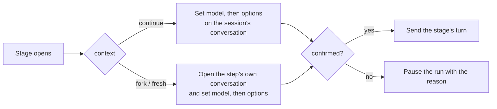

# Workflow agent selection

Status: design — not built. Extends [workflows.md](workflows.md).

## Purpose

One workflow run uses different models for different stages: a top model writes the spec, a workhorse implements it,
and another vendor's model reviews the result. A stage names what runs it; Weavie applies that and fails loudly when
it can't.

## What a step names

`agent` sits on a step (`run` or `check`). Every value is the provider's own id, never a label and never inferred.

```yaml
agent:
  provider: codex-acp            # required: model and option ids mean nothing without their provider
  model: gpt-6.1-sol             # optional; omitted means that provider's model as it stands
  options: { reasoning_effort: high }   # optional; the provider's config option ids and values
```

A step with no `agent` runs on the **session's own model**: the one the session had outside the run. A workflow
that names a provider on a `continue` or `fork` step runs only in that provider's sessions, and says so when refused.

```yaml
id: spec-then-build
description: Spec with Fable, build with Opus, review with Codex.
inputs: { feature: text }
stages:
  - id: spec
    run:
      agent: { provider: claude-acp, model: claude-fable-5-1, options: { effort: xhigh } }
      prompt: Interview me, then write docs/specs/<slug>/design.md for "{{inputs.feature}}".
      outputs: { dir: text }
    then: { ask: "Approve {{spec.dir}}/design.md?", by: user, choices: { approve: build, revise: spec } }
  - id: build
    run:
      agent: { provider: claude-acp, model: opus }
      prompt: Implement {{spec.dir}}/design.md.
  - id: review
    run:
      agent: { provider: codex-acp, model: gpt-6-astra }
      context: fresh
      prompt: Review this branch against {{spec.dir}}/design.md and report findings.
      outputs: { findings: list }
```

## Where a step runs

The user only ever converses with the session's own provider, so a conversation never changes provider and the
session is never recreated.

| `context` | Session's provider | Another provider |
| --- | --- | --- |
| `continue` | switches the model on the live conversation | refused |
| `fork` | a background conversation forked from the session's, opened on the step's model | refused: a conversation can't be copied across providers |
| `fresh` | a background conversation opened on the step's model | a background conversation on that provider |

- **`continue`** changes the session's conversation in place with the same call the pane's model picker makes. Stage
  turns are delivered only while the session is idle, so a switch always lands between turns. The turn is sent only
  after the agent confirms every change.
- **`fork` and `fresh`** steps own their conversation, so the session's conversation is untouched. Weavie always sets
  the step's model on the new conversation, including the session's own model for a step that names nothing: a fork
  opens on the provider's default, not its parent's model.
- **Another provider** runs only as a `fresh` background step, written explicitly. It receives what the workflow
  owns: its rendered prompt and args, the outputs it references, and the files in the shared worktree. There is no
  generated handoff summary.

Model is applied first and each option after it, validated against what the agent advertises at that moment, because
the available options depend on the model.

## The session's own model

- A workflow change is never remembered as the user's default for that provider. Only the picker remembers.
- When a run ends or is cancelled, or a `continue` step names nothing, the conversation returns to the session's own
  values for every axis the run changed. The run persists those values, so a restart mid-run restores them too.
- The picker still works during a run. Used while a step's `agent` is in effect, it changes that step only; used
  otherwise, it changes the session's own model.

## Refusals

Nothing is substituted. Each refusal names the step, what it asked for, and what the provider advertises.

| When | Refused |
| --- | --- |
| Load (`validateWorkflow`) | an `agent` that isn't a map of `provider`, `model`, `options`, or that omits `provider` |
| Run start | any step naming a model or options on a terminal Claude session (use the Claude ACP agent); `continue`, `fork`, or an unwritten `context` on a step whose `provider` differs from the session's; an unknown or unavailable provider; a model or option the session's provider doesn't advertise |
| Step open | a model, option, or value the conversation no longer advertises; an option in the provider's `mode` category |

A refusal at run start leaves no run. A refusal at step open pauses the run with the reason.

Options in the `mode` category (permission and sandbox modes) are refused because a repository's workflow file must
not raise what the agent may do without asking.

Another provider's models are checked at run start against `AgentModelCatalog` and again when its conversation opens,
which is the authoritative list.

## Visibility

- The pane's model control shows the running model with no new UI: the switch goes through the same control state.
- Each switch on the session's conversation adds one transcript line: `Workflow: implement runs on Opus 5.5`.
- The header's run tooltip adds the step's agent when it differs from the session's own.
- Background steps show their provider and model on their background-work card.
- The session list is unchanged.

## Run history

Each step records the provider, model, and options it actually ran with, and tokens per model. Both agents report
tokens per model on every turn (`_meta.quota.model_usage`). Neither reports a price, so history holds tokens, not
currency, and Weavie keeps no price table.

## Architecture

The engine stays provider-free. A step's `agent` travels on the `WorkflowKickoff` the runner hands to
`IWorkflowRunPort`; the session applies it before sending the turn and fails the stage through the existing
turn-failure path. `IStructuredAgentControls` gains an awaited, unremembered way to apply a set of control values,
beside the picker's `SetControl`. Background steps apply the same values when their `AcpConversation` opens.



## Verified behaviour

Observed on 2026-11-10 by giving a codeword on one model, switching, and reading which model answered from the usage
report.

| Agent | Result |
| --- | --- |
| claude-agent-acp 0.102.0 | Fable 5.1 → Opus 5.5 → Fable 5.1 on one conversation kept the codeword. A fork opened on the default model, took a different one, and left its parent's model alone. |
| codex-acp 2.6.0 | Astra → Sol → Astra kept the codeword. A fork opened on the default model, took a different one, and left its parent's model alone. |
| Terminal Claude 2.1.321 | `--resume <id> --model` keeps context but restarts the process. `/model` in the pane rewrites the user's default model in `~/.claude/settings.json`. |

What a switch costs:

- The first turn on a new model reads the whole conversation uncached: on Claude, 30k of a 41k-token conversation was
  written to the cache again. A long spec conversation is paid for once more when the build stage continues it, so a
  build that needs only the spec file is cheaper as `fresh`.
- The context window changes with the model: Codex reported 258k on Astra and 475k on Sol. A conversation larger
  than the new model's window is the agent's to compact; if it errors instead, the turn fails and the run pauses
  with that error.
- The option set changes with the model: Claude's `fast` is absent on Fable 5.1.

## Deferred

- **Roles** (`agent: planner`): names mapped to a model per provider in user settings, so built-in and repository
  workflows can ask for a stronger or cheaper model without naming one. Until then built-in workflows name no
  model and run on the session's own.
- A foreground step on another provider.
- Per-step models on terminal Claude.
- A model override on a decision.
