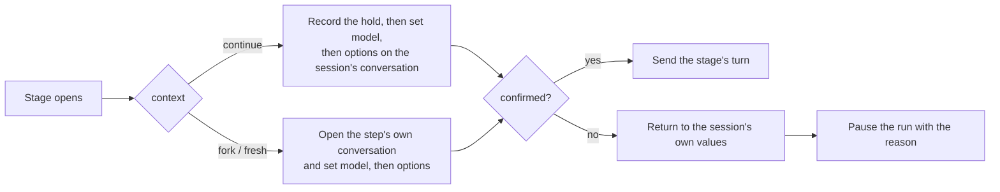

# Workflow agent selection

Status: partially built. `agents`, a `run` step's `agent` or `role`, and `continue`, `fork`, and `fresh` on the session's own
provider run end to end in native ACP sessions; another provider's steps, `check`, and run history are not built.
Extends [workflows.md](workflows.md).

## Purpose

One workflow run uses different models for different stages: a top model writes the spec, a workhorse implements it,
and another vendor's model reviews the result. A stage names what runs it; Weavie applies that and fails loudly when
it can't.

## Naming agents

A workflow defines its agents once, by name, and steps refer to them. Every id is the provider's own, never a label
and never inferred.

```yaml
agents:
  <name>:
    provider: codex-acp            # required: model and option ids mean nothing without their provider
    model: gpt-6.1-sol             # optional; omitted means that provider's model as it stands
    options: { reasoning_effort: high }   # optional; the provider's config option ids and values
```

A step's `agent` (on `run`; `check` takes one too once it exists) is one of those names; a step can't define an agent inline. A step with no
`agent` runs on the **session's own model**: the one the session had outside the run. A workflow whose `continue` or
`fork` step uses an agent runs only in that agent's provider's sessions, and says so when refused.

```yaml
id: spec-then-build
description: Spec with Fable, build with Opus, review with Codex.
inputs: { feature: text }
agents:
  planner: { provider: claude-acp, model: claude-fable-5-1, options: { effort: xhigh } }
  builder: { provider: claude-acp, model: opus }
  reviewer: { provider: codex-acp, model: gpt-6-astra }
stages:
  - id: spec
    run:
      agent: planner
      prompt: Interview me, then write docs/specs/<slug>/design.md for "{{inputs.feature}}".
      outputs: { dir: text }
    then: { ask: "Approve {{spec.dir}}/design.md?", by: user, choices: { approve: build, revise: spec } }
  - id: build
    run:
      agent: builder
      prompt: Implement {{spec.dir}}/design.md.
  - id: review
    run:
      agent: reviewer
      context: fresh
      prompt: Review this branch against {{spec.dir}}/design.md and report findings.
      outputs: { findings: list }
```

## Roles

A step can ask for a role instead of an agent: `run: { role: planner, prompt: … }`. A role is a name the user owns, with
one agent per session provider, saved user-wide in `~/.weavie/workflow-roles.json`; `planner` can be Fable in Claude
sessions and Astra in Codex sessions. Workflows carry no description of a role and Weavie ships none; `planner`,
`builder`, and `reviewer` are a convention. A step takes `agent` or `role`, not both, so a role never overrides a pinned
agent and an undefined `agent` still fails at load.

- **Filling one.** The agent saves a role with `weavie.workflow.setRole` (role, session provider, and an agent of
  provider, model, and options) and reads them from `listWorkflows`. The new-session composer shows a model picker for
  each role the chosen workflow needs on the chosen provider, prefilled by the decision provider when it is confident
  (evidence: the role's name and the prompts of the stages that use it; choices: the provider's models), and saves
  the picks at Start.
- **Resolving.** Preparing a run resolves every role for the session's provider, so a launch never holds an unfilled
  role; the run keeps the resolved agents, and a later change to a role affects the next run. From then on a role's
  stage is a pinned agent's: the same hold, step open, and refusals.
- **Nothing is substituted.** A role with nothing saved, a saved model the provider no longer offers, a provider that
  offers no model choice, and terminal Claude all refuse the start. While the provider's models are still being
  listed, a saved role is trusted until its stage opens.

See [workflow-roles/design.md](workflow-roles/design.md).

## Where a step runs

Each conversation keeps its provider. Main stays usable while a same-provider stage runs in its own
replyable card. Another-provider rows below describe the deferred extension.

| `context` | Session's provider | Another provider |
| --- | --- | --- |
| `continue` | switches the model on the live conversation | refused |
| `fork` | a background conversation forked from the session's, opened on the step's model | refused: a conversation can't be copied across providers |
| `fresh` | a background conversation opened on the step's model | a background conversation on that provider |

- **`continue`** changes the session's conversation in place with the same call the pane's model picker makes. Stage
  turns are delivered only while the session is idle, so a switch always lands between turns. The turn is sent only
  after the agent confirms every change.
- **`fork` and `fresh`** steps own their conversation, so the session's conversation is untouched. Weavie copies main's
  controls, including permission mode, then applies the step's model and options before prompting. A stage
  naming no agent keeps those captured controls; the workflow cannot change permission mode.
- **Another provider** runs only as a `fresh` background step, written explicitly. It receives what the workflow
  owns: its rendered prompt and args, the outputs it references, and the files in the shared worktree. There is no
  generated handoff summary.

Model is applied first and each option after it, validated against what the agent advertises at that moment, because
the available options depend on the model. Every axis the step doesn't set returns to the session's own value where
the agent advertises it, so a step never inherits the previous step's options.

## The session's own model

- A workflow change is never remembered as the user's default for that provider. Only the picker remembers.
- The run persists one **hold**: the session's own value of every axis outside the `mode` category, recorded when a
  step first takes an agent, and the step and values it holds over them (its agent's model and options, plus any
  picks made during it). The hold is recorded before the change is applied. Main reopening during `continue` while the
  run is live (a restart, `/clear`, Rewind, a reload after a host restart) opens on the user's defaults overlaid with
  the held values, model first.
- When a `continue` step names nothing, the conversation returns to the session's own values before its turn and the
  run stops holding any. When a run ends or is cancelled, it returns once the session is idle; a failed return is
  shown as an error and the hold is dropped. A run that ended without returning, because the host stopped first,
  holds nothing on reload: the reopened conversation is already on the user's defaults.
- The picker still works during a run. Used while the open step of a live run holds values, it changes that step
  only; used otherwise, including while the next step is still waiting to open, it changes the session's own value,
  in the hold too. Options in the `mode` category always change the session's own value.

## Refusals

Nothing is substituted. Each refusal names the step, what it asked for, and what the provider advertises.

| When | Refused |
| --- | --- |
| Load (`validateWorkflow`) | an `agents` entry that isn't `provider`, `model`, `options`, or that omits `provider`; a step `agent` that names no entry |
| Run start | a role with no agent for the session's provider, or saved with a model it no longer offers; any step with an `agent` or `role` on a terminal Claude session (use the Claude ACP agent); a step whose agent's provider differs from the session's, which covers an unknown or unavailable provider; a model the session's provider doesn't advertise; an option in the `mode` category; an unknown option or value on a step whose model is the one in effect |
| Step open | a model, option, or value the conversation doesn't advertise at that moment |

A refusal at run start leaves no run. A step opens all or nothing: when it can't, the conversation returns to the
session's own values for every axis the step changed, with a transcript line (`Workflow: plan didn't open, back on
Opus 5.5`), the run holds nothing, and the run pauses with the refusal as its reason, unsent: `Workflow spec-then-build
paused: Stage "plan" sets option "fast", which the agent doesn't advertise; it advertises effort, ultracode, agent.`
Resume opens the step again. When the return fails too, the reason adds why, and the hold stays for the run's end to
return.

The options an agent advertises depend on its model, so a step that switches the model has its options checked when it
opens, after the switch. A run started by `weavie.session.new` starts before the new session's agent advertises
anything: only a terminal session or a provider mismatch is refused up front, before a worktree exists, and every
other problem pauses the run when its first stage opens.

Options in the `mode` category (permission and sandbox modes) are refused because a repository's workflow file must
not raise what the agent may do without asking.

Another provider's models are checked at run start against `AgentModelCatalog` and again when its conversation opens,
which is the authoritative list.

## Visibility

- The pane's model control shows the running model with no new UI: the switch goes through the same control state.
- Each change on the session's conversation adds one transcript line naming the model and every option the step sets:
  `Workflow: implement runs on Opus 5.5, Effort High`, and at the end `Workflow: spec-then-build ended, back on Fable 5.1`.
- The header's run tooltip adds the current step's agent while that step holds values over the session's own; between
  a step completing and the next opening it names none:
  `spec-then-build · build on builder · working`.
- Background steps show their provider and model on their background-work card.
- The session list is unchanged.

## Run history

Each step records the provider, model, and options it actually ran with, and tokens per model. Both agents report
tokens per model on every turn (`_meta.quota.model_usage`). Neither reports a price, so history holds tokens, not
currency, and Weavie keeps no price table.

## Architecture

The engine stays provider-free: it reads `agents` as opaque provider ids, persists the hold it is handed, and asks its
port to refuse a definition before a run exists (`IWorkflowRunPort.Refusal`, called outside the runner's lock). Each
`WorkflowKickoff` names the stage it opens (`Opens`, empty for a question or a turn within the stage); the session
looks up that stage's agent with `WorkflowRunner.AgentOf`. `WorkflowAgentControls` in Core is the one place that
checks agents against the advertised axes and words refusals.

`HostSession` opens a stage, returns an ended run, and handles a pick behind one gate, never while holding the
runner's lock. The stage's turn is delivered only while the session is idle; before sending it the session records the
hold and calls `IStructuredAgentControls.ApplyControlsAsync`, an awaited, unremembered batch beside the picker's
`SetControl` on the same ordered queue. It completes once the agent confirms each change, faults with the advertised
values when one isn't offered at that moment, and faults when the conversation is replaced first. A fault returns the
conversation to the session's own values and pauses the run through `WorkflowRunner.RefuseOpen`, which pauses only
while the run still owes that stage's turn; the turn-failure path stays for a turn that couldn't be sent. The conversation reads the held values from `IAgentControlHold` when it
opens, as it reads the stage block from `IAgentTurnContext`. Background steps will apply the same values when their
`AcpConversation` opens.



## Verified behaviour

Observed on 2026-11-10 by giving a codeword on one model, switching, and reading which model answered from the usage
report.

| Agent | Result |
| --- | --- |
| claude-agent-acp 0.102.0 | Fable 5.1 → Opus 5.5 → Fable 5.1 on one conversation kept the codeword. A fork opened on the default model, took a different one, and left its parent's model alone. |
| codex-acp 2.6.0 | Astra → Sol → Astra kept the codeword. A fork opened on the default model, took a different one, and left its parent's model alone. |
| Terminal Claude 2.1.321 | `--resume <id> --model` keeps context but restarts the process. `/model` in the pane rewrites the user's default model in `~/.claude/settings.json`. |

What a switch costs:

- The first turn on a new model reads the whole conversation uncached: on Claude, 30k of a 41k-token conversation was
  written to the cache again. A long spec conversation is paid for once more when the build stage continues it, so a
  build that needs only the spec file is cheaper as `fresh`.
- The context window changes with the model: Codex reported 258k on Astra and 475k on Sol. A conversation larger
  than the new model's window is the agent's to compact; if it errors instead, the turn fails and the run pauses
  with that error.
- The option set changes with the model: Claude's `fast` is absent on Fable 5.1.

## Deferred

- A foreground step on another provider.
- Per-step models on terminal Claude.
- A model override on a decision.
