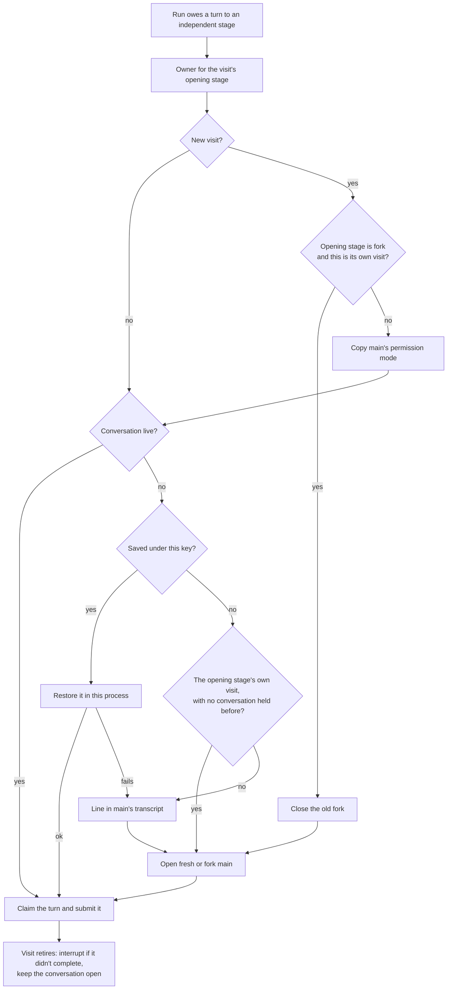

# Workflow context reuse: design

Implements [brief.md](brief.md). [challenge.md](challenge.md) shaped the brief; its code citations are reused here.

## Summary

**What changes for the user**

- A `fresh` stage keeps one conversation for the whole run. `review → fix → review` returns to the same reviewer,
  which already holds the design and its own findings.
- A stage can continue another stage's conversation with `context: { reuse: review }`, for a return that needs its
  own prompt or `limit`.
- A stage's card no longer closes when the run moves on. It stays open until the run ends, later visits continue in
  it, and the user can reply in it between visits.
- After a host restart, a session reload, or Restart Agent, the next visit picks the same conversation up again,
  as an aside does. An agent crash, `/clear`, or a Rewind ends it, and the next visit opens a new one.
- When a conversation can't be continued, the stage opens a new one and main's transcript says why.

**Main pieces**

| Piece | Where | Job |
| --- | --- | --- |
| `reuse` in the definition | `Weavie.Workflows` | Reads and validates `context: { reuse: <stage> }`, and tells the host which stage's conversation a visit uses |
| Conversation owner | `Weavie.Hosting` | One object per run and opening stage. Opens or restores the conversation, lends it to one visit at a time, closes it when the run ends |
| Kept continuation | `Weavie.AgentClientProtocol` | A stage conversation is saved, suspended, and restored by the paths asides use. It differs in two ways: only its owner restores it, and closing it forgets it |

**Decided at approval**

- A stage conversation takes an aside's behaviour wherever one exists, including being final after an agent crash.
  Fixing that is a later change for both.
- `/clear` and Rewind get no workflow handling. They close stage conversations as they do today, and a later visit
  opens a new one.
- After a host restart a kept conversation receives the run's prompt images once more.
- Every stage conversation stays open until the run ends, including a `fork` no stage returns to.
- A card whose conversation is not live (after Restart Agent or a reload) takes replies again once its stage next
  runs. Restoring it from a reply would need a second route to the owner.

## Flow



## Formats by example

**Workflow file**

```yaml
stages:
  - id: review
    run: { agent: fable, context: fresh, prompt: "Review {{build.pr}} ...", outputs: { report: files } }
    then: { ask: "Any bug or warn open?", choices: { clean: ci, fix: fix } }
  - id: fix
    run: { agent: opus, prompt: "Fix every open finding in {{review.report}}." }
    then: recheck
  - id: recheck
    run:
      context: { reuse: review }          # no agent: it runs on review's
      prompt: "Check only the commits since your review. Update {{review.report}}."
      outputs: { report: files }
    then: { ask: "Any bug or warn open?", choices: { clean: ci, fix: fix }, limit: 2 }
```

**Load-time diagnostics**

| Path | Condition | Text |
| --- | --- | --- |
| `stages[i].run.context.reuse` | names no stage | `"x" names no stage` |
| same | names itself | `a stage can't reuse its own conversation; fresh already keeps one for the run` |
| same | named stage is `continue` | `stage "x" runs in the main conversation; reuse names a fork or fresh stage` |
| same | named stage itself reuses | `stage "x" reuses "y"; name "y"` |
| `stages[i].run.agent` | a reusing stage names an agent | `a stage that reuses a conversation runs on that conversation's agent; set agent on "x"` |

**Stage block**, one added sentence after the stage position, only on a turn that continues an existing conversation:

```text
Stage "review" has opened again; your earlier work on it is above.
Stage "recheck" continues the conversation of stage "review"; that work is above.
```

**Lines in main's transcript**, only when a new conversation replaces one the visit expected:

```text
Workflow: review opened a new conversation; its earlier one could not be restored: <error>
Workflow: review opened a new conversation; its earlier one ended
Workflow: recheck opened a new conversation; stage "review" has no conversation to continue
```

**Saved continuation** (`AcpConversationState`, the `state` JSON column of `conversations`), one added member:

```json
{ "conversationId": "4f0c…", "sessionId": "sess_91…", "anchorTurnNumber": 41, "initialPrompt": "review",
  "turnNumber": 3, "guidanceSent": false, "planTurns": {}, "failed": false,
  "owner": { "scope": "r-b922f54170a0", "name": "review" } }
```

## Types added or changed

**`Weavie.Workflows`**

```csharp
public sealed record WorkflowWork {
	/// <summary>How the conversation that runs this step opens; a reusing step takes the named stage's.</summary>
	public required WorkflowContext Context { get; init; }          // enum unchanged: Continue, Fork, Fresh
	/// <summary>The stage whose conversation this step continues, or null.</summary>
	public required string? Reuse { get; init; }
}

public sealed record WorkflowDefinition {
	/// <summary>The stage whose conversation runs <paramref name="stage"/>, or null for main.</summary>
	public WorkflowStage? Opener(WorkflowStage stage);
}

public sealed class WorkflowStageExecution {
	public WorkflowStage? Opener { get; }                 // null for a continue stage
	public string Compose(bool continues);                // was Compose()
}
```

`WorkflowContext` stays a three-value enum, so `WorkflowKickoff.Context`, the saved run format, and the dozen
`Context != Continue` call sites are untouched. A reusing stage's resolved `Context` is `Fork` or `Fresh`, which is what
those sites ask. The run file does not change.

This builds on #1196: the engine gains no host-supplied value, new members live on records, and engine tests go
through the `TestWorkflows` factory. The one widened signature is `Compose(bool)`, a per-turn fact.

**`Weavie.Core`**

```csharp
/// <summary>Who keeps an independently owned conversation: a scope (the run id) and a name (the opening stage).</summary>
public sealed record AgentConversationKey(string Scope, string Name);

public sealed record AgentConversationBinding {
	/// <summary>The owner that keeps this conversation, or null for main and asides.</summary>
	public AgentConversationKey? Owner { get; init; }
}

public interface IStructuredAgentConversations {             // OpenFreshAsync and OpenForkAsync keep their signatures
	/// <summary>Restores the conversation kept under the binding's owner by an earlier process; null when none is kept.</summary>
	Task<IAgentConversation?> RestoreAsync(AgentConversationBinding binding, CancellationToken ct);
	/// <summary>Forgets every kept conversation that is not live and whose owner <paramref name="owners"/> selects, ending its card.</summary>
	void Forget(Func<AgentConversationKey, bool> owners);
}

public sealed record AcpConversationState {
	/// <summary>The owner that keeps this conversation, or null for main and asides.</summary>
	public AgentConversationKey? Owner { get; init; }     // not required: existing rows have none
}
```

`AcpSessionStore` gains `Forget(string providerId, string workspace, string conversationId)`. The SQL schema is
unchanged.

**`Weavie.Hosting`**: `WorkflowConversationOwner` and its `StageLease` replace `WorkflowStageOwner` and
`StageTurnContext`.

## Components

### Engine

- **Reader** (`WorkflowReader.ReadStage`). A mapping value reads `Reuse`, and `Context` is the named stage's written
  context (`Fresh` when the name is invalid, which `WorkflowSemantics` then reports).
- **Schema** (`WorkflowSchema.Build`). `context` becomes
  `TextOrObjectShape(description, EnumShape([...]), ObjectShape([new("reuse", TextShape(IdPattern), true)]))`.
- **Semantics** (`WorkflowSemantics.CheckStage`). The five diagnostics above.
- **Runner.** `WorkflowRunner.StageBlock(execution, continues)` passes the flag to `WorkflowStageBlock.Compose`,
  which words the sentence. The host supplies the fact because only it knows whether a conversation was continued or replaced.
- **Pause text.** The three "Resume to open a new conversation" reasons (`WorkflowRunner.cs:101`,
  `HostSession.Workflow.cs:99`, the owner's observer) end "Resume to continue it."

Tool admission is unchanged: a call captures the visit and round, and `WorkflowRunner.Validate` already rejects a
call from a visit or round that has ended.

### Conversation owner

One `WorkflowConversationOwner` per `AgentConversationKey(run.Id, opener.Id)`, held by `HostSession` in a
dictionary keyed by opening stage and created by `DeliverWorkflowTurn`.

```csharp
sealed class StageLease : IAgentTurnContext {             // one per opened or restored conversation
	public WorkflowStageExecution? Visit;                 // the borrower; null between visits
	public bool Continues;
	public string Compose() => Visit?.Compose(Continues) ?? "";
}
// binding.Tools = _registry.CreateGrant(() => lease.Visit?.Capture());
```

```text
SendAsync(visit, owed):                                   // under the owner's delivery gate
  if !Workflow.Owes(owed.Kickoff): return
  if lease.Visit != visit:                                // a new visit borrows the conversation
    ReturnMainForChildAsync(visit)                        // main back on the session's own values, as today
    if opener is Fork and visit.Stage == opener: close the conversation    // a fork copies main again
    else if live: ApplyControlsAsync(main's mode-category axes)
  opened = false
  if no live conversation:
    restored, error = try RestoreAsync(binding)           // skipped after the fork close above
    if restored is null:
      conversation = opener is Fork ? OpenForkAsync(binding) : OpenFreshAsync(binding)
      opened = true; _promptImagesSent = false
      reason = error ?? (_held ? "ended" : visit.Stage != opener ? "has not opened one" : null)
      if reason is not null and not a fork forking again: Agent.Structured.Notice(line)
    _held = true
    apply the opener's agent: model, check options, options   // the code at WorkflowStageOwner.cs:100-106
    observe conversation.Completion
  lease.Visit = visit; watch visit.Retired
  if owed.Kickoff.Opens.Length > 0: lease.Continues = !opened
  refuse a missing prompt image, TryClaimKickoff, Submit
```

- **Visit ends.** The watcher awaits `visit.Retired`. A visit that did not complete (Jump, Cancel) interrupts the
  running turn. `lease.Visit` clears and the conversation stays open.
- **Conversation ends while lent.** `visit.ConversationEnded("… Resume to continue it.")` pauses the run, as today.
  Ending between visits does nothing; the next visit restores or opens.
- **Resume.** The same visit, so no hand-over and no second fork. It restores if needed and sends the stage's prompt
  with `Continues` true; that sentence is what the agent is told about the repeated prompt.
- **Reply in the card.** No new code: `ReplyAside` already submits to a live nested conversation.
- **Run ends or is replaced.** `Workflow.Changed` closes every owner: wait for the last completion reply, then
  dispose the live conversation or `Forget` one that is not live.
- **Session unload.** A lent visit pauses, as today. Owners stop without forgetting.

### Conversation layer

A stage conversation goes through the aside paths, with two differences.

- **Save.** `IndependentPort.Store` saves the state as `SidePort.Store` does, into the store and
  `_sideConversations`, with `Owner` set. A crash marks it `Failed`, as it does an aside.
- **Suspend.** `Restart()` suspends stage conversations with the asides (`SuspendSides`), so they journal no terminal
  marker and stay restorable. Unload and a host restart leave the saved record as they leave an aside's.
- **Restore.** `RestoreAsync` finds the record by `Owner` and opens it through the shared `OpenOwnedAsync` as
  `new(AcpConversationHandoff.Fresh(state), AcpConversationOpening.Continue, AcpConversationRole.Independent)`. A
  failed record or none returns null. A provider with neither `session/load` nor `session/resume`, or a refused
  restore, forgets the record and throws.
- **Difference 1: only the owner restores.** `ReplyAside`'s restore branch (`SideConversations.cs:37`) requires
  `Owner: null`, so a stage conversation is never restored with an aside's binding.
- **Difference 2: closed means forgotten.** `AcpRuntime.CloseAsync` deletes a stage conversation's record before it
  retires, and `side-conversation-closed` ends its card as today. Nothing then restores a session on the process
  that closed it, which is the path the connection layer rejects (`AcpJsonRpcConnection.Endpoints.cs:95-98`).
- **Rewind and `/clear`** are unchanged. Both already close every independent conversation
  (`AcpAgentSession.Rewind.cs:26`, `AcpAgentSession.Process.cs:112`), which now also forgets it.

### Web

No production change. A kept conversation journals no terminal marker until it is forgotten, and a restore
publishes no marker, so the existing fold (`AgentPaneSideConversations.ts`) shows the card open, then active on
each visit.

## Error handling

| Failure | Result |
| --- | --- |
| Restore refused, or the provider cannot restore | Record forgotten, new conversation, line in main's transcript. No pause |
| Opening a new conversation fails | `WorkflowRunner.RefuseOpen`: the run pauses with the reason, as today |
| Main's permission mode can't be applied to the conversation | `RefuseOpen`. Nothing is substituted |
| Conversation ends during a visit | Run pauses; Resume restores it or opens a new one with the line |
| `completeStage` between visits or from an ended visit | Refused: no visit is captured, or `Validate` rejects it |
| A reply to a stage conversation that is not live | Refused by `ReplyAside`, as a closed aside is |
| Agent crash, `/clear`, or Rewind between visits | The next visit opens a new conversation, with the line when the owner held one |
| Store failure | Unchanged: the archive failure path stops the runtime |

## Testing

All deterministic tests run on the fake ACP agent. Real-agent checks follow steps 2 and 3, per the brief.

- **Engine** (`WorkflowContextReaderTests`, `WorkflowContextTests`, `WorkflowStageExecutionTests`): `reuse` reads;
  each diagnostic at its path; the schema union; `Opener` for each context; the sentence for an opener, a reuser, and a skill stage, and never in main's block.
- **Conversation layer** (new `AcpOwnedConversationTests`, a store test): the saved row carries `Owner`; Restart
  Agent then restore keeps the conversation id, journals no marker, and carries a new credential; a crash leaves it
  unrestorable; close, `/clear`, and Rewind forget it; `ReplyAside` refuses an owned id that is not live; a refused
  restore throws and forgets (a new fake-ACP mode); a row without `owner` reads.
- **Hosting** (`HostCoreWorkflowConversationTests*`; `RewindClosesAnIdleStageAndPausesIt` and the two restart tests
  in `.Lifecycle.cs` are rewritten): a `fresh` return reuses the conversation and carries the sentence; a `fork`
  forks again and its old card closes; a reusing stage continues, and arriving first opens one with the line;
  `completeStage` between visits is refused; mode follows main on the second visit; Restart Agent between visits
  does not pause, mid-visit pauses and Resume restores; a failed restore gives the line and no pause; images are not
  sent twice in one host lifetime; run end and cancel close; Jump to the open stage interrupts and re-prompts; a
  reply between visits reaches the live conversation.
- **Web**: a multi-visit case in `AgentPaneSideConversations.test.ts`; `e2e/functional/workflow-step-context.spec.ts`
  gains a return visit and a reply between visits, on `headless`.
- **Real agents** (Claude and Codex): a `new` and a `fork` session restore in a new process after close and call
  MCP with the new credential; interrupt then prompt on one session; an idle session held through a long stage;
  billed tokens for review, fix, re-review against a clean narrow recheck.

## Files

| File | Change |
| --- | --- |
| `src/Weavie.Workflows/WorkflowDefinition.cs` | `Reuse`, `Opener` |
| `src/Weavie.Workflows/WorkflowReader.cs`, `WorkflowSchema.cs`, `WorkflowSemantics.cs` | Read, shape, diagnostics |
| `src/Weavie.Workflows/WorkflowRunner.cs`, `WorkflowRunner.Execution.cs`, `WorkflowStageExecution.cs`, `WorkflowStageBlock.cs` | `Opener`, `Compose(bool)`, the sentence, pause text |
| `src/Weavie.Core/Agents/IAgentConversation.cs` | `AgentConversationKey`, `Owner` on the binding, `RestoreAsync`, `Forget` |
| `src/Weavie.Core/Sessions/AcpConversationState.cs`, `AcpSessionStore.cs` | `Owner`, `Forget` |
| `src/Weavie.Core/Mcp/AuthorWorkflowPrompt.cs` | Context guidance |
| `src/Weavie.AgentClientProtocol/AcpAgentSession.Conversations.cs`, `AcpNestedPorts.cs`, `AcpRuntime.cs` | Restore, forget; the port saves as an aside's does; forget on close |
| `src/Weavie.AgentClientProtocol/AcpAgentSession.SideConversations.cs` | Suspend covers stage conversations; the `Owner: null` guard |
| `src/Weavie.Hosting/HostSession.WorkflowConversation.cs` (new) | The owner and its lease |
| `src/Weavie.Hosting/HostSession.WorkflowStageOwner.cs` | Deleted |
| `src/Weavie.Hosting/HostSession.Workflow.cs` | Delivery, run end, unload |
| `tests/…`, `src/web/src/agent/AgentPaneSideConversations.test.ts`, `src/web/e2e/functional/workflow-step-context.spec.ts`, the fake ACP agent | As in Testing |
| `docs/specs/workflows.md`, `workflow-agent-selection.md`, `conversation-layer.md`, `docs/concepts/acp-conversations.md` | Behaviour, and the two reversed conversation-layer decisions argued |

## Where the brief and the code disagree

- **Rewind.** The brief kept a conversation through a Rewind that left its latest visit intact. The conversation
  layer has no visits, and Rewind already closes every stage conversation, so that edge is dropped: any Rewind ends
  them. brief.md is updated to match.
- **"The user removed it."** The owner knows it held a conversation only within one host lifetime. After a host
  restart, a stage whose conversation ended earlier opens a new one without the transcript line.
- **Model after a restore.** No child control is saved. A conversation whose opening stage names no agent takes
  main's model as it stands when restored, as any stage opening does.
- **The sentence repeats.** The stage block rides every turn so that compaction cannot lose the stage, so "has
  opened again" appears on each turn of a continuing visit.
- **Rewind while a stage runs.** Main's Rewind is already refused while an independent conversation is working
  (`AcpAgentSession.Rewind.cs:20-22`). That now also covers a turn the user started by replying in a card.
- **Aside after a same-process Rewind.** Replying to an aside there appears to hit the rebind the challenge traced.
  It is an existing path, traced and not run, and out of scope; it gets its own issue.

## Risks

- **A real agent refuses to restore a non-primary session.** Every restart would then cost a new conversation and a
  transcript line. Checked on Claude and Codex straight after step 2.
- **The saving is unproven.** Step 1 measures it; a reuse that costs more than a clean narrow recheck goes back to
  the user before the rest is built.
- **Idle provider sessions for the run's length.** Checked on real agents in step 3.
- **Prompting a session straight after interrupting it** (Jump mid-turn) relies on the conversation's cancel
  handling; covered by a test and a real-agent check.

## Measured

Real agents on 2026-11-11, through a probe speaking ACP over stdio. A three-line commit with three planted defects in
the workflow engine was reviewed. Two defects were then fixed and the recheck ran at once, on a warm cache. Both
rechecks on each agent reached the same, correct verdicts.

| Agent | Recheck | Uncached input | Cache read | Cache write | Output | Time |
| --- | --- | --- | --- | --- | --- | --- |
| claude-agent-acp 0.102.0, Fable 5.2 | continued | 8 | 240,550 | 4,623 | 2,460 | 22 s |
| | clean, narrow | 10 | 119,688 | 20,483 | 2,136 | 21 s |
| codex-acp 2.6.0, Astra | continued | 8,126 | 160,256 | — | 1,291 | 36 s |
| | clean, narrow | 29,765 | 166,016 | — | 2,030 | 58 s |

Weighting cache reads at a tenth of input, Claude's cache writes at 1.25×, and output at 5× (Claude) and 8× (Codex),
the continued recheck costs about 13% less on Claude and 45% less on Codex. An expired cache was not measured. Past
the provider's cache lifetime, the continued recheck's first request rewrites the whole earlier conversation.

A second probe closed a fresh child session and a fork of it, stopped the agent, and restored both in a new process
as Weavie does (`session/resume`, which both agents prefer over `session/load`). On claude-agent-acp 0.102.0 and
codex-acp 2.6.0 each restored session still held its codewords. Not checked on real agents: the restored session's MCP
calls with the new credential, and an idle session held through a long stage.

## Build checklist

- [x] 1. Measure on real Claude and Codex with a wire-level probe: billed tokens for review, fix, re-review, reused
      against a clean recheck that reads only the findings file and the fix commits. Report the numbers.
- [x] 2. Engine: `Reuse`, reader, schema, diagnostics, `Opener`, the stage-block sentence, with its tests.
- [x] 3. Conversation layer: `AgentConversationKey`, `Owner`, `Forget`, the port's save, `RestoreAsync`,
      `Forget`, forget on close, suspend with the asides, the `ReplyAside` guard, with its tests. Then the
      real-agent restore check.
- [x] 4. Hosting: `WorkflowConversationOwner`, delivery, hand-over, notices, run end, unload; delete
      `WorkflowStageOwner`; with its tests. Then the real-agent loop check.
- [x] 5. Web: the e2e spec. The fold needs no change or new case: a kept card is an aside card that keeps taking turns.
- [x] 6. Docs, schema description, `author-workflow` prompt.
- [x] 7. `dotnet format`, `biome check --write`, a duplication pass over the whole diff.
