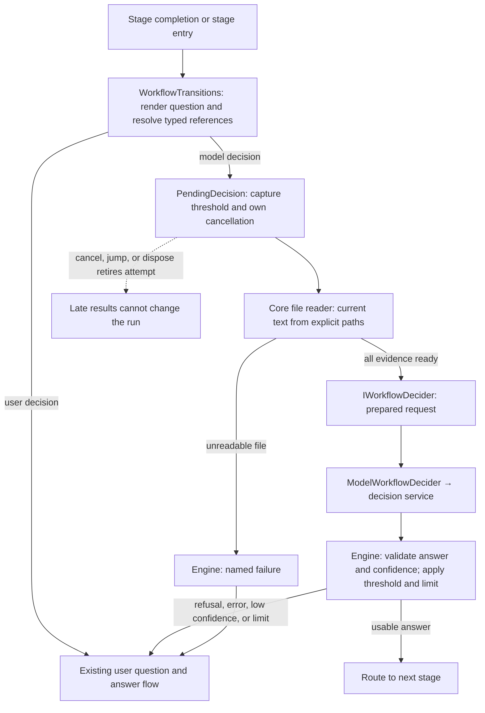

# Workflow decision evidence — design overview

The engine prepares evidence and owns routing policy. Core supplies file access and model inference.
Future deciders receive complete evidence without implementing file loading, thresholds, or escalation.
Scope and behavior: [brief](brief.md), [requirements](requirements.md).

## Flow



`Deciding` covers reading and inference. The existing `PendingDecision` identity check protects result
delivery. File bodies are temporary; reload reconstructs a new attempt using current files and settings.

## Contracts

These are proposed signatures; existing names are retained where shown. Interfaces live in
`Weavie.Workflows`, with implementations in Core. Code bodies below are schematic, not implementation tasks.

```csharp
// Definition changes
WorkflowQuestion.Confidence : double?;
public sealed record WorkflowChoice(string Name, string Target, string? Description);

// Only this internal plan carries unresolved files and routing policy.
internal sealed record WorkflowDecisionPlan(
    string Question, IReadOnlyList<WorkflowDecisionOption> Choices,
    IReadOnlyDictionary<string, string> Outputs, string Summary,
    IReadOnlyList<string> FilePaths, double MinimumConfidence);

public sealed record WorkflowDecisionOption(string Name, string? Description);
public sealed record WorkflowFileEvidence(string Path, string Text);
public sealed record WorkflowDecisionEvidence(
    IReadOnlyDictionary<string, string> Outputs, string Summary,
    IReadOnlyList<WorkflowFileEvidence> Files);
public sealed record WorkflowDecisionRequest(
    string Question, IReadOnlyList<WorkflowDecisionOption> Choices,
    WorkflowDecisionEvidence Evidence);

public interface IWorkflowFileReader {
    WorkflowFileRead Read(WorkflowFileScope files, string path);
}
public abstract record WorkflowFileRead {
    public sealed record Text(string Contents) : WorkflowFileRead;
    public sealed record Unreadable(string Reason) : WorkflowFileRead;
}

public interface IWorkflowDecider {
    Task<WorkflowDecisionResult> DecideAsync(WorkflowDecisionRequest request, CancellationToken ct);
}
public abstract record WorkflowDecisionResult {
    public sealed record Answered(string Choice, double Confidence) : WorkflowDecisionResult;
    public sealed record Refused(string Reason) : WorkflowDecisionResult;
    public sealed record Failed(string Reason) : WorkflowDecisionResult;
}
```

`WorkflowEffect.Decide` carries the plan. Model requests contain neither routing targets nor thresholds.
The result variants prevent a refusal/failure from also carrying an answer. Numeric and membership
validation remains the engine's responsibility. No implicit `unsure` choice or generated explanation is required.

## Data examples

```yaml
run:
  prompt: Write the acceptance criteria.
  outputs: { documents: files }
then:
  ask: "Does this document define observable acceptance criteria?\n{{draft.documents}}"
  confidence: 0.8
  choices:
    approve:
      then: build
      description: The document defines observable acceptance criteria.
    revise: draft
```

The utility adapter serializes a prepared request behind the existing untrusted-input boundary:

```json
{
  "question": "Does this document define observable acceptance criteria?\n- docs/criteria.md",
  "choices": [
    { "name": "approve", "description": "The document defines observable acceptance criteria." },
    { "name": "revise", "description": null }
  ],
  "evidence": {
    "outputs": { "documents": "- docs/criteria.md" },
    "summary": "Wrote the acceptance criteria.",
    "files": [{ "path": "docs/criteria.md", "text": "# Acceptance criteria\n..." }]
  }
}
```

A decision provider returns one probability per choice, such as `{"approve":0.91,"revise":0.09}`; the chosen
label is the most probable ([inference-providers.md](../inference-providers.md)). Refusals and provider failures
arrive through the decision result channel. JSON contracts remain source-generated and strict.
There is no new web message or persisted evidence format.

## Component behavior

**Definitions and validation.** Extend the single schema table with a bounded numeric shape and
text-or-object choices; normalize both choice forms into `WorkflowChoice`. Resolve reference types from
the definition through one shared helper used by validation and planning. Path warnings examine template
text and declared types, never read files or guess runtime values. A composed path such as
`{{draft.dir}}/criteria.md` is detectable; arbitrary text input that later happens to contain a path is not.

**`WorkflowTransitions`.** Preserve rendered paths in the question; add bodies only to evidence.

```text
Ask:
  render question using existing value/feedback rules
  if by:user → existing AskUser
  select only ask references declared as files (inputs or stage outputs)
  normalize and deduplicate their explicit paths using the shared worktree path rule
  emit Decide(plan, minimum = question.Confidence ?? live setting)

Resolve(run, result, attemptMinimum):
  refusal/failure → AskUser(reason)
  unknown choice or nonfinite/out-of-range confidence → AskUser(invalid result)
  confidence < attemptMinimum → AskUser(confidence and threshold)
  apply existing loop limit and routing
```

Missing stage values retain the existing missing-reference behavior; an omitted optional input contributes
no files. The threshold is captured when the plan is created, not reread when its answer arrives.

**`WorkflowRunner.PendingDecision`.** Retain the existing background execution and owned lifetime; extract
it into `WorkflowRunner.PendingDecision.cs` as preparation grows. Capture the cancellation token before
starting work so disposal cannot race access to the token source.

```text
background attempt:
  for each explicit file:
    check cancellation
    read through IWorkflowFileReader
    check cancellation
    unreadable → resolve Failed(path + reason); stop
    collect path + text
  construct prepared WorkflowDecisionRequest
  check cancellation
  await decider.DecideAsync(request, token)
  resolve through owner using this attempt's identity and captured threshold

owner.Resolve:
  under runner lock, ignore unless this is still the current pending decision
  apply WorkflowTransitions.Resolve
```

**Core file reader and utility adapter.** `WorkflowFileReader` uses the injected `IFileSystem.TryReadAllText`
and the existing content decoder. Share path normalization/containment with `WorkflowValues`; do not copy
its rules. Binary content and expected filesystem failures become named failures. The adapter only builds
the typed prompt and translates inference results; it requests numeric confidence and has no filesystem
dependency or threshold logic.

**Settings and composition.** Add `SettingKind.Number`, represented as a finite `double`, and
`SettingsStore.RequireNumber`. Carry it through existing environment/JSON/TOML coercion, numeric persistence,
and catalog serialization. `WorkflowSettings.DecisionConfidence` registers default `0.8`, range `[0, 1]`,
and live application. `HostSession.CreateWorkflowRunner` injects the reader and a live-setting accessor,
as it already does for stage attempts and review-item opening. No platform-specific host changes.

**Typed inference.** Delete `MaxPromptBytes` and its checks from options and all callers. Keep the existing
Claude stdin and ACP prompt transports; prove they carry large inputs intact. Retain output/image/time
policies. `InputRejected` still describes other rejected inputs; revise its prompt-limit-only documentation.
Surface provider rejection through the existing failure channel without exposing raw response bodies.

## Files affected

Paths grouped below share the stated directory prefix. New files are marked **new**.

| Files | Responsibility |
| --- | --- |
| `src/Weavie.Workflows/WorkflowDefinition.cs`, `WorkflowSchema.cs`, `WorkflowShape.cs`, `WorkflowReader.cs` | Confidence field, numeric shape, optional choice descriptions and both authoring forms. |
| `src/Weavie.Workflows/WorkflowSemantics.cs`, `WorkflowTemplate.cs`; **new** `WorkflowReferences.cs` | Shared declared-reference lookup and advisory evidence warnings. |
| `src/Weavie.Workflows/WorkflowDecision.cs`, `WorkflowEffects.cs`; **new** `WorkflowDecisionEvidence.cs` | Plan/prepared request distinction, result variants, file-reader contract. |
| `src/Weavie.Workflows/WorkflowTransitions.cs`, `WorkflowTransitions.Values.cs`, `WorkflowRunner.cs`, `WorkflowRun.cs`; **new** `WorkflowRunner.PendingDecision.cs` | Planning, captured thresholds, preparation lifecycle, routing and updated decision terminology. |
| `src/Weavie.Workflows/WorkflowValues.cs`; **new** `WorkflowFileScope.cs` | One shared path rule for validation, normalization, and evidence access. |
| `src/Weavie.Core/Workflows/ModelWorkflowDecider.cs`; **new** `WorkflowFileReader.cs` | Prepared evidence as a decision question ([inference-providers.md](../inference-providers.md)); shared filesystem adapter. |
| `src/Weavie.Core/Configuration/SettingDefinition.cs`, `SettingsStore.cs`, `SettingsFileLayer.cs`, `WorkflowSettings.cs` | Numeric setting support, persistence and registry exposure. |
| `src/Weavie.Hosting/HostSession.Workflow.cs` | Inject the reader and live confidence accessor. |
| `src/Weavie.Core/Inference/InferenceQuery.cs`, `InferenceService.cs`, `InferenceResult.cs`, `BranchNameInference.cs`; `src/Weavie.Core/Revise/ReviseQuery.cs` | Remove prompt caps across consumers and update failure descriptions. |
| `src/Weavie.Core/Mcp/AuthorWorkflowPrompt.cs`; `docs/specs/workflows.md`, `docs/specs/settings.md`; affected inference docs | Explain actual evidence, confidence, warnings and numeric settings. |
| `tests/Weavie.Workflows.Tests/`, `tests/Weavie.Core.Tests/`, `tests/Weavie.Hosting.Tests/`; `src/web/e2e/functional/`; `tools/Weavie.FakeAcp/InferenceFake.cs` as needed | Cover policy, preparation, settings, utility responses, both large-prompt transports and a deterministic headless journey. |

## Risks and checks

- Synchronous reads cannot be interrupted mid-read, but run cancellation remains responsive and prevents
  subsequent inference/result application. Test cancellation during preparation and late completions.
- Reading current files is not an atomic snapshot across files. Existing containment is lexical, not a
  new symlink sandbox. Test normalized-path deduplication and files disappearing after validation.
- Full evidence uses memory and can exceed provider context limits. Surface rejection; add no hidden cap,
  truncation, retry, or fallback. Test complete large prompts through both process seams.
- Utility confidence is self-reported. Test threshold boundaries and invalid results; do not describe it
  as a correctness guarantee. Advisory path detection can be imperfect and must never become enforcement.
- Protect the shared boundaries with engine/reader tests: zero inference calls on incomplete evidence,
  identical evidence policy for every decider, numeric setting round-trips, and unchanged human escalation.
