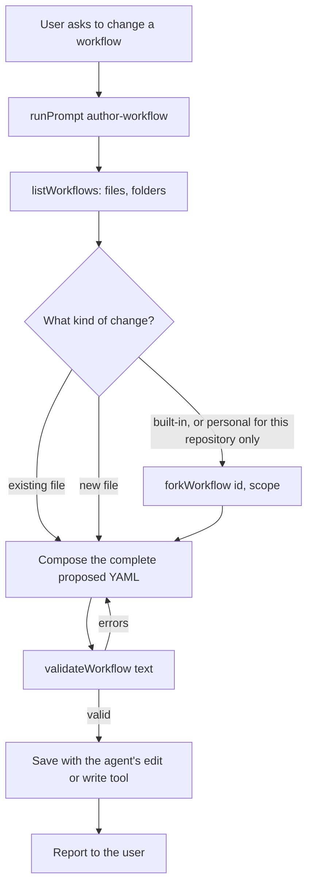

# Workflow editing tools: design overview

Agents keep editing workflow YAML with their own edit tools. Weavie checks a proposal before it is saved, makes forking
possible, and reports the real folders. All the rules live in `WorkflowCatalog`; Core only passes calls through. See
[brief.md](brief.md).

## Flow



## Wire format

`validateWorkflow` takes exactly one of `id` and `text`; the reply text is unchanged.

```jsonc
// Checks the saved workflow that wins for this id, broken or not, such as one the user edited by hand
{"name":"validateWorkflow","arguments":{"id":"feature-build"}}

// Checks a proposal; no file is read or written
{"name":"validateWorkflow","arguments":{"text":"id: feature-build\ndescription: ...\nstages: ..."}}

// Neither, both, or any other argument is a tool error
"validateWorkflow takes exactly one of 'id' or 'text', and nothing else."
```

`forkWorkflow` replies with the path it wrote, which the agent then edits:

```jsonc
{"name":"forkWorkflow","arguments":{"id":"quick-fix","scope":"personal"}}
// "Forked quick-fix to /home/debian/.weavie/workflows/quick-fix.yaml."
```

`listWorkflows` gains a `folders` object beside `workflows`:

```json
{
  "folders": {
    "personal": "/home/debian/.weavie/workflows",
    "repository": "/home/debian/project/.weavie/workflows"
  },
  "workflows": [
    {"id": "quick-fix", "scope": "built-in", "path": "built-in:quick-fix.yaml", "valid": true}
  ]
}
```

## Interfaces

`WorkflowCatalog` gains these members. `Validate(string path)` is deleted, along with the catalog's use of the worktree
for resolving it; the worktree stays for reading file inputs.

```csharp
public sealed class WorkflowCatalog(string worktree, string personalDirectory, string repositoryDirectory) {
	/// <summary>The problems in the saved workflow that wins for <paramref name="id"/>; empty when valid.</summary>
	public IReadOnlyList<WorkflowDiagnostic> Validate(string id);

	/// <summary>The problems in proposed workflow <paramref name="text"/>; no file is touched.</summary>
	public IReadOnlyList<WorkflowDiagnostic> ValidateText(string text);

	/// <summary>Copies the valid workflow <paramref name="id"/> into <paramref name="scope"/>; returns the new path.</summary>
	public string Fork(string id, WorkflowScope scope);

	/// <summary>The folder holding <paramref name="scope"/>'s workflow files.</summary>
	public string Folder(WorkflowScope scope);
}
```

`IWorkflowRegistry` mirrors them. `SessionWorkflowRegistry` forwards each to its catalog, and
`WorkflowRegistry.None` throws its usual `ToolUnavailableException`.

```csharp
public interface IWorkflowRegistry {
	IReadOnlyList<WorkflowCatalogEntry> List();
	IReadOnlyList<WorkflowDiagnostic> Validate(string id);
	IReadOnlyList<WorkflowDiagnostic> ValidateText(string text);
	string Fork(string id, WorkflowScope scope);
	string Folder(WorkflowScope scope);
	string CompleteStage(JsonElement outputs, string summary);
	void FailStage(string reason);
}
```

## Components

### WorkflowReader

Semantics compare a definition's id with its file name. A proposal has no file, so it is compared with itself. Shape
errors return before semantics run, so a missing or malformed `id` is already reported as an ordinary error.

```csharp
public static WorkflowReadResult Read(string text, string fileId) => Read(text, _ => fileId);

public static WorkflowReadResult ReadProposal(string text) => Read(text, definition => definition.Id);

private static WorkflowReadResult Read(string text, Func<WorkflowDefinition, string> fileId) {
	// Today's body; only the semantics call changes.
	WorkflowSemantics.Check(definition, fileId(definition), check);
}
```

### WorkflowCatalog

`Resolve` is the part of today's `Winner` that finds the entry. `Winner` keeps its refusal of broken files.

```csharp
private WorkflowCatalogEntry Resolve(string id) {
	var winners = List().Where(e => e.ShadowedBy is null).ToList();
	return winners.FirstOrDefault(e => e.Id == id)
		?? throw new WorkflowException($"No workflow \"{id}\" exists; the workflows are: {...}.");
}

private (WorkflowCatalogEntry Entry, WorkflowDefinition Definition) Winner(string id) {
	var entry = Resolve(id);
	return (entry, entry.Definition ?? throw new WorkflowException($"Workflow \"{id}\" ({entry.Path}) is invalid: {...}"));
}

public IReadOnlyList<WorkflowDiagnostic> Validate(string id) => Resolve(id).Diagnostics;

public IReadOnlyList<WorkflowDiagnostic> ValidateText(string text) => WorkflowReader.ReadProposal(text).Diagnostics;

public string Folder(WorkflowScope scope) => scope switch {
	WorkflowScope.Personal => personalDirectory,
	WorkflowScope.Repository => repositoryDirectory,
	_ => throw new WorkflowException("Built-in workflows have no folder."),
};

public string Fork(string id, WorkflowScope scope) {
	var (entry, definition) = Winner(id);                 // refuses unknown and broken workflows
	if (scope <= entry.Scope) {
		throw new WorkflowException($"Fork \"{id}\" into a more specific scope than {entry.Scope}.");
	}

	string folder = Folder(scope);
	System.IO.Directory.CreateDirectory(folder);
	string path = System.IO.Path.Combine(folder, id + Extension);
	using var file = File.Open(path, FileMode.CreateNew, FileAccess.Write);   // an existing file throws IOException
	using var writer = new StreamWriter(file);
	writer.Write(definition.SourceText);
	return path;
}
```

`id` needs no traversal guard: it must match a listed workflow exactly, and a valid definition has passed `IdPattern`.

### McpServer.WorkflowTools

The handlers parse arguments and format replies. The `ScopeName` mapping gains its inverse for the two forkable scopes.

```csharp
private async Task HandleValidateWorkflowAsync(IMcpResponder responder, JsonElement args, string? idRaw, CancellationToken ct) {
	string id = args.GetStringOrEmpty("id");
	string text = args.GetStringOrEmpty("text");
	if ((id.Length == 0) == (text.Length == 0) || args.EnumerateObject().Count() != 1) {
		await SendToolErrorAsync(responder, idRaw, $"{ValidateWorkflowTool} takes exactly one of 'id' or 'text', and nothing else.", ct);
		return;
	}

	// Today's catch and verdict formatting, around:
	diagnostics = id.Length > 0 ? _workflows.Validate(id) : _workflows.ValidateText(text);
}

private async Task HandleForkWorkflowAsync(IMcpResponder responder, JsonElement args, string? idRaw, CancellationToken ct) {
	// Requires 'id'; 'scope' must be "personal" or "repository". Same catch as validate.
	string path = _workflows.Fork(id, scope);
	await SendToolTextAsync(responder, idRaw, $"Forked {id} to {path}.", ct);
}
```

`forkWorkflow` is the one authoring tool without `readOnlyHint`. `McpServer.DispatchToolAsync` gains its case.

### Prompt and guidance

`AuthorWorkflowPrompt` replaces step 3, moves step 12's validation and summary into new steps 13 and 14, and limits step 2's fork wording to
creating a process, through `forkWorkflow`:

```text
3. A change goes in the winning file: the entry `listWorkflows` shows with no `shadowedBy`. A new workflow goes in
   `<id>.yaml` in the personal folder `listWorkflows` reports, or its repository folder if the user says the process
   belongs to this repository; never assume a folder. The `id` must equal the file name. To change a built-in, or a
   personal workflow for this repository only, call `forkWorkflow` first and change the copy, forking a built-in to
   `personal` unless the user says it belongs to this repository; never edit a built-in in place. A fork keeps its
   id; a variant under a new id is a new workflow, not a fork.

13. Before saving any new or changed workflow, pass the complete proposed YAML to `validateWorkflow` as `text`. Fix
   every error and validate again until it reports `Valid.`, because later checks and all warnings only run once
   structural errors are gone. Heed its warnings. Then save with your normal edit or write tool, not a script.
```

`EmbeddedAgentGuidance` keeps its trigger line and adds that workflows are found through `listWorkflows`, not by
assuming a folder. The `getWorkflowSchema` and `validateWorkflow` tool descriptions match the new rules, and
`docs/specs/workflows.md` drops `validateWorkflow(path)`.

## Files

| File | Change |
| --- | --- |
| `src/Weavie.Workflows/WorkflowCatalog.cs` | Add `Validate(id)`, `ValidateText`, `Fork`, `Folder`, `Resolve`; delete `Validate(path)` |
| `src/Weavie.Workflows/WorkflowReader.cs` | Add `ReadProposal` over a shared private `Read` |
| `src/Weavie.Core/Workflows/IWorkflowRegistry.cs` | New members on the interface, `Unavailable`, and `SessionWorkflowRegistry` |
| `src/Weavie.Core/Mcp/McpServer.WorkflowTools.cs` | Tool entries, exactly-one check, `forkWorkflow` handler, `folders` in `listWorkflows`, scope parsing |
| `src/Weavie.Core/Mcp/McpServer.cs` | Dispatch `forkWorkflow` |
| `src/Weavie.Core/Mcp/AuthorWorkflowPrompt.cs` | Changing, saving, forking and folder rules |
| `src/Weavie.Core/Mcp/EmbeddedAgentGuidance.cs` | Find workflows through `listWorkflows` |
| `docs/specs/workflows.md` | Tools, prompt rules, and forking |
| `tests/Weavie.Workflows.Tests/WorkflowCatalogTests.cs` | Replace the path test; cover fork scopes, broken winners, proposals, and refused overwrites |
| `tests/Weavie.Core.Tests/Mcp/RegistryMcpTests.cs` | Neither or both arguments, fork, folders, and fork's missing read-only hint |
| `tests/Weavie.Core.Tests/Mcp/AuthorWorkflowPromptTests.cs` | The prompt's editing rules |
| `tests/Weavie.Core.Tests/Mcp/HostRuntimeInfoTests.cs` | The guidance's workflow rule |

## Risks

- **A repository fork is missing from the agent-edits review.** The host writes it, so only the Uncommitted and Branch
  views and `git status` show it. See [design.md](design.md#repository-forks-in-review).
- **An id and file name can disagree.** Proposal `b` passes `text` validation, then is saved as `a.yaml`. The prompt
  says they must match, and a mismatch shows as broken in `listWorkflows` and can't start.
- **A failed fork write can leave a partial file.** A full disk could do this, and the file then blocks a retry. The
  error is visible and these files are small, so an atomic write isn't worth a second code path.
- **Nothing enforces the prompt.** An agent can still save without validating; the cost is a workflow that can't start
  until it is fixed, which `listWorkflows` shows.
