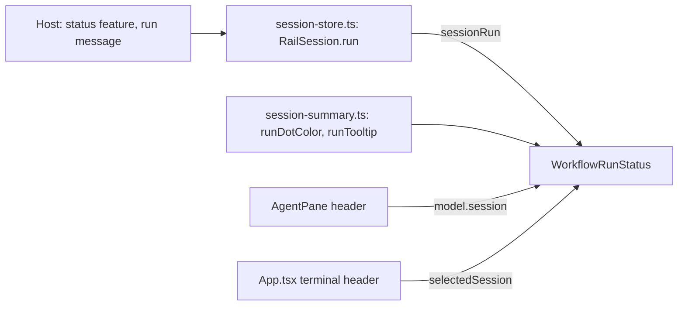

# Workflow run in the agent pane header: design overview

Implements [brief.md](brief.md). Web-only: the client already receives each session's run.

## Components

## Data and control flow

The host publishes a session's run on that session's `status` feed, and `session-store.ts` patches it onto the session's
exact owner. `WorkflowRunStatus` takes a session, looks up its run through `sessionRun`, and renders nothing when there
is none, so the line appears and disappears with the run.

The session decides whose run shows. The native header is mounted per session and passes its fixed `model.session`, so
it can't show another session's run. The terminal header is shared across sessions, so it passes `selectedSession()`,
which is the session it is displaying.

The line is display only, so nothing flows back to the host.

## Changes to existing code

- `session-store.ts`: adds the `sessionRun` lookup, which also replaces the same lookup in the `watchedUnseen` memo.
- `session-summary.ts`: adds the dot color and tooltip functions beside the private state phrases.
- `AgentPane.tsx`, `App.tsx`: each renders the component directly before its shortcut badge.
- `layout.css`: adds the run line. The stage keeps its full width (`flex: none; max-width: 100%`), so the workflow name
  truncates first, and `.pane-run + .pane-shortcut` keeps the run just left of the badge. The label stops shrinking.
- `mobile.css`: joins the compact hide list.
- The dot reuses `.session-status` with no state modifier, so it needs no new dot styles.
- `docs/specs/workflows.md`: records the outcome of "detail on demand".

## Risks

- **Truncation is unmeasured.** `max-width: 100%` inside a shrinking flex item needs a real check on WebKit, which the
  Mac and Linux hosts use.
- **Run arriving before its session.** `session-store.ts` drops a run message with no matching session. The catalog
  should publish first, but the client ordering is untraced. A reload test covers it.
- **Terminal header test route.** It is unconfirmed that the fake Claude can start a run in a terminal session.
- **Badge inconsistency.** The native pane's shortcut badge ignores the pane hints setting, so it appears there more
  often than in the terminal header. This design leaves that as it is.
