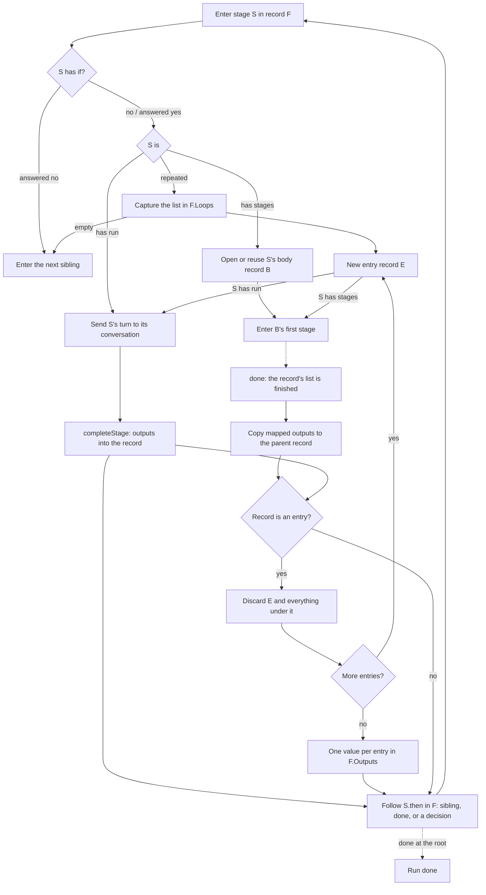

# Workflow nested stages: design

Implements [brief.md](brief.md). [challenge.md](challenge.md) and a second independent challenge shaped the brief;
their code citations are reused here.

## Summary

### What changes for you

- A stage can contain stages. The stages inside run in order, then the outer stage finishes with outputs it picks
  from them. From outside it reads like any other stage.
- A stage can repeat over a list with `foreach`. Entries run one after another. Inside, `item` and `index` name the
  current entry. From outside, each output holds one value per entry and prompts show them labelled by entry.
- `agent`, `context`, and `outputs` are written on the stage, not under `run`. Every existing workflow file changes.
- `fork` copies the conversation the stage sits in, not always main. A group that forks main can hold tasks that
  each fork the group.
- The header and the session list show where the run is as a path: `feature-build · group 2/5 › review`. Each
  conversation's card is titled the same way: `group 2 › task 3`.
- Questions are still asked in the main conversation. A question from deep inside a group arrives with that
  stage's outputs and summary, so the main agent can put it to you properly.
- When an entry finishes, the conversations opened inside it close. Their cards stay readable.
- Jump to Stage goes to a sibling of the current stage, or to `done` to leave the current level.

### How it is built

- **The definition becomes a tree.** The reader, the schema the agent reads, and the load-time checks all learn
  nesting, `foreach`, where each field now lives, and which stage may read which outputs.
- **The run keeps a record for every level it is inside.** Each record has its own id and holds what belongs to
  that level: its stages' outputs, its `limit` counts, the reports waiting for its conversations, and which of its
  conversations have been used. A repeated stage gets a new record for every entry. Throwing a record away is what
  ends an entry: its outputs, counts, and conversations go with it.
- **Every turn says which conversation it is for.** Weavie works that out once, when a level opens, and nothing
  later guesses it from the word `continue`.
- **A conversation is identified by the record that owns it.** A second pass over a repeated stage gets new
  records, so it can never pick up the first pass's conversations.
- **A fork is asked of the conversation being copied.** The agent layer gains that one ability; everything else
  about opening, keeping, restoring, and closing a stage conversation is what PR #1200 built.
- **The path you see is worked out from the records.** The web client needs no change: the host already sends the
  stage as text.

### Where the code made the brief awkward

- **A repeated stage with no children also needs a record per entry.** The brief gave records only to lists of
  stages, but a repeated `fork` stage opens a conversation per entry that needs an identity and an end.
- **The run now remembers whether a conversation has been used.** Until now only the host knew, and only until it
  restarted. Deciding between "open a new copy", "continue", and "this was lost" needs it to survive a restart.
- **"Lost conversation pauses, Resume continues in a new one" needs the run to remember the loss.** Otherwise
  Resume would find the same missing conversation and pause again.
- **A conversation that runs several stages must finish one turn before the next arrives.** Main already waits.
  Stage conversations never needed to, because each ran one stage. Without the wait, the next stage's prompt could
  be injected into the tail of the previous turn.
- **"Only the answer to that question is accepted" needs a number.** Each question gets one and the agent passes
  it back with your answer. You never see it.
- **A run saved by the old build cannot be read at all.** It is set aside with a message, as any unreadable run
  is, and you start it again.
- **A `then` back to itself still means two things.** On a stage with `run` it reopens the work with your
  feedback, as today. On a stage with children it enters the stage again.

### Decided at approval

- **One pull request**, built in the order below. The new format is only useful with the new run state.
- **The built-in `spec-driven` uses `foreach` for its task list**, so one built-in shows the feature. `quick-fix`
  only has its fields moved.
- **`continue` stays a written value of `context`.** It means the conversation the stage sits in, the same as
  writing nothing. Continuing another stage's conversation is `{ reuse: <stage> }`.

### Risks

- **Real agents may not fork a fork, or may lose history doing it.** This is checked on Claude and Codex before
  anything else is built, and a failure comes back to you.
- **Forking a conversation whose turn has only just ended** may behave differently per agent. The same check
  covers it.
- **Open sessions add up inside one entry** (a group, its reviewer, a task). The check counts how many an agent
  process holds.
- **The engine change is wide.** About 2,700 lines of engine tests change shape. They are moved first, with
  behaviour unchanged, before nesting is added.
- **About 30 cards pile up in a long run.** Folding them is your follow-up.

### Plan

1. Check nested forks on real Claude and Codex, and report.
2. The tree definition: format, checks, and every existing workflow and test moved to it, behaving as today.
3. The run's records, per-entry values, and the engine walking the tree.
4. Forking from any conversation in the agent layer.
5. The host: conversations owned by records, turns sent to the right conversation, closing with an entry, the
   lost-conversation pause.
6. Path display, commands, the authoring prompt.
7. An end-to-end test, then a real-agent run of a small nested workflow.
8. Docs, built-ins, and converted copies of your three personal workflows for you to install after the merge.

## Reference for the build

### Flow



### Formats by example

**Workflow file.** The complete example is in [brief.md](brief.md). The moved fields on an existing stage:

```yaml
- id: review
  agent: fable
  context: fresh
  run: { prompt: "Review {{build.pr}} ..." }
  outputs: { report: files }
  then: { ask: "Does {{review.report}} list an open bug or warn?", choices: { clean: prove, fix: fix } }
```

**Load-time diagnostics** (path, condition, text). Existing ones keep their text at the moved path
(`stages[i].agent`, `stages[i].context.reuse`).

| Path | Condition | Text |
| --- | --- | --- |
| `…stages[i]` | neither or both of `run` and `stages` | `a stage has exactly one of run or stages` |
| `…stages[i].id` | id used anywhere else in the file | `stage id "x" is used twice` |
| `…stages[i].outputs.n` | `run` stage, value is not a type | `"v" is not a type; a stage with run declares text, url, list, files, or pr` |
| same | stage with `stages`, value is not exactly one reference | `a stage with stages takes each output from one of its stages: "{{stage.output}}"` |
| same | the reference names no output of a direct child | `{{x.y}} names no output of a stage inside "g"` |
| same | name is `item` or `index` on a repeated stage | `"item" names the current entry of a repeated stage` |
| `…stages[i].foreach` | not exactly one reference | `foreach takes one reference to a list` |
| same | the value is not a `list`, `files`, or a repeated output | `{{x.y}} is not a list` |
| `…then`, `…then.choices.c` | target is not a sibling or `done` | `"x" is not a stage beside "s"; then reaches the stages in the same list, or done` |
| any template | output of a stage that is not visible | `{{x.y}} is inside stage "g"; read an output of "g" instead` |
| any template | `x.item` or `x.index` where `x` is not this stage or an enclosing repeated stage | `{{x.item}} is readable only inside repeated stage "x"` |
| `…if`, `…then`, `…foreach` | the stage's own `item` or `index` | `{{x.item}} is not set here; a repeated stage's if, foreach, and then apply once` |
| `…then.ask` | a repeated stage reads its own children | `{{x.y}} is one entry's value; a repeated stage's then reads its own outputs` |
| `…agent`, `…role` | a stage with `stages` and no `fork` or `fresh` | `a stage with stages runs no turn of its own; give it fork or fresh to run its stages on "a"` |
| same | a stage with no `context` whose enclosing conversation is not main | `stage "s" runs in the conversation of "g"; give it fork or fresh to run on "a"` |
| `…context.reuse` | names a stage that is not a sibling | `"x" is not a stage beside "s"` |
| same | names a repeated stage | `stage "x" opens a conversation per entry; reuse names one that is not repeated` |

**Saved run** (the `run` member of the run file; `outputs`, `streaks`, and `unreported` leave the run):

```json
{
  "id": "r-5bf9130fd953", "workflowId": "feature-build", "stage": "review", "phase": "open",
  "frame": "r-5bf9130fd953/7", "nextFrame": 9, "nextTurn": 31, "lost": null,
  "frames": [
    { "id": "r-5bf9130fd953/0", "parent": "", "stage": "", "entry": 0, "item": "", "conversation": null,
      "outputs": { "design": { "groups": { "items": ["auth", "billing"] } } },
      "loops": { "group": { "items": ["auth", "billing"],
                            "results": [ { "pr": { "text": "https://github.com/o/r/pull/7" } } ] } },
      "streaks": {}, "owed": { "": "Stage \"group\" (entry 1 of 2) ran in its own conversation …" }, "opened": [] },
    { "id": "r-5bf9130fd953/7", "parent": "r-5bf9130fd953/0", "stage": "group", "entry": 2, "item": "billing",
      "conversation": { "frame": "r-5bf9130fd953/7", "opener": "group" },
      "outputs": { "plan": { "tasks": { "items": ["invoices", "refunds"] } },
                   "task": { "notes": { "entries": [ { "item": "invoices", "value": { "text": "…" } } ] } } },
      "loops": {}, "streaks": { "review": 1 }, "owed": {}, "opened": ["group", "review"] }
  ],
  "asked": null,
  "kickoff": { "id": 30, "conversation": { "frame": "r-5bf9130fd953/7", "opener": "review" }, "continues": true,
               "renews": false, "text": "…", "command": "", "opens": "review", "carriesPromptImages": false }
}
```

**Repeated output in a prompt** (`{{group.report}}`, then `{{task.notes}}` with multi-line text):

```text
- auth:
  - docs/specs/x/report-1.md
- billing:
  - docs/specs/x/report-2.md

- invoices: Added the invoice table.
- refunds:
  Added the refund flow.
  Left the ledger untouched.
```

An entry that did not report the value is left out. Every declared output is present once the repetition finishes,
holding no entries when none reported it or the list was empty, so a later stage reads it without pausing.

**Stage block**, the position sentence:

```text
[Weavie workflow] Run r-5bf9130fd953 of workflow "feature-build" is at stage "review", inside "group" (entry 2 of 5: "billing").
```

Each enclosing repeated stage adds one `inside` clause, innermost first; an enclosing stage that is not repeated
adds `inside "g"`. The entry text is the item's first line.

**Report owed to a parent conversation** adds the entry when the stage is repeated:

```text
Stage "task" (entry 2 of 3: "refunds") ran in its own conversation and completed.
Outputs: notes = …
Summary: …
```

**Question turn in main** from a stage that did not run in main:

```text
Stage "prove", inside "group" (entry 2 of 5: "billing"), completed.
Outputs: videos = - src/web/e2e/.recordings/billing.mp4
Summary: …

Weavie now asks the user: Are the results ready? (answers: ready, iterate; question 12). …
```

**Answer command**: `weavie.workflow.answer` takes `run`, `question` (the number), `choice`, `feedback`.

**Lines in main's transcript** (new):

```text
Workflow: group 2 › task 3 opened a new conversation; its earlier one could not be restored: <error>
```

**Pause reason for a lost parent conversation**:

```text
Stage "group" (entry 2 of 5: "billing") lost its conversation: <reason>. Its stages' earlier work there is gone. Resume to continue in a new one.
```

### Types added or changed

**`Weavie.Workflows`, definition**

```csharp
public sealed record WorkflowDefinition {
	public required IReadOnlyList<WorkflowStage> Stages { get; init; }     // the root list
	/// <summary>The stage with <paramref name="id"/>, at any depth.</summary>
	public WorkflowStage Stage(string id);
	/// <summary>The stage whose list holds <paramref name="stage"/>, or null at the root.</summary>
	public WorkflowStage? Parent(WorkflowStage stage);
	/// <summary>The stages beside <paramref name="stage"/>, itself included, in file order.</summary>
	public IReadOnlyList<WorkflowStage> List(WorkflowStage stage);
	/// <summary>Every stage, parents before their stages.</summary>
	public IEnumerable<WorkflowStage> All { get; }
	/// <summary>The stage whose conversation runs <paramref name="stage"/>'s turns, or null for main.</summary>
	public WorkflowStage? Opener(WorkflowStage stage);   // fork/fresh: itself; reuse: the sibling; else Opener(Parent)
	public WorkflowAgent? AgentOf(WorkflowStage stage, IReadOnlyList<WorkflowAgent> roles);   // unchanged meaning
}

public sealed record WorkflowStage {
	public required string Id { get; init; }
	public required WorkflowQuestion? If { get; init; }
	public required WorkflowTemplate? Foreach { get; init; }             // one reference, or null
	public required WorkflowContext Context { get; init; }               // moved from WorkflowWork
	public required string? Reuse { get; init; }
	public required string? Agent { get; init; }
	public required string? Role { get; init; }
	public required WorkflowWork? Run { get; init; }                     // null on a stage with stages
	public required IReadOnlyList<WorkflowStage> Stages { get; init; }   // empty on a stage with run
	public required IReadOnlyList<WorkflowOutputSpec> Outputs { get; init; }
	public required WorkflowThen Then { get; init; }
}

public sealed record WorkflowWork { Prompt, Skill, Args }                // nothing else
public sealed record WorkflowOutputSpec {
	public required string Name { get; init; }
	public required WorkflowValueType Type { get; init; }                 // a mapped output takes its source's
	public required WorkflowReference? Source { get; init; }              // the child output a stage with stages copies
}
```

`WorkflowContext` keeps its three values; `Continue` now means the enclosing conversation. Every
`stage.Run.Context`, `stage.Run.Agent`, `stage.Run.Role`, `stage.Run.Reuse`, and `stage.Run.Outputs` becomes
`stage.Context` and so on. The flat scans (`definition.Stages.First(...)` in `WorkflowDefinition`, `WorkflowRunner`,
`WorkflowReferences`, `WorkflowSemantics`, `WorkflowStageBlock`, `WorkflowAgentControls`) go through `Stage(id)` and
`All`; file-wide ids make the index one dictionary built by the reader.

**`Weavie.Workflows`, values**

```csharp
public sealed record WorkflowValue {
	public string? Text { get; init; }
	public IReadOnlyList<string>? Items { get; init; }
	/// <summary>A repeated stage's output: one value per entry that reported it, in order.</summary>
	public IReadOnlyList<WorkflowEntryValue>? Entries { get; init; }
	public string Render();                    // entries render labelled, nested ones indented
	public IReadOnlyList<string> Flat();       // items; a text as one item; entries concatenated
}
public sealed record WorkflowEntryValue(string Item, WorkflowValue Value);
```

`TrySelectFiles` and the `foreach` capture read `Flat()`. `WorkflowReferences.TypeOf` resolves through the tree and
returns the base type; a second helper says whether the reference is repeated.

**`Weavie.Workflows`, run**

```csharp
public sealed record WorkflowRun {
	// removed: Outputs, Streaks, Unreported
	public required string Stage { get; init; }               // the stage the run is at: an open run stage, or the stage deciding
	public required string Frame { get; init; }               // the innermost live record
	public required IReadOnlyList<WorkflowFrame> Frames { get; init; }
	public required int NextFrame { get; init; }
	public required int NextTurn { get; init; }               // numbers kickoffs and questions
	public required WorkflowConversationRef? Lost { get; init; }   // set by a lost-conversation pause until Resume
	/// <summary>The path for display: <c>group 2/5 › review</c>.</summary>
	public string Path();
}

/// <summary>One instance of a level: the root, a stage with stages, or one entry of a repeated stage.</summary>
public sealed record WorkflowFrame {
	public required string Id { get; init; }                  // "<run id>/<n>"
	public required string Parent { get; init; }              // "" for the root
	public required string Stage { get; init; }               // "" for the root
	public required int Entry { get; init; }                  // from 1; 0 when the stage is not repeated
	public required string Item { get; init; }
	public required WorkflowConversationRef? Conversation { get; init; }   // where its stages with no context run; null is main
	public required Dictionary<string, Dictionary<string, WorkflowValue>> Outputs { get; init; }   // by stage in this level
	public required Dictionary<string, WorkflowLoop> Loops { get; init; }  // repeated stages in progress
	public required Dictionary<string, int> Streaks { get; init; }
	public required Dictionary<string, string> Owed { get; init; }         // reports owed, by opener; "" is main, on the root
	public required HashSet<string> Opened { get; init; }                  // openers whose conversation has taken a turn
}
public sealed record WorkflowLoop(IReadOnlyList<string> Items, IReadOnlyList<Dictionary<string, WorkflowValue>> Results);
public sealed record WorkflowConversationRef(string Frame, string Opener);

public sealed record WorkflowKickoff {
	// removed: Context
	public required int Id { get; init; }
	public required WorkflowConversationRef? Conversation { get; init; }   // null is main
	public required bool Continues { get; init; }             // the conversation has taken a turn and this turn extends it
	public required bool Renews { get; init; }                // the user resumed after this conversation was lost
	…Text, Command, Opens, CarriesPromptImages
}
public sealed record WorkflowAsked { public required int Id { get; init; } … }
```

Which records exist:

| Stage | Record | Lives |
| --- | --- | --- |
| root | one | the run |
| has `stages`, not repeated | one body record, child of the record it sits in, reused on every return | as long as its parent record |
| repeated (with `run` or `stages`) | one entry record per entry, per pass | until the entry finishes |
| has `run`, not repeated | none; it uses the record it sits in | |

A conversation opened by stage `O` is `(F, O)`, where `F` is `O`'s entry record when `O` is repeated and otherwise
the record `O` sits in. So a conversation lives exactly as long as that record.

**`Weavie.Workflows`, runner**

```csharp
public sealed class WorkflowStageExecution {
	// removed: Opener
	public WorkflowStageConversation? Conversation { get; }   // null when the visit runs in main
}
/// <summary>What the host needs to own a stage conversation.</summary>
public sealed record WorkflowStageConversation {
	public required WorkflowConversationRef Key { get; init; }
	public required WorkflowStage Opener { get; init; }
	public required WorkflowConversationRef? Source { get; init; }   // what a fork copies; null is main
	public required WorkflowAgent? Agent { get; init; }
	public required string Title { get; init; }                      // "group 2 › task 3"
}
public sealed partial class WorkflowRunner {
	public WorkflowStageConversation Conversation(WorkflowConversationRef key);    // for a fork's source
	public void ConversationLost(WorkflowKickoff turn, string reason);             // pause and remember, while owed
	public void Answer(string runId, int question, string choice, string feedback);
	public WorkflowStageCall? CaptureStageCall();   // only when the open stage's conversation is main
}
```

`WorkflowEffect` is unchanged; discarding a record is visible to the host as its id leaving `Current.Frames`.

**`Weavie.Core`**

```csharp
public interface IAgentConversation {
	/// <summary>Forks this conversation as it stands; the copy is owned by <paramref name="binding"/>.</summary>
	Task<IAgentConversation> ForkAsync(AgentConversationBinding binding, CancellationToken ct);
	/// <summary>Completes when no turn is running or queued.</summary>
	Task WhenIdleAsync(CancellationToken ct);
}
```

`AgentConversationKey(Scope, Name)` is unchanged: `Scope` is the record id, `Name` the opener. `WorkflowRunSummary.Stage`
carries `run.Path()`; `SessionRun.stage` on the wire is that text.

### Components

#### Reader, schema, semantics

- **Schema** (`WorkflowSchema.Build`). The stage shape is recursive: `stage` gains `foreach`, `agent`, `role`,
  `context`, `outputs`, and `stages` (a list of `stage`); `run` and `stages` are both optional in the shape and
  the exactly-one rule is a semantic check. `outputs` values are text: a type name, or one `{{…}}` reference.
  `run` keeps `prompt`, `skill`, `args`.
- **Reader** (`WorkflowReader.ReadStage`) recurses, builds the id index, and resolves in a second pass: a reusing
  stage's `Context` from its sibling (as today), and each mapped output's `Type` from its source.
- **Semantics** (`WorkflowSemantics`) walks the tree with the stage's list for `then` targets and applies the
  diagnostics table. Visibility is one function:

```text
Visible(from, S):   S is in the list of `from` or of any stage enclosing `from`
Readable(from, field, {{S.x}}):
  x in {item, index}:   S is repeated and (S encloses `from`, or S == from and field is run)
  S == from:            field is then                       // own outputs, as today
  S inside from:        S is a direct child, and field is outputs, or then on a stage that is not repeated
  else:                 Visible(from, S)
```

- **Evidence warnings** (`WorkflowEvidenceWarnings.CheckOutputs`) read `stage.Outputs`.

#### Transitions

`WorkflowTransitions` stays pure. Every transition works on `Scope(run)`: the record whose list holds `run.Stage`
(the live record, or its parent when the live record is the entry of a repeated `run` stage).

```text
Enter(run, F, target):
  target == done → Finish(run, F)
  S = target; run.Stage = S; run.Frame = F
  S.If → Ask(If) in F; a yes answer → Begin; a no answer → Enter(F, Following(S))
  else Begin(run, F, S)

Begin(run, F, S):
  S.Context == Fork → F.Opened.Remove(S)                    // a fork entered again copies again
  S.Foreach:
    items = Flat(resolve S.Foreach)                         // unreported → Pause, as any template
    items empty → F.Outputs[S] = each output with no entries; Enter(F, Following(S))
    F.Loops[S] = (items, []); StartEntry(run, F, S, 1)
  S.Stages → B = body record of S under F, created on first entry; Enter(run, B, S.Stages[0])
  else Open(run, F, S)

StartEntry(run, F, S, k):
  E = new record(parent F, stage S, entry k, item items[k-1])
  S.Stages → Enter(run, E, S.Stages[0])   else Open(run, E, S)

Complete(run, outputs, summary):                            // the open run stage T
  values = ReadOutputs(T)                                   // rejection and attempts as today
  Report(T, values, summary)
  live record is T's entry E → EndEntry(run, E, values)     else Scope.Outputs[T] = values; Advance(run, Scope, T)

Finish(run, F):                                             // F's list is done
  F is the root → Done
  G = F.Stage; values = each G output whose source is in F.Outputs
  Report(G, values, run.Summary)
  F is an entry → EndEntry(run, F, values)                  else P.Outputs[G] = values; Advance(run, P, G)

EndEntry(run, E, values):
  P = E's parent; P.Loops[G].Results += values; drop E and every record under it
  more entries → StartEntry(run, P, G, k+1)
  else P.Outputs[G] = one Entries value per output; P.Loops.Remove(G); Advance(run, P, G)

Advance(run, F, S):   S.Then: sibling or done → Enter(F, target); decision → Ask(Then) in F; none → Enter(F, Following(S))
```

- **Conversation of a turn.** `Open` resolves the stage's conversation and writes it on the kickoff:
  `fork`/`fresh` → `(record, S)`; `reuse X` → `(record, X)`; none → the record's `Conversation`. A new record's
  `Conversation` is resolved the same way from its stage. `Continues` is `Opened.Contains(opener)` on the owning
  record.
- **Reports.** `Report` does nothing for a stage with no conversation of its own. Otherwise the text is appended to
  `Owed[opener]` of the record owning the enclosing conversation. `Send` prefixes a kickoff with what is owed to its
  conversation, and a kickoff with `Continues` false and a `fork` opener also with what is owed to its source.
  `TryClaimKickoff` clears only the target conversation's entry, adds the opener to `Opened`, and for main keeps
  `PromptImagesSent` as today.
- **Questions.** `Ask` and `AskUser` number the question from `NextTurn`. A question whose stage did not run in main
  is one kickoff to main: the stage's position, outputs, and summary, then `PutToUser`. A stage that ran in main
  keeps the question in its `completeStage` reply. `Answer` requires the question number to match `Asked.Id`.
- **Streaks.** A model answer sets `F.Streaks = { [S] = count }` on the decision's own record. A user answer clears
  every record's streaks.
- **Route.** A choice leading back to the deciding stage reopens it when it has `run` (today's revise turn) and
  calls `Enter(F, S)` when it has `stages` or is repeated.
- **Resume.** A paused `if` or `then` is asked again in `Scope`. Otherwise: the stage is open in a live record →
  `Open` again, with `Renews` and `Lost` cleared when `Lost` is set; the stage had not begun (a `foreach` list was
  unreported) → `Begin`.
- **Jump.** The target is in `List(run.Stage)` or is `done`; anything else throws naming the stages beside the
  current one. A live entry record of the current stage and its loop are dropped first. `done` → `Finish(Scope)`.
- **ConversationLost.** `Pause` with the reason and `Lost = key`.
- **Cancel** needs no definition: it uses `run.WorkflowId`. `WorkflowRunner.Cancel` runs it when `_definition` is
  null, which is the paused state `Activate` leaves for a saved definition that no longer validates.

#### Runner

- `CreateExecution` builds the visit for `run.Stage` with its `WorkflowStageConversation` (null in main, and null
  while a stage with `stages` is deciding).
- `CaptureStageCall` returns a call only when `_execution.Conversation is null`. `CompleteStageLocked`'s
  "independent" is `Conversation is not null`.
- `Activate` pauses a reloaded mid-visit stage when `Conversation is not null`, as it does today for
  `Context != Continue`.
- `StageBlock` composes the position from the records; `ownsStage` and `continued` keep their meaning.
- `AgentOf(stage)` resolves through `definition.Stage(id)`.

#### Conversation owner (`HostSession.WorkflowConversation.cs`)

One owner per `AgentConversationKey(record, opener)`, built from `WorkflowStageConversation`, held in a dictionary by
that key. `DeliverWorkflowTurn` sends a kickoff with a `Conversation` to its owner and every other kickoff to main's
queue. The host fields `_held`, `_refork`, and `_turned` go: the kickoff says what they guessed.

```text
SendAsync(visit, owed):                                     // under the owner's delivery gate
  if !Workflow.Owes(owed.Kickoff): return
  if lease.Visit != visit:
    ReturnMainForChildAsync(visit)                          // as today
    if live and Continues: ApplyControlsAsync(main's mode axes)
    lease.Visit = visit; watch visit.Retired
  if !Continues:                                            // first turn, or a fork entered again
    close any conversation held; conversation = Open()
  else if not live:
    restored, error = try RestoreAsync(binding)
    if restored is null:
      if Opener.Stages.Count > 0 and !Renews:
        Workflow.ConversationLost(kickoff, error ?? "it ended"); return
      conversation = Open(); Notice("Workflow: <title> opened a new conversation; …")
  if kickoff.Opens.Length > 0: await conversation.WhenIdleAsync()
  lease.Continues = Continues and the conversation was not just opened
  refuse a missing prompt image, TryClaimKickoff, Submit

Open():
  fresh → conversations.OpenFreshAsync(binding)
  fork, Source null → conversations.OpenForkAsync(binding)                 // main
  fork, Source key  → source = owner(Source).LiveAsync(); await source.WhenIdleAsync(); source.ForkAsync(binding)
  apply Agent when it is not null (model, check options, options), as today
```

- `LiveAsync` returns the owner's live conversation, restoring it when needed; a source that cannot be restored
  fails the open, and the opening stage pauses through `RefuseOpen` with that reason.
- A reusing stage that arrives first (`Continues` false, `visit.Stage != Opener`) keeps today's line in main.
- **Closing.** `Workflow.Changed` ends every owner whose `Key.Scope` is not a record of the live run, and forgets
  every kept conversation by the same test. That one rule covers an entry finishing, a jump out of an entry, the run
  ending, and a replaced run. An owner ended while the run is live waits for the last completion reply, as a
  finished run's owners do today.
- `WorkflowControlHold.Values` holds main's values only when `Workflow.Execution.Conversation is null`.
- Unload, the lease, tool grants, and the visit watcher are unchanged.

#### Agent layer

- `AcpConversationHandle.ForkAsync` calls `AcpAgentSession.OpenOwnedAsync` with the handle's conversation as the
  source. `ChildSpec` takes the source and the card anchor separately: the anchor stays main's turn number, and
  the opening is `ForkFromOpening(source)` when `source.HasHistory`.
- `AcpConversation.HasHistory`: it has taken a turn, was opened by a fork, or was restored. Today's
  `primary.TurnNumber > 0` test would open a fork of a fresh fork empty.
- A fork snapshots its controls from its source; a fresh conversation from main, as today. That gives a fork with
  no agent its source's model.
- `OpenOwnedAsync` waits for the source to be ready and requires it live on the runtime, as it does for main.
- `WhenIdleAsync` completes when the conversation has no active or queued prompt.
- The fake ACP agent forks from any session, records each session's inherited prompts so a test can assert what a
  fork holds, and gains a mode that refuses a nested fork.

#### Core and web

- `CoreCommands.Workflows`: `question` on Answer; Jump's description says a stage beside the current one, or
  `done`. `HostCore.Workflows` passes them through.
- `WorkflowAgentControls.Refusal`, `NoModelChoice`, and `WorkflowDefinition.Roles`/`UsesPrompt` walk `All`.
- `WorkflowRunSummary.From` sets `Stage = run.Path()`; `hold.Stage == run.Stage` still compares ids.
- `AuthorWorkflowPrompt` and the schema descriptions teach nesting, `foreach`, mapped outputs, the entry in file
  names, and that a report is a last stage.
- Web: no production change. `SessionRun.stage` and the card title are already text.

### Error handling

| Failure | Result |
| --- | --- |
| A nested fork is refused by the agent | `RefuseOpen`: the run pauses with the agent's reason |
| A fork's source cannot be restored | The opening stage pauses with the reason; Resume tries again |
| A stage-with-stages conversation is gone after it has taken a turn | Pause with `Lost`; Resume opens a new one with the line in main |
| A `run` stage's conversation is gone | New conversation and the line in main, as today |
| `foreach` list unreported | Pause with today's "hasn't reported it"; Resume begins the stage again |
| A mapped output's source never reported | The output is absent; a later read pauses |
| `completeStage` from main for a stage in another conversation | Refused: main holds no call |
| An answer with the wrong question number | Refused, naming the current question |
| Jump to a stage that is not beside the current one | Refused, listing the stages that are |
| `/clear`, Rewind, or an agent crash mid-entry | Conversations close as today; the next turn follows the two "gone" rows |
| A run saved by the old build | Set aside with the existing "couldn't be read … set aside" message |
| A saved definition that no longer validates | Paused, and Cancel now works |

### Testing

Deterministic tests run on the fake ACP agent. Real-agent checks are steps 1 and 9.

- **Engine, moved first.** Every existing test's YAML moves to the new field places and `TestWorkflows` builds the
  root record; assertions on `run.Outputs`, `Streaks`, and `Unreported` read the root record. No behaviour changes.
- **Engine, new.** `WorkflowTreeReaderTests` (shape, recursion, mapped output types); `WorkflowTreeSemanticsTests`
  (each diagnostic at its path); `WorkflowValueEntriesTests` (render, flat, nesting); `WorkflowNestedTransitionsTests`
  (enter and finish a stage with stages; mapped and absent outputs; summary; `done` at each level; a return
  continuing a body record; `then` to self on both kinds); `WorkflowForeachTests` (capture, empty list, entries in
  order, per-entry and nested values, a second pass getting new record ids, `item`/`index`, a repeated `run`
  stage); `WorkflowFrameStateTests` (`limit` per entry and an outer `limit` surviving inner decisions; owed reports
  per conversation; a fork's opening turn carrying its source's owed reports without clearing them; `Continues`
  across Resume and re-entry; question numbers; Jump to a sibling, to `done`, and refused; Resume before a stage
  began; `Lost` then Resume; Cancel with no definition; the run document round-trip).
- **Agent layer** (`AcpOwnedConversationTests`): fork from an owned conversation holds its history; a fork of a
  fork with no turn of its own is not empty; controls come from the source; restore of a fork of a fork;
  `WhenIdleAsync`.
- **Hosting** (`HostCoreWorkflowConversationTests.Nested.cs`): children with no context run in the group's
  conversation and only it can complete them; a task forks the group and holds its plan; a group with no agent on
  its fork runs on its source's model; a question from inside a group reaches main with the outputs and only its
  number answers it; entry conversations close and their cards end when the entry finishes; a second pass opens
  new conversations after a host restart mid-entry; a lost group conversation pauses and Resume opens a new one; a
  lost `run`-stage conversation does not pause; the next stage's turn waits for the previous turn to end.
- **Core**: `WorkflowRunSummary` path; `WorkflowAgentControls.Refusal` on nested stages; the answer command.
- **Web**: `e2e/functional/workflow-nested-stages.spec.ts` on `headless`: a two-entry group with a forked task and a
  user question; asserts the header path through both entries, card titles, an entry's cards closing, and the
  question in main.
- **Real agents** (Claude and Codex), step 1 by wire probe as in PR #1200: a fork of a fork and of that fork, each
  holding a codeword from every ancestor; a fork of a fork that has taken no turn; restoring a fork of a fork in a
  new process; forking a parent again after closing its earlier children; forking a parent whose turn has just
  ended; three live sessions on one process. Step 9: the small nested workflow from the e2e spec in the real app.

### Files

| File | Change |
| --- | --- |
| `src/Weavie.Workflows/WorkflowDefinition.cs` | Stage shape, tree index, `Opener` through parents |
| `src/Weavie.Workflows/WorkflowSchema.cs`, `WorkflowReader.cs`, `WorkflowSemantics.cs`, `WorkflowReferences.cs`, `WorkflowEvidenceWarnings.cs` | Recursive shape, reading, the diagnostics, visibility, types |
| `src/Weavie.Workflows/WorkflowValues.cs` | `Entries`, `Render`, `Flat` |
| `src/Weavie.Workflows/WorkflowRun.cs`, new `WorkflowFrame.cs` | Records, kickoff and question numbers, `Lost`, `Path` |
| `src/Weavie.Workflows/WorkflowTransitions.cs`, `WorkflowTransitions.Values.cs`, new `WorkflowTransitions.Tree.cs` | The walk above; rendering through records |
| `src/Weavie.Workflows/WorkflowRunner.cs`, `WorkflowRunner.Execution.cs`, `WorkflowStageExecution.cs`, `WorkflowStageBlock.cs` | Visit conversation, authority, `ConversationLost`, Answer number, Cancel with no definition, position text |
| `src/Weavie.Workflows/BuiltIn/quick-fix.yaml`, `spec-driven.yaml` | Field move; `foreach` for the task list in `spec-driven` |
| `src/Weavie.Core/Agents/IAgentConversation.cs` | `ForkAsync`, `WhenIdleAsync` |
| `src/Weavie.Core/Workflows/WorkflowRunSummary.cs`, `WorkflowAgentControls.cs`, `WorkflowKickoffTurns.cs` | Path, tree walk |
| `src/Weavie.Core/Commands/CoreCommands.Workflows.cs`, `src/Weavie.Core/Mcp/AuthorWorkflowPrompt.cs`, `EmbeddedAgentGuidance.cs` | Answer number, Jump wording, authoring guidance |
| `src/Weavie.AgentClientProtocol/AcpAgentSession.Conversations.cs`, `AcpConversationHandle.cs`, `AcpConversation*.cs` | Fork from a source, `HasHistory`, controls from the source, idle wait |
| `src/Weavie.Hosting/HostSession.WorkflowConversation.cs`, `HostSession.Workflow.cs`, `HostSession.WorkflowAgent.cs`, `HostCore.Workflows.cs` | Owners by record, delivery by conversation, source forks, lost policy, closing by live records |
| `tools/Weavie.FakeAcp` | Nested fork, inherited history, the refusal mode |
| `tests/Weavie.Workflows.Tests/*`, `tests/Weavie.Hosting.Tests/HostCoreWorkflow*` and `AcpOwnedConversationTests.cs`, `tests/Weavie.Core.Tests`, `src/web/e2e/functional/workflow-*.spec.ts` | As in Testing; every workflow YAML in tests and e2e moves its fields |
| `docs/specs/workflows.md`, `workflow-agent-selection.md`, `conversation-layer.md`, `docs/concepts/acp-conversations.md`, `AGENTS.md` | Format, context, records, fork from any conversation; `foreach` leaves "not built"; a stage in its own session stays deferred |

### Risks and handling

| Risk | Handling |
| --- | --- |
| A real agent refuses or empties a nested fork | Step 1, before any other code; a failure goes back to the user |
| A fork taken just after its source's turn ends misses that turn | `WhenIdleAsync` on the source before forking; step 1 checks it on both agents |
| A next stage's prompt steers the previous turn | `WhenIdleAsync` before a stage-opening turn; covered by a hosting test |
| Sessions held per entry exceed what an agent process allows | Step 1 counts; entries close their conversations, so the peak is one entry's depth |
| Moving 2,700 lines of engine tests hides a behaviour change | Step 2 and the first half of step 3 change shape only and must pass with assertions otherwise untouched |
| A stale output from an earlier pass satisfies a mapped output in a reused body record | Same rule as the root today, where a revisited stage's earlier outputs stay readable; stated in `workflows.md` |
| A live run on the update is lost | Set aside with a visible message; called out in the PR |
| 30 cards after one main turn | Follow-up PR; Rewind already closes every stage conversation |
| A later feature runs a stage in another session | A record is self-contained and a kickoff names its conversation by reference; nothing addresses a stage by position |

### Build checklist

- [x] 1. Real-agent probe on Claude and Codex for the six checks in Testing. Report the results to the user.
- [x] 2. Definition: stage shape, tree index, schema, reader, semantics, evidence warnings; built-ins and every
      test and e2e workflow moved to the new field places; existing tests pass unchanged in meaning.
- [x] 3. Run state: `WorkflowFrame`, `WorkflowValue.Entries`, kickoff and question numbers, `Lost`; existing
      engine tests pass on the root record. Then the tree walk, `foreach`, routing, Resume, Jump, Cancel, the stage
      block, with the new engine tests.
- [x] 4. Agent layer: `ForkAsync`, `HasHistory`, controls from the source, `WhenIdleAsync`, the fake agent, tests.
- [x] 5. Hosting: owners by record, delivery by conversation, `Open` from a source, the lost policy, closing by
      live records, the hold test, with the hosting tests.
- [x] 6. Core: summary path, Answer and Jump commands, `WorkflowAgentControls`, authoring prompt and guidance.
- [x] 7. Web: the e2e spec; `vite build` and `dotnet build` before running it.
- [x] 8. Docs and `AGENTS.md`; `spec-driven` with `foreach`; converted and validated copies of
      `feature-build`, `issue-fix`, and `quick-fix` in the run's shared documents folder under `personal-workflows/`.
- [x] 9. The small nested workflow on a real agent in the running app (real Claude; recorded in the prove stage).
- [x] 10. `dotnet format`, `biome check --write`, and a duplication pass over the whole diff.
