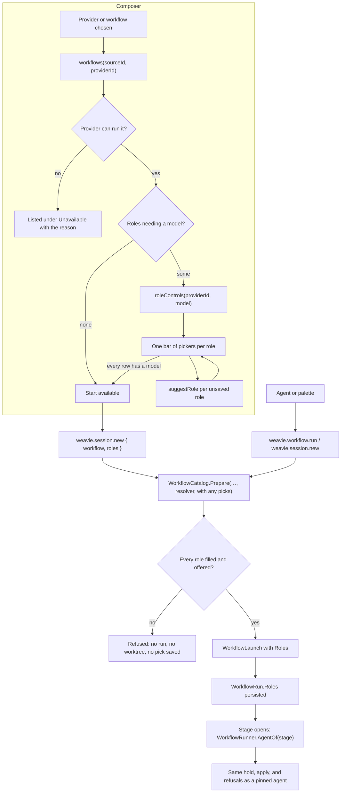

# Workflow roles — design

Implements [brief.md](brief.md). Extends [workflow-agent-selection.md](../workflow-agent-selection.md) and
[workflows.md](../workflows.md).

## Summary

**What changes for the user**

- A workflow step can say `role: planner` instead of naming a model. You decide once, per provider, which model
  fills each role; every workflow that names the role then uses it.
- You fill a role by asking your agent ("make Fable my planner", "what are my roles"). A role is user-wide.
- In the new-session composer, a workflow that names a role you haven't filled for the chosen provider shows one
  row per such role under a "Roles for <workflow>" heading: the agent's own Model, Effort, and Fast mode pickers, on
  the bar the getting-started dialog uses. With inference on, each model is prefilled when the decision model
  is confident. Start saves the picks. A workflow whose roles are all filled shows nothing new.
- A workflow the chosen provider can't run appears under *Unavailable* with the reason. `spec-driven` now uses
  `planner` and `builder`, so it is unavailable in terminal Claude sessions.
- Nothing is substituted: a missing role, a model that has gone, or a provider that can't choose a model refuses
  the start and says what to do.

**Main pieces**

| Piece | Where | Job |
| --- | --- | --- |
| `role` on a step | engine | parsed and validated; the definition lists the roles it names |
| Role resolver seam | engine | preparing a launch asks it for one agent per role, so no launch exists unresolved; the run keeps the answer |
| Role store | Core | provider → role → agent, in one user-wide file |
| Resolver | Core | the one rule for filled, unfilled, and stale roles, and the refusal wording |
| `weavie.workflow.setRole`, roles in `listWorkflows` | Core + host | how the agent changes and reads roles |
| Composer requests | HostCore | provider-aware workflow list, the model list, the role suggestion |
| Picker rows | web | one row per role that needs a model |

**Open questions (yours to decide)**

1. **`spec-driven`'s implement stage.** It continues the planner's conversation on the builder model, so the whole
   conversation is read uncached once at the switch (measured in workflow-agent-selection.md). Making it `fresh`
   is cheaper but moves the build into a background card. The design keeps `continue`.
2. **Options on a role.** The agent can set options such as effort, but `listAgents` lists models only, so it must
   know the option ids; a wrong one is refused at run start with the ids the provider advertises. The design does
   not add an option listing.
3. **A pick is saved when Start is pressed, before the session exists.** If creating the session then fails (a bad
   branch name), the role stays saved and the picker is gone on the retry. The design accepts that.

## Flow



## Formats

**Workflow YAML.** `role` sits beside `agent` on a step; a step takes one or neither.

```yaml
id: spec-driven
stages:
  - id: requirements
    run: { role: planner, prompt: "…{{run.prompt}}" }
  - id: implement
    run: { role: builder, prompt: "…" }
```

**Role file**: `~/.weavie/workflow-roles.json`, user-wide. It is JSON like every store Weavie writes itself; only
agent-authored workflows are YAML.

```json
{ "version": 1,
  "providers": {
    "claude-acp": {
      "planner": { "provider": "claude-acp", "model": "fable", "options": { "effort": "xhigh" } },
      "builder": { "provider": "claude-acp", "model": "opus", "options": {} } },
    "codex-acp": {
      "planner": { "provider": "codex-acp", "model": "gpt-6-astra", "options": {} } } } }
```

**Persisted run**, a new member beside `hold`:

```json
"roles": [
  { "name": "planner", "provider": "claude-acp", "model": "fable", "options": { "effort": "xhigh" } },
  { "name": "builder", "provider": "claude-acp", "model": "opus", "options": {} } ]
```

**`weavie.workflow.setRole`** takes exactly one of `agent` or `clear`. `provider` is the session provider the entry
is for.

```json
{ "role": "planner", "provider": "claude-acp",
  "agent": { "provider": "claude-acp", "model": "fable", "options": { "effort": "xhigh" } } }
{ "role": "planner", "provider": "claude-acp", "clear": true }
```

Results: `planner in claude-acp sessions is now fable (effort xhigh).` and
`Cleared planner for claude-acp sessions.`

**`listWorkflows`** adds the saved roles beside its workflows:

```json
{ "folders": { … }, "workflows": [ … ], "roles": [
  { "role": "planner", "provider": "claude-acp",
    "agent": { "provider": "claude-acp", "model": "fable", "options": { "effort": "xhigh" } } },
  { "role": "planner", "provider": "codex-acp",
    "agent": { "provider": "codex-acp", "model": "gpt-6-astra", "options": {} } } ] }
```

and `"roles": ["planner", "builder"]` to each valid workflow.

**`weavie.session.new`** gains `roles`, role → a model id of `agentProviderId`:

```json
{ "branch": "feat/x", "workflow": "spec-driven", "prompt": "…",
  "agentProviderId": "claude-acp",
  "roles": { "planner": { "model": "fable", "options": { "effort": "xhigh" } }, "builder": { "model": "opus" } } }
```

**Composer wire** (host feature `sessionCreation`):

| Request | Payload | Reply |
| --- | --- | --- |
| `workflows` (changed) | `{ "sourceId": null, "providerId": "claude-acp" }` | each workflow gains `roles`: `[{ "role": "planner", "problem": null }, { "role": "builder", "problem": "The saved model \"opus-4\" is no longer offered." }]`; `error` also carries why the provider can't run it |
| `suggestWorkflow` (changed) | `{ "sourceId": null, "providerId": "claude-acp", "prompt": "…" }` | unchanged |
| `roleControls` (new) | `{ "providerId": "claude-acp", "model": "opus" }` (`""` for no model yet) | `{ "axes": [<Model>, <Effort>, <Fast mode>], "error": null }`: `AgentControlAxis` records, the shape the pane's and getting-started's pickers use |
| `suggestRole` (new) | `{ "sourceId": null, "providerId": "claude-acp", "workflow": "spec-driven", "role": "planner" }` | `{ "applies": true, "model": "fable", "error": null }` |

`roles` lists only the roles that need a model. `roleControls` stays pending while the provider's models are being
probed, so "loading" is the pending request. Each option id is the provider's own; `""` on Effort or Fast mode is
"Default (<what the model runs with>)" and saves nothing for that option.

**The role decision** sent to the decision provider:

```json
{ "question": "Which model should fill the role in the evidence, judging by the stages it runs?",
  "choices": [ { "label": "fable", "description": "Fable 5.2: For your toughest challenges" },
               { "label": "opus", "description": "Opus 5.5: For complex work and everyday tasks" } ],
  "evidence": { "role": "planner", "prompts": ["Interview me as needed… {{run.prompt}}", "Write … design.md …"] } }
```

## Types and interfaces

### Engine (`src/Weavie.Workflows`)

| Symbol | File | Change |
| --- | --- | --- |
| `WorkflowWork.Role` | `WorkflowDefinition.cs` | `public required string? Role { get; init; }` beside `Agent` |
| `WorkflowDefinition.Roles` | `WorkflowDefinition.cs` | distinct `Stages[].Run.Role` in first-use order |
| `WorkflowDefinition.AgentOf(stage, roles)` | `WorkflowDefinition.cs` | the one lookup: the pinned agent, or the role's agent in `roles`, or null; the runner is strict about a missing role, the refusals skip it |
| `role` field, `WorkflowSchema.IsRoleName` | `WorkflowSchema.cs` | a `TextShape` with `IdPattern()` after `agent`; `IsRoleName` lets the role store refuse to save or clear a name no YAML can ask for |
| parse, validate | `WorkflowReader.cs`, `WorkflowSemantics.cs` | read `role`; `a step takes agent or role, not both` at `…run.role` |
| `IWorkflowRoleResolver` | `WorkflowCatalog.cs` | new seam, below |
| `WorkflowCatalog.Prepare` | `WorkflowCatalog.cs` | one signature taking the resolver; the two-argument overload is deleted |
| `WorkflowLaunch` | `WorkflowCatalog.cs` | sealed class, get-only members, internal constructor, plus `Roles` |
| `WorkflowRun.Roles` | `WorkflowRun.cs` | `public IReadOnlyList<WorkflowAgent> Roles { get; set; } = [];` beside `Prompt`, which loads the same way |
| `WorkflowTransitions.Start` | `WorkflowTransitions.cs` | takes the launch's roles and sets them on the new run |
| `IWorkflowRunPort.Refusal` | `WorkflowRunner.cs` | `string? Refusal(WorkflowLaunch launch)` |
| `WorkflowRunner` | `WorkflowRunner.cs` | constructor gains `IWorkflowRoleResolver roles`; `Prepare(workflowId, inputs, documentsDirectory, prompt)`; `AgentOf` looks roles up in the run |

```csharp
/// <summary>Fills a definition's roles for the session that will run it.</summary>
public interface IWorkflowRoleResolver {
	/// <summary>One agent per role in <see cref="WorkflowDefinition.Roles"/>, each named for its role; throws
	/// <see cref="WorkflowException"/> when that session can't run the definition or a role has no agent.</summary>
	IReadOnlyList<WorkflowAgent> Resolve(WorkflowDefinition definition);
}

public WorkflowLaunch Prepare(string id, JsonElement inputs, string? documentsDirectory,
	WorkflowStartPrompt prompt, IWorkflowRoleResolver roles);
```

### Core

| Symbol | File | Notes |
| --- | --- | --- |
| `StrictJsonDocumentStore` | `FileSystem/StrictJsonDocumentStore.cs` (new) | the held load failure, `EnsureAvailable()`, throwing `OnUnusable`/`OnPersistFailed`, and commit-with-rollback, extracted from `AcpControlStore` so the role store copies none of it |
| `WorkflowRoleStore`, `WorkflowRoleAgent`, `WorkflowRoleAssignment` | `Workflows/WorkflowRoleStore.cs` (new) | the file: `Find(providerId, role)`, `All()`, `Set(providerId, agents)` (all or none, checked by the rule the file is read back with), `bool Clear(providerId, role)`; source-generated document; failures are `WorkflowException` |
| `WorkflowRoleResolver : IWorkflowRoleResolver` | `Workflows/WorkflowRoleResolver.cs` (new) | `(WorkflowRoleStore, AgentProviderInfo, AgentModelCatalog)`; `Read`, `Resolve`, `Picking(picks)`; `WorkflowRoleGap(Role, MissingModel)`, `WorkflowRoleResolution(Agents, Unfilled, Refusal, Offered)`, read from one snapshot of the provider's models |
| `WorkflowAgentControls.Refusal` | `Workflows/WorkflowAgentControls.cs` | gains `IReadOnlyList<WorkflowAgent> roles`; a stage's agent is its pinned one or its role's; new wording `Unfilled`, `NoModelChoice`, `Stale` |
| `WorkflowRoleCommand.Run` | `Workflows/WorkflowRoleCommand.cs` (new) | parses and validates `setRole` arguments, writes, returns the result text |
| `CoreCommands.WorkflowSetRole` | `Commands/CoreCommands.Workflows.cs` | `weavie.workflow.setRole`, "Set Workflow Role", unbound, not in the palette (it needs arguments) |
| `WorkflowStartOptions.From` | `Workflows/WorkflowStartOptions.cs` | takes the resolver; each offered entry carries its resolution; `Startable` excludes entries the provider can't run |
| `WorkflowSuggester.AskAsync` | `Workflows/WorkflowSuggester.cs` | the ask-and-threshold switch, shared with the role suggester; `Chosen(string? Choice)` |
| `WorkflowSuggester.SuggestRoleAsync` | `Workflows/WorkflowSuggester.cs` | builds the role decision beside the workflow one |
| `AgentModelCatalog.SettledAsync` | `Agents/AgentModelCatalog.cs` | returns a provider's entry once it isn't `Probing`; a private change signal completes it |
| `IWorkflowRegistry.Roles()` | `Workflows/IWorkflowRegistry.cs`, `Mcp/McpServer.WorkflowTools.cs` | the saved roles and each workflow's roles in `listWorkflows` |
| `NewSessionRequest.Roles` | `Sessions/ISessionHost.cs`, `Commands/SessionCommands.cs` | parsed from `roles`; in the command's schema and description |
| `WeaviePaths.WorkflowRolesFile` | `WeaviePaths.cs` | beside `AcpControlsFile` |

### Hosting and web

| Symbol | File | Notes |
| --- | --- | --- |
| `HostServices.WorkflowRoles` | `HostServices.cs` | host-wide, so every window shares one copy of the file |
| `RoleResolver(AgentProviderInfo)`, `RoleModelsAsync`, `SuggestRoleAsync`, wire records | `HostCore.WorkflowStart.cs` | the resolver for a provider and the two new composer requests |
| `WorkflowStartTarget`, `WorkflowSuggestionRequest`, `WorkflowOptionWire` | `HostCore.WorkflowStart.cs` | carry `ProviderId`; options carry `Roles` |
| registrations, contracts | `HostCore.Messages.cs`, `Messaging/WireJson.cs` | `roleControls` (`NoDeadline`), `suggestRole` (`Droppable`), both concurrent |
| setRole handler, `weavie.workflow.run` | `HostCore.Workflows.cs` | the handler; run goes through `runner.Prepare` |
| `NewSessionAsync` | `HostCore.Sessions.cs` | saves picks, prepares with the resolver; the explicit `WorkflowAgentControls.Refusal` call there is deleted |
| `HostSession` | `HostSession.cs`, `HostSession.Workflow.cs` | constructor takes the roles and resolver; `WorkflowPort.Refusal(WorkflowLaunch)` |
| bridge requests | `src/web/src/bridge.ts` | `providerId` on the two existing requests; `requestRoleModels`, `requestRoleSuggestion` |
| `NewSessionRoleChoice` | `src/web/src/chrome/new-session-role-choice.ts` (new) | the picker rows' state owner, like `NewSessionWorkflowChoice` |
| `ControlBar` | `src/web/src/chrome/ControlBar.tsx` (new) | the bar of agent-reported pickers, extracted from the getting-started dialog's suggestion profile and used by it and by each role row |
| `NewSessionPicker` | `src/web/src/mobile/NewSessionPicker.tsx` (new) | the workflow field's own menu toggle |
| `WorkflowRolePick`, `WorkflowRoleAxes` | `src/Weavie.Core/Workflows/WorkflowRolePick.cs` (new) | a start's pick (model and options) and the role pickers built from the provider's models and the chosen model's controls |
| `providerId` prop | `NewSessionWorkflowField.tsx`, `NewSessionComposer.tsx`, `SessionInbox.tsx`, `App.tsx` | provider down to the field; `roles` in the seed and the create call |

`HostSession.WorkflowAgent.cs` and `HostSession.WorkflowStageOwner.cs` don't change: they see only
`WorkflowRunner.AgentOf`, so the hold, step open, transcript lines, and the run tooltip work for a role as for a
pinned agent.

## Components

### Engine: a launch can't exist unresolved

```text
Prepare(id, inputs, documents, prompt, resolver):
  definition = Winner(id); prompt check as today
  resolved   = resolver.Resolve(definition)                 // throws WorkflowException
  roles      = definition.Roles.map(r => resolved.First(a => a.Name == r))   // a skipped role throws here
  return new WorkflowLaunch(definition, path, inputs, prompt, roles)        // internal constructor

Start(launch):  port.Refusal(launch) → Transitions.Start(…, launch.Roles) → run.Roles persisted
Activate:       unchanged; run.Roles arrives from the store with the run

AgentOf(stage):
  stage.Run.Agent is name → definition.Agents.First(name)
  stage.Run.Role  is role → run.Roles.FirstOrDefault(role)
                            ?? throw WorkflowException("Run <id> has no agent saved for role \"<role>\"; cancel it and start it again.")
  otherwise               → null (the session's own model)
```

The runner holds the session's resolver, so `runner.Prepare` and `runner.Start(id, inputs)` are the only start
paths in a session. A role never resolves to null, so it can't run on the session's model.

### Role store

One file, provider → role → agent, read once and written atomically. An unreadable file is never reset: its failure
is thrown from the first use. A per-repository override would be a second store of the same class consulted first.

### Resolver

```text
Read(definition), for one session provider:
  entry   = models.Find(provider.Id)
  offered = entry is Ready ? entry.Models : null            // null: unknown right now
  for role in definition.Roles:
    saved = roles.Find(provider.Id, role)
    saved is null                                            → gap(role, null)
    saved.Provider == provider.Id and offered is not null
        and saved.Model not in offered                       → gap(role, saved.Model)
    otherwise                                                → agent { Name = role, …saved }
  Refusal = WorkflowAgentControls.Refusal(definition, agents, provider, axes: null)
            ?? (gaps.Any and (entry is null or offered is empty) ? NoModelChoice : null)

Resolve(definition):                                         // the engine seam; every start
  r = Read(definition)
  refusal = r.Refusal ?? (r.Unfilled.Any ? Unfilled(…) : null)
  refusal is null ? r.Agents : throw WorkflowException(refusal)

Picking(picks).Resolve(definition):                          // a composer start's picks; saves nothing
  a pick for a role the definition doesn't ask for           → throw WorkflowException
  the provider's own refusal (terminal, no model choice)     → throw, so a pick never masks it
  picks while the models aren't known, or of a model not offered → throw
  each pick as { provider.Id, model, options } over the saved roles; an unfilled role → throw

Picking(picks).Save():                                       // only after Resolve succeeded
  roles.Set(provider.Id, every pick)                         // one write
```

A saved role is trusted while the model list is loading or failed; its step is checked when it opens. When the run
starts in a live session, `WorkflowPort.Refusal(launch)` then checks model and options against the session's own
controls, exactly as for a pinned agent.

### Composer catalog

```text
WorkflowStartOptions.From(catalog, defaultId, resolver), for each entry offered for a prompt:
  broken    → Problem = entry.Error
  otherwise → r = resolver.Read(definition); Problem = r.Refusal
              roles = Problem is null ? r.Unfilled.map(g => (g.Role, g.MissingModel is null ? null : Stale(g))) : []
Startable = entries with no Problem                          // all the workflow suggestion sees
a default with a Problem → DefaultProblem = The default workflow "x" can't run here: <reason>
```

### Model list and role suggestion

```text
roleControls(providerId, model):
  entry = await models.SettledAsync(providerId, ct)
  not Ready → { axes: [], error: entry.Error or "<name> offers no model to choose." }
  selected  = model is "" ? [] : provider.ProbeInferenceControlsAsync(model).Selected   // a failure keeps the model picker
  axes      = WorkflowRoleAxes.Build(entry.Models, model, selected)
              // Model (required), then the Effort and Fast mode among `selected`, each led by "Default (…)"

suggestRole(sourceId, providerId, workflow, role):
  gap = Read(definition).Unfilled.First(role)                // none, or something saved → Unchanged
  models not Ready, or fewer than 2                          → Unchanged
  AskAsync(evidence { role, prompts of the stages using it }, choices = models, Origin = Automatic,
           threshold = workflow.decisionConfidence)
    p >= threshold → Chosen(model id);  below → Unchanged
    Disabled or PolicyDenied → Unchanged;  any other failure → Failed(detail)
```

It is an automatic query, like the workflow suggestion, so it needs `inference.allowAutomatic` as well as
`inference.enabled`.

### Start

```text
NewSessionAsync, before any worktree exists:
  request.Roles.Any and request.Workflow is null → Failure("'roles' needs a 'workflow'.")
  picks = RoleResolver(providerInfo).Picking(request.Roles)
  launch = Catalog(LaunchRoot(source)).Prepare(workflow, inputs, documents, prompt, picks)
  picks.Save()                                               // a refused Prepare saved nothing
```

### Picker rows (web)

| Event | Rule |
| --- | --- |
| target, workflow, or its needed roles change | abort everything; rebuild empty rows; with no rows the field is ready; otherwise ask for the pickers with no model |
| models pending | each row shows the bar's placeholder; Start waits |
| models failed | the group shows `Couldn't list models: <error>`; Start waits; showing the same pair again asks again |
| models ready | each row shows its Model picker; one `suggestRole` per row with nothing saved, which reads `Suggesting…` |
| a model is picked or suggested | the row's options are dropped, and the pickers are asked for with that model, once per model; Effort and Fast mode appear when they land |
| suggestion lands | applied only when the pair is still current, the user hasn't picked that row's model, and the model is on offer |
| an option is picked | saved on the row; picking Default removes it |
| the options can't be asked for | the model stays picked and the row says `Couldn't get the options: <error>` |
| `capture()` at Start | returns role → `{ model, options }` and discards suggestions in flight |
| after a successful Start | the field re-reads the catalog, so saved roles stop showing |

The group is titled `Roles for <workflow>` (a `.ui-section-label`), so the rows read as the workflow's and not as
session fields. Each row is the role name beside a `ControlBar`; the problem line is a `<small role="alert">`, as the
workflow field's is.

## Error handling

| When | Where it surfaces | Wording |
| --- | --- | --- |
| `agent` and `role` on one step | `validateWorkflow`; the *Unavailable* row | `a step takes agent or role, not both` |
| a role or pinned agent on a terminal provider | composer *Unavailable*; command failure | `Stage "requirements" runs on role "planner", but Claude Code runs in a terminal, where a stage can't choose its model; run the workflow in a native agent session.` |
| a pinned agent, or a role saved with another provider's agent | same | `Stage "x" runs on role "planner" of provider codex-acp, so workflow w runs only in codex-acp sessions; this session runs claude-acp.` |
| a role needs a model and the provider offers none | same | `Stage "requirements" runs on role "planner", but <Name> offers no model to choose.` |
| a role has nothing saved (command start) | command failure; no run, no worktree | `Workflow spec-driven can't start: role "planner" has no agent for claude-acp sessions. Fill it with weavie.workflow.setRole: role, provider "claude-acp", agent.` |
| the saved model is no longer offered (command start) | same | `…role "builder" is saved as model "opus-4", which Claude Agent no longer offers (it offers fable, opus).` |
| same, in the composer | by the role's picker | `The saved model "opus-4" is no longer offered.` |
| a model, option, or value the live session doesn't advertise | command failure, or the run pauses at step open | unchanged |
| a reloaded run has no agent for a role | paused run | `Run r-… has no agent saved for role "planner"; cancel it and start it again.` |
| `setRole` arguments | command failure | `weavie.workflow.setRole takes exactly one of 'agent' or 'clear'.`; `'agent.provider' is required.`; `"Planner" isn't a role name: use lowercase words joined by hyphens.`; `No agent provider 'claude-apc' is registered; the providers are claude, claude-acp, codex-acp.` (the registry's one wording); `No planner is saved for claude-acp sessions.` |
| a Start pick the provider doesn't offer | the Start failure toast; nothing saved | `Role "planner" can't take model "x": Claude Agent offers a, b.` |
| a Start pick for a role the workflow doesn't ask for | command failure; nothing saved | `Workflow spec-driven asks for no role "Planner".` |
| a Start pick while the provider's models aren't known | command failure; nothing saved | `Claude Agent's models aren't known yet, so its roles can't be picked.` |
| a role file unreadable or unwritable | whichever surface touched it | `Workflow roles could not be loaded from '<path>': <cause>` |
| the model list failed | by each role row; Start waits | `Couldn't list models: <error>` |
| the role suggestion failed | by that row | `Model suggestion failed: <error>` |
| inference off, below the threshold, fewer than two models | nothing | the picker stays empty |

## Testing strategy

- **Engine** (`tests/Weavie.Workflows.Tests`): `role` parses, conflicts with `agent`, and lists in `Roles`;
  `Prepare` asks the resolver, a throwing resolver leaves no launch, an omitted role throws; a run's roles survive a
  JSON round trip and a new runner's `Activate`; a role changed after start doesn't change the run; `spec-driven`
  names `planner` and `builder`, `quick-fix` none.
- **Core** (`tests/Weavie.Core.Tests`): the store round-trips and holds a malformed, wrong-version, or unknown-member
  file as a failure without touching it; the resolver covers filled, unfilled,
  stale, stale-ignored-while-probing, terminal, other-provider, and no-model-choice; picks drop options, refuse an
  unoffered model or a role the workflow doesn't ask for, and save all or none; every `setRole` argument failure; a role-filled stage gets the same
  refusals as a pinned one; the provider-aware start options; the role decision's evidence, choices, threshold, and
  the two-model rule; `SettledAsync`; roles in `listWorkflows`. `AcpControlStore`'s tests stay unchanged, proving the
  extraction changed no behaviour.
- **Hosting** (`tests/Weavie.Hosting.Tests`): `setRole` then `weavie.workflow.run` applies the role's model before
  the stage's turn; an unfilled role leaves no run; `weavie.session.new` with an unfilled role creates no session or
  worktree; `roles` on `weavie.session.new` saves and starts; a bad pick saves nothing; unload
  and reload keeps the run's roles; the four composer requests.
- **Web unit**: every row of the picker table, including a suggestion landing after a pick or after `capture()`; a
  provider change reloads the catalog and drops a workflow the new provider can't run.
- **E2E**: the mock-host composer spec (rows appear, Start waits for each, a suggestion prefills, a failed list
  shows its reason, `roles` is submitted); the headless functional spec with the fake ACP agent (`spec-driven`
  picked, both roles prefilled, the run starts on the picked model, reopening shows no pickers; with terminal
  Claude it is *Unavailable*); `workflow-agent.spec.ts` (a role workflow refused until `setRole`, then run).
  Headless only; nothing here is transport-sensitive.
- **Real agents, once by hand**: `planner` and `builder` on claude-agent-acp and codex-acp through the composer,
  since the fake can't show that a real probe lists models with usable descriptions.

## Files

| File | Why |
| --- | --- |
| `src/Weavie.Workflows/WorkflowDefinition.cs`, `WorkflowSchema.cs`, `WorkflowReader.cs`, `WorkflowSemantics.cs` | `role` on a step |
| `src/Weavie.Workflows/WorkflowCatalog.cs`, `WorkflowRun.cs`, `WorkflowTransitions.cs`, `WorkflowRunner.cs` | the resolver seam, the launch's and run's roles, the lookup |
| `src/Weavie.Workflows/BuiltIn/spec-driven.yaml` | `planner` and `builder` |
| `src/Weavie.Core/FileSystem/StrictJsonDocumentStore.cs` (new), `src/Weavie.Core/Sessions/AcpControlStore.cs` | the shared store base |
| `src/Weavie.Core/Workflows/WorkflowRoleStore.cs`, `WorkflowRoleResolver.cs`, `WorkflowRoleCommand.cs` (new), `WorkflowSuggester.cs` | the store, resolution, command, suggestion |
| `src/Weavie.Core/Workflows/WorkflowAgentControls.cs`, `WorkflowStartOptions.cs`, `WorkflowSuggester.cs`, `IWorkflowRegistry.cs` | role-aware refusals, provider-aware options, the shared ask |
| `src/Weavie.Core/Agents/AgentModelCatalog.cs` | `SettledAsync` |
| `src/Weavie.Core/Commands/CoreCommands.Workflows.cs`, `SessionCommands.cs`, `src/Weavie.Core/Sessions/ISessionHost.cs` | the command; `roles` on `weavie.session.new` |
| `src/Weavie.Core/Mcp/McpServer.WorkflowTools.cs`, `McpServer.cs`, `AuthorWorkflowPrompt.cs`, `EmbeddedAgentGuidance.cs` | the listing tool; authoring and "make X my planner" guidance |
| `src/Weavie.Core/Configuration/WorkflowSettings.cs`, `src/Weavie.Core/WeaviePaths.cs` | the confidence description names the role suggestion; the path |
| `src/Weavie.Hosting/HostServices.cs`, `HostCore.cs`, `HostCore.WorkflowStart.cs`, `HostCore.Workflows.cs`, `HostCore.Sessions.cs`, `HostCore.Messages.cs`, `Messaging/WireJson.cs`, `HostSession.cs`, `HostSession.Workflow.cs` | wiring, requests, start paths |
| `src/web/src/bridge.ts`, `chrome/new-session-workflow-choice.ts`, `chrome/new-session-role-choice.ts` (new), `chrome/ControlBar.tsx` and `chrome/control-bar.css` (new), `getting-started/SuggestionProfile.tsx`, `mobile/NewSessionPicker.tsx` (new), `mobile/NewSessionWorkflowField.tsx`, `mobile/NewSessionComposer.tsx`, `mobile/SessionInbox.tsx`, `App.tsx` | the provider reaches the field; the rows |
| `tests/…`, `src/web/e2e/…` | as in the testing strategy |
| `docs/specs/workflow-agent-selection.md`, `docs/specs/workflows.md`, `AGENTS.md` | a Roles section, `role` in the format, the deferred notes removed, the concept line |

## Risks, and where the code makes the brief awkward

- **"Saved through the same command" is one Core write, not a dispatch.** The composer sends its picks with
  `weavie.session.new` and the host saves them through the resolver, the code the command also ends in. Dispatching
  the command from the web would leave several saves that can partly fail before the start.
- **A stale role is refused earlier than a stale pinned agent.** From `weavie.session.new`, a pinned agent's missing
  model pauses the run when its stage opens. The brief wants a missing role model refused at start, so the resolver
  reads the model catalog when it is ready; while it is loading, a role behaves as a pinned agent does.
- **The provider is written twice in `setRole`** (the session provider and `agent.provider`), which is what storing
  a full agent costs. A mismatch is savable and refused at start, as the brief says.
- **The model catalog has no change signal today**, so the model-list request waits on a new one instead of
  replying "loading". A probe that hangs keeps the rows on their placeholder, visibly, with Start waiting.
- **Two hosts on one `~/.weavie` don't see each other's role writes** until restart; the last writer wins, as for
  the remembered picker defaults.
- **The composer reads needed roles from the loaded catalog.** A role the agent saves while the composer is open
  keeps its picker until the catalog is re-read (provider change, reopening, Start). Start resolves from the store.
- **The test host has no models.** Its catalog isn't started and the fake provider's probe returns none, so the
  hosting tests start it and open a session first.
- **`spec-driven` leaves the default provider's list.** Intended; tests that list it as startable now name a
  provider.
- **E2E isn't typechecked.** Every `sessionCreation` stub and payload assertion is found by hand.

## Build checklist

- [x] Extract `StrictJsonDocumentStore`; move `AcpControlStore` onto it with its tests unchanged.
- [x] Engine: `role` in the schema, reader, and semantics; `Roles`; `IsRoleName`.
- [x] Engine: `IWorkflowRoleResolver`, the single `Prepare`, sealed `WorkflowLaunch`, `WorkflowRun.Roles`,
      `Transitions.Start`, the runner's resolver, `Prepare`, and `AgentOf`; the port signature; one
      `WorkflowDefinition.AgentOf(stage, roles)` lookup; give `WorkflowAgentControls.Refusal` its `roles` argument.
- [x] Core: the path, `WorkflowRoleStore`.
- [x] Core: `WorkflowRoleResolver`, the new refusal wording, provider-aware `WorkflowStartOptions`.
- [x] Core: `WorkflowRoleCommand`, the command definition, `IWorkflowRegistry.Roles`, `roles`
      in `listWorkflows`.
- [x] Host: `HostServices.WorkflowRoles`, `HostSession` wiring, the `setRole` handler, `weavie.workflow.run`
      through `runner.Prepare`, `NewSessionRequest.Roles` and `NewSessionAsync`.
- [x] `spec-driven.yaml` on `planner` and `builder`; fix the tests that list it.
- [x] Composer host side: `SettledAsync`, `SuggestRoleAsync` with the shared ask, provider-aware `workflows`
      and `suggestWorkflow`, `roleControls`, `suggestRole`, `WireJson`.
- [x] Web: bridge requests, `providerId` down to the field, `NewSessionRoleChoice`, `ControlBar`, `NewSessionPicker`, the
      seed and create call, CSS.
- [x] E2E: the mock-host spec, the functional spec, `workflow-agent.spec.ts`, the harness helper (after
      `vite build` and `dotnet build`).
- [x] Guidance and docs: `AuthorWorkflowPrompt`, `EmbeddedAgentGuidance`, the setting description, the two specs,
      `AGENTS.md`.
- [x] `biome check --write`, `dotnet format`, a duplication read of the whole diff.
