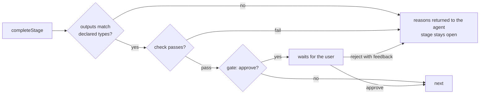

# Workflows

Status: proposed

## Purpose

A workflow is a user-defined, multi-stage process a session runs — e.g. *spec → implement → independent review →
record proof → draft PR → address PR feedback*, or Kiro-style *requirements → design → tasks → implement each*. Weavie
ships no opinion about the process; it ships a small engine plus example workflows the user forks.

Prompt-only processes (skills, slash commands, markdown playbooks) fail over long sessions: a skill body is truncated or
dropped after compaction, conversation-only state ("which step are we on") is summarized away, and an agent declares
done early. Every reliable long-running harness keeps the step state outside the model and verifies "done" outside the
model's word. So **Weavie owns the run; the agent fills each step.** Anything a workflow depends on — position,
iteration, typed outputs, gates, checks — is held by Weavie. The agent only produces the content of a step.

## Concepts

- **Workflow** — a YAML definition: inputs, milestones, ordered stages.
- **Run** — one execution of a workflow, owned by a session and persisted with it. A session hosts many runs over its
  life; at most one run chain (a run plus the `in: here` children it is waiting on) is active at a time.
- **Stage** — one unit of a run. Its `do` step does the work; `check`, `gate`, and `next` decide what happens after.
- **Step** — anything that takes a prompt or skill. One shape everywhere (`do`, `when`, `next`, `check`).

## Definitions

### Location and precedence

| Scope | Path | Notes |
| --- | --- | --- |
| Built-in | shipped with Weavie | examples; never edited in place |
| Personal | `~/.weavie/workflows/*.yaml` | |
| Repository | `<repo>/.weavie/workflows/*.yaml` | |

A matching `id` in a more specific scope overrides a less specific one: a repository applies to one project, personal
to every project, built-in to everyone (repository > personal > built-in). Forking is the agent copying a file into a
more specific scope. A shadowed workflow stays visible in `listWorkflows` and the picker, labelled with what shadows it. Weavie treats every opened folder as trusted, so repository workflows run like any repository
file; a trust flag for repositories is deferred.

### Authoring

Workflows are written by the agent, not by hand. The registry exposes:

- `getWorkflowSchema` — the JSON Schema of the format, so the agent reads the real field list instead of recalling one.
- `validateWorkflow(path)` — exact errors (`unknown key "runs-on" at stages[2]`); the agent calls it before finishing.
- `listWorkflows` — every resolved workflow with scope, path, and validity.

The vocabulary is deliberately small and unlike GitHub Actions, so an agent has nothing similar to drift toward.

**The authoring prompt.** A bundled prompt, `author-workflow`, carries the judgment the schema can't. It triggers
without an explicit command the same way issue reporting does: the always-injected embedded-agent guidance
(`EmbeddedAgentGuidance`) says *when the user asks to create, fork, change, or improve a Weavie workflow, call
`runPrompt` with `author-workflow` and follow it*. **Improve This Workflow** and the workflow suggestion cards prefill a
request that lands on the same prompt. It holds guidance only; the field list stays in `getWorkflowSchema`, so the two
never drift. It tells the agent to:

- Interview the user about how they actually work, and model that process. Built-ins are references for the format,
  not templates; fork one only when it already matches what the user described.
- Prefer the user's existing skills as stage steps over restating them as prompts.
- Write personal workflows unless the user says the process belongs to the repository.
- Leave `agent` unset unless the user names a model, so a workflow stays portable across providers.
- Keep checks to confirming state, never redoing work; put long work in `do`.
- Choose each step's `context` by the rule in [Choosing context](#choosing-context).
- Use `gate: approve` where the user wants to sign off, `in: new-session` where each item needs its own branch and PR,
  and `max` on every loop.
- Never encode facts the run already knows (a skipped stage, an output's presence) as a model decision; use `else`.
- Call `validateWorkflow` and fix every error before finishing; with run history, cite the evidence for each change.

**Edit Workflow** opens the YAML in the editor; the same schema drives inline diagnostics. Saving is never blocked.
An invalid file is listed as broken (with its error) in the picker and cannot start; a run executes the definition
snapshot it started with, so editing a file never changes a run in flight. A visual viewer is deferred.

### Format

```yaml
id: <kebab-case>                 # unique within its scope
description: <one line>          # shown in the picker; read by the workflow suggestion
inputs: { <name>: <type> }       # `?` suffix marks optional
milestones: [<name>]             # optional; points a parent can wait for
stages: [<stage>]
```

**Stage**

| Field | Meaning |
| --- | --- |
| `id` | unique within the workflow |
| `when` | choice step (yes/no); a "no" skips the stage. A bare string is shorthand for a yes/no question on the default model. |
| `else` | stage to jump to when `when` skips this one |
| `do` | the work step |
| `check` | step that must pass when the stage completes (see [Completing a stage](#completing-a-stage)) |
| `gate: approve` | the user approves (or rejects with feedback) before the run advances |
| `next` | a stage id, `done`, or a choice step whose `choices` map to stage ids / `done`; `max: N` caps how often this transition loops |
| `reaches` | milestone reached when the stage completes |
| `workflow` + `args` | run another workflow as this stage |
| `in` | `here` (this session) or `new-session` (Weavie creates a linked session). Required with `workflow`. |
| `foreach` | a `list` output; runs `workflow` once per item, exposed as `{{item}}` |
| `wait` | for `workflow` stages: a child milestone, `done`, or `none` |

Stages advance in order unless `next`/`else` says otherwise.

**Step**

| Field | Meaning |
| --- | --- |
| `skill` / `prompt` | what to run; `skill` is sent as the provider's real slash command (`/spec <args>`) |
| `args` | text passed to the skill |
| `agent` | `{ provider, model, options }`, all provider-native |
| `context` | `continue`, `fork`, or `fresh` |
| `choices` | list, or map of choice → stage id; makes the step a typed decision |
| `outputs` | `{ <name>: text \| url \| list \| files \| pr }` the step must report |

Templates reference `{{inputs.<name>}}`, ``, and `{{item}}`. There is no expression language.

### Defaults

| Step | `agent` | `context` |
| --- | --- | --- |
| `do` | the session's agent | `continue` |
| `check` | the session's agent | `fork` |
| `when`, `next` | the utility inference model (the one branch naming uses) | — |
| any other agent step | as written | `fork` |

Nothing defaults to `fresh`: a step missing context it needed fails invisibly, while a fork's cost shows in run
history. `fresh` is for deliberate independence (a reviewer that must not inherit the author's assumptions).

- `continue` runs in the session's conversation.
- `fork` copies the conversation (ACP `session/fork`; Claude `--resume … --fork-session`); only its outputs, choice,
  or summary return. Forked and fresh steps appear as background-work cards with Stop.
- `fresh` starts a new conversation seeded only with the step's prompt and args.
- All three share the worktree; files are never forked.

#### Choosing context

Ask whether later steps — and the user — need *how* the step did its work, or only *what* it produced.

| Use | When | Examples |
| --- | --- | --- |
| `continue` | the user converses in the step, or later steps build on its reasoning | spec interview, implement, fix review findings |
| `fork` | the step needs everything so far, but only its result matters afterward | record videos, gather review findings, research, a check |
| `fresh` | the step must not inherit the author's assumptions, or its inputs fully describe it | an independent review, one `foreach` item whose context is on disk |

A forked step runs as a background-work card, which the user can watch but not talk to, so a step that expects
conversation is always `continue`.

A choice step on a tool-less model sees only its prompt, the stage's outputs, and the agent's last message — never the
transcript.

### Agent options

`agent.options` is passed through untouched and validated when the stage starts against what that provider advertises
(ACP config options; Claude's own switches). An unknown option or value fails the stage loudly, naming what the
provider supports. A model that only answers typed choices (e.g. Jev, OpenAI Decisions) is valid only on choice steps;
this is checked at load. Provider-native ids are never inferred. Model aliases ("roles") are deferred: built-in
workflows use only the defaults above, so they ship without naming a model.

## Starting a run

- The new-session composer gains a **workflow picker** beside the branch field. It is auto-suggested from the first
  prompt by one utility typed query, the same way the branch name is; `workflow.default` sets the initial value.
  The query also extracts the workflow's `inputs` from the prompt into editable composer fields. A failed suggestion
  shows the default with the failure reason.
- `weavie.session.new` gains `workflow` and `inputs` arguments, so an agent can start a session running a workflow.
- **Run Workflow** starts a workflow in the current session.

## Running a stage

Each turn during a run carries a short **stage block**: run, stage, expected outputs, and how to complete. Weavie
appends it to every prompt it sends an ACP agent, and adds it for terminal Claude through a `UserPromptSubmit` hook on
the hook bridge. The next turn always restates the stage, so compaction cannot lose it.

A stage whose agent is idle is **waiting on you** — the agent asked a question, proposed an approach, or is
interviewing you. Weavie does nothing on turn end. There are no stage kinds.

Waiting on external events (PR comments, CI) is the agent's job, through its own background tasks, monitors, or
scheduled wakeups. The session's existing `Waiting` status distinguishes "idle with background work pending" from idle,
and the run shows it as *watching in background*. Unloading a session with a waiting run confirms first; a dead agent
process marks the run stalled. Weavie-owned event triggers are deferred until run history shows agent-driven waiting
is unreliable.

## Completing a stage

The agent calls `completeStage(outputs)` or `failStage(reason)`. Calls carry no run or stage id: they arrive on the
session's own registry endpoint, which identifies the run by construction.



- Checks run **only** on `completeStage`, never on turn end.
- A check is a step that returns `pass` or `fail` with a reason. What it can verify depends on what runs it: the
  default (a fork of the session's agent) can inspect the worktree; a tool-less model can only judge text.
- A check confirms state, it doesn't redo work: "the tests the agent ran are green and everything is pushed", not
  "run the full suite". Long work belongs in `do`. A check that runs long is a defect in the workflow, and run
  history shows its duration.
- Rejections count toward `workflow.maxStageAttempts`; hitting it pauses the run and notifies the user.
- `failStage` pauses the run with the reason.
- **Finish Stage** asks the agent to wrap up and call `completeStage`; the check still runs. **Skip Stage** advances
  without checking and is recorded.

### Decisions

Every choice step implicitly allows `unsure`. An `unsure` answer, a failed query, or confidence below
`workflow.decisionConfidence` pauses the run and asks the user — a run never advances on a guess. Decision-model
providers (Jev, OpenAI Decisions) plug in as typed-inference providers
([ad-hoc-inference.md](../concepts/ad-hoc-inference.md)).

## Child runs

A `workflow` stage starts a child run. With `foreach`, Weavie iterates the list itself — the position and per-item
status live in the parent run, never in a prompt.

- `in: here` runs children sequentially in this session; the parent waits on each.
- `in: new-session` — Weavie calls the session-creation path directly (branch suggestion included), and the parent
  holds a handle to the child run. Each child owns its worktree, branch, and PR.
- `wait` names the child milestone that advances the parent (`pr-ready` lets the next task start while the child keeps
  addressing feedback), `done`, or `none`.

### Run state

Run state is distinct from session status: an idle session is not a finished task.

| State | Meaning |
| --- | --- |
| `running` | a stage is open and the agent is working |
| `waiting-on-user` | a stage is open and the agent is idle, or a gate awaits approval |
| `watching` | a stage is open and the session is `Waiting` on background work |
| `waiting-on-children` | a `workflow` stage awaits its `wait` condition |
| `paused` | a cap, `failStage`, or an unsure decision needs the user |
| `stalled` | the agent process ended with a stage open |
| `done` / `cancelled` | terminal |

Each run is persisted with its session. A workspace-level **run registry** resolves a run by id and publishes its state
changes; the parent's `foreach`, the session rail, attention notifications, and the agent (`getRun`, `listRuns`) all
read it. Milestones reached and `done` raise attention events.

## Commands

All unbound by default and reachable from the palette, user keybindings, and agents: **Run Workflow**, **Edit
Workflow**, **Approve Stage**, **Reject Stage** (with feedback), **Finish Stage**, **Skip Stage**, **Retry Stage**,
**Jump to Stage**, **Pause Run**, **Resume Run**, **Cancel Run**, **Improve This Workflow**.

Every run command takes an explicit run id; a card or strip that shows a run registers the handler for it, so a
shortcut never acts on whichever run happens to be newest.

## Visualizing a run

A workflow must not take over the standard session experience. The everyday UI gains almost nothing; detail lives in
a view the user opens on demand.

- **Session rail** — no new rows, nesting, or indentation. A session in a run uses its existing status line for the
  run's stage and state (`review · decision needs you` instead of `idle · 5m ago`). Child sessions are ordinary
  sessions.
- **Agent pane** — one chip in the existing status line under the composer (`ship-task · review 2/6`), beside the PR
  chip. Stage boundaries appear in the transcript as one-line dividers (`implement ✓ · check passed`), not cards.
- **Cards only when the run needs the user** — an approval gate or an `unsure` decision, styled like a permission
  request, with keyed choices. Forked and fresh steps use the existing background-work cards.
- **Run view** — opened from the chip or **Show Run**, as an ordinary editor tab: stages with status, attempts, and
  check reasons; outputs; `foreach` items with their child sessions (each jumps to its session); decisions with their
  answers and confidence; Pause, Cancel, and Edit Workflow. Closing it leaves the standard UI untouched.

Mockup: `temp/mockups/workflow-run.html` (not tracked).

## Run history and suggestions

Every run records per-stage duration, attempts, loop counts, rejections with feedback, decisions with confidence, and
cost. **Improve This Workflow** prefills that history into the session's agent to propose YAML edits — Weavie stores
the signal, the agent reasons ([learn-from-corrections.md](learn-from-corrections.md)).

Two suggestion cards ([suggestions.md](../concepts/suggestions.md)): a workspace with no personal or repository
workflows ("Have the agent build a workflow from how you work"), and a workflow whose runs repeatedly stall or get
rejected at one stage.

## Settings

| Key | Meaning |
| --- | --- |
| `workflow.default` | workflow preselected in the new-session composer |
| `workflow.maxStageAttempts` | rejected completions before a run pauses |
| `workflow.decisionConfidence` | minimum confidence for a choice step to advance |

## Naming

Today's bundled instruction prompts (`report-weavie-bug`, `request-weavie-feature`, workspace setup) and the
`runWorkflow` tool are renamed to **prompts** / `runPrompt` in a separate change first, freeing "workflow".

## Built-in examples

### quick-fix

```yaml
id: quick-fix
description: A small, well-understood change. Implement, verify, open a PR.
inputs: { task: text }
stages:
  - id: implement
    do: { prompt: "{{inputs.task}}" }
    check:
      prompt: Run the tests and the linter. Pass only if both are green and the work is committed.
  - id: pr
    do:
      prompt: Push and open a draft PR describing the change.
      outputs: { pr: pr }
```

### ship-task

```yaml
id: ship-task
description: Implement one task, get an independent review, record proof, open a PR, then address its feedback.
inputs: { task: text, spec: url? }
milestones: [pr-ready]
stages:
  - id: implement
    do: { prompt: "Implement: {{inputs.task}}. Spec, if any: {{inputs.spec}}" }
    check:
      prompt: Run the tests and the linter. Pass only if both are green and the work is committed.

  - id: review
    do:
      prompt: >
        Get an independent review of this branch's diff against main from a different configured
        agent than yourself (listAgents + consultAgent). Report its blocking findings.
      outputs: { findings: text }
    next:
      prompt: "Do these findings contain anything blocking? {{review.findings}}"
      choices: { yes: fix, no: record }
      max: 3

  - id: fix
    do: { prompt: "Fix these review findings and commit: {{review.findings}}" }
    next: review

  - id: record
    do:
      skill: record-tour
      context: fork
      outputs: { videos: files }

  - id: pr
    do:
      prompt: "Push and open a draft PR. Embed these videos: {{record.videos}}"
      outputs: { pr: pr }
    reaches: pr-ready

  - id: respond
    do:
      prompt: >
        Monitor this PR for new review comments in the background until it merges. For each, make
        any code change it needs and commit, then draft a reply into my pending review — never
        submit it. Call completeStage when the PR merges.
```

### spec-driven

```yaml
id: spec-driven
description: Requirements, design, and tasks — each approved — then implement the tasks one by one on this branch.
inputs: { feature: text }
stages:
  - id: requirements
    do:
      prompt: >
        Interview me as needed, then choose a short kebab-case slug and write EARS-style user stories
        with acceptance criteria for "{{inputs.feature}}" to docs/specs/<slug>/requirements.md.
      outputs: { dir: text }
    gate: approve

  - id: design
    do: { prompt: "Write {{requirements.dir}}/design.md from the approved requirements." }
    gate: approve

  - id: tasks
    do:
      prompt: Break the design into small, independently testable tasks in {{requirements.dir}}/tasks.md.
      outputs: { tasks: list }
    gate: approve

  - id: implement
    foreach: tasks.tasks
    workflow: quick-fix
    args: { task: "{{item}} (per {{requirements.dir}}/design.md)" }
    in: here
    wait: done
```

### diagnose

```yaml
id: diagnose
description: Investigate a reported problem, then route it to quick-fix or spec-driven by complexity.
inputs: { report: text }
stages:
  - id: research
    do:
      prompt: >
        Investigate "{{inputs.report}}" with whatever observability and chat tools you have (logs,
        metrics, Slack threads). Change no code. Report the likely cause, blast radius, and files involved.
      outputs: { findings: text }
    next:
      prompt: "How involved is the fix for: {{research.findings}}"
      choices: { simple: quick, complex: spec }

  - id: quick
    workflow: quick-fix
    args: { task: "{{research.findings}}" }
    in: here
    wait: done
    next: done

  - id: spec
    workflow: spec-driven
    args: { feature: "Fix: {{research.findings}}" }
    in: here
    wait: done
```

## Personal example: Notion spec

Uses the user's own `/spec` and `/implement-task` skills, with a personal fork of `ship-task` whose `implement` step is
`do: { skill: implement-task, args: "{{inputs.spec}} {{inputs.task}}" }`.

```yaml
id: notion-spec
description: Interview me into a Notion spec with a task list, then ship each task in its own session.
inputs: { idea: text }
stages:
  - id: spec
    when: "{{inputs.idea}} is complex enough to need a written spec"
    else: just-ship
    do:
      skill: spec
      args: "{{inputs.idea}}"
      outputs: { notionUrl: url, tasks: list }
    gate: approve

  - id: build
    foreach: spec.tasks
    workflow: ship-task
    args: { spec: "{{spec.notionUrl}}", task: "{{item}}" }
    in: new-session
    wait: pr-ready
    next: done

  - id: just-ship
    workflow: ship-task
    args: { task: "{{inputs.idea}}" }
    in: here
    wait: done
```

## Integration tests

Full-stack on `headless` ([integration-testing-strategy.md](integration-testing-strategy.md)): the fake agent calls
`completeStage`, a fake inference provider answers choice steps, and the static PR fake supplies PR state.

1. **quick-fix** — a check fails, the reason reaches the agent, the retry passes, the `pr` output is recorded.
2. **spec-driven** — each gate blocks until approval; a rejection with feedback reopens the stage; `foreach … in: here`
   walks three tasks with per-item progress in the strip.
3. **ship-task** — the review loop runs `fix` twice then pauses at `max`; resuming reaches `pr-ready`; the `respond`
   stage shows `watching` while the agent holds background work.
4. **diagnose** — the routing decision picks `quick`; an `unsure` answer pauses the run instead of advancing.

## Deferred

- Repository trust flag.
- Model aliases (roles) with automatic mapping from the model catalog.
- Weavie-owned event triggers (`on: pr.comment` fed by the PR monitor).
- A visual workflow viewer.

Provider agent files (`.claude/agents`, `.codex/agents`) are not supported: they are provider-specific, and a prompt
can already ask the agent to use one.

## Open questions

- YAML parsing under Native AOT: the repo has no YAML dependency yet.
- `completeStage` waits for its check. Claude over ACP aborts an HTTP MCP call that sends no response headers within
  60s, so the response must stream (SSE) rather than return headers only when the check finishes.
- Fork support for terminal Claude: `--fork-session` starts a separate process outside the PTY pane.
