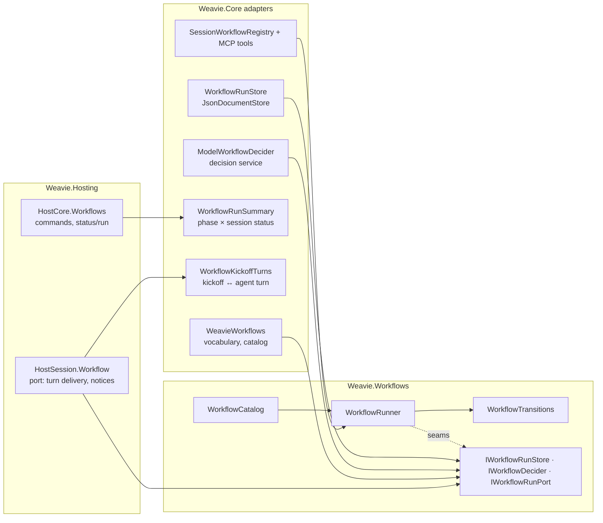
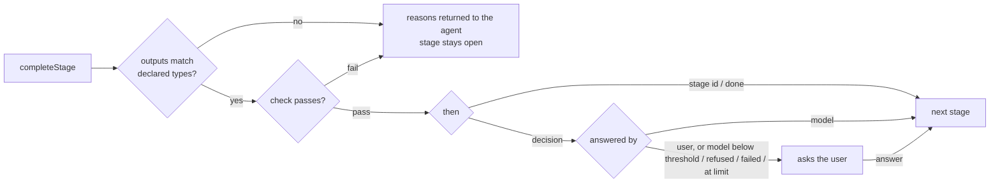

# Workflows

Status: partially built — see [Built so far](#built-so-far).

## Built so far

The first slice runs a workflow end to end in one session, for terminal Claude and native ACP agents alike:

- **Definitions** — YAML from all three scopes (parsed with YamlDotNet's low-level parser, AOT-safe), one field table
  that drives both the JSON Schema and positioned diagnostics, `listWorkflows` / `getWorkflowSchema` /
  `validateWorkflow` / `forkWorkflow`, and the `author-workflow` prompt. Built-ins: `quick-fix`, `spec-driven`. A workflow's `id`
  equals its file name.
- **Fields** — `inputs`, `agents` (`provider`, `model`, `options`), and stages with `if`, `run` (`prompt` or `skill`,
  `args`, `outputs`, `agent`), and `then` (stage id, `done`, or a decision with `ask`, `choices`, `limit`, `by`,
  `confidence`). Every other field is rejected as an unknown key.
- **Agents** — a `run` step's `agent` switches the session's conversation to that agent's model and options before the
  stage's turn, in native ACP sessions of the agent's provider; a stage naming none and the run's end return it to the
  session's own values. See [workflow-agent-selection.md](workflow-agent-selection.md).
- **Runs** — a session-owned run persisted per worktree; started by `weavie.workflow.run` or `weavie.session.new`
  with `workflow` + `inputs`; the stage block on every turn; `completeStage` (outputs + summary) / `failStage`;
  Answer, Resume, Jump to Stage, and Cancel as commands taking the run id. The user answers a question by telling the
  agent, which runs `weavie.workflow.answer`.
- **Decisions** — answered by the decision provider (`by: model`) or the user (`by: user`); a model decision sees its
  question, the stage's outputs, and the agent's summary. A low-confidence, refused, failed, or invalid model answer, or a
  `limit` reached, puts the same question to the user. The agent puts every question to the user, opening the main
  item it is about unless `workflow.openReviewItem` is off.
- **UI** — the session list's status line shows `<stage> · <activity or run state>`; a run waiting on the user's
  reply or decision, or a paused run, sits under *Needs you*. The agent pane header shows `● <workflow> · <stage>`.

Not built yet: `check`, `context` (`fork` / `fresh`), another provider's steps, child runs (`workflow`, `foreach`, `in`,
`wait`, milestones), the new-session workflow picker, run history, suggestions, and model
overrides on decisions.

## Purpose

A workflow is a user-defined, multi-stage process a session runs — e.g. *spec → implement → independent review →
record proof → draft PR → address PR feedback*, or Kiro-style *requirements → design → tasks → implement each*. Weavie
ships no opinion about the process; it ships a small engine plus example workflows the user forks.

Prompt-only processes (skills, slash commands, markdown playbooks) fail over long sessions: a skill body is truncated or
dropped after compaction, conversation-only state ("which step are we on") is summarized away, and an agent declares
done early. Every reliable long-running harness keeps the step state outside the model and verifies "done" outside the
model's word. So **Weavie owns the run; the agent fills each step.** Anything a workflow depends on — position,
iteration, typed outputs, decisions, checks — is held by Weavie. The agent only produces the content of a step.

## Concepts

- **Workflow** — a YAML definition: inputs, milestones, ordered stages.
- **Run** — one execution of a workflow, owned by a session and persisted with it. A session hosts many runs over its
  life; at most one run chain (a run plus the `in: here` children it is waiting on) is active at a time.
- **Stage** — one unit of a run. Its `run` step does the work; `check` and `then` decide what happens after.
- **Decision** — a question with choices, answered by a model or by the user (`by`). `if` and `then` take one;
  approvals are decisions the user answers.

## Architecture

The engine is its own project, `src/Weavie.Workflows`, with no reference to Weavie.Core: the YAML reader, schema and
diagnostics, definitions, catalog (built-ins embedded; personal and repository directories passed in), transitions,
runner, stage block, and the run's persisted form. It meets its owner only through seams it defines:
`IWorkflowRunStore` (persistence), `IWorkflowDecider` (model decisions), `IWorkflowRunPort` (deliver a turn,
notify the user), and `WorkflowVocabulary` (the host's name and the tool and command names it writes into agent-facing
text). The runner also reads, per use, whether the agent opens what a question is about. Only the types those seams and the catalog expose are public. Weavie.Core holds the adapters in
`src/Weavie.Core/Workflows` — `WeavieWorkflows` supplies the vocabulary from the MCP tool and command constants and
builds the catalog over `~/.weavie/workflows` and the repository's `.weavie/workflows`; Hosting wires one runner per
session.



## Definitions

### Location and precedence

| Scope | Path | Notes |
| --- | --- | --- |
| Built-in | shipped with Weavie | examples; never edited in place |
| Personal | `~/.weavie/workflows/*.yaml` | |
| Repository | `<repo>/.weavie/workflows/*.yaml` | |

A matching `id` in a more specific scope overrides a less specific one: a repository applies to one project, personal to
every project, built-in to everyone (repository > personal > built-in). Forking copies a valid workflow into a more
specific scope under the same id, through `forkWorkflow`; it never overwrites. A shadowed workflow stays visible in
`listWorkflows` and the picker, labelled with what shadows it. Weavie treats every opened folder as trusted, so
repository workflows run like any repository file; a trust flag for repositories is deferred.

### Authoring

Workflows are written by the agent, not by hand. The registry exposes:

- `getWorkflowSchema` — the JSON Schema of the format, so the agent reads the real field list instead of recalling one.
- `validateWorkflow(id | text)` — positioned errors and advisory warnings. Model questions flag unreferenced `files`
  outputs and literal/composed paths that supply no contents, as well as questions with no referenced context or
  stage outputs. `text` checks proposed YAML without touching any file; `id` checks the saved winner. Structural
  errors stop later checks. Warnings never make a file invalid or prevent saving and running it.
- `listWorkflows` — every resolved workflow with scope, path, and validity, plus the personal and repository folders
  this host reads.
- `forkWorkflow(id, scope)` — copies a valid workflow, including a built-in, into a more specific scope and returns the
  path. The host writes the file, so a repository fork shows in the Uncommitted and Branch views, not the agent-edits
  review.

Agents edit workflow YAML with their normal edit tools; nothing enforces how. See
[workflow-editing-tools](workflow-editing-tools/design.md).

The vocabulary is deliberately small and unlike GitHub Actions, so an agent has nothing similar to drift toward.

**The authoring prompt.** A bundled prompt, `author-workflow`, carries the judgment the schema can't. It triggers
without an explicit command the same way issue reporting does: the always-injected embedded-agent guidance
(`EmbeddedAgentGuidance`) says *when the user asks to create, fork, change, or improve a Weavie workflow, call
`runPrompt` with `author-workflow` and follow it*. **Improve This Workflow** and the workflow suggestion cards prefill a
request that lands on the same prompt. It holds guidance only; the field list stays in `getWorkflowSchema`, so the two
never drift. It tells the agent to:

- Interview the user about how they actually work, and model that process. Built-ins are references for the format,
  not templates; when creating a process, fork one only when it already matches what the user described.
- Change the winning file, find folders through `listWorkflows`, and fork a built-in rather than editing it in place.
- Prefer the user's existing skills as stage steps over restating them as prompts.
- Write personal workflows unless the user says the process belongs to the repository.
- Leave `agent` unset unless the user names a model, so a workflow stays portable across providers.
- Keep checks to confirming state, never redoing work; put long work in `run`.
- Choose each step's `context` by the rule in [Choosing context](#choosing-context).
- Put a `by: user` decision where the user wants to sign off, `in: new-session` where each item needs its own branch
  and PR, and `limit` on every decision that can loop.
- Ask about observable criteria, one concern per question. A model decision sees its rendered question, explicitly
  referenced file contents, stage output values, and the completion summary with feedback. It has no tools or
  conversation history. Declare typed values and explicitly reference the files it needs.
- Never encode facts the run already knows (a skipped stage, an output's presence) as a model decision.
- Persist to a file anything a later stage needs from every visit of a repeated stage; a revisit overwrites its outputs.
- Only use commands and flags verified to exist, and check that every file or value a stage uses is produced earlier
  and reachable where it's used.
- Walk through a run stage by stage; with run history, cite the evidence for each change.
- Before saving, pass the complete proposed YAML to `validateWorkflow` as `text` and fix every error. Warnings are
  flags for judgment; intentional warnings may remain unresolved. Save with a normal edit or write tool, not a script.

**Edit Workflow** opens the YAML in the editor; the same schema drives inline diagnostics. Saving is never blocked.
An invalid file is listed as broken (with its error) in the picker and cannot start; a run executes the definition
snapshot it started with, so editing a file never changes a run in flight. A visual viewer is deferred.

### Format

```yaml
id: <kebab-case>                 # unique within its scope
description: <one line>          # shown in the picker; read by the workflow suggestion
inputs: { <name>: <type> }       # `?` suffix marks optional
milestones: [<name>]             # optional; points a parent can wait for
agents: { <name>: <agent> }      # optional; `{ provider, model, options }`, all provider-native
stages: [<stage>]
```

**Stage**

| Field | Meaning |
| --- | --- |
| `id` | unique within the workflow |
| `if` | a yes/no decision; on no the stage is skipped and the run moves to the following stage. Text is shorthand for a question the model answers. |
| `run` | the work step |
| `check` | step that must pass when the stage completes (see [Completing a stage](#completing-a-stage)) |
| `then` | what follows: a stage id, `done`, or a decision whose `choices` map each answer to a stage id or `done` |
| `reaches` | milestone reached when the stage completes |
| `workflow` + `args` | run another workflow as this stage |
| `in` | `here` (this session) or `new-session` (Weavie creates a linked session). Required with `workflow`. |
| `foreach` | a `list` output; runs `workflow` once per item, exposed as `{{item}}` |
| `wait` | for `workflow` stages: a child milestone, `done`, or `none` |

Stages advance in order unless `then` says otherwise; a skipped stage falls through to the following one.

**Decision** (`if` takes `ask` and `by`; `then` takes all four)

| Field | Meaning |
| --- | --- |
| `ask` | the question; may reference values |
| `choices` | each answer and the stage (or `done`) it leads to; an answer leading back to the current stage reopens it with a short turn carrying the answer and any feedback. Feedback toward another stage travels with the run until a stage opens (a model `if` on the way sees it too); with no stage left it appears in the finished notice. |
| `limit` | how many times in a row the model may answer this decision, whatever it answers, before the user is asked instead. The count restarts when the user answers any decision or another stage's `then` decision is answered, so it caps every loop through this decision (alternating answers included) without accumulating across separate passes. Model-answered decisions only; on `by: user` it is an error. |
| `by` | `model` (default) or `user` |

**Step**

| Field | Meaning |
| --- | --- |
| `skill` / `prompt` | what to run; `skill` is sent as the provider's real slash command (`/spec <args>`) |
| `args` | text passed to the skill |
| `agent` | the name of an entry in the workflow's `agents` ([workflow-agent-selection.md](workflow-agent-selection.md)) |
| `context` | `continue`, `fork`, or `fresh` |
| `outputs` | `{ <name>: text \| url \| list \| files \| pr }` the step must report |

Templates reference `{{inputs.<name>}}`, ``, and `{{run.documents}}`. The `run` stage id is reserved.
`{{item}}` belongs to the deferred child-run syntax. There is no expression language.

### Defaults

| Step | `agent` | `context` |
| --- | --- | --- |
| `run` | the session's agent | `continue` |
| `check` | the session's agent | `fork` |
| model decisions | the `inference.decisionProvider` decision provider: the agent (the one branch naming uses) or a decision model ([inference-providers.md](inference-providers.md)) | — |
| any other agent step | as written | `fork` |

Nothing defaults to `fresh`: a step missing context it needed fails invisibly, while a fork's cost shows in run
history. `fresh` is for deliberate independence (a reviewer that must not inherit the author's assumptions).

- `continue` runs in the session's conversation.
- `fork` copies the conversation (ACP `session/fork`; Claude `--resume … --fork-session`); only its outputs, choice,
  or summary return. Forked and fresh steps appear as background-work cards with Stop.
- `fresh` starts a new conversation seeded only with the step's prompt and args.
- All three share the worktree; files are never forked.

#### Choosing context

Ask whether later steps — and the user — need *how* the step did its work, or only *what* it produced.

| Use | When | Examples |
| --- | --- | --- |
| `continue` | the user converses in the step, or later steps build on its reasoning | spec interview, implement, fix review findings |
| `fork` | the step needs everything so far, but only its result matters afterward | record videos, gather review findings, research, a check |
| `fresh` | the step must not inherit the author's assumptions, or its inputs fully describe it | an independent review, one `foreach` item whose context is on disk |

A forked step runs as a background-work card, which the user can watch but not talk to, so a step that expects
conversation is always `continue`.

A model decision runs with no tools. It sees its rendered `ask`, explicitly referenced file contents, the stage's
output values, and the completion summary with user feedback. It receives no conversation transcript. The summary
is the uniform channel for what the agent did, for terminal Claude and ACP agents alike.

### Agent options

An agent's `options` are passed through untouched and validated when the stage starts against what that provider advertises
(ACP config options; Claude's own switches). An unknown option or value fails the stage loudly, naming what the
provider supports. A model that only answers typed choices (e.g. Jev, OpenAI Decisions) is valid only on decisions;
this is checked at load. Provider-native ids are never inferred. Model aliases ("roles") are deferred: built-in
workflows use only the defaults above, so they ship without naming a model. Which model and provider run each step,
and how a stage switches the model on the session's conversation, is designed in
[workflow-agent-selection.md](workflow-agent-selection.md).

## Starting a run

- The new-session composer gains a **workflow picker** beside the branch field. It is auto-suggested from the first
  prompt by one utility typed query, the same way the branch name is; `workflow.default` sets the initial value.
  The query also extracts the workflow's `inputs` from the prompt into editable composer fields. A failed suggestion
  shows the default with the failure reason.
- `weavie.session.new` gains `workflow` and `inputs` arguments, so an agent can start a session running a workflow.
- **Run Workflow** starts a workflow in the current session.

## Shared documents

Every root run gets a documents folder outside all worktrees, under the host workspace's
`~/.weavie/workspaces/<id>/workflow-documents/<run-id>`. `{{run.documents}}` resolves to its absolute path in
prompts, skill arguments, and questions. The folder is created before the first stage starts; failures prevent the
run from starting and report the path and reason. Its path is saved with the run and restated in agent turn context.

```yaml
stages:
  - id: design
    run:
      prompt: "Write {{run.documents}}/design.md and report its absolute path."
      outputs: { design: files }
```

Sessions created through `weavie.session.new` or `weavie.session.fork` inherit the invoking session's documents,
regardless of which session the user is viewing. Their workflow runs use the same `{{run.documents}}`; plain sessions
receive the directory in their turn context. Descendants inherit it too, without passing paths as inputs. Existing
sessions merely selected by a creation command keep their own context. Automatic child-workflow stages remain deferred.

Shared files open and save through the editor's normal absolute-path support. Typed `files` inputs and outputs accept
absolute files contained within the granted documents directory as well as existing worktree-relative paths. Unrelated
absolute paths and traversal outside either scope are rejected. A directory reference supplies a path, not contents;
model decisions still require an explicit `files` reference to receive evidence. Containment remains lexical, not a
symlink sandbox. Shared edits use ordinary file semantics; Weavie does not serialize concurrent appends or edits.

The directory survives completion, cancellation, unloading, and recreation. It is deleted automatically when the last
referencing session is deleted or replaces its run. A parent's deletion or replacement cannot delete documents still
used by a child. Temporary references protect sessions being created, including failed creation. On host startup,
ownership is rebuilt from persisted sessions and runs, including dormant sessions, and orphaned directories are removed
from the managed documents folder only. Invalid ownership records stop cleanup with a visible error; deletion failures
also report an error and are reconciled on a later startup. Worktrees are never scanned for this cleanup.

## Running a stage

Each turn during a run carries a short **stage block**: run, stage, expected outputs, and how to complete. Weavie
appends it to every prompt it sends an ACP agent, and adds it for terminal Claude through a `UserPromptSubmit` hook on
the hook bridge. The next turn always restates the stage, so compaction cannot lose it. A `skill` stage's opening
turn is the provider command as the first block with the stage block after it, which agents read as the command plus
context; other provider commands the user sends stay a single block.

A stage's turn is owed by the run until it is handed to the agent: it is sent only if, at that moment, the run still
owes exactly that turn, so a cancel, pause, or newer turn retires it. An owed turn survives a restart and is sent
again on reload. A paused run's reason, a question awaiting the user's answer, and a saved run that couldn't be loaded
travel with the session's run line, in the session list's tooltip.

A stage whose agent is idle is **waiting on you** — the agent asked a question, proposed an approach, or is
interviewing you. Weavie does nothing on turn end. There are no stage kinds.

Waiting on external events (PR comments, CI) is the agent's job, through its own background tasks, monitors, or
scheduled wakeups. The session's existing `Waiting` status distinguishes "idle with background work pending" from idle,
and the run shows it as *watching in background*. Unloading a session with a waiting run confirms first; a dead agent
process marks the run stalled. Weavie-owned event triggers are deferred until run history shows agent-driven waiting
is unreliable.

## Completing a stage

The agent calls `completeStage(outputs, summary)` or `failStage(reason)`. Calls carry no run or stage id: they arrive on
the session's own registry endpoint, which identifies the run by construction. The summary is required: a few
sentences on what the stage did and found, which the following model decision reads.



- Checks run **only** on `completeStage`, never on turn end.
- A check is a step that returns `pass` or `fail` with a reason. What it can verify depends on what runs it: the
  default (a fork of the session's agent) can inspect the worktree; a tool-less model can only judge text.
- A check confirms state, it doesn't redo work: "the tests the agent ran are green and everything is pushed", not
  "run the full suite". Long work belongs in `do`. A check that runs long is a defect in the workflow, and run
  history shows its duration.
- Rejections count toward `workflow.maxStageAttempts`; hitting it pauses the run and notifies the user.
- `failStage` pauses the run with the reason.
- **Finish Stage** asks the agent to wrap up and call `completeStage`; the check still runs. **Skip Stage** advances
  without checking and is recorded.

### Decisions

`ModelWorkflowDecider` asks the decision service one choice question over the prepared evidence and returns the
top label at its probability ([inference-providers.md](inference-providers.md)); it records how long each
agent-answered decision took in the workspace's decision history. A decider returns an allowed choice and finite
numeric confidence in `[0, 1]`, or refusal/failure. The engine validates the answer and compares confidence with the live `workflow.decisionConfidence` setting (default `0.8`),
or the decision's optional `confidence:` override. Both model `if` and `then` support overrides; `by: user` rejects
them. Each attempt captures its threshold before inference; changes affect subsequent attempts. Equality routes.
The threshold is never included in the model prompt.

Lower confidence, refusal, provider failure, invalid choice/confidence, or a reached `limit` puts the same question
and choices to the user, with the reason. Low-confidence reasons include the value and threshold. Values are never
clamped. Failed or low-confidence attempts do not count as routed model answers. There is no implicit or reserved
`unsure` answer: an explicitly declared label of that name behaves like any other choice.

Choices accept plain destinations or descriptions, including mixtures:

```yaml
then:
  ask: Does every required check pass?
  confidence: 0.9
  choices:
    approve: { then: build, description: Every required check passes. }
    revise: draft
```

Descriptions are optional plain text, recommended to distinguish answer criteria. The model receives labels and
descriptions, never routing destinations. The agent provider returns strict JSON with one probability per label,
such as `{"approve":0.91,"revise":0.09}`; probabilities are estimated from evidence, not assigned a constant.

A model `ask` that references a `files` input or output receives each file's complete current text as separate,
path-labelled evidence. Inputs, current-stage outputs, and earlier-stage outputs work alike. Paths resolve inside
the session worktree or its shared documents folder and normalized duplicates appear once, in reference order. The question and output values
keep their path labels. Initial `files` validation still requires existing, non-empty files; a later empty file
contributes empty text. Text readability uses the shared content decoder, including BOM support, not extensions.

```yaml
run:
  prompt: Write the review.
  outputs: { review: files }
then:
  ask: "Does {{draft.review}} document every required check?"
  choices: { approve: build, revise: draft }
```

If any referenced file is binary, missing, or unreadable, the whole question goes to the user with its path and
reason; no partial evidence reaches a model. Absent optional inputs and empty file lists add no contents. Missing
stage output values retain the existing pause behavior. Invalid file paths escalate instead of escaping the worktree.

Only explicit references to `files` values trigger reads. Literal paths, paths composed from text references,
unreferenced file outputs, URLs, and document links are not expanded. No workspace scan or linked-resource fetch
occurs. User decisions do not prepare evidence.

Validation warns at a model `then.ask` for each current-stage `files` output it does not reference. Model `if` and
`then` questions also flag recognizable literal/composed paths, including `README.md`, `docs/review.md`, Windows
paths, and `{{draft.directory}}/review.md`. Appending a path or extension to a `files` reference does not select a
different file. Plain references and HTTP(S) links do not trigger the path flag. These checks inspect declarations
and template syntax only; they never read files or evaluate runtime values. The heuristic can flag intentional
prose such as `yes/no`; authors may ignore it. User decisions receive neither evidence flag.

The engine prepares evidence and runs inference under one pending attempt, outside its state lock. Cancellation
retires the attempt; late reads or model results cannot affect a newer one. File bodies are never persisted in run
state. Resuming a saved model decision rereads current files and the live confidence setting. Reads are not an
atomic snapshot across files, synchronous reads cannot be interrupted, and path containment is lexical rather than
a symlink sandbox. Complete evidence is sent without a local prompt cap; provider rejection reaches the user.

A `by: user` decision always goes to the user. The agent relays the user's answer with `weavie.workflow.answer`
(run id, choice, and the user's own words as feedback) and never answers for them. Human answers bypass model
confidence checks. Future decision-provider adapters translate prepared requests and results; the engine owns
confidence policy. This change adds no Jev or OpenAI provider.

Every question reaches the user through the agent. A question asked as a stage completes rides the `completeStage`
reply; any other (a model decision handed over, an `if`, one reached by an answer, resume, or jump) is a turn the run
owes the agent, retired like a stage's. Both carry one instruction: when `workflow.openReviewItem` is on, the agent
opens the main file the question is about with `openFile`, `preview: true`, `rendered: true`, and `focus: true`, and links any others
in its reply. `rendered` shows a file's rendered view when it has one (Markdown, HTML, SVG); any other file shows its source.
Stages that just run and decisions the model answers open nothing, and workflow authors write nothing for this.
The preview tab is reused across opens. `openFile` lands in the agent's own session: in a session the user isn't
viewing, the tab waits there and shows when they switch to it. In the session they are viewing, `focus: true`
selects the requested tab and focuses the editor, including when another tab is being edited. Without `focus`,
`openFile` preserves keyboard focus and only adds the tab while the user is typing in the editor.

## Child runs

A `workflow` stage starts a child run. With `foreach`, Weavie iterates the list itself — the position and per-item
status live in the parent run, never in a prompt.

- `in: here` runs children sequentially in this session; the parent waits on each.
- `in: new-session` — Weavie calls the session-creation path directly (branch suggestion included), and the parent
  holds a handle to the child run. Each child owns its worktree, branch, and PR.
- `wait` names the child milestone that advances the parent (`pr-ready` lets the next task start while the child keeps
  addressing feedback), `done`, or `none`.

### Run state

Run state is distinct from session status: an idle session is not a finished task.

| State | Meaning |
| --- | --- |
| `running` | a stage is open and the agent is working |
| `waiting-on-user` | a stage is open and the agent is idle |
| `needs-answer` | a decision waits for the user's answer |
| `watching` | a stage is open and the session is `Waiting` on background work |
| `waiting-on-children` | a `workflow` stage awaits its `wait` condition |
| `paused` | `workflow.maxStageAttempts` or `failStage` needs the user |
| `stalled` | the agent process ended with a stage open |
| `done` / `cancelled` | terminal |

Each run is persisted with its session. A workspace-level **run registry** resolves a run by id and publishes its state
changes; the parent's `foreach`, the session rail, attention notifications, and the agent (`getRun`, `listRuns`) all
read it. Milestones reached and `done` raise attention events.

## Commands

All unbound by default and reachable from the palette, user keybindings, and agents: **Run Workflow**, **Edit
Workflow**, **Answer** (with feedback), **Finish Stage**, **Skip Stage**, **Retry Stage**,
**Jump to Stage**, **Pause Run**, **Resume Run**, **Cancel Run**, **Improve This Workflow**.

Every run command takes an explicit run id, so a command never acts on whichever run happens to be newest.

## Visualizing a run

A workflow must not take over the standard session experience.

- **Session list** — no new rows, nesting, or indentation. A session in a run uses its existing status line for the
  run's stage and state (`review · needs your answer` instead of `idle · 5m ago`); the full pause reason is its
  tooltip. Runs that need the user join the Needs you group. Child sessions are ordinary sessions.
- **Questions for the user are a conversation, not cards.** The agent asks in its own words, the user replies however
  they like, and the agent relays the chosen answer and any feedback through `weavie.workflow.answer`. The stage
  block tells the agent never to answer for the user.
- **Agent pane header** — a live run shows as `● <workflow> · <stage>` right-aligned in the header, its dot colored by
  run state and its tooltip spelling out the state and any reason. The compact layout omits it, since the session inbox
  gives stage and state. There is no stage count, since `if` skips and `then` loops make one misleading. It is display
  only: there is no expandable run header or run view, and opening an editor tab to see run state was rejected as too
  much friction. See [workflow-header-status](workflow-header-status/brief.md).

## Run history and suggestions

Every run records per-stage duration, attempts, loop counts, the user's answers with feedback, decisions with
confidence, and cost. **Improve This Workflow** prefills that history into the session's agent to propose YAML edits — Weavie stores
the signal, the agent reasons ([learn-from-corrections.md](learn-from-corrections.md)).

Two suggestion cards ([suggestions.md](../concepts/suggestions.md)): a workspace with no personal or repository
workflows ("Have the agent build a workflow from how you work"), and a workflow whose runs repeatedly stall or get
rejected at one stage.

## Settings

| Key | Meaning |
| --- | --- |
| `workflow.default` | workflow preselected in the new-session composer |
| `workflow.maxStageAttempts` | rejected completions before a run pauses |
| `workflow.decisionConfidence` | live finite number in `[0, 1]`, default `0.8`; minimum confidence to advance unless the decision overrides it |
| `workflow.openReviewItem` | the agent opens the main item a question to the user is about (default on) |

## Naming

Bundled instruction prompts (`report-weavie-bug`, `request-weavie-feature`, workspace setup) are **prompts**, started
through `runPrompt`; "workflow" means only this feature.

## Built-in examples

### quick-fix

```yaml
id: quick-fix
description: A small, well-understood change. Implement, verify, open a PR.
inputs: { task: text }
stages:
  - id: implement
    run: { prompt: "{{inputs.task}}" }
    check:
      prompt: Run the tests and the linter. Pass only if both are green and the work is committed.
  - id: pr
    run:
      prompt: Push and open a draft PR describing the change.
      outputs: { pr: pr }
```

### ship-task

```yaml
id: ship-task
description: Implement one task, get an independent review, record proof, open a PR, then address its feedback.
inputs: { task: text, spec: url? }
milestones: [pr-ready]
stages:
  - id: implement
    run: { prompt: "Implement: {{inputs.task}}. Spec, if any: {{inputs.spec}}" }
    check:
      prompt: Run the tests and the linter. Pass only if both are green and the work is committed.

  - id: review
    run:
      prompt: >
        Get an independent review of this branch's diff against main from a different configured
        agent than yourself (listAgents + consultAgent). Report its blocking findings.
      outputs: { findings: text }
    then:
      ask: "Do these findings contain anything blocking? {{review.findings}}"
      choices: { yes: fix, no: record }
      limit: 3

  - id: fix
    run: { prompt: "Fix these review findings and commit: {{review.findings}}" }
    then: review

  - id: record
    run:
      skill: record-tour
      context: fork
      outputs: { videos: files }

  - id: pr
    run:
      prompt: "Push and open a draft PR. Embed these videos: {{record.videos}}"
      outputs: { pr: pr }
    reaches: pr-ready

  - id: respond
    run:
      prompt: >
        Monitor this PR for new review comments in the background until it merges. For each, make
        any code change it needs and commit, then draft a reply into my pending review — never
        submit it. Call completeStage when the PR merges.
```

### spec-driven

```yaml
id: spec-driven
description: Requirements, design, and tasks — each approved — then implement the tasks one by one on this branch.
inputs: { feature: text }
stages:
  - id: requirements
    run:
      prompt: >
        Interview me as needed, then choose a short kebab-case slug and write EARS-style user stories
        with acceptance criteria for "{{inputs.feature}}" to docs/specs/<slug>/requirements.md.
      outputs: { dir: text }
    then:
      ask: Approve the requirements in {{requirements.dir}}/requirements.md?
      by: user
      choices: { approve: design, revise: requirements }

  - id: design
    run: { prompt: "Write {{requirements.dir}}/design.md from the approved requirements." }
    then:
      ask: Approve the design in {{requirements.dir}}/design.md?
      by: user
      choices: { approve: tasks, revise: design }

  - id: tasks
    run:
      prompt: Break the design into small, independently testable tasks in {{requirements.dir}}/tasks.md.
      outputs: { tasks: list }
    then:
      ask: Approve the task list?
      by: user
      choices: { approve: implement, revise: tasks }

  - id: implement
    foreach: tasks.tasks
    workflow: quick-fix
    args: { task: "{{item}} (per {{requirements.dir}}/design.md)" }
    in: here
    wait: done
```

The shipped `spec-driven` implements the task list in one stage that reports the tasks still `remaining` and loops
until that list is empty (`limit: 3`), since `foreach` isn't built yet.

### diagnose

```yaml
id: diagnose
description: Investigate a reported problem, then route it to quick-fix or spec-driven by complexity.
inputs: { report: text }
stages:
  - id: research
    run:
      prompt: >
        Investigate "{{inputs.report}}" with whatever observability and chat tools you have (logs,
        metrics, Slack threads). Change no code. Report the likely cause, blast radius, and files involved.
      outputs: { findings: text }
    then:
      ask: "How involved is the fix for: {{research.findings}}"
      choices: { simple: quick, complex: spec }

  - id: quick
    workflow: quick-fix
    args: { task: "{{research.findings}}" }
    in: here
    wait: done
    then: done

  - id: spec
    workflow: spec-driven
    args: { feature: "Fix: {{research.findings}}" }
    in: here
    wait: done
```

## Personal example: Notion spec

Uses the user's own `/spec` and `/implement-task` skills, with a personal fork of `ship-task` whose `implement` step is
`run: { skill: implement-task, args: "{{inputs.spec}} {{inputs.task}}" }`.

```yaml
id: notion-spec
description: Interview me into a Notion spec with a task list, then ship each task in its own session.
inputs: { idea: text }
stages:
  - id: just-ship
    if: "Is {{inputs.idea}} small enough to ship without a written spec?"
    workflow: ship-task
    args: { task: "{{inputs.idea}}" }
    in: here
    wait: done
    then: done

  - id: spec
    run:
      skill: spec
      args: "{{inputs.idea}}"
      outputs: { notionUrl: url, tasks: list }
    then:
      ask: Approve the spec at {{spec.notionUrl}}?
      by: user
      choices: { approve: build, revise: spec }

  - id: build
    foreach: spec.tasks
    workflow: ship-task
    args: { spec: "{{spec.notionUrl}}", task: "{{item}}" }
    in: new-session
    wait: pr-ready
```

## Integration tests

Full-stack on `headless` ([integration-testing-strategy.md](integration-testing-strategy.md)): the fake agent calls
`completeStage`, a fake inference provider answers model decisions, and the static PR fake supplies PR state.

1. **quick-fix** — a check fails, the reason reaches the agent, the retry passes, the `pr` output is recorded.
2. **spec-driven** — each `by: user` decision waits for the answer; `revise` with feedback reopens the stage;
   `foreach … in: here` walks three tasks with per-item progress in the strip.
3. **ship-task** — the model sends `review → fix` three times in a row, then the fourth asks the user (`limit: 3`);
   answering continues to `pr-ready`; the `respond` stage shows `watching` while the agent holds background work.
4. **diagnose** — the routing decision picks `quick`; a low-confidence answer puts the question to the user instead of
   advancing.
5. **status line** (`workflow-status-line.spec.ts`, built) — a fake-ACP session runs a two-stage repository workflow
   whose first stage ends in a `by: user` question; its line moves through `implement · …`,
   `implement · waiting on you`, `implement · needs your answer` under *Needs you*, `ship · waiting on you`, and back to
   idle when the run ends.

## Deferred

- Repository trust flag.
- Model aliases (roles) with automatic mapping from the model catalog.
- Weavie-owned event triggers (`on: pr.comment` fed by the PR monitor).
- A visual workflow viewer.

Provider agent files (`.claude/agents`, `.codex/agents`) are not supported: they are provider-specific, and a prompt
can already ask the agent to use one.

## Open questions

- `completeStage` waits for its check. Claude over ACP aborts an HTTP MCP call that sends no response headers within
  60s, so the response must stream (SSE) rather than return headers only when the check finishes.
- Fork support for terminal Claude: `--fork-session` starts a separate process outside the PTY pane.
- Skill stages on codex-acp: a stage's opening command is followed by the stage block. claude-agent-acp runs the
  skill and sees the block (verified against 0.99.1); codex-acp is unverified.
